<!-- This file is generated by tools/generate_site.py. Edit the generator, not this file. -->

# Ability changes

Abilities marked &#42;&#42; are not normally available to that Pokémon and are removed in the legal-moves version.

| # | Pokémon | Slot | Vanilla | RR/SS |
| --- | --- | --- | --- | --- |
| 001 | 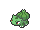{ .icon loading=lazy } [Bulbasaur](../pokemon/001.md) | Ability 2 | <em>none</em> | **Effect Spore** &#42;&#42; |
| 002 | 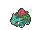{ .icon loading=lazy } [Ivysaur](../pokemon/002.md) | Ability 2 | <em>none</em> | **Effect Spore** &#42;&#42; |
| 003 | 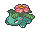{ .icon loading=lazy } [Venusaur](../pokemon/003.md) | Ability 2 | <em>none</em> | **Thick Fat** &#42;&#42; |
| 004 | 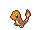{ .icon loading=lazy } [Charmander](../pokemon/004.md) | Ability 2 | <em>none</em> | **Tough Claws** &#42;&#42; |
| 005 | 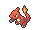{ .icon loading=lazy } [Charmeleon](../pokemon/005.md) | Ability 2 | <em>none</em> | **Tough Claws** &#42;&#42; |
| 006 | 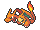{ .icon loading=lazy } [Charizard](../pokemon/006.md) | Ability 2 | <em>none</em> | **Tough Claws** &#42;&#42; |
| 007 | 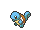{ .icon loading=lazy } [Squirtle](../pokemon/007.md) | Ability 2 | <em>none</em> | **Shell Armor** &#42;&#42; |
| 008 | 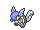{ .icon loading=lazy } [Wartortle](../pokemon/008.md) | Ability 2 | <em>none</em> | **Shell Armor** &#42;&#42; |
| 009 | 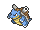{ .icon loading=lazy } [Blastoise](../pokemon/009.md) | Ability 2 | <em>none</em> | **Mega Launcher** &#42;&#42; |
| 010 | 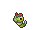{ .icon loading=lazy } [Caterpie](../pokemon/010.md) | Ability 2 | <em>none</em> | **Run Away**  |
| 012 | 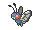{ .icon loading=lazy } [Butterfree](../pokemon/012.md) | Ability 2 | <em>none</em> | **Tinted Lens**  |
| 013 | 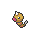{ .icon loading=lazy } [Weedle](../pokemon/013.md) | Ability 2 | <em>none</em> | **Run Away**  |
| 015 | 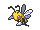{ .icon loading=lazy } [Beedrill](../pokemon/015.md) | Ability 2 | <em>none</em> | **Sniper**  |
| 021 | 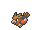{ .icon loading=lazy } [Spearow](../pokemon/021.md) | Ability 2 | <em>none</em> | **Sniper**  |
| 022 | 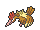{ .icon loading=lazy } [Fearow](../pokemon/022.md) | Ability 2 | <em>none</em> | **Sniper**  |
| 025 | { .icon loading=lazy } [Pikachu](../pokemon/025.md) | Ability 2 | <em>none</em> | **Lightning Rod**  |
| 026 | 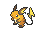{ .icon loading=lazy } [Raichu](../pokemon/026.md) | Ability 2 | <em>none</em> | **Lightning Rod**  |
| 027 | 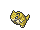{ .icon loading=lazy } [Sandshrew](../pokemon/027.md) | Ability 2 | <em>none</em> | **Sand Rush**  |
| 028 | { .icon loading=lazy } [Sandslash](../pokemon/028.md) | Ability 2 | <em>none</em> | **Sand Rush**  |
| 037 | 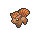{ .icon loading=lazy } [Vulpix](../pokemon/037.md) | Ability 2 | <em>none</em> | **Drought**  |
| 038 | 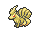{ .icon loading=lazy } [Ninetales](../pokemon/038.md) | Ability 2 | <em>none</em> | **Drought**  |
| 041 | 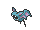{ .icon loading=lazy } [Zubat](../pokemon/041.md) | Ability 2 | <em>none</em> | **Infiltrator**  |
| 042 | { .icon loading=lazy } [Golbat](../pokemon/042.md) | Ability 2 | <em>none</em> | **Infiltrator**  |
| 043 | { .icon loading=lazy } [Oddish](../pokemon/043.md) | Ability 2 | <em>none</em> | **Run Away**  |
| 044 | 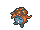{ .icon loading=lazy } [Gloom](../pokemon/044.md) | Ability 2 | <em>none</em> | **Stench**  |
| 045 | { .icon loading=lazy } [Vileplume](../pokemon/045.md) | Ability 2 | <em>none</em> | **Effect Spore**  |
| 069 | 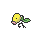{ .icon loading=lazy } [Bellsprout](../pokemon/069.md) | Ability 2 | <em>none</em> | **Gluttony**  |
| 070 | 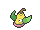{ .icon loading=lazy } [Weepinbell](../pokemon/070.md) | Ability 2 | <em>none</em> | **Gluttony**  |
| 071 | 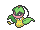{ .icon loading=lazy } [Victreebel](../pokemon/071.md) | Ability 2 | <em>none</em> | **Gluttony**  |
| 102 | 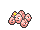{ .icon loading=lazy } [Exeggcute](../pokemon/102.md) | Ability 2 | <em>none</em> | **Harvest**  |
| 103 | 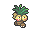{ .icon loading=lazy } [Exeggutor](../pokemon/103.md) | Ability 2 | <em>none</em> | **Harvest**  |
| 125 | 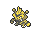{ .icon loading=lazy } [Electabuzz](../pokemon/125.md) | Ability 2 | <em>none</em> | **Vital Spirit**  |
| 126 | { .icon loading=lazy } [Magmar](../pokemon/126.md) | Ability 2 | <em>none</em> | **Vital Spirit**  |
| 129 | 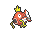{ .icon loading=lazy } [Magikarp](../pokemon/129.md) | Ability 2 | <em>none</em> | **Rattled**  |
| 130 | 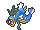{ .icon loading=lazy } [Gyarados](../pokemon/130.md) | Ability 2 | <em>none</em> | **Moxie**  |
| 132 | 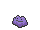{ .icon loading=lazy } [Ditto](../pokemon/132.md) | Ability 2 | <em>none</em> | **Imposter**  |
| 134 | { .icon loading=lazy } [Vaporeon](../pokemon/134.md) | Ability 2 | <em>none</em> | **Hydration**  |
| 135 | 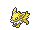{ .icon loading=lazy } [Jolteon](../pokemon/135.md) | Ability 2 | <em>none</em> | **Quick Feet**  |
| 136 | 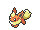{ .icon loading=lazy } [Flareon](../pokemon/136.md) | Ability 2 | <em>none</em> | **Guts**  |
| 144 | 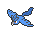{ .icon loading=lazy } [Articuno](../pokemon/144.md) | Ability 2 | <em>none</em> | **Snow Cloak**  |
| 145 | 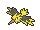{ .icon loading=lazy } [Zapdos](../pokemon/145.md) | Ability 2 | <em>none</em> | **Static**  |
| 146 | 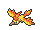{ .icon loading=lazy } [Moltres](../pokemon/146.md) | Ability 2 | <em>none</em> | **Flame Body**  |
| 147 | 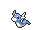{ .icon loading=lazy } [Dratini](../pokemon/147.md) | Ability 2 | <em>none</em> | **Marvel Scale**  |
| 148 | 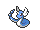{ .icon loading=lazy } [Dragonair](../pokemon/148.md) | Ability 2 | <em>none</em> | **Marvel Scale**  |
| 149 | 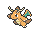{ .icon loading=lazy } [Dragonite](../pokemon/149.md) | Ability 2 | <em>none</em> | **Multiscale**  |
| 150 | 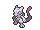{ .icon loading=lazy } [Mewtwo](../pokemon/150.md) | Ability 2 | <em>none</em> | **Unnerve**  |
| 152 | 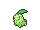{ .icon loading=lazy } [Chikorita](../pokemon/152.md) | Ability 2 | <em>none</em> | **Natural Cure** &#42;&#42; |
| 153 | 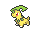{ .icon loading=lazy } [Bayleef](../pokemon/153.md) | Ability 2 | <em>none</em> | **Natural Cure** &#42;&#42; |
| 154 | 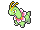{ .icon loading=lazy } [Meganium](../pokemon/154.md) | Ability 2 | <em>none</em> | **Natural Cure** &#42;&#42; |
| 155 | 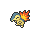{ .icon loading=lazy } [Cyndaquil](../pokemon/155.md) | Ability 2 | <em>none</em> | **Flash Fire**  |
| 156 | 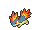{ .icon loading=lazy } [Quilava](../pokemon/156.md) | Ability 2 | <em>none</em> | **Flash Fire**  |
| 157 | 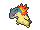{ .icon loading=lazy } [Typhlosion](../pokemon/157.md) | Ability 2 | <em>none</em> | **Flash Fire**  |
| 158 | 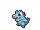{ .icon loading=lazy } [Totodile](../pokemon/158.md) | Ability 2 | <em>none</em> | **Sheer Force**  |
| 159 | 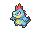{ .icon loading=lazy } [Croconaw](../pokemon/159.md) | Ability 2 | <em>none</em> | **Sheer Force**  |
| 160 | { .icon loading=lazy } [Feraligatr](../pokemon/160.md) | Ability 2 | <em>none</em> | **Sheer Force**  |
| 162 | 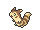{ .icon loading=lazy } [Furret](../pokemon/162.md) | Ability 1 | Run Away | **Limber** &#42;&#42; |
| 164 | 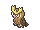{ .icon loading=lazy } [Noctowl](../pokemon/164.md) | Ability 2 | Keen Eye | **Analytic**  |
| 169 | { .icon loading=lazy } [Crobat](../pokemon/169.md) | Ability 2 | <em>none</em> | **Infiltrator**  |
| 172 | 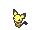{ .icon loading=lazy } [Pichu](../pokemon/172.md) | Ability 2 | <em>none</em> | **Lightning Rod**  |
| 182 | { .icon loading=lazy } [Bellossom](../pokemon/182.md) | Ability 2 | <em>none</em> | **Healer**  |
| 196 | { .icon loading=lazy } [Espeon](../pokemon/196.md) | Ability 2 | <em>none</em> | **Magic Bounce**  |
| 197 | { .icon loading=lazy } [Umbreon](../pokemon/197.md) | Ability 2 | <em>none</em> | **Poison Touch** &#42;&#42; |
| 204 | { .icon loading=lazy } [Pineco](../pokemon/204.md) | Ability 2 | <em>none</em> | **Overcoat**  |
| 205 | { .icon loading=lazy } [Forretress](../pokemon/205.md) | Ability 2 | <em>none</em> | **Overcoat**  |
| 206 | { .icon loading=lazy } [Dunsparce](../pokemon/206.md) | Ability 2 | Run Away | **Pixilate** &#42;&#42; |
| 215 | { .icon loading=lazy } [Sneasel](../pokemon/215.md) | Ability 2 | Keen Eye | **Technician** &#42;&#42; |
| 219 | { .icon loading=lazy } [Magcargo](../pokemon/219.md) | Ability 1 | Magma Armor | **Solid Rock** &#42;&#42; |
| 222 | { .icon loading=lazy } [Corsola](../pokemon/222.md) | Ability 1 | Hustle | **Regenerator**  |
| 222 | { .icon loading=lazy } [Corsola](../pokemon/222.md) | Hidden | Regenerator | **Hustle**  |
| 225 | { .icon loading=lazy } [Delibird](../pokemon/225.md) | Ability 2 | Hustle | **Aerilate** &#42;&#42; |
| 225 | { .icon loading=lazy } [Delibird](../pokemon/225.md) | Hidden | Insomnia | **Hustle**  |
| 231 | { .icon loading=lazy } [Phanpy](../pokemon/231.md) | Ability 2 | <em>none</em> | **Sand Veil**  |
| 232 | { .icon loading=lazy } [Donphan](../pokemon/232.md) | Ability 2 | <em>none</em> | **Sand Veil**  |
| 239 | { .icon loading=lazy } [Elekid](../pokemon/239.md) | Ability 2 | <em>none</em> | **Vital Spirit**  |
| 240 | { .icon loading=lazy } [Magby](../pokemon/240.md) | Ability 2 | <em>none</em> | **Vital Spirit**  |
| 243 | { .icon loading=lazy } [Raikou](../pokemon/243.md) | Ability 2 | <em>none</em> | **Volt Absorb**  |
| 244 | { .icon loading=lazy } [Entei](../pokemon/244.md) | Ability 2 | <em>none</em> | **Flash Fire**  |
| 245 | { .icon loading=lazy } [Suicune](../pokemon/245.md) | Ability 2 | <em>none</em> | **Water Absorb**  |
| 246 | { .icon loading=lazy } [Larvitar](../pokemon/246.md) | Ability 2 | <em>none</em> | **Sand Veil**  |
| 248 | { .icon loading=lazy } [Tyranitar](../pokemon/248.md) | Ability 2 | <em>none</em> | **Unnerve**  |
| 249 | { .icon loading=lazy } [Lugia](../pokemon/249.md) | Ability 2 | <em>none</em> | **Multiscale**  |
| 250 | { .icon loading=lazy } [Ho-Oh](../pokemon/250.md) | Ability 2 | <em>none</em> | **Regenerator**  |
| 252 | { .icon loading=lazy } [Treecko](../pokemon/252.md) | Ability 2 | <em>none</em> | **Unburden**  |
| 253 | { .icon loading=lazy } [Grovyle](../pokemon/253.md) | Ability 2 | <em>none</em> | **Unburden**  |
| 254 | { .icon loading=lazy } [Sceptile](../pokemon/254.md) | Ability 2 | <em>none</em> | **Unburden**  |
| 255 | { .icon loading=lazy } [Torchic](../pokemon/255.md) | Ability 2 | <em>none</em> | **Speed Boost**  |
| 256 | { .icon loading=lazy } [Combusken](../pokemon/256.md) | Ability 2 | <em>none</em> | **Speed Boost**  |
| 257 | { .icon loading=lazy } [Blaziken](../pokemon/257.md) | Ability 2 | <em>none</em> | **Speed Boost**  |
| 258 | { .icon loading=lazy } [Mudkip](../pokemon/258.md) | Ability 2 | <em>none</em> | **Damp**  |
| 259 | { .icon loading=lazy } [Marshtomp](../pokemon/259.md) | Ability 2 | <em>none</em> | **Damp**  |
| 260 | { .icon loading=lazy } [Swampert](../pokemon/260.md) | Ability 2 | <em>none</em> | **Damp**  |
| 265 | { .icon loading=lazy } [Wurmple](../pokemon/265.md) | Ability 2 | <em>none</em> | **Run Away**  |
| 267 | { .icon loading=lazy } [Beautifly](../pokemon/267.md) | Ability 2 | <em>none</em> | **Rivalry**  |
| 269 | { .icon loading=lazy } [Dustox](../pokemon/269.md) | Ability 2 | <em>none</em> | **Compound Eyes**  |
| 276 | { .icon loading=lazy } [Taillow](../pokemon/276.md) | Ability 2 | <em>none</em> | **Scrappy**  |
| 277 | { .icon loading=lazy } [Swellow](../pokemon/277.md) | Ability 2 | <em>none</em> | **Scrappy**  |
| 278 | { .icon loading=lazy } [Wingull](../pokemon/278.md) | Ability 2 | <em>none</em> | **Rain Dish**  |
| 279 | { .icon loading=lazy } [Pelipper](../pokemon/279.md) | Ability 2 | <em>none</em> | **Rain Dish**  |
| 283 | { .icon loading=lazy } [Surskit](../pokemon/283.md) | Ability 2 | <em>none</em> | **Speed Boost** &#42;&#42; |
| 284 | { .icon loading=lazy } [Masquerain](../pokemon/284.md) | Ability 2 | <em>none</em> | **Levitate** &#42;&#42; |
| 290 | { .icon loading=lazy } [Nincada](../pokemon/290.md) | Ability 2 | <em>none</em> | **Run Away**  |
| 291 | { .icon loading=lazy } [Ninjask](../pokemon/291.md) | Ability 2 | <em>none</em> | **Infiltrator**  |
| 293 | { .icon loading=lazy } [Whismur](../pokemon/293.md) | Ability 2 | <em>none</em> | **Rattled**  |
| 294 | { .icon loading=lazy } [Loudred](../pokemon/294.md) | Ability 2 | <em>none</em> | **Scrappy**  |
| 295 | { .icon loading=lazy } [Exploud](../pokemon/295.md) | Ability 2 | <em>none</em> | **Scrappy**  |
| 311 | { .icon loading=lazy } [Plusle](../pokemon/311.md) | Ability 2 | <em>none</em> | **Victory Star** &#42;&#42; |
| 312 | { .icon loading=lazy } [Minun](../pokemon/312.md) | Ability 2 | <em>none</em> | **Victory Star** &#42;&#42; |
| 318 | { .icon loading=lazy } [Carvanha](../pokemon/318.md) | Ability 2 | <em>none</em> | **Speed Boost**  |
| 319 | { .icon loading=lazy } [Sharpedo](../pokemon/319.md) | Ability 2 | <em>none</em> | **Speed Boost**  |
| 324 | { .icon loading=lazy } [Torkoal](../pokemon/324.md) | Ability 2 | <em>none</em> | **Shell Armor**  |
| 331 | { .icon loading=lazy } [Cacnea](../pokemon/331.md) | Ability 2 | <em>none</em> | **Water Absorb**  |
| 332 | { .icon loading=lazy } [Cacturne](../pokemon/332.md) | Ability 2 | <em>none</em> | **Water Absorb**  |
| 333 | { .icon loading=lazy } [Swablu](../pokemon/333.md) | Ability 2 | <em>none</em> | **Cloud Nine**  |
| 334 | { .icon loading=lazy } [Altaria](../pokemon/334.md) | Ability 2 | <em>none</em> | **Cloud Nine**  |
| 335 | { .icon loading=lazy } [Zangoose](../pokemon/335.md) | Ability 2 | <em>none</em> | **Toxic Boost**  |
| 336 | { .icon loading=lazy } [Seviper](../pokemon/336.md) | Ability 2 | <em>none</em> | **Infiltrator**  |
| 345 | { .icon loading=lazy } [Lileep](../pokemon/345.md) | Ability 2 | <em>none</em> | **Storm Drain**  |
| 346 | { .icon loading=lazy } [Cradily](../pokemon/346.md) | Ability 2 | <em>none</em> | **Storm Drain**  |
| 347 | { .icon loading=lazy } [Anorith](../pokemon/347.md) | Ability 2 | <em>none</em> | **Swift Swim**  |
| 348 | { .icon loading=lazy } [Armaldo](../pokemon/348.md) | Ability 2 | <em>none</em> | **Swift Swim**  |
| 352 | { .icon loading=lazy } [Kecleon](../pokemon/352.md) | Ability 2 | <em>none</em> | **Protean**  |
| 355 | { .icon loading=lazy } [Duskull](../pokemon/355.md) | Ability 2 | <em>none</em> | **Frisk**  |
| 356 | { .icon loading=lazy } [Dusclops](../pokemon/356.md) | Ability 2 | <em>none</em> | **Frisk**  |
| 366 | { .icon loading=lazy } [Clamperl](../pokemon/366.md) | Ability 2 | <em>none</em> | **Rattled**  |
| 367 | { .icon loading=lazy } [Huntail](../pokemon/367.md) | Ability 2 | <em>none</em> | **Water Veil**  |
| 368 | { .icon loading=lazy } [Gorebyss](../pokemon/368.md) | Ability 2 | <em>none</em> | **Hydration**  |
| 370 | { .icon loading=lazy } [Luvdisc](../pokemon/370.md) | Ability 2 | <em>none</em> | **Cute Charm** &#42;&#42; |
| 371 | { .icon loading=lazy } [Bagon](../pokemon/371.md) | Ability 2 | <em>none</em> | **Sheer Force**  |
| 372 | { .icon loading=lazy } [Shelgon](../pokemon/372.md) | Ability 2 | <em>none</em> | **Overcoat**  |
| 373 | { .icon loading=lazy } [Salamence](../pokemon/373.md) | Ability 2 | <em>none</em> | **Moxie**  |
| 374 | { .icon loading=lazy } [Beldum](../pokemon/374.md) | Ability 2 | <em>none</em> | **Light Metal**  |
| 375 | { .icon loading=lazy } [Metang](../pokemon/375.md) | Ability 2 | <em>none</em> | **Light Metal**  |
| 376 | { .icon loading=lazy } [Metagross](../pokemon/376.md) | Ability 2 | <em>none</em> | **Light Metal**  |
| 377 | { .icon loading=lazy } [Regirock](../pokemon/377.md) | Ability 2 | <em>none</em> | **Sturdy**  |
| 378 | { .icon loading=lazy } [Regice](../pokemon/378.md) | Ability 2 | <em>none</em> | **Ice Body**  |
| 379 | { .icon loading=lazy } [Registeel](../pokemon/379.md) | Ability 2 | <em>none</em> | **Light Metal**  |
| 387 | { .icon loading=lazy } [Turtwig](../pokemon/387.md) | Ability 2 | <em>none</em> | **Shell Armor**  |
| 388 | { .icon loading=lazy } [Grotle](../pokemon/388.md) | Ability 2 | <em>none</em> | **Shell Armor**  |
| 389 | { .icon loading=lazy } [Torterra](../pokemon/389.md) | Ability 2 | <em>none</em> | **Shell Armor**  |
| 390 | { .icon loading=lazy } [Chimchar](../pokemon/390.md) | Ability 2 | <em>none</em> | **Iron Fist**  |
| 391 | { .icon loading=lazy } [Monferno](../pokemon/391.md) | Ability 2 | <em>none</em> | **Iron Fist**  |
| 392 | { .icon loading=lazy } [Infernape](../pokemon/392.md) | Ability 2 | <em>none</em> | **Iron Fist**  |
| 393 | { .icon loading=lazy } [Piplup](../pokemon/393.md) | Ability 2 | <em>none</em> | **Defiant**  |
| 394 | { .icon loading=lazy } [Prinplup](../pokemon/394.md) | Ability 2 | <em>none</em> | **Defiant**  |
| 395 | { .icon loading=lazy } [Empoleon](../pokemon/395.md) | Ability 2 | <em>none</em> | **Defiant**  |
| 396 | { .icon loading=lazy } [Starly](../pokemon/396.md) | Ability 2 | <em>none</em> | **Reckless**  |
| 397 | { .icon loading=lazy } [Staravia](../pokemon/397.md) | Ability 2 | <em>none</em> | **Reckless**  |
| 398 | { .icon loading=lazy } [Staraptor](../pokemon/398.md) | Ability 2 | <em>none</em> | **Reckless**  |
| 401 | { .icon loading=lazy } [Kricketot](../pokemon/401.md) | Ability 2 | <em>none</em> | **Run Away**  |
| 402 | { .icon loading=lazy } [Kricketune](../pokemon/402.md) | Ability 2 | <em>none</em> | **Technician**  |
| 408 | { .icon loading=lazy } [Cranidos](../pokemon/408.md) | Ability 2 | <em>none</em> | **Sheer Force**  |
| 409 | { .icon loading=lazy } [Rampardos](../pokemon/409.md) | Ability 2 | <em>none</em> | **Sheer Force**  |
| 410 | { .icon loading=lazy } [Shieldon](../pokemon/410.md) | Ability 2 | <em>none</em> | **Soundproof**  |
| 411 | { .icon loading=lazy } [Bastiodon](../pokemon/411.md) | Ability 2 | <em>none</em> | **Soundproof**  |
| 412 | { .icon loading=lazy } [Burmy](../pokemon/412.md) | Ability 2 | <em>none</em> | **Overcoat**  |
| 413 | { .icon loading=lazy } [Wormadam](../pokemon/413.md) | Ability 2 | <em>none</em> | **Overcoat**  |
| 414 | { .icon loading=lazy } [Mothim](../pokemon/414.md) | Ability 2 | <em>none</em> | **Tinted Lens**  |
| 415 | { .icon loading=lazy } [Combee](../pokemon/415.md) | Ability 2 | <em>none</em> | **Hustle**  |
| 416 | { .icon loading=lazy } [Vespiquen](../pokemon/416.md) | Ability 2 | <em>none</em> | **Unnerve**  |
| 417 | { .icon loading=lazy } [Pachirisu](../pokemon/417.md) | Ability 1 | Run Away | **Adaptability** &#42;&#42; |
| 418 | { .icon loading=lazy } [Buizel](../pokemon/418.md) | Ability 2 | <em>none</em> | **Water Veil**  |
| 419 | { .icon loading=lazy } [Floatzel](../pokemon/419.md) | Ability 2 | <em>none</em> | **Water Veil**  |
| 441 | { .icon loading=lazy } [Chatot](../pokemon/441.md) | Ability 1 | Keen Eye | **Gale Wings** &#42;&#42; |
| 442 | { .icon loading=lazy } [Spiritomb](../pokemon/442.md) | Ability 2 | <em>none</em> | **Infiltrator**  |
| 443 | { .icon loading=lazy } [Gible](../pokemon/443.md) | Ability 2 | <em>none</em> | **Rough Skin**  |
| 444 | { .icon loading=lazy } [Gabite](../pokemon/444.md) | Ability 2 | <em>none</em> | **Rough Skin**  |
| 445 | { .icon loading=lazy } [Garchomp](../pokemon/445.md) | Ability 2 | <em>none</em> | **Rough Skin**  |
| 449 | { .icon loading=lazy } [Hippopotas](../pokemon/449.md) | Ability 2 | <em>none</em> | **Sand Force**  |
| 450 | { .icon loading=lazy } [Hippowdon](../pokemon/450.md) | Ability 2 | <em>none</em> | **Sand Force**  |
| 459 | { .icon loading=lazy } [Snover](../pokemon/459.md) | Ability 2 | <em>none</em> | **Soundproof**  |
| 460 | { .icon loading=lazy } [Abomasnow](../pokemon/460.md) | Ability 2 | <em>none</em> | **Soundproof**  |
| 461 | { .icon loading=lazy } [Weavile](../pokemon/461.md) | Ability 2 | <em>none</em> | **Technician** &#42;&#42; |
| 466 | { .icon loading=lazy } [Electivire](../pokemon/466.md) | Ability 2 | <em>none</em> | **Vital Spirit**  |
| 467 | { .icon loading=lazy } [Magmortar](../pokemon/467.md) | Ability 2 | <em>none</em> | **Vital Spirit**  |
| 470 | { .icon loading=lazy } [Leafeon](../pokemon/470.md) | Ability 2 | <em>none</em> | **Chlorophyll**  |
| 471 | { .icon loading=lazy } [Glaceon](../pokemon/471.md) | Ability 2 | <em>none</em> | **Ice Body**  |
| 475 | { .icon loading=lazy } [Gallade](../pokemon/475.md) | Ability 2 | <em>none</em> | **Justified**  |
| 477 | { .icon loading=lazy } [Dusknoir](../pokemon/477.md) | Ability 2 | <em>none</em> | **Frisk**  |
| 478 | { .icon loading=lazy } [Froslass](../pokemon/478.md) | Ability 2 | <em>none</em> | **Cursed Body**  |
| 483 | { .icon loading=lazy } [Dialga](../pokemon/483.md) | Ability 2 | <em>none</em> | **Telepathy**  |
| 484 | { .icon loading=lazy } [Palkia](../pokemon/484.md) | Ability 2 | <em>none</em> | **Telepathy**  |
| 485 | { .icon loading=lazy } [Heatran](../pokemon/485.md) | Ability 2 | <em>none</em> | **Flame Body**  |
| 487 | { .icon loading=lazy } [Giratina](../pokemon/487.md) | Ability 2 | <em>none</em> | **Telepathy**  |
| 495 | { .icon loading=lazy } [Snivy](../pokemon/495.md) | Ability 2 | <em>none</em> | **Contrary**  |
| 496 | { .icon loading=lazy } [Servine](../pokemon/496.md) | Ability 2 | <em>none</em> | **Contrary**  |
| 497 | { .icon loading=lazy } [Serperior](../pokemon/497.md) | Ability 2 | <em>none</em> | **Contrary**  |
| 498 | { .icon loading=lazy } [Tepig](../pokemon/498.md) | Ability 2 | <em>none</em> | **Thick Fat**  |
| 499 | { .icon loading=lazy } [Pignite](../pokemon/499.md) | Ability 2 | <em>none</em> | **Thick Fat**  |
| 500 | { .icon loading=lazy } [Emboar](../pokemon/500.md) | Ability 2 | <em>none</em> | **Reckless**  |
| 501 | { .icon loading=lazy } [Oshawott](../pokemon/501.md) | Ability 2 | <em>none</em> | **Shell Armor**  |
| 502 | { .icon loading=lazy } [Dewott](../pokemon/502.md) | Ability 2 | <em>none</em> | **Shell Armor**  |
| 503 | { .icon loading=lazy } [Samurott](../pokemon/503.md) | Ability 2 | <em>none</em> | **Shell Armor**  |
| 511 | { .icon loading=lazy } [Pansage](../pokemon/511.md) | Ability 2 | <em>none</em> | **Overgrow**  |
| 512 | { .icon loading=lazy } [Simisage](../pokemon/512.md) | Ability 2 | <em>none</em> | **Overgrow**  |
| 513 | { .icon loading=lazy } [Pansear](../pokemon/513.md) | Ability 2 | <em>none</em> | **Blaze**  |
| 514 | { .icon loading=lazy } [Simisear](../pokemon/514.md) | Ability 2 | <em>none</em> | **Blaze**  |
| 515 | { .icon loading=lazy } [Panpour](../pokemon/515.md) | Ability 2 | <em>none</em> | **Torrent**  |
| 516 | { .icon loading=lazy } [Simipour](../pokemon/516.md) | Ability 2 | <em>none</em> | **Torrent**  |
| 524 | { .icon loading=lazy } [Roggenrola](../pokemon/524.md) | Ability 2 | <em>none</em> | **Sand Force**  |
| 525 | { .icon loading=lazy } [Boldore](../pokemon/525.md) | Ability 2 | <em>none</em> | **Sand Force**  |
| 526 | { .icon loading=lazy } [Gigalith](../pokemon/526.md) | Ability 2 | <em>none</em> | **Sand Force**  |
| 554 | { .icon loading=lazy } [Darumaka](../pokemon/554.md) | Ability 2 | <em>none</em> | **Inner Focus**  |
| 555 | { .icon loading=lazy } [Darmanitan](../pokemon/555.md) | Ability 2 | <em>none</em> | **Zen Mode**  |
| 582 | { .icon loading=lazy } [Vanillite](../pokemon/582.md) | Ability 2 | <em>none</em> | **Weak Armor**  |
| 583 | { .icon loading=lazy } [Vanillish](../pokemon/583.md) | Ability 2 | <em>none</em> | **Weak Armor**  |
| 584 | { .icon loading=lazy } [Vanilluxe](../pokemon/584.md) | Ability 2 | <em>none</em> | **Weak Armor**  |
| 587 | { .icon loading=lazy } [Emolga](../pokemon/587.md) | Ability 2 | <em>none</em> | **Motor Drive**  |
| 590 | { .icon loading=lazy } [Foongus](../pokemon/590.md) | Ability 2 | <em>none</em> | **Regenerator**  |
| 591 | { .icon loading=lazy } [Amoonguss](../pokemon/591.md) | Ability 2 | <em>none</em> | **Regenerator**  |
| 613 | { .icon loading=lazy } [Cubchoo](../pokemon/613.md) | Ability 2 | <em>none</em> | **Rattled**  |
| 614 | { .icon loading=lazy } [Beartic](../pokemon/614.md) | Ability 2 | <em>none</em> | **Tough Claws** &#42;&#42; |
| 636 | { .icon loading=lazy } [Larvesta](../pokemon/636.md) | Ability 2 | <em>none</em> | **Swarm**  |
| 637 | { .icon loading=lazy } [Volcarona](../pokemon/637.md) | Ability 2 | <em>none</em> | **Swarm**  |
| 641 | { .icon loading=lazy } [Tornadus](../pokemon/641.md) | Ability 2 | <em>none</em> | **Defiant**  |
| 642 | { .icon loading=lazy } [Thundurus](../pokemon/642.md) | Ability 2 | <em>none</em> | **Defiant**  |
| 645 | { .icon loading=lazy } [Landorus](../pokemon/645.md) | Ability 2 | <em>none</em> | **Sheer Force**  |
| 650 | { .icon loading=lazy } [Chespin](../pokemon/650.md) | Ability 2 | <em>none</em> | **Bulletproof**  |
| 651 | { .icon loading=lazy } [Quilladin](../pokemon/651.md) | Ability 2 | <em>none</em> | **Bulletproof**  |
| 652 | { .icon loading=lazy } [Chesnaught](../pokemon/652.md) | Ability 2 | <em>none</em> | **Bulletproof**  |
| 653 | { .icon loading=lazy } [Fennekin](../pokemon/653.md) | Ability 2 | <em>none</em> | **Magician**  |
| 654 | { .icon loading=lazy } [Braixen](../pokemon/654.md) | Ability 2 | <em>none</em> | **Magician**  |
| 655 | { .icon loading=lazy } [Delphox](../pokemon/655.md) | Ability 2 | <em>none</em> | **Magician**  |
| 656 | { .icon loading=lazy } [Froakie](../pokemon/656.md) | Ability 2 | <em>none</em> | **Protean**  |
| 657 | { .icon loading=lazy } [Frogadier](../pokemon/657.md) | Ability 2 | <em>none</em> | **Protean**  |
| 658 | { .icon loading=lazy } [Greninja](../pokemon/658.md) | Ability 2 | <em>none</em> | **Protean**  |
| 661 | { .icon loading=lazy } [Fletchling](../pokemon/661.md) | Ability 2 | <em>none</em> | **Gale Wings**  |
| 662 | { .icon loading=lazy } [Fletchinder](../pokemon/662.md) | Ability 2 | <em>none</em> | **Gale Wings**  |
| 663 | { .icon loading=lazy } [Talonflame](../pokemon/663.md) | Ability 2 | <em>none</em> | **Gale Wings**  |
| 669 | { .icon loading=lazy } [Flabébé](../pokemon/669.md) | Ability 2 | <em>none</em> | **Symbiosis**  |
| 670 | { .icon loading=lazy } [Floette](../pokemon/670.md) | Ability 2 | <em>none</em> | **Symbiosis**  |
| 671 | { .icon loading=lazy } [Florges](../pokemon/671.md) | Ability 2 | <em>none</em> | **Symbiosis**  |
| 672 | { .icon loading=lazy } [Skiddo](../pokemon/672.md) | Ability 2 | <em>none</em> | **Grass Pelt**  |
| 673 | { .icon loading=lazy } [Gogoat](../pokemon/673.md) | Ability 2 | <em>none</em> | **Grass Pelt**  |
| 682 | { .icon loading=lazy } [Spritzee](../pokemon/682.md) | Ability 2 | <em>none</em> | **Aroma Veil**  |
| 683 | { .icon loading=lazy } [Aromatisse](../pokemon/683.md) | Ability 2 | <em>none</em> | **Aroma Veil**  |
| 684 | { .icon loading=lazy } [Swirlix](../pokemon/684.md) | Ability 2 | <em>none</em> | **Unburden**  |
| 685 | { .icon loading=lazy } [Slurpuff](../pokemon/685.md) | Ability 2 | <em>none</em> | **Unburden**  |
| 696 | { .icon loading=lazy } [Tyrunt](../pokemon/696.md) | Ability 2 | <em>none</em> | **Sturdy**  |
| 697 | { .icon loading=lazy } [Tyrantrum](../pokemon/697.md) | Ability 2 | <em>none</em> | **Rock Head**  |
| 698 | { .icon loading=lazy } [Amaura](../pokemon/698.md) | Ability 2 | <em>none</em> | **Snow Warning**  |
| 699 | { .icon loading=lazy } [Aurorus](../pokemon/699.md) | Ability 2 | <em>none</em> | **Snow Warning**  |
| 700 | { .icon loading=lazy } [Sylveon](../pokemon/700.md) | Ability 2 | <em>none</em> | **Pixilate**  |
| 703 | { .icon loading=lazy } [Carbink](../pokemon/703.md) | Ability 2 | <em>none</em> | **Sturdy**  |
| 707 | { .icon loading=lazy } [Klefki](../pokemon/707.md) | Ability 2 | <em>none</em> | **Magician**  |
