<!-- This file is generated by tools/generate_site.py. Edit the generator, not this file. -->

# Gifts & static encounters

??? quote "From Drayano's documentation"

    This document covers any changes made to the Gift Pokémon you receive as well as any static encounters within the game e.g. the Kecleon you encounter throughout the game, many legendary Pokémon and even the Wild Pokémon you encounter when Soaring in the Sky.

    To see these changes, you need to include the DllField.cro file when building your game. However you will only be able to actually use these changes if you're playing with a method that is able to 'patch the RO module', else your game will crash upon trying to launch it. This means for Gateway and HANS users you can't use these changes, but Luma3DS or Citra users should be able to include it with no problems whatsoever.

## Gift Pokémon Changes

| Encounter | Pokémon | Changes |
| --- | --- | --- |
| Starter Pokémon, Treecko | { .icon loading=lazy } [Treecko](../pokemon/252.md) | Holds Oran Berry and always has max IVs |
| Starter Pokémon, Torchic | { .icon loading=lazy } [Torchic](../pokemon/255.md) | Holds Oran Berry and always has max IVs |
| Starter Pokémon, Mudkip | { .icon loading=lazy } [Mudkip](../pokemon/258.md) | Holds Oran Berry and always has max IVs |
| Fossil Pokémon, Lileep | { .icon loading=lazy } [Lileep](../pokemon/345.md) | Level increased to 30, always has max IVs |
| Fossil Pokémon, Anorith | { .icon loading=lazy } [Anorith](../pokemon/347.md) | Level increased to 30, always has max IVs |
| Fossil Pokémon, Aerodactyl | 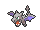{ .icon loading=lazy } [Aerodactyl](../pokemon/142.md) | Level increased to 30, always has max IVs |
| Fossil Pokémon, Shieldon | { .icon loading=lazy } [Shieldon](../pokemon/410.md) | Level increased to 30, always has max IVs |
| Fossil Pokémon, Cranidos | { .icon loading=lazy } [Cranidos](../pokemon/408.md) | Level increased to 30, always has max IVs |
| Fossil Pokémon, Tirtouga | { .icon loading=lazy } [Tirtouga](../pokemon/564.md) | Level increased to 30, always has max IVs |
| Fossil Pokémon, Archen | 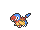{ .icon loading=lazy } [Archen](../pokemon/566.md) | Level increased to 30, always has max IVs |
| Fossil Pokémon, Tyrunt | { .icon loading=lazy } [Tyrunt](../pokemon/696.md) | Level increased to 30, always has max IVs |
| Fossil Pokémon, Amaura | { .icon loading=lazy } [Amaura](../pokemon/698.md) | Level increased to 30, always has max IVs |
| Weather Institute, Castform | { .icon loading=lazy } [Castform](../pokemon/351.md) | Level increased to 40, random nature, max IVs |
| Battle Resort, Camerupt | { .icon loading=lazy } [Camerupt](../pokemon/323.md) | Level increased to 80, always has max IVs |
| Battle Resort, Sharpedo | { .icon loading=lazy } [Sharpedo](../pokemon/319.md) | Level increased to 80, always has max IVs |
| Route 118, Latias | 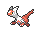{ .icon loading=lazy } [Latias](../pokemon/380.md) | Level increased to 40, always has max IVs |
| Route 118, Latios | 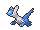{ .icon loading=lazy } [Latios](../pokemon/381.md) | Level increased to 40, always has max IVs |
| Gift from Birch, Chikorita | { .icon loading=lazy } [Chikorita](../pokemon/152.md) | Always has max IVs |
| Gift from Birch, Cyndaquil | { .icon loading=lazy } [Cyndaquil](../pokemon/155.md) | Always has max IVs |
| Gift from Birch, Totodile | { .icon loading=lazy } [Totodile](../pokemon/158.md) | Always has max IVs |
| Gift from Birch, Turtwig | { .icon loading=lazy } [Turtwig](../pokemon/387.md) | Always has max IVs |
| Gift from Birch, Chimchar | { .icon loading=lazy } [Chimchar](../pokemon/390.md) | Always has max IVs |
| Gift from Birch, Piplup | { .icon loading=lazy } [Piplup](../pokemon/393.md) | Always has max IVs |
| Gift from Birch, Snivy | { .icon loading=lazy } [Snivy](../pokemon/495.md) | Always has max IVs |
| Gift from Birch, Tepig | { .icon loading=lazy } [Tepig](../pokemon/498.md) | Always has max IVs |
| Gift from Birch, Oshawott | { .icon loading=lazy } [Oshawott](../pokemon/501.md) | Always has max IVs |

## Static Encounter Changes

| Encounter | Pokémon | Changes |
| --- | --- | --- |
| Route 101, First Battle on Route |  | Changed from Lv. 3 Wurmple to Lv. 5 Pidgey |
| Route 119/120, Kecleon | { .icon loading=lazy } [Kecleon](../pokemon/352.md) | Level increased to 40 |
| Team Hideout, Voltorb | 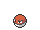{ .icon loading=lazy } [Voltorb](../pokemon/100.md) | Level increased to 40 |
| Team Hideout, Electrode | { .icon loading=lazy } [Electrode](../pokemon/101.md) | Level increased to 50 |
| Desert Ruins, Regirock | { .icon loading=lazy } [Regirock](../pokemon/377.md) | Level increased to 60 |
| Island Cave, Regice | { .icon loading=lazy } [Regice](../pokemon/378.md) | Level increased to 60 |
| Ancient Tomb, Registeel | { .icon loading=lazy } [Registeel](../pokemon/379.md) | Level increased to 60 |
| Island Cave, Regigigas | { .icon loading=lazy } [Regigigas](../pokemon/486.md) | Level increased to 68 |
| Cave of Origin, Kyogre | 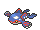{ .icon loading=lazy } [Kyogre](../pokemon/382.md) | Level increased to 65 |
| Cave of Origin, Groudon | 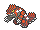{ .icon loading=lazy } [Groudon](../pokemon/383.md) | Level increased to 65 |
| Soaring in the Sky, Wild Pokémon |  | Level 60, hidden ability, max IV&#42; |
| Sky Pillar, Rayquaza | 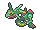{ .icon loading=lazy } [Rayquaza](../pokemon/384.md) | Level increased to 75 |
| Soaring in the Sky, Thundurus | { .icon loading=lazy } [Thundurus](../pokemon/642.md) | Level increased to 65, found as Therian forme |
| Soaring in the Sky, Tornadus | { .icon loading=lazy } [Tornadus](../pokemon/641.md) | Level increased to 65, found as Therian forme |
| Soaring in the Sky, Landorus | { .icon loading=lazy } [Landorus](../pokemon/645.md) | Level increased to 68, found as Therian forme |
| Soaring in the Sky, Dialga | { .icon loading=lazy } [Dialga](../pokemon/483.md) | Level increased to 70, holding Adamant Orb |
| Soaring in the Sky, Palkia | { .icon loading=lazy } [Palkia](../pokemon/484.md) | Level increased to 70, holding Lustrous Orb |
| Soaring in the Sky, Giratina | { .icon loading=lazy } [Giratina](../pokemon/487.md) | Level increased to 70, holding Griseous Orb |
| Trackless Forest, Raikou | { .icon loading=lazy } [Raikou](../pokemon/243.md) | Level increased to 65 |
| Trackless Forest, Entei | { .icon loading=lazy } [Entei](../pokemon/244.md) | Level increased to 65 |
| Trackless Forest, Suicune | { .icon loading=lazy } [Suicune](../pokemon/245.md) | Level increased to 65 |
| Pathless Plain, Cobalion | 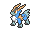{ .icon loading=lazy } [Cobalion](../pokemon/638.md) | Level increased to 65 |
| Pathless Plain, Terrakion | 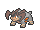{ .icon loading=lazy } [Terrakion](../pokemon/639.md) | Level increased to 65 |
| Pathless Plain, Virizion | 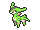{ .icon loading=lazy } [Virizion](../pokemon/640.md) | Level increased to 65 |
| Fabled Cave, Reshiram | 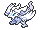{ .icon loading=lazy } [Reshiram](../pokemon/643.md) | Level increased to 70 |
| Fabled Cave, Zekrom | 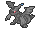{ .icon loading=lazy } [Zekrom](../pokemon/644.md) | Level increased to 70 |
| Gnarled Den, Kyurem | 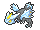{ .icon loading=lazy } [Kyurem](../pokemon/646.md) | Level increased to 70 |
| Sea Mauville, Ho-oh |  | Level increased to 70, has Regenerator |
| Sea Mauville, Lugia | { .icon loading=lazy } [Lugia](../pokemon/249.md) | Level increased to 70, has Multiscale |
| Sea Mauville, Spiritomb | { .icon loading=lazy } [Spiritomb](../pokemon/442.md) | Level increased to 60 |
| Southern Island, Latias | { .icon loading=lazy } [Latias](../pokemon/380.md) | Level increased to 40 |
| Southern Island, Latios | { .icon loading=lazy } [Latios](../pokemon/381.md) | Level increased to 40 |

&#42; Pokémon species also changed. See area changes doc for details.

