<!-- This file is generated by tools/generate_site.py. Edit the generator, not this file. -->

# Held item changes

Wild Pokémon whose held items were changed. Many of these carry evolution items or fossils so that you can get them without trading.

| # | Pokémon | Wild held items |
| --- | --- | --- |
| 028 | { .icon loading=lazy } [Sandslash](../pokemon/028.md) | 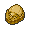{ .item loading=lazy } Dome Fossil (50%), { .item loading=lazy } Grip Claw (5%) |
| 142 | { .icon loading=lazy } [Aerodactyl](../pokemon/142.md) | { .item loading=lazy } Flying Gem (100%) |
| 207 | { .icon loading=lazy } [Gligar](../pokemon/207.md) | 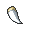{ .item loading=lazy } Razor Fang (50%) |
| 215 | { .icon loading=lazy } [Sneasel](../pokemon/215.md) | 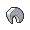{ .item loading=lazy } Razor Claw (50%), { .item loading=lazy } Quick Claw (5%) |
| 222 | { .icon loading=lazy } [Corsola](../pokemon/222.md) | 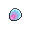{ .item loading=lazy } Prism Scale (50%), { .item loading=lazy } Luminous Moss (5%) |
| 328 | { .icon loading=lazy } [Trapinch](../pokemon/328.md) | { .item loading=lazy } Jaw Fossil (50%), { .item loading=lazy } Soft Sand (5%) |
| 331 | { .icon loading=lazy } [Cacnea](../pokemon/331.md) | 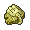{ .item loading=lazy } Root Fossil (50%), { .item loading=lazy } Sticky Barb (5%) |
| 343 | { .icon loading=lazy } [Baltoy](../pokemon/343.md) | { .item loading=lazy } Helix Fossil (50%), { .item loading=lazy } Light Clay (5%) |
| 370 | { .icon loading=lazy } [Luvdisc](../pokemon/370.md) | { .item loading=lazy } Heart Scale (100%) |
| 372 | { .icon loading=lazy } [Shelgon](../pokemon/372.md) | { .item loading=lazy } Salamencite (50%), { .item loading=lazy } Dragon Fang (5%) |
| 373 | { .icon loading=lazy } [Salamence](../pokemon/373.md) | { .item loading=lazy } Salamencite (50%), { .item loading=lazy } Dragon Fang (5%) |
| 380 | { .icon loading=lazy } [Latias](../pokemon/380.md) | { .item loading=lazy } Soul Dew (100%) |
| 381 | { .icon loading=lazy } [Latios](../pokemon/381.md) | { .item loading=lazy } Soul Dew (100%) |
| 443 | { .icon loading=lazy } [Gible](../pokemon/443.md) | 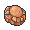{ .item loading=lazy } Skull Fossil (50%) |
| 449 | { .icon loading=lazy } [Hippopotas](../pokemon/449.md) | { .item loading=lazy } Armor Fossil (50%) |
| 461 | { .icon loading=lazy } [Weavile](../pokemon/461.md) | { .item loading=lazy } Grip Claw (50%), { .item loading=lazy } Quick Claw (5%) |
| 551 | { .icon loading=lazy } [Sandile](../pokemon/551.md) | { .item loading=lazy } Claw Fossil (50%) |
| 554 | { .icon loading=lazy } [Darumaka](../pokemon/554.md) | 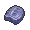{ .item loading=lazy } Cover Fossil (50%) |
| 556 | { .icon loading=lazy } [Maractus](../pokemon/556.md) | 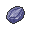{ .item loading=lazy } Plume Fossil (50%), { .item loading=lazy } Miracle Seed (5%) |
| 561 | { .icon loading=lazy } [Sigilyph](../pokemon/561.md) | 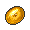{ .item loading=lazy } Old Amber (50%) |
| 694 | { .icon loading=lazy } [Helioptile](../pokemon/694.md) | 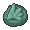{ .item loading=lazy } Sail Fossil (50%) |
| 719 | { .icon loading=lazy } [Diancie](../pokemon/719.md) | { .item loading=lazy } Diancite (100%) |
| 720 | { .icon loading=lazy } [Hoopa](../pokemon/720.md) | 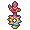{ .item loading=lazy } Prison Bottle (100%) |
