<!-- This file is generated by tools/generate_site.py. Edit the generator, not this file. -->

# Item & shop changes

??? quote "From Drayano's documentation"

    This document covers any changes made to items such as usability or price, as well as changes to what the PokéMarts and markets around Hoenn are selling.

    The changes to PokéMarts are key to evolving many of the new Pokémon you can get as they will sell you evolution stones and items. You need to use the code.bin file in the exeFS and if not using HANS, also make sure no OR/AS patches from the eshop are installed to see these mart changes. (The same also applies to text edits but those aren't as important.)

    PokéMarts also sell a few Mega Stones for a hefty price that you weren't able to get before defeating the Elite Four in OR/AS. This includes every Mega Stone with the exception of Salamencite and Diancite, which can be found as held items on Shelgon or Salamence and Diancie respectively.

## Item Usability Changes

The items listed below can now be USEd like evolution stones in addition to their previous effects. They evolve the Pokémon they normally would through trading.

| Item | Evolves |
| --- | --- |
| { .item loading=lazy } Deep Sea Scale | Clamperl → Gorebyss |
| { .item loading=lazy } Deep Sea Tooth | Clamperl → Huntail |
| { .item loading=lazy } Dragon Scale | Seadra → Kingdra |
| 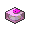{ .item loading=lazy } Dubious Disc | Porygon2 → Porygon-Z |
| { .item loading=lazy } Electirizer | Electabuzz → Electivire |
| { .item loading=lazy } King’s Rock | Poliwhirl → Politoed, Slowpoke → Slowking |
| { .item loading=lazy } Magmarizer | Magmar → Magmortar |
| { .item loading=lazy } Metal Coat | Onix → Steelix, Scyther → Scizor |
| { .item loading=lazy } Prism Scale | Feebas → Milotic |
| 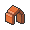{ .item loading=lazy } Protector | Rhydon → Rhyperior |
| 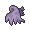{ .item loading=lazy } Reaper Cloth | Dusclops → Dusknoir |
| 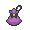{ .item loading=lazy } Sachet | — |
| 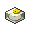{ .item loading=lazy } Upgrade | Porygon → Porygon2 |
| 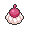{ .item loading=lazy } Whipped Dream | — |

## Item Price Changes

Items listed below have had their price modified; Poké Balls are cheaper to make

things easier to catch everything you see, while some items are given prices as

they are now buyable where they weren't before. Cheaper items are in the left

column and more expensive items on the right.

| Item | Vanilla price | RR/SS price |
| --- | --- | --- |
| { .item loading=lazy } Audinite | ¥0 | **¥20,000** |
| { .item loading=lazy } Blastoisinite | ¥0 | **¥20,000** |
| { .item loading=lazy } Cameruptite | ¥0 | **¥20,000** |
| { .item loading=lazy } Deep Sea Scale | ¥200 | **¥2,100** |
| { .item loading=lazy } Deep Sea Tooth | ¥200 | **¥2,100** |
| { .item loading=lazy } Galladite | ¥0 | **¥20,000** |
| { .item loading=lazy } Garchompite | ¥0 | **¥20,000** |
| { .item loading=lazy } Gengarite | ¥0 | **¥20,000** |
| { .item loading=lazy } Great Ball | ¥600 | **¥150** |
| { .item loading=lazy } Heart Scale | ¥100 | **¥2,100** |
| { .item loading=lazy } King’s Rock | ¥200 | **¥2,100** |
| { .item loading=lazy } Lucarionite | ¥0 | **¥20,000** |
| 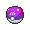{ .item loading=lazy } Master Ball | ¥0 | **¥80,000** |
| { .item loading=lazy } Metagrossite | ¥0 | **¥20,000** |
| { .item loading=lazy } Metal Coat | ¥200 | **¥2,100** |
| { .item loading=lazy } Poké Ball | ¥200 | **¥50** |
| { .item loading=lazy } Sharpedonite | ¥0 | **¥20,000** |
| 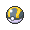{ .item loading=lazy } Ultra Ball | ¥1,200 | **¥300** |

## Market Changes

A lot of the shops have been changed around the Hoenn region, now selling you a

mixture of evolution items, mega stones and some TMs. The inventories for these

shops is listed below.

Due to limited space, you cannot buy vitamins or X items anymore. Vitamins can

be found from the Battle Resort stalls, but X items that you don't find on the

floor are no longer available. Sorry about that!

| Shop | Inventory |
| --- | --- |
| **Any Mart, 6 Badges** | { .item loading=lazy } Poké Ball, { .item loading=lazy } Great Ball, { .item loading=lazy } Ultra Ball, 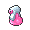{ .item loading=lazy } Hyper Potion, 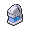{ .item loading=lazy } Max Potion, 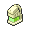{ .item loading=lazy } Full Restore, { .item loading=lazy } Revive, 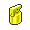{ .item loading=lazy } Full Heal, 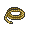{ .item loading=lazy } Escape Rope, 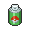{ .item loading=lazy } Repel, 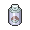{ .item loading=lazy } Super Repel, 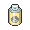{ .item loading=lazy } Max Repel, { .item loading=lazy } Audinite, { .item loading=lazy } Blastoisinite, { .item loading=lazy } Cameruptite, { .item loading=lazy } Galladite, { .item loading=lazy } Gengarite, { .item loading=lazy } Lucarionite, { .item loading=lazy } Sharpedonite |
| **Any Mart, 7 Badges** | { .item loading=lazy } Poké Ball, { .item loading=lazy } Great Ball, { .item loading=lazy } Ultra Ball, { .item loading=lazy } Hyper Potion, { .item loading=lazy } Max Potion, { .item loading=lazy } Full Restore, { .item loading=lazy } Revive, { .item loading=lazy } Full Heal, { .item loading=lazy } Escape Rope, { .item loading=lazy } Repel, { .item loading=lazy } Super Repel, { .item loading=lazy } Max Repel, { .item loading=lazy } Audinite, { .item loading=lazy } Blastoisinite, { .item loading=lazy } Cameruptite, { .item loading=lazy } Galladite, { .item loading=lazy } Gengarite, { .item loading=lazy } Lucarionite, { .item loading=lazy } Sharpedonite |
| **Any Mart, 8 Badges** | { .item loading=lazy } Poké Ball, { .item loading=lazy } Great Ball, { .item loading=lazy } Ultra Ball, { .item loading=lazy } Master Ball, { .item loading=lazy } Max Potion, { .item loading=lazy } Full Restore, { .item loading=lazy } Revive, { .item loading=lazy } Full Heal, { .item loading=lazy } Escape Rope, { .item loading=lazy } Max Repel, { .item loading=lazy } Audinite, { .item loading=lazy } Blastoisinite, { .item loading=lazy } Cameruptite, { .item loading=lazy } Galladite, { .item loading=lazy } Garchompite, { .item loading=lazy } Gengarite, { .item loading=lazy } Lucarionite, { .item loading=lazy } Metagrossite, { .item loading=lazy } Sharpedonite |
| **Slateport Poké Mart** | 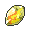{ .item loading=lazy } Fire Stone, 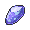{ .item loading=lazy } Water Stone, 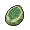{ .item loading=lazy } Leaf Stone, 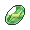{ .item loading=lazy } Thunder Stone, 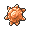{ .item loading=lazy } Sun Stone, { .item loading=lazy } Moon Stone, { .item loading=lazy } Whipped Dream, { .item loading=lazy } Sachet |
| **Slateport Market** | { .item loading=lazy } Deep Sea Tooth, { .item loading=lazy } Deep Sea Scale, { .item loading=lazy } Dragon Scale, { .item loading=lazy } King’s Rock, { .item loading=lazy } Metal Coat, { .item loading=lazy } Upgrade |
| **Verdanturf Poké Mart** | 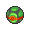{ .item loading=lazy } Dusk Ball, 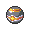{ .item loading=lazy } Luxury Ball, 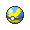{ .item loading=lazy } Quick Ball |
| **Fallarbor Poké Mart** | 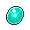{ .item loading=lazy } Dawn Stone, 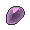{ .item loading=lazy } Dusk Stone, 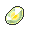{ .item loading=lazy } Shiny Stone |
| **Lilycove Poké Mart 2F** | 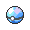{ .item loading=lazy } Dive Ball, 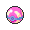{ .item loading=lazy } Heal Ball, 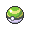{ .item loading=lazy } Nest Ball |
| **Lilycove Poké Mart 3F** | TM66 Payback, TM74 Gyro Ball, TM84 Poison Jab, TM90 Substitute, TM91 Flash Cannon, TM95 Snarl |
| **Lilycove Poké Mart 3F** | { .item loading=lazy } Heart Scale, { .item loading=lazy } Dubious Disc, { .item loading=lazy } Electirizer, { .item loading=lazy } Magmarizer, { .item loading=lazy } Protector, { .item loading=lazy } Razor Claw, { .item loading=lazy } Razor Fang, { .item loading=lazy } Reaper Cloth |

