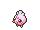

<!-- This file is generated by tools/generate_site.py. Edit the generator, not this file. -->

# Other changes

## EV yield changes

| # | Pokémon | Change |
| --- | --- | --- |
| 083 | { .icon loading=lazy } [Farfetch’d](../pokemon/083.md) | 1 Atk → **2 Atk** |
| 163 | { .icon loading=lazy } [Hoothoot](../pokemon/163.md) | 1 HP → **1 Sp. Def** |
| 164 | { .icon loading=lazy } [Noctowl](../pokemon/164.md) | 2 HP → **2 Sp. Def** |
| 301 | { .icon loading=lazy } [Delcatty](../pokemon/301.md) | 1 HP, 1 Speed → **2 Sp. Atk** |
| 313 | { .icon loading=lazy } [Volbeat](../pokemon/313.md) | 1 Speed → **1 Attack** |
| 314 | { .icon loading=lazy } [Illumise](../pokemon/314.md) | 1 Speed → **1 Sp. Atk** |
| 351 | { .icon loading=lazy } [Castform](../pokemon/351.md) | 1 HP → **1 Sp. Atk** |
| 370 | { .icon loading=lazy } [Luvdisc](../pokemon/370.md) | 1 Spd → **2 Spd** |
| 441 | { .icon loading=lazy } [Chatot](../pokemon/441.md) | 1 Atk → **1 Sp. Atk, 1 Spd** |
| 666 | { .icon loading=lazy } [Vivillon](../pokemon/666.md) | 1 SAtk, 1 Spd → **2 SAtk** |

## Base friendship changes

| # | Pokémon | Change |
| --- | --- | --- |
| 133 | { .icon loading=lazy } [Eevee](../pokemon/133.md) | 70 → **140** |
| 172 | { .icon loading=lazy } [Pichu](../pokemon/172.md) | 70 → **200** |
| 173 | { .icon loading=lazy } [Cleffa](../pokemon/173.md) | 70 → **200** |
| 174 | { .icon loading=lazy } [Igglybuff](../pokemon/174.md) | 70 → **200** |
| 175 | { .icon loading=lazy } [Togepi](../pokemon/175.md) | 70 → **180** |
| 298 | { .icon loading=lazy } [Azurill](../pokemon/298.md) | 70 → **200** |
| 406 | { .icon loading=lazy } [Budew](../pokemon/406.md) | 70 → **200** |
| 427 | { .icon loading=lazy } [Buneary](../pokemon/427.md) | 0 → **140** |
| 433 | { .icon loading=lazy } [Chingling](../pokemon/433.md) | 70 → **200** |
| 527 | { .icon loading=lazy } [Woobat](../pokemon/527.md) | 70 → **140** |
| 540 | { .icon loading=lazy } [Sewaddle](../pokemon/540.md) | 70 → **140** |
| 541 | { .icon loading=lazy } [Swadloon](../pokemon/541.md) | 70 → **140** |

## Catch rate changes

| # | Pokémon | Change |
| --- | --- | --- |
| 374 | { .icon loading=lazy } [Beldum](../pokemon/374.md) | 3 → **45** |
| 375 | { .icon loading=lazy } [Metang](../pokemon/375.md) | 3 → **45** |
| 376 | { .icon loading=lazy } [Metagross](../pokemon/376.md) | 3 → **45** |

