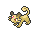

<!-- This file is generated by tools/generate_site.py. Edit the generator, not this file. -->

# Base stat changes

Changed cells show the vanilla value and the new value. Base Stat Totals are recomputed from the new stats.

| # | Pokémon | Form | HP | Atk | Def | SpA | SpD | Spe | BST |
| --- | --- | --- | --- | --- | --- | --- | --- | --- | --- |
| 012 | { .icon loading=lazy } [Butterfree](../pokemon/012.md) | Normal | 60 | 45 → <strong class="changed">25</strong> | 50 | 90 → <strong class="changed">115</strong> | 80 → <strong class="changed">105</strong> | 70 → <strong class="changed">95</strong> | 395 → <strong>450</strong> |
| 015 | { .icon loading=lazy } [Beedrill](../pokemon/015.md) | Normal | 65 | 90 → <strong class="changed">115</strong> | 40 | 45 → <strong class="changed">25</strong> | 80 → <strong class="changed">105</strong> | 75 → <strong class="changed">100</strong> | 395 → <strong>450</strong> |
| 015 | { .icon loading=lazy } [Beedrill](../pokemon/015.md) | Mega Beedrill | 65 | 150 | 40 → <strong class="changed">50</strong> | 15 → <strong class="changed">30</strong> | 80 → <strong class="changed">110</strong> | 145 | 495 → <strong>550</strong> |
| 020 | { .icon loading=lazy } [Raticate](../pokemon/020.md) | Normal | 55 → <strong class="changed">60</strong> | 81 → <strong class="changed">100</strong> | 60 | 50 → <strong class="changed">35</strong> | 70 | 97 → <strong class="changed">115</strong> | 413 → <strong>440</strong> |
| 022 | { .icon loading=lazy } [Fearow](../pokemon/022.md) | Normal | 65 | 90 → <strong class="changed">100</strong> | 65 | 61 → <strong class="changed">60</strong> | 61 → <strong class="changed">60</strong> | 100 | 442 → <strong>450</strong> |
| 024 | { .icon loading=lazy } [Arbok](../pokemon/024.md) | Normal | 60 | 85 → <strong class="changed">95</strong> | 69 → <strong class="changed">70</strong> | 65 → <strong class="changed">55</strong> | 79 → <strong class="changed">85</strong> | 80 → <strong class="changed">85</strong> | 438 → <strong>450</strong> |
| 026 | { .icon loading=lazy } [Raichu](../pokemon/026.md) | Normal | 60 | 90 → <strong class="changed">100</strong> | 55 | 90 → <strong class="changed">100</strong> | 80 | 110 | 485 → <strong>505</strong> |
| 039 | { .icon loading=lazy } [Jigglypuff](../pokemon/039.md) | Normal | 115 | 45 | 20 → <strong class="changed">40</strong> | 45 → <strong class="changed">60</strong> | 25 → <strong class="changed">40</strong> | 20 | 270 → <strong>320</strong> |
| 040 | { .icon loading=lazy } [Wigglytuff](../pokemon/040.md) | Normal | 140 → <strong class="changed">150</strong> | 70 → <strong class="changed">80</strong> | 45 → <strong class="changed">55</strong> | 85 → <strong class="changed">95</strong> | 50 → <strong class="changed">60</strong> | 45 | 435 → <strong>485</strong> |
| 046 | { .icon loading=lazy } [Paras](../pokemon/046.md) | Normal | 35 | 70 → <strong class="changed">80</strong> | 55 | 45 | 55 | 25 | 285 → <strong>295</strong> |
| 047 | { .icon loading=lazy } [Parasect](../pokemon/047.md) | Normal | 60 → <strong class="changed">80</strong> | 95 → <strong class="changed">115</strong> | 80 → <strong class="changed">90</strong> | 60 → <strong class="changed">45</strong> | 80 → <strong class="changed">90</strong> | 30 | 405 → <strong>450</strong> |
| 049 | { .icon loading=lazy } [Venomoth](../pokemon/049.md) | Normal | 70 | 65 → <strong class="changed">55</strong> | 60 | 90 → <strong class="changed">100</strong> | 75 | 90 → <strong class="changed">100</strong> | 450 → <strong>460</strong> |
| 051 | { .icon loading=lazy } [Dugtrio](../pokemon/051.md) | Normal | 35 → <strong class="changed">45</strong> | 80 → <strong class="changed">100</strong> | 50 → <strong class="changed">60</strong> | 50 | 70 → <strong class="changed">80</strong> | 120 | 405 → <strong>455</strong> |
| 053 | { .icon loading=lazy } [Persian](../pokemon/053.md) | Normal | 65 | 70 → <strong class="changed">85</strong> | 60 | 65 → <strong class="changed">75</strong> | 65 | 115 | 440 → <strong>465</strong> |
| 083 | { .icon loading=lazy } [Farfetch’d](../pokemon/083.md) | Normal | 52 → <strong class="changed">65</strong> | 65 → <strong class="changed">130</strong> | 55 → <strong class="changed">65</strong> | 58 → <strong class="changed">30</strong> | 62 → <strong class="changed">65</strong> | 60 → <strong class="changed">120</strong> | 352 → <strong>475</strong> |
| 087 | { .icon loading=lazy } [Dewgong](../pokemon/087.md) | Normal | 90 | 70 → <strong class="changed">80</strong> | 80 | 70 → <strong class="changed">80</strong> | 95 | 70 → <strong class="changed">60</strong> | 475 → <strong>485</strong> |
| 095 | { .icon loading=lazy } [Onix](../pokemon/095.md) | Normal | 35 → <strong class="changed">65</strong> | 45 → <strong class="changed">75</strong> | 160 | 30 | 45 | 70 → <strong class="changed">100</strong> | 385 → <strong>475</strong> |
| 105 | { .icon loading=lazy } [Marowak](../pokemon/105.md) | Normal | 60 → <strong class="changed">70</strong> | 80 | 110 | 50 | 80 | 45 → <strong class="changed">60</strong> | 425 → <strong>450</strong> |
| 119 | { .icon loading=lazy } [Seaking](../pokemon/119.md) | Normal | 80 | 92 → <strong class="changed">100</strong> | 65 → <strong class="changed">80</strong> | 65 → <strong class="changed">40</strong> | 80 | 68 → <strong class="changed">80</strong> | 450 → <strong>460</strong> |
| 136 | { .icon loading=lazy } [Flareon](../pokemon/136.md) | Normal | 65 | 130 | 60 | 95 → <strong class="changed">65</strong> | 110 | 65 → <strong class="changed">95</strong> | 525 → <strong>525</strong> |
| 162 | { .icon loading=lazy } [Furret](../pokemon/162.md) | Normal | 85 → <strong class="changed">95</strong> | 76 → <strong class="changed">85</strong> | 64 → <strong class="changed">65</strong> | 45 → <strong class="changed">40</strong> | 55 | 90 → <strong class="changed">100</strong> | 415 → <strong>440</strong> |
| 163 | { .icon loading=lazy } [Hoothoot](../pokemon/163.md) | Normal | 60 | 30 → <strong class="changed">25</strong> | 30 → <strong class="changed">25</strong> | 36 → <strong class="changed">45</strong> | 56 → <strong class="changed">65</strong> | 50 | 262 → <strong>270</strong> |
| 164 | { .icon loading=lazy } [Noctowl](../pokemon/164.md) | Normal | 100 | 50 → <strong class="changed">30</strong> | 50 → <strong class="changed">60</strong> | 76 → <strong class="changed">90</strong> | 96 → <strong class="changed">110</strong> | 70 → <strong class="changed">75</strong> | 442 → <strong>465</strong> |
| 165 | { .icon loading=lazy } [Ledyba](../pokemon/165.md) | Normal | 40 | 20 → <strong class="changed">50</strong> | 30 | 40 → <strong class="changed">20</strong> | 80 | 55 | 265 → <strong>275</strong> |
| 166 | { .icon loading=lazy } [Ledian](../pokemon/166.md) | Normal | 55 | 35 → <strong class="changed">110</strong> | 50 | 55 → <strong class="changed">40</strong> | 110 | 85 | 390 → <strong>450</strong> |
| 167 | { .icon loading=lazy } [Spinarak](../pokemon/167.md) | Normal | 40 | 60 → <strong class="changed">70</strong> | 40 | 40 | 40 | 30 → <strong class="changed">40</strong> | 250 → <strong>270</strong> |
| 168 | { .icon loading=lazy } [Ariados](../pokemon/168.md) | Normal | 70 | 90 → <strong class="changed">120</strong> | 70 | 60 → <strong class="changed">50</strong> | 60 | 40 → <strong class="changed">80</strong> | 390 → <strong>450</strong> |
| 184 | { .icon loading=lazy } [Azumarill](../pokemon/184.md) | Normal | 100 | 50 | 80 | 60 → <strong class="changed">80</strong> | 80 | 50 | 420 → <strong>440</strong> |
| 185 | { .icon loading=lazy } [Sudowoodo](../pokemon/185.md) | Normal | 70 → <strong class="changed">80</strong> | 100 → <strong class="changed">110</strong> | 115 → <strong class="changed">125</strong> | 30 → <strong class="changed">40</strong> | 65 → <strong class="changed">75</strong> | 30 | 410 → <strong>460</strong> |
| 187 | { .icon loading=lazy } [Hoppip](../pokemon/187.md) | Normal | 35 | 35 → <strong class="changed">50</strong> | 40 | 35 → <strong class="changed">50</strong> | 55 → <strong class="changed">60</strong> | 50 → <strong class="changed">55</strong> | 250 → <strong>290</strong> |
| 188 | { .icon loading=lazy } [Skiploom](../pokemon/188.md) | Normal | 55 | 45 → <strong class="changed">65</strong> | 50 | 45 → <strong class="changed">65</strong> | 65 → <strong class="changed">75</strong> | 80 | 340 → <strong>390</strong> |
| 189 | { .icon loading=lazy } [Jumpluff](../pokemon/189.md) | Normal | 75 | 55 → <strong class="changed">75</strong> | 70 | 55 → <strong class="changed">75</strong> | 95 | 110 | 460 → <strong>500</strong> |
| 192 | { .icon loading=lazy } [Sunflora](../pokemon/192.md) | Normal | 75 → <strong class="changed">95</strong> | 75 → <strong class="changed">55</strong> | 55 → <strong class="changed">95</strong> | 105 → <strong class="changed">125</strong> | 85 → <strong class="changed">105</strong> | 30 | 425 → <strong>505</strong> |
| 194 | { .icon loading=lazy } [Wooper](../pokemon/194.md) | Normal | 55 | 45 → <strong class="changed">55</strong> | 45 → <strong class="changed">55</strong> | 25 | 25 | 15 | 210 → <strong>230</strong> |
| 195 | { .icon loading=lazy } [Quagsire](../pokemon/195.md) | Normal | 95 | 85 → <strong class="changed">95</strong> | 85 → <strong class="changed">95</strong> | 65 | 65 | 35 | 430 → <strong>450</strong> |
| 201 | { .icon loading=lazy } [Unown](../pokemon/201.md) | Normal | 48 → <strong class="changed">50</strong> | 72 → <strong class="changed">150</strong> | 48 → <strong class="changed">50</strong> | 72 → <strong class="changed">150</strong> | 48 → <strong class="changed">50</strong> | 48 → <strong class="changed">50</strong> | 336 → <strong>500</strong> |
| 202 | { .icon loading=lazy } [Wobbuffet](../pokemon/202.md) | Normal | 190 → <strong class="changed">240</strong> | 33 → <strong class="changed">30</strong> | 58 → <strong class="changed">60</strong> | 33 → <strong class="changed">30</strong> | 58 → <strong class="changed">60</strong> | 33 → <strong class="changed">30</strong> | 405 → <strong>450</strong> |
| 206 | { .icon loading=lazy } [Dunsparce](../pokemon/206.md) | Normal | 100 → <strong class="changed">110</strong> | 70 → <strong class="changed">80</strong> | 70 → <strong class="changed">80</strong> | 65 | 65 | 45 → <strong class="changed">55</strong> | 415 → <strong>455</strong> |
| 211 | { .icon loading=lazy } [Qwilfish](../pokemon/211.md) | Normal | 65 | 95 → <strong class="changed">100</strong> | 75 | 55 | 55 | 85 → <strong class="changed">90</strong> | 430 → <strong>440</strong> |
| 218 | { .icon loading=lazy } [Slugma](../pokemon/218.md) | Normal | 40 → <strong class="changed">50</strong> | 40 → <strong class="changed">50</strong> | 40 → <strong class="changed">50</strong> | 70 → <strong class="changed">80</strong> | 40 → <strong class="changed">50</strong> | 20 | 250 → <strong>300</strong> |
| 219 | { .icon loading=lazy } [Magcargo](../pokemon/219.md) | Normal | 50 → <strong class="changed">80</strong> | 50 | 120 | 80 → <strong class="changed">115</strong> | 80 → <strong class="changed">110</strong> | 30 | 410 → <strong>505</strong> |
| 222 | { .icon loading=lazy } [Corsola](../pokemon/222.md) | Normal | 55 → <strong class="changed">75</strong> | 55 | 85 → <strong class="changed">105</strong> | 65 → <strong class="changed">85</strong> | 85 → <strong class="changed">105</strong> | 35 | 380 → <strong>460</strong> |
| 225 | { .icon loading=lazy } [Delibird](../pokemon/225.md) | Normal | 45 → <strong class="changed">65</strong> | 55 → <strong class="changed">80</strong> | 45 → <strong class="changed">65</strong> | 65 → <strong class="changed">110</strong> | 45 → <strong class="changed">65</strong> | 75 → <strong class="changed">120</strong> | 330 → <strong>505</strong> |
| 262 | { .icon loading=lazy } [Mightyena](../pokemon/262.md) | Normal | 70 | 90 → <strong class="changed">110</strong> | 70 | 60 | 60 | 70 → <strong class="changed">80</strong> | 420 → <strong>450</strong> |
| 263 | { .icon loading=lazy } [Zigzagoon](../pokemon/263.md) | Normal | 38 | 30 → <strong class="changed">40</strong> | 41 | 30 → <strong class="changed">20</strong> | 41 | 60 | 240 → <strong>240</strong> |
| 264 | { .icon loading=lazy } [Linoone](../pokemon/264.md) | Normal | 78 → <strong class="changed">80</strong> | 70 → <strong class="changed">90</strong> | 61 → <strong class="changed">60</strong> | 50 → <strong class="changed">40</strong> | 61 → <strong class="changed">60</strong> | 100 → <strong class="changed">110</strong> | 420 → <strong>440</strong> |
| 267 | { .icon loading=lazy } [Beautifly](../pokemon/267.md) | Normal | 60 → <strong class="changed">65</strong> | 70 | 50 → <strong class="changed">55</strong> | 100 → <strong class="changed">120</strong> | 50 → <strong class="changed">55</strong> | 65 → <strong class="changed">85</strong> | 395 → <strong>450</strong> |
| 269 | { .icon loading=lazy } [Dustox](../pokemon/269.md) | Normal | 60 | 50 | 70 | 50 → <strong class="changed">85</strong> | 90 → <strong class="changed">120</strong> | 65 | 385 → <strong>450</strong> |
| 277 | { .icon loading=lazy } [Swellow](../pokemon/277.md) | Normal | 60 | 85 → <strong class="changed">95</strong> | 60 | 50 | 50 → <strong class="changed">60</strong> | 125 | 430 → <strong>450</strong> |
| 279 | { .icon loading=lazy } [Pelipper](../pokemon/279.md) | Normal | 60 → <strong class="changed">80</strong> | 50 | 100 | 85 | 70 | 65 | 430 → <strong>450</strong> |
| 280 | { .icon loading=lazy } [Ralts](../pokemon/280.md) | Normal | 28 | 25 | 25 | 45 → <strong class="changed">65</strong> | 35 → <strong class="changed">55</strong> | 40 | 198 → <strong>238</strong> |
| 281 | { .icon loading=lazy } [Kirlia](../pokemon/281.md) | Normal | 38 | 35 | 35 | 65 → <strong class="changed">85</strong> | 55 → <strong class="changed">75</strong> | 50 | 278 → <strong>318</strong> |
| 283 | { .icon loading=lazy } [Surskit](../pokemon/283.md) | Normal | 40 | 30 → <strong class="changed">60</strong> | 32 | 50 → <strong class="changed">62</strong> | 52 | 65 | 269 → <strong>311</strong> |
| 284 | { .icon loading=lazy } [Masquerain](../pokemon/284.md) | Normal | 70 | 60 → <strong class="changed">50</strong> | 62 → <strong class="changed">65</strong> | 80 → <strong class="changed">105</strong> | 82 → <strong class="changed">105</strong> | 60 → <strong class="changed">85</strong> | 414 → <strong>480</strong> |
| 300 | { .icon loading=lazy } [Skitty](../pokemon/300.md) | Normal | 50 | 45 | 45 | 35 → <strong class="changed">45</strong> | 35 → <strong class="changed">45</strong> | 50 | 260 → <strong>280</strong> |
| 301 | { .icon loading=lazy } [Delcatty](../pokemon/301.md) | Normal | 70 → <strong class="changed">80</strong> | 65 | 65 | 55 → <strong class="changed">100</strong> | 55 → <strong class="changed">65</strong> | 70 → <strong class="changed">80</strong> | 380 → <strong>455</strong> |
| 302 | { .icon loading=lazy } [Sableye](../pokemon/302.md) | Normal | 50 → <strong class="changed">55</strong> | 75 → <strong class="changed">80</strong> | 75 → <strong class="changed">80</strong> | 65 → <strong class="changed">70</strong> | 65 → <strong class="changed">70</strong> | 50 → <strong class="changed">55</strong> | 380 → <strong>410</strong> |
| 302 | { .icon loading=lazy } [Sableye](../pokemon/302.md) | Mega Sableye | 50 → <strong class="changed">55</strong> | 85 → <strong class="changed">90</strong> | 125 → <strong class="changed">130</strong> | 85 → <strong class="changed">90</strong> | 115 → <strong class="changed">120</strong> | 20 → <strong class="changed">25</strong> | 480 → <strong>510</strong> |
| 303 | { .icon loading=lazy } [Mawile](../pokemon/303.md) | Normal | 50 → <strong class="changed">55</strong> | 85 → <strong class="changed">90</strong> | 85 → <strong class="changed">90</strong> | 55 → <strong class="changed">60</strong> | 55 → <strong class="changed">60</strong> | 50 → <strong class="changed">55</strong> | 380 → <strong>410</strong> |
| 303 | { .icon loading=lazy } [Mawile](../pokemon/303.md) | Mega Mawile | 50 → <strong class="changed">55</strong> | 105 → <strong class="changed">110</strong> | 125 → <strong class="changed">130</strong> | 55 → <strong class="changed">60</strong> | 95 → <strong class="changed">100</strong> | 50 → <strong class="changed">55</strong> | 480 → <strong>510</strong> |
| 311 | { .icon loading=lazy } [Plusle](../pokemon/311.md) | Normal | 60 → <strong class="changed">70</strong> | 50 → <strong class="changed">60</strong> | 40 → <strong class="changed">50</strong> | 85 → <strong class="changed">95</strong> | 75 → <strong class="changed">85</strong> | 95 → <strong class="changed">105</strong> | 405 → <strong>465</strong> |
| 312 | { .icon loading=lazy } [Minun](../pokemon/312.md) | Normal | 60 → <strong class="changed">70</strong> | 40 → <strong class="changed">50</strong> | 50 → <strong class="changed">60</strong> | 75 → <strong class="changed">85</strong> | 85 → <strong class="changed">95</strong> | 95 → <strong class="changed">105</strong> | 405 → <strong>465</strong> |
| 313 | { .icon loading=lazy } [Volbeat](../pokemon/313.md) | Normal | 65 | 73 → <strong class="changed">105</strong> | 55 → <strong class="changed">60</strong> | 47 → <strong class="changed">45</strong> | 75 → <strong class="changed">80</strong> | 85 → <strong class="changed">95</strong> | 400 → <strong>450</strong> |
| 314 | { .icon loading=lazy } [Illumise](../pokemon/314.md) | Normal | 65 | 47 → <strong class="changed">45</strong> | 55 → <strong class="changed">60</strong> | 73 → <strong class="changed">105</strong> | 75 → <strong class="changed">80</strong> | 85 → <strong class="changed">95</strong> | 400 → <strong>450</strong> |
| 327 | { .icon loading=lazy } [Spinda](../pokemon/327.md) | Normal | 60 → <strong class="changed">80</strong> | 60 → <strong class="changed">80</strong> | 60 → <strong class="changed">80</strong> | 60 → <strong class="changed">80</strong> | 60 → <strong class="changed">80</strong> | 60 → <strong class="changed">80</strong> | 360 → <strong>480</strong> |
| 330 | { .icon loading=lazy } [Flygon](../pokemon/330.md) | Normal | 80 | 100 → <strong class="changed">110</strong> | 80 | 80 → <strong class="changed">90</strong> | 80 | 100 → <strong class="changed">110</strong> | 520 → <strong>550</strong> |
| 337 | { .icon loading=lazy } [Lunatone](../pokemon/337.md) | Normal | 70 → <strong class="changed">80</strong> | 55 | 65 → <strong class="changed">80</strong> | 95 → <strong class="changed">110</strong> | 85 → <strong class="changed">100</strong> | 70 | 440 → <strong>495</strong> |
| 338 | { .icon loading=lazy } [Solrock](../pokemon/338.md) | Normal | 70 → <strong class="changed">80</strong> | 95 → <strong class="changed">110</strong> | 85 → <strong class="changed">100</strong> | 55 | 65 → <strong class="changed">80</strong> | 70 | 440 → <strong>495</strong> |
| 351 | { .icon loading=lazy } [Castform](../pokemon/351.md) | Normal | 70 → <strong class="changed">60</strong> | 70 → <strong class="changed">60</strong> | 70 → <strong class="changed">60</strong> | 70 → <strong class="changed">100</strong> | 70 → <strong class="changed">100</strong> | 70 → <strong class="changed">100</strong> | 420 → <strong>480</strong> |
| 352 | { .icon loading=lazy } [Kecleon](../pokemon/352.md) | Normal | 60 → <strong class="changed">80</strong> | 90 → <strong class="changed">100</strong> | 70 → <strong class="changed">80</strong> | 60 | 120 | 40 | 440 → <strong>480</strong> |
| 357 | { .icon loading=lazy } [Tropius](../pokemon/357.md) | Normal | 99 → <strong class="changed">105</strong> | 68 → <strong class="changed">75</strong> | 83 → <strong class="changed">105</strong> | 72 → <strong class="changed">85</strong> | 87 → <strong class="changed">105</strong> | 51 → <strong class="changed">60</strong> | 460 → <strong>535</strong> |
| 358 | { .icon loading=lazy } [Chimecho](../pokemon/358.md) | Normal | 65 → <strong class="changed">80</strong> | 50 → <strong class="changed">35</strong> | 70 → <strong class="changed">85</strong> | 95 → <strong class="changed">110</strong> | 80 → <strong class="changed">95</strong> | 65 → <strong class="changed">80</strong> | 425 → <strong>485</strong> |
| 370 | { .icon loading=lazy } [Luvdisc](../pokemon/370.md) | Normal | 43 → <strong class="changed">45</strong> | 30 | 55 | 40 → <strong class="changed">100</strong> | 65 → <strong class="changed">90</strong> | 97 → <strong class="changed">145</strong> | 330 → <strong>465</strong> |
| 400 | { .icon loading=lazy } [Bibarel](../pokemon/400.md) | Normal | 79 → <strong class="changed">90</strong> | 85 → <strong class="changed">95</strong> | 60 → <strong class="changed">65</strong> | 55 | 60 | 71 → <strong class="changed">75</strong> | 410 → <strong>440</strong> |
| 402 | { .icon loading=lazy } [Kricketune](../pokemon/402.md) | Normal | 77 → <strong class="changed">80</strong> | 85 → <strong class="changed">110</strong> | 51 → <strong class="changed">65</strong> | 55 | 51 → <strong class="changed">65</strong> | 65 | 384 → <strong>440</strong> |
| 413 | { .icon loading=lazy } [Wormadam](../pokemon/413.md) | Normal | 60 → <strong class="changed">80</strong> | 59 → <strong class="changed">50</strong> | 85 → <strong class="changed">100</strong> | 79 → <strong class="changed">90</strong> | 105 → <strong class="changed">110</strong> | 36 → <strong class="changed">30</strong> | 424 → <strong>460</strong> |
| 413 | { .icon loading=lazy } [Wormadam](../pokemon/413.md) | Sandy Wormadam | 60 → <strong class="changed">80</strong> | 79 → <strong class="changed">90</strong> | 105 → <strong class="changed">110</strong> | 59 → <strong class="changed">50</strong> | 85 → <strong class="changed">100</strong> | 36 → <strong class="changed">30</strong> | 424 → <strong>460</strong> |
| 413 | { .icon loading=lazy } [Wormadam](../pokemon/413.md) | Trash Wormadam | 60 → <strong class="changed">80</strong> | 69 → <strong class="changed">70</strong> | 95 → <strong class="changed">105</strong> | 69 → <strong class="changed">70</strong> | 95 → <strong class="changed">105</strong> | 36 → <strong class="changed">30</strong> | 424 → <strong>460</strong> |
| 414 | { .icon loading=lazy } [Mothim](../pokemon/414.md) | Normal | 70 → <strong class="changed">80</strong> | 94 → <strong class="changed">100</strong> | 50 | 94 → <strong class="changed">100</strong> | 50 | 66 → <strong class="changed">80</strong> | 424 → <strong>460</strong> |
| 417 | { .icon loading=lazy } [Pachirisu](../pokemon/417.md) | Normal | 60 → <strong class="changed">70</strong> | 45 → <strong class="changed">60</strong> | 70 → <strong class="changed">90</strong> | 45 → <strong class="changed">60</strong> | 90 | 95 | 405 → <strong>465</strong> |
| 421 | { .icon loading=lazy } [Cherrim](../pokemon/421.md) | Normal | 70 | 60 | 70 | 87 → <strong class="changed">90</strong> | 78 → <strong class="changed">80</strong> | 85 | 450 → <strong>455</strong> |
| 421 | { .icon loading=lazy } [Cherrim](../pokemon/421.md) | Sunshine Form | 70 | 60 | 70 → <strong class="changed">80</strong> | 87 → <strong class="changed">120</strong> | 78 → <strong class="changed">110</strong> | 85 → <strong class="changed">115</strong> | 450 → <strong>555</strong> |
| 441 | { .icon loading=lazy } [Chatot](../pokemon/441.md) | Normal | 76 → <strong class="changed">80</strong> | 65 | 45 → <strong class="changed">55</strong> | 92 → <strong class="changed">110</strong> | 42 → <strong class="changed">55</strong> | 91 → <strong class="changed">110</strong> | 411 → <strong>475</strong> |
| 457 | { .icon loading=lazy } [Lumineon](../pokemon/457.md) | Normal | 69 → <strong class="changed">75</strong> | 69 → <strong class="changed">80</strong> | 76 → <strong class="changed">85</strong> | 69 → <strong class="changed">80</strong> | 86 → <strong class="changed">90</strong> | 91 → <strong class="changed">95</strong> | 460 → <strong>505</strong> |
| 497 | { .icon loading=lazy } [Serperior](../pokemon/497.md) | Normal | 75 | 75 → <strong class="changed">80</strong> | 95 | 75 → <strong class="changed">80</strong> | 95 | 113 | 528 → <strong>538</strong> |
| 500 | { .icon loading=lazy } [Emboar](../pokemon/500.md) | Normal | 110 | 123 → <strong class="changed">128</strong> | 65 | 100 | 65 | 65 | 528 → <strong>533</strong> |
| 503 | { .icon loading=lazy } [Samurott](../pokemon/503.md) | Normal | 95 | 100 | 85 | 108 → <strong class="changed">113</strong> | 70 | 70 | 528 → <strong>533</strong> |
| 505 | { .icon loading=lazy } [Watchog](../pokemon/505.md) | Normal | 60 → <strong class="changed">65</strong> | 85 → <strong class="changed">95</strong> | 69 → <strong class="changed">70</strong> | 60 | 69 → <strong class="changed">70</strong> | 77 → <strong class="changed">80</strong> | 420 → <strong>440</strong> |
| 510 | { .icon loading=lazy } [Liepard](../pokemon/510.md) | Normal | 64 → <strong class="changed">65</strong> | 88 → <strong class="changed">90</strong> | 50 | 88 → <strong class="changed">90</strong> | 50 | 106 → <strong class="changed">115</strong> | 446 → <strong>460</strong> |
| 528 | { .icon loading=lazy } [Swoobat](../pokemon/528.md) | Normal | 67 → <strong class="changed">75</strong> | 57 → <strong class="changed">60</strong> | 55 → <strong class="changed">60</strong> | 77 → <strong class="changed">95</strong> | 55 → <strong class="changed">60</strong> | 114 → <strong class="changed">115</strong> | 425 → <strong>465</strong> |
| 587 | { .icon loading=lazy } [Emolga](../pokemon/587.md) | Normal | 55 → <strong class="changed">60</strong> | 75 → <strong class="changed">85</strong> | 60 → <strong class="changed">65</strong> | 75 → <strong class="changed">85</strong> | 60 → <strong class="changed">65</strong> | 103 → <strong class="changed">105</strong> | 428 → <strong>465</strong> |
| 660 | { .icon loading=lazy } [Diggersby](../pokemon/660.md) | Normal | 85 → <strong class="changed">96</strong> | 56 | 77 → <strong class="changed">80</strong> | 50 | 77 → <strong class="changed">80</strong> | 78 | 423 → <strong>440</strong> |
| 666 | { .icon loading=lazy } [Vivillon](../pokemon/666.md) | Normal | 80 | 52 → <strong class="changed">50</strong> | 50 → <strong class="changed">55</strong> | 90 → <strong class="changed">115</strong> | 50 → <strong class="changed">55</strong> | 89 → <strong class="changed">100</strong> | 411 → <strong>455</strong> |
| 702 | { .icon loading=lazy } [Dedenne](../pokemon/702.md) | Normal | 67 → <strong class="changed">75</strong> | 58 → <strong class="changed">60</strong> | 57 → <strong class="changed">60</strong> | 81 → <strong class="changed">90</strong> | 67 → <strong class="changed">70</strong> | 101 → <strong class="changed">110</strong> | 431 → <strong>465</strong> |
