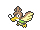
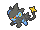
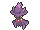
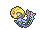
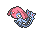
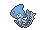

<!-- This file is generated by tools/generate_site.py. Edit the generator, not this file. -->

# Type changes

| # | Pokémon | Vanilla type | RR/SS type |
| --- | --- | --- | --- |
| 083 | { .icon loading=lazy } [Farfetch’d](../pokemon/083.md) | Normal Flying | Fighting Flying |
| 164 | { .icon loading=lazy } [Noctowl](../pokemon/164.md) | Normal Flying | Psychic Flying |
| 200 | { .icon loading=lazy } [Misdreavus](../pokemon/200.md) | Ghost | Ghost Fairy |
| 206 | { .icon loading=lazy } [Dunsparce](../pokemon/206.md) | Normal | Normal Fairy |
| 284 | { .icon loading=lazy } [Masquerain](../pokemon/284.md) | Bug Flying | Bug Water |
| 313 | { .icon loading=lazy } [Volbeat](../pokemon/313.md) | Bug | Bug Fairy |
| 314 | { .icon loading=lazy } [Illumise](../pokemon/314.md) | Bug | Bug Fairy |
| 370 | { .icon loading=lazy } [Luvdisc](../pokemon/370.md) | Water | Water Fairy |
| 405 | { .icon loading=lazy } [Luxray](../pokemon/405.md) | Electric | Electric Dark |
| 429 | { .icon loading=lazy } [Mismagius](../pokemon/429.md) | Ghost | Ghost Fairy |
| 466 | { .icon loading=lazy } [Electivire](../pokemon/466.md) | Electric | Electric Fighting |
| 480 | { .icon loading=lazy } [Uxie](../pokemon/480.md) | Psychic | Psychic Fairy |
| 481 | { .icon loading=lazy } [Mesprit](../pokemon/481.md) | Psychic | Psychic Fairy |
| 482 | { .icon loading=lazy } [Azelf](../pokemon/482.md) | Psychic | Psychic Fairy |
| 497 | { .icon loading=lazy } [Serperior](../pokemon/497.md) | Grass | Grass Dragon |
| 502 | { .icon loading=lazy } [Dewott](../pokemon/502.md) | Water | Water Fighting |
| 503 | { .icon loading=lazy } [Samurott](../pokemon/503.md) | Water | Water Fighting |
| 614 | { .icon loading=lazy } [Beartic](../pokemon/614.md) | Ice | Ice Fighting |
