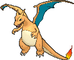
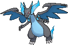
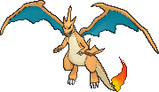

<!-- This file is generated by tools/generate_site.py. Edit the generator, not this file. -->

# #006 Charizard

{ .sprite-lg loading=lazy }

**Flame Pokémon**

Fire Flying

[:material-arrow-left: #005 Charmeleon](005.md) · [Pokédex](index.md) · [#007 Squirtle :material-arrow-right:](007.md)

!!! info "Changes in Rising Ruby / Sinking Sapphire"

    - **Ability 2:** **Tough Claws** &#42;&#42;

## Location

Evolve { .icon loading=lazy } [Charmeleon](../pokemon/005.md) (Lv. 36)

## Type defenses

| Damage taken | Attacking types |
| --- | --- |
| Immune (×0) | Ground |
| Very resistant (×¼) | Bug Grass |
| Resistant (×½) | Fighting Steel Fire Fairy |
| Neutral (×1) | Normal Flying Poison Ghost Psychic Ice Dragon Dark |
| Weak (×2) | Water Electric |
| Very weak (×4) | Rock |

## Abilities

| Slot | Ability | Effect | Note |
| --- | --- | --- | --- |
| Ability 1 | **Blaze** | Strengthens Fire moves to inflict 1.5× damage at 1/3 max HP or less. |  |
| Ability 2 | **Tough Claws** | Strengthens moves that make contact to 1.33× their power. | changed &#42;&#42; |
| Hidden | **Solar Power** | Increases Special Attack to 1.5× but costs 1/8 max HP after each turn during strong sunlight. |  |

## Base stats

| Form | HP | Atk | Def | SpA | SpD | Spe | BST |
| --- | --- | --- | --- | --- | --- | --- | --- |
| { .sprite-sm loading=lazy } Normal | 78 | 84 | 78 | 109 | 85 | 100 | **534** |
| { .sprite-sm loading=lazy } Mega Charizard X | 78 | 130 | 111 | 130 | 85 | 100 | **634** |
| { .sprite-sm loading=lazy } Mega Charizard Y | 78 | 104 | 78 | 159 | 115 | 100 | **634** |

## Training & breeding

| Property | Value |
| --- | --- |
| EV yield | 3 SpA |
| Catch rate | 45 |
| Base friendship | 70 |
| Base experience | 240 |
| Growth rate | medium slow |
| Egg groups | Monster, Dragon |
| Hatch counter | 20 |
| Gender ratio | 87.5% ♂ / 12.5% ♀ |
| Height / weight | 1.7 m / 90.5 kg |

## Evolution

- { .icon loading=lazy } [Charmander](../pokemon/004.md) → { .icon loading=lazy } [Charmeleon](../pokemon/005.md): Lv. 16
- { .icon loading=lazy } [Charmeleon](../pokemon/005.md) → { .icon loading=lazy } **[Charizard](../pokemon/006.md)**: Lv. 36
- { .sprite-sm loading=lazy } **Mega Charizard X**: Mega Evolves by holding the { .item loading=lazy } Charizardite X
- { .sprite-sm loading=lazy } **Mega Charizard Y**: Mega Evolves by holding the { .item loading=lazy } Charizardite Y

## Wild held items

None.

## Level-up moves { data-search-exclude }

Moves marked &#42; are not normally learned by level up (they come from egg moves, TMs/HMs or tutors in the official games); moves marked &#42;&#42; cannot normally be learned by this Pokémon at all and are omitted from the legal-moves version of the hack.

| Lv. | Move | Type | Cat. | Power | Acc. | PP | Effect | Note |
| --- | --- | --- | --- | --- | --- | --- | --- | --- |
| 1 | Flare Blitz | Fire | Physical | 120 | 100% | 15 | User takes 1/3 the damage inflicted in recoil.  Has a chance to burn the target. |  |
| 1 | Dragon Claw | Dragon | Physical | 80 | 100% | 15 | Inflicts regular damage with no additional effect. |  |
| 1 | Shadow Claw | Ghost | Physical | 70 | 100% | 15 | Has an increased chance for a critical hit. |  |
| 1 | Air Slash | Flying | Special | 75 | 95% | 15 | Has a chance to make the target flinch. |  |
| 1 | [Scratch](../changes/moves.md#scratch) changed | Normal | Physical | 50 | 100% | 35 | Inflicts regular damage with no additional effect. |  |
| 3 | Growl | Normal | Status | — | 100% | 40 | Lowers the target’s Attack by one stage. |  |
| 5 | Smokescreen | Normal | Status | — | 100% | 20 | Lowers the target’s accuracy by one stage. |  |
| 7 | Ember | Fire | Special | 40 | 100% | 25 | Has a chance to burn the target. |  |
| 9 | Metal Claw | Steel | Physical | 50 | 95% | 35 | Has a chance to raise the user’s Attack by one stage. | &#42; |
| 11 | Bite | Dark | Physical | 60 | 100% | 25 | Has a chance to make the target flinch. | &#42; |
| 13 | Dragon Rage | Dragon | Special | — | 100% | 10 | Inflicts 40 points of damage. |  |
| 17 | Flame Burst | Fire | Special | 70 | 100% | 15 | Deals splash damage to Pokémon next to the target. |  |
| 20 | Scary Face | Normal | Status | — | 100% | 10 | Lowers the target’s Speed by two stages. |  |
| 24 | Fire Fang | Fire | Physical | 65 | 95% | 15 | Has a chance to burn the target and a chance to make the target flinch. |  |
| 28 | Slash | Normal | Physical | 70 | 100% | 20 | Has an increased chance for a critical hit. |  |
| 32 | Dragon Pulse | Dragon | Special | 85 | 100% | 10 | Inflicts regular damage with no additional effect. | &#42; |
| 36 | Wing Attack | Flying | Physical | 60 | 100% | 35 | Inflicts regular damage with no additional effect. |  |
| 37 | Flamethrower | Fire | Special | 90 | 100% | 15 | Has a chance to burn the target. |  |
| 42 | Crunch | Dark | Physical | 80 | 100% | 15 | Has a chance to lower the target’s Defense by one stage. | &#42; |
| 47 | Fire Spin | Fire | Special | 35 | 85% | 15 | Prevents the target from fleeing and inflicts damage for 2-5 turns. |  |
| 52 | Dragon Dance | Dragon | Status | — | — | 20 | Raises the user’s Attack and Speed by one stage. | &#42; |
| 57 | Outrage | Dragon | Physical | 120 | 100% | 10 | Hits every turn for 2-3 turns, then confuses the user. | &#42; |
| 62 | Inferno | Fire | Special | 100 | 50% | 5 | Has a chance to burn the target. |  |
| 67 | Heat Wave | Fire | Special | 95 | 90% | 10 | Has a chance to burn the target. |  |
| 72 | Flare Blitz | Fire | Physical | 120 | 100% | 15 | User takes 1/3 the damage inflicted in recoil.  Has a chance to burn the target. |  |

## TM & HM moves { data-search-exclude }

| Machine | Move | Type | Cat. | Power | Acc. | PP | Effect |
| --- | --- | --- | --- | --- | --- | --- | --- |
| HM01 | [Cut](../changes/moves.md#cut) changed | Grass | Physical | 70 | 100% | 15 | High Critical Rate. High Critical Rate |
| HM02 | [Fly](../changes/moves.md#fly) changed | Flying | Physical | 100 | 100% | 10 | User flies high into the air, dodging all attacks, and hits next turn. |
| HM04 | [Strength](../changes/moves.md#strength) changed | Normal | Physical | 100 | 100% | 10 | Inflicts regular damage with no additional effect. |
| HM06 | [Rock Smash](../changes/moves.md#rock-smash) changed | Fighting | Physical | 65 | 100% | 15 | Has a chance to lower the target’s Defense by one stage. |
| TM01 | Hone Claws | Dark | Status | — | — | 15 | Raises the user’s Attack and accuracy by one stage. |
| TM02 | Dragon Claw | Dragon | Physical | 80 | 100% | 15 | Inflicts regular damage with no additional effect. |
| TM05 | Roar | Normal | Status | — | — | 20 | Immediately ends wild battles.  Forces trainers to switch Pokémon. |
| TM06 | Toxic | Poison | Status | — | 90% | 10 | Badly poisons the target, inflicting more damage every turn. |
| TM10 | Hidden Power | Normal | Special | 60 | 100% | 15 | Power and type depend upon user’s IVs.  Power can range from 30 to 70. |
| TM100 | Confide | Normal | Status | — | — | 20 | Lowers the target’s Special Attack by one stage. |
| TM11 | Sunny Day | Fire | Status | — | — | 5 | Changes the weather to sunny for five turns. |
| TM15 | Hyper Beam | Normal | Special | 150 | 90% | 5 | User foregoes its next turn to recharge. |
| TM17 | Protect | Normal | Status | — | — | 10 | Prevents any moves from hitting the user this turn. |
| TM19 | Roost | Flying | Status | — | — | 5 | Heals the user by half its max HP. |
| TM21 | Frustration | Normal | Physical | — | 100% | 20 | Power increases as happiness decreases, up to a maximum of 102. |
| TM22 | Solar Beam | Grass | Special | 120 | 100% | 10 | Requires a turn to charge before attacking. |
| TM26 | Earthquake | Ground | Physical | 100 | 100% | 10 | Inflicts regular damage and can hit Dig users. |
| TM27 | Return | Normal | Physical | — | 100% | 20 | Power increases with happiness, up to a maximum of 102. |
| TM28 | Dig | Ground | Physical | 80 | 100% | 10 | User digs underground, dodging all attacks, and hits next turn. |
| TM31 | Brick Break | Fighting | Physical | 75 | 100% | 15 | Destroys Reflect and Light Screen. |
| TM32 | Double Team | Normal | Status | — | — | 15 | Raises the user’s evasion by one stage. |
| TM35 | Flamethrower | Fire | Special | 90 | 100% | 15 | Has a chance to burn the target. |
| TM38 | Fire Blast | Fire | Special | 110 | 85% | 5 | Has a chance to burn the target. |
| TM39 | Rock Tomb | Rock | Physical | 60 | 95% | 15 | Has a chance to lower the target’s Speed by one stage. |
| TM40 | Aerial Ace | Flying | Physical | 60 | — | 20 | Never misses. |
| TM42 | Facade | Normal | Physical | 70 | 100% | 20 | Power doubles if user is burned, paralyzed, or poisoned. |
| TM43 | Flame Charge | Fire | Physical | 50 | 100% | 20 | Inflicts regular damage.  Raises the user’s Speed by one stage. |
| TM44 | Rest | Psychic | Status | — | — | 5 | User sleeps for two turns, completely healing itself. |
| TM45 | Attract | Normal | Status | — | 100% | 15 | Target falls in love if it has the opposite gender, and has a 50% chance to refuse attacking the user. |
| TM48 | Round | Normal | Special | 60 | 100% | 15 | Has double power if it’s used more than once per turn. |
| TM49 | Echoed Voice | Normal | Special | 40 | 100% | 15 | Power increases by 100% for each consecutive use by any friendly Pokémon, to a maximum of 200. |
| TM50 | Overheat | Fire | Special | 130 | 90% | 5 | Lowers the user’s Special Attack by two stages after inflicting damage. |
| TM51 | Steel Wing | Steel | Physical | 70 | 90% | 25 | Has a chance to raise the user’s Defense by one stage. |
| TM52 | Focus Blast | Fighting | Special | 120 | 70% | 5 | Has a chance to lower the target’s Special Defense by one stage. |
| TM56 | Fling | Dark | Physical | — | 100% | 10 | Throws held item at the target; power depends on the item. |
| TM58 | Sky Drop | Flying | Physical | 60 | 100% | 10 | Carries the target high into the air, dodging all attacks against either, and drops it next turn. |
| TM59 | Incinerate | Fire | Special | 60 | 100% | 15 | Destroys the target’s held berry. |
| TM61 | Will-O-Wisp | Fire | Status | — | 85% | 15 | Burns the target. |
| TM65 | Shadow Claw | Ghost | Physical | 70 | 100% | 15 | Has an increased chance for a critical hit. |
| TM68 | Giga Impact | Normal | Physical | 150 | 90% | 5 | User foregoes its next turn to recharge. |
| TM75 | Swords Dance | Normal | Status | — | — | 20 | Raises the user’s Attack by two stages. |
| TM78 | Bulldoze | Ground | Physical | 60 | 100% | 20 | Has a chance to lower the target’s Speed by one stage. |
| TM80 | Rock Slide | Rock | Physical | 75 | 90% | 10 | Has a chance to make the target flinch. |
| TM82 | Dragon Tail | Dragon | Physical | 60 | 90% | 10 | Ends wild battles.  Forces trainers to switch Pokémon. |
| TM87 | Swagger | Normal | Status | — | 90% | 15 | Raises the target’s Attack by two stages and confuses the target. |
| TM88 | Sleep Talk | Normal | Status | — | — | 10 | Randomly uses one of the user’s other three moves.  Only works if the user is sleeping. |
| TM90 | Substitute | Normal | Status | — | — | 10 | Transfers 1/4 of the user’s max HP into a doll, protecting the user from further damage or status changes until it breaks. |
| TM94 | Secret Power | Normal | Physical | 70 | 100% | 20 | Has a chance to inflict a status effect which depends upon the terrain. |
| TM98 | Power-Up Punch | Fighting | Physical | 40 | 100% | 20 | Raises the user’s Attack by one stage after inflicting damage. |

## Move tutor moves { data-search-exclude }

| Move | Type | Cat. | Power | Acc. | PP | Effect |
| --- | --- | --- | --- | --- | --- | --- |
| Blast Burn | Fire | Special | 150 | 90% | 5 | User foregoes its next turn to recharge. |
| Dragon Pulse | Dragon | Special | 85 | 100% | 10 | Inflicts regular damage with no additional effect. |
| [Fire Pledge](../changes/moves.md#fire-pledge) changed | Fire | Special | 85 | 100% | 10 | With Water Pledge, doubles the effect chance of friendly Pokémon’s moves for four turns. |
| Fire Punch | Fire | Physical | 75 | 100% | 15 | Has a chance to burn the target. |
| Focus Punch | Fighting | Physical | 150 | 100% | 20 | If the user takes damage before attacking, the attack is canceled. |
| Heat Wave | Fire | Special | 95 | 90% | 10 | Has a chance to burn the target. |
| Iron Tail | Steel | Physical | 100 | 75% | 15 | Has a chance to lower the target’s Defense by one stage. |
| Outrage | Dragon | Physical | 120 | 100% | 10 | Hits every turn for 2-3 turns, then confuses the user. |
| Snore | Normal | Special | 50 | 100% | 15 | Has a chance to make the target flinch.  Only works if the user is sleeping. |
| Tailwind | Flying | Status | — | — | 15 | For three turns, friendly Pokémon have doubled Speed. |
| Thunder Punch | Electric | Physical | 75 | 100% | 15 | Has a chance to paralyze the target. |

## Egg moves { data-search-exclude }

No egg moves.

??? note "Trainers using Charizard (8)"

    | Area | Trainer | Level |
    | --- | --- | --- |
    | [Southern Island](../trainers/southern_island.md#trainers) | Magma Admin Courtney | Lv. 44 |
    | [Mt. Pyre Summit 2](../trainers/mt_pyre_summit_2.md#trainers) | Magma Admin Courtney | Lv. 55 |
    | [Magma Hideout](../trainers/magma_hideout.md#trainers) | Magma Admin Courtney | Lv. 57 |
    | [Route 125](../trainers/route_125.md#trainers) | Teammates Kim & Iris | Lv. 57 |
    | [Victory Road B1F](../trainers/victory_road_b1f.md#trainers) | Dragon Tamer Egon | Lv. 65 |
    | [Petalburg City (Post Game)](../trainers/petalburg_city_post_game.md#trainers) | Magma Admin Courtney | Lv. 77 |
    | [Mossdeep City (Post Game)](../trainers/mossdeep_city_post_game.md#trainers) | Magma Admin Courtney | Lv. 79 |
    | [Battle Resort](../trainers/battle_resort.md#trainers) | Dragon Tamer Antonin [Lance] | Lv. 86 |

---

[:material-arrow-left: #005 Charmeleon](005.md) · [#007 Squirtle :material-arrow-right:](007.md)
