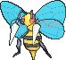
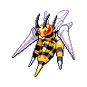

<!-- This file is generated by tools/generate_site.py. Edit the generator, not this file. -->

# #015 Beedrill

{ .sprite-lg loading=lazy }

**Poison Bee Pokémon**

Bug Poison

[:material-arrow-left: #014 Kakuna](014.md) · [Pokédex](index.md) · [#016 Pidgey :material-arrow-right:](016.md)

!!! info "Changes in Rising Ruby / Sinking Sapphire"

    - **Ability 2:** **Sniper** 
    - **Base stats:** Atk 90 → **115**, SpA 45 → **25**, SpD 80 → **105**, Spe 75 → **100** (BST 395 → **450**)
    - **Base stats (Mega Beedrill):** Def 40 → **50**, SpA 15 → **30**, SpD 80 → **110** (BST 495 → **550**)
    - **New TM/HM compatibility:** [Fly](../changes/moves.md#fly) changed

## Location

[Route 101](../wild/route_101.md)

### Wild encounters

| Area | Method | Level | Note |
| --- | --- | --- | --- |
| [Safari Zone (1)](../wild/safari_zone_1.md) | Grass | 45 |  |

## Type defenses

| Damage taken | Attacking types |
| --- | --- |
| Very resistant (×¼) | Fighting Grass |
| Resistant (×½) | Poison Bug Fairy |
| Neutral (×1) | Normal Ground Ghost Steel Water Electric Ice Dragon Dark |
| Weak (×2) | Flying Rock Fire Psychic |

## Abilities

| Slot | Ability | Effect | Note |
| --- | --- | --- | --- |
| Ability 1 | **Swarm** | Strengthens Bug moves to inflict 1.5× damage at 1/3 max HP or less. |  |
| Ability 2 | **Sniper** | Strengthens critical hits to inflict 3× damage rather than 2×. | changed  |
| Hidden | **Sniper** | Strengthens critical hits to inflict 3× damage rather than 2×. |  |

## Base stats

| Form | HP | Atk | Def | SpA | SpD | Spe | BST |
| --- | --- | --- | --- | --- | --- | --- | --- |
| { .sprite-sm loading=lazy } Normal | 65 | 115<small class="was">was 90</small> | 40 | 25<small class="was">was 45</small> | 105<small class="was">was 80</small> | 100<small class="was">was 75</small> | 450<small class="was">was 395</small> |
| { .sprite-sm loading=lazy } Mega Beedrill | 65 | 150 | 50<small class="was">was 40</small> | 30<small class="was">was 15</small> | 110<small class="was">was 80</small> | 145 | 550<small class="was">was 495</small> |

## Training & breeding

| Property | Value |
| --- | --- |
| EV yield | 2 Atk, 1 SpD |
| Catch rate | 45 |
| Base friendship | 70 |
| Base experience | 178 |
| Growth rate | medium |
| Egg groups | Bug |
| Hatch counter | 15 |
| Gender ratio | 50% ♂ / 50% ♀ |
| Height / weight | 1 m / 29.5 kg |

## Evolution

- { .icon loading=lazy } [Weedle](../pokemon/013.md) → { .icon loading=lazy } [Kakuna](../pokemon/014.md): Lv. 7
- { .icon loading=lazy } [Kakuna](../pokemon/014.md) → { .icon loading=lazy } **[Beedrill](../pokemon/015.md)**: Lv. 10
- { .sprite-sm loading=lazy } **Mega Beedrill**: Mega Evolves by holding the { .item loading=lazy } Beedrillite

## Wild held items

| Item | Chance | Note |
| --- | --- | --- |
| { .item loading=lazy } Poison Barb | 5% |  |

## Level-up moves { data-search-exclude }

Moves marked &#42; are not normally learned by level up (they come from egg moves, TMs/HMs or tutors in the official games); moves marked &#42;&#42; cannot normally be learned by this Pokémon at all and are omitted from the legal-moves version of the hack.

| Lv. | Move | Type | Cat. | Power | Acc. | PP | Effect | Note |
| --- | --- | --- | --- | --- | --- | --- | --- | --- |
| 1 | Fury Attack | Normal | Physical | 15 | 85% | 20 | Hits 2-5 times in one turn. |  |
| 10 | Fury Attack | Normal | Physical | 15 | 85% | 20 | Hits 2-5 times in one turn. |  |
| 10 | Twineedle | Bug | Physical | 25 | 100% | 20 | Hits twice in the same turn.  Has a chance to poison the target. |  |
| 12 | Focus Energy | Normal | Status | — | — | 30 | Increases the user’s chance to score a critical hit. |  |
| 14 | Cross Poison | Poison | Physical | 70 | 100% | 20 | Has an increased chance for a critical hit and a chance to poison the target. | &#42;&#42; |
| 16 | Pursuit | Dark | Physical | 40 | 100% | 20 | Has double power against, and can hit, Pokémon attempting to switch out. |  |
| 18 | Toxic Spikes | Poison | Status | — | — | 20 | Scatters poisoned spikes, poisoning opposing Pokémon that switch in. |  |
| 20 | Pin Missile | Bug | Physical | 25 | 95% | 20 | Hits 2-5 times in one turn. |  |
| 22 | Poison Jab | Poison | Physical | 80 | 100% | 20 | Has a chance to poison the target. |  |
| 24 | X-Scissor | Bug | Physical | 80 | 100% | 15 | Inflicts regular damage with no additional effect. | &#42; |
| 26 | Agility | Psychic | Status | — | — | 30 | Raises the user’s Speed by two stages. |  |
| 28 | Assurance | Dark | Physical | 60 | 100% | 10 | Power is doubled if the target has already received damage this turn. |  |
| 30 | Endeavor | Normal | Physical | — | 100% | 5 | Lowers the target’s HP to equal the user’s. |  |
| 32 | Fell Stinger | Bug | Physical | 30 | 100% | 25 | Raises the user’s Attack by two stages if it KOs the target. |  |
| 34 | Drill Run | Ground | Physical | 80 | 95% | 10 | Has an increased chance for a critical hit. | &#42; |
| 36 | Acrobatics | Flying | Physical | 55 | 100% | 15 | Has double power if the user has no held item. | &#42; |
| 38 | Payback | Dark | Physical | 50 | 100% | 10 | Power is doubled if the target has already moved this turn. | &#42; |
| 40 | Brick Break | Fighting | Physical | 75 | 100% | 15 | Destroys Reflect and Light Screen. | &#42; |
| 42 | Megahorn | Bug | Physical | 120 | 85% | 10 | Inflicts regular damage with no additional effect. | &#42;&#42; |

## TM & HM moves { data-search-exclude }

| Machine | Move | Type | Cat. | Power | Acc. | PP | Effect |
| --- | --- | --- | --- | --- | --- | --- | --- |
| HM01 | [Cut](../changes/moves.md#cut) changed | Grass | Physical | 70 | 100% | 15 | High Critical Rate. High Critical Rate |
| HM02 new | [Fly](../changes/moves.md#fly) changed | Flying | Physical | 100 | 100% | 10 | User flies high into the air, dodging all attacks, and hits next turn. |
| HM06 | [Rock Smash](../changes/moves.md#rock-smash) changed | Fighting | Physical | 65 | 100% | 15 | Has a chance to lower the target’s Defense by one stage. |
| TM06 | Toxic | Poison | Status | — | 90% | 10 | Badly poisons the target, inflicting more damage every turn. |
| TM09 | Venoshock | Poison | Special | 65 | 100% | 10 | Inflicts double damage if the target is Poisoned. |
| TM10 | Hidden Power | Normal | Special | 60 | 100% | 15 | Power and type depend upon user’s IVs.  Power can range from 30 to 70. |
| TM100 | Confide | Normal | Status | — | — | 20 | Lowers the target’s Special Attack by one stage. |
| TM11 | Sunny Day | Fire | Status | — | — | 5 | Changes the weather to sunny for five turns. |
| TM15 | Hyper Beam | Normal | Special | 150 | 90% | 5 | User foregoes its next turn to recharge. |
| TM17 | Protect | Normal | Status | — | — | 10 | Prevents any moves from hitting the user this turn. |
| TM19 | Roost | Flying | Status | — | — | 5 | Heals the user by half its max HP. |
| TM21 | Frustration | Normal | Physical | — | 100% | 20 | Power increases as happiness decreases, up to a maximum of 102. |
| TM22 | Solar Beam | Grass | Special | 120 | 100% | 10 | Requires a turn to charge before attacking. |
| TM27 | Return | Normal | Physical | — | 100% | 20 | Power increases with happiness, up to a maximum of 102. |
| TM31 | Brick Break | Fighting | Physical | 75 | 100% | 15 | Destroys Reflect and Light Screen. |
| TM32 | Double Team | Normal | Status | — | — | 15 | Raises the user’s evasion by one stage. |
| TM36 | Sludge Bomb | Poison | Special | 90 | 100% | 10 | Has a chance to poison the target. |
| TM40 | Aerial Ace | Flying | Physical | 60 | — | 20 | Never misses. |
| TM42 | Facade | Normal | Physical | 70 | 100% | 20 | Power doubles if user is burned, paralyzed, or poisoned. |
| TM44 | Rest | Psychic | Status | — | — | 5 | User sleeps for two turns, completely healing itself. |
| TM45 | Attract | Normal | Status | — | 100% | 15 | Target falls in love if it has the opposite gender, and has a 50% chance to refuse attacking the user. |
| TM46 | Thief | Dark | Physical | 60 | 100% | 25 | Takes the target’s item. |
| TM48 | Round | Normal | Special | 60 | 100% | 15 | Has double power if it’s used more than once per turn. |
| TM54 | False Swipe | Normal | Physical | 40 | 100% | 40 | Cannot lower the target’s HP below 1. |
| TM62 | Acrobatics | Flying | Physical | 55 | 100% | 15 | Has double power if the user has no held item. |
| TM66 | Payback | Dark | Physical | 50 | 100% | 10 | Power is doubled if the target has already moved this turn. |
| TM68 | Giga Impact | Normal | Physical | 150 | 90% | 5 | User foregoes its next turn to recharge. |
| TM70 | Flash | Normal | Status | — | 100% | 20 | Lowers the target’s accuracy by one stage. |
| TM75 | Swords Dance | Normal | Status | — | — | 20 | Raises the user’s Attack by two stages. |
| TM76 | Struggle Bug | Bug | Special | 50 | 100% | 20 | Has a chance to lower the target’s Special Attack by one stage. |
| TM81 | X-Scissor | Bug | Physical | 80 | 100% | 15 | Inflicts regular damage with no additional effect. |
| TM83 | Infestation | Bug | Special | 20 | 100% | 20 | Prevents the target from fleeing and inflicts damage for 2-5 turns. |
| TM84 | Poison Jab | Poison | Physical | 80 | 100% | 20 | Has a chance to poison the target. |
| TM87 | Swagger | Normal | Status | — | 90% | 15 | Raises the target’s Attack by two stages and confuses the target. |
| TM88 | Sleep Talk | Normal | Status | — | — | 10 | Randomly uses one of the user’s other three moves.  Only works if the user is sleeping. |
| TM89 | U-turn | Bug | Physical | 70 | 100% | 20 | User must switch out after attacking. |
| TM90 | Substitute | Normal | Status | — | — | 10 | Transfers 1/4 of the user’s max HP into a doll, protecting the user from further damage or status changes until it breaks. |
| TM94 | Secret Power | Normal | Physical | 70 | 100% | 20 | Has a chance to inflict a status effect which depends upon the terrain. |

## Move tutor moves { data-search-exclude }

| Move | Type | Cat. | Power | Acc. | PP | Effect |
| --- | --- | --- | --- | --- | --- | --- |
| Bug Bite | Bug | Physical | 60 | 100% | 20 | If target has a berry, inflicts double damage and uses the berry. |
| Drill Run | Ground | Physical | 80 | 95% | 10 | Has an increased chance for a critical hit. |
| Electroweb | Electric | Special | 55 | 95% | 15 | Lowers the target’s Speed by one stage. |
| Endeavor | Normal | Physical | — | 100% | 5 | Lowers the target’s HP to equal the user’s. |
| Giga Drain | Grass | Special | 75 | 100% | 10 | Drains half the damage inflicted to heal the user. |
| Knock Off | Dark | Physical | 65 | 100% | 20 | Target drops its held item. |
| Snore | Normal | Special | 50 | 100% | 15 | Has a chance to make the target flinch.  Only works if the user is sleeping. |
| Tailwind | Flying | Status | — | — | 15 | For three turns, friendly Pokémon have doubled Speed. |

## Egg moves { data-search-exclude }

No egg moves.

??? note "Trainers using Beedrill (2)"

    | Area | Trainer | Level |
    | --- | --- | --- |
    | [Route 119 (Mauville)](../trainers/route_119_mauville.md#trainers) | Bug Catcher Greg | Lv. 39 |
    | [Victory Road 1F](../trainers/victory_road_1f.md#trainers) | Street Thug Regan | Lv. 65 |

---

[:material-arrow-left: #014 Kakuna](014.md) · [#016 Pidgey :material-arrow-right:](016.md)
