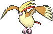
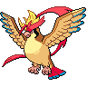

<!-- This file is generated by tools/generate_site.py. Edit the generator, not this file. -->

# #018 Pidgeot

{ .sprite-lg loading=lazy }

**Bird Pokémon**

Normal Flying

[:material-arrow-left: #017 Pidgeotto](017.md) · [Pokédex](index.md) · [#019 Rattata :material-arrow-right:](019.md)

!!! note "No documented changes"

    Drayano's documentation lists no stat, type, ability, evolution or held item changes for this Pokémon. Its level-up moves are listed below as they appear in the hack.

## Location

[Soaring in the Sky](../wild/soaring_in_the_sky.md)

### Wild encounters

| Area | Method | Level | Note |
| --- | --- | --- | --- |
| [Safari Zone (2)](../wild/safari_zone_2.md) | DexNav | 50 |  |
| [Soaring in the Sky](../wild/soaring_in_the_sky.md) | Birds | 60 |  |

## Type defenses

| Damage taken | Attacking types |
| --- | --- |
| Immune (×0) | Ground Ghost |
| Resistant (×½) | Bug Grass |
| Neutral (×1) | Normal Fighting Flying Poison Steel Fire Water Psychic Dragon Dark Fairy |
| Weak (×2) | Rock Electric Ice |

## Abilities

| Slot | Ability | Effect | Note |
| --- | --- | --- | --- |
| Ability 1 | **Keen Eye** | Prevents accuracy from being lowered. |  |
| Ability 2 | **Tangled Feet** | Doubles evasion when confused. |  |
| Hidden | **Big Pecks** | Protects against Defense drops. |  |

## Base stats

| Form | HP | Atk | Def | SpA | SpD | Spe | BST |
| --- | --- | --- | --- | --- | --- | --- | --- |
| { .sprite-sm loading=lazy } Normal | 83 | 80 | 75 | 70 | 70 | 101 | **479** |
| { .sprite-sm loading=lazy } Mega Pidgeot | 83 | 80 | 80 | 135 | 80 | 121 | **579** |

## Training & breeding

| Property | Value |
| --- | --- |
| EV yield | 3 Spe |
| Catch rate | 45 |
| Base friendship | 70 |
| Base experience | 216 |
| Growth rate | medium slow |
| Egg groups | Flying |
| Hatch counter | 15 |
| Gender ratio | 50% ♂ / 50% ♀ |
| Height / weight | 1.5 m / 39.5 kg |

## Evolution

- { .icon loading=lazy } [Pidgey](../pokemon/016.md) → { .icon loading=lazy } [Pidgeotto](../pokemon/017.md): Lv. 18
- { .icon loading=lazy } [Pidgeotto](../pokemon/017.md) → { .icon loading=lazy } **[Pidgeot](../pokemon/018.md)**: Lv. 36
- { .sprite-sm loading=lazy } **Mega Pidgeot**: Mega Evolves by holding the { .item loading=lazy } Pidgeotite

## Wild held items

None.

## Level-up moves { data-search-exclude }

Moves marked &#42; are not normally learned by level up (they come from egg moves, TMs/HMs or tutors in the official games); moves marked &#42;&#42; cannot normally be learned by this Pokémon at all and are omitted from the legal-moves version of the hack.

| Lv. | Move | Type | Cat. | Power | Acc. | PP | Effect | Note |
| --- | --- | --- | --- | --- | --- | --- | --- | --- |
| 1 | Hurricane | Flying | Special | 110 | 70% | 10 | Has a chance to confuse the target. |  |
| 1 | Heat Wave | Fire | Special | 95 | 90% | 10 | Has a chance to burn the target. | &#42; |
| 1 | Ominous Wind | Ghost | Special | 60 | 100% | 5 | Has a chance to raise all of the user’s stats by one stage. | &#42; |
| 1 | Tackle | Normal | Physical | 50 | 100% | 35 | Inflicts regular damage with no additional effect. |  |
| 1 | Sand Attack | Ground | Status | — | 100% | 15 | Lowers the target’s accuracy by one stage. |  |
| 4 | Gust | Flying | Special | 40 | 100% | 35 | Inflicts regular damage and can hit Pokémon in the air. |  |
| 7 | Quick Attack | Normal | Physical | 40 | 100% | 30 | Inflicts regular damage with no additional effect. |  |
| 10 | Uproar | Normal | Special | 90 | 100% | 10 | Forced to use this move for several turns.  Pokémon cannot fall asleep in that time. | &#42; |
| 13 | Wing Attack | Flying | Physical | 60 | 100% | 35 | Inflicts regular damage with no additional effect. |  |
| 16 | Twister | Dragon | Special | 40 | 100% | 20 | Has a chance to make the target flinch. |  |
| 20 | Whirlwind | Normal | Status | — | — | 20 | Immediately ends wild battles.  Forces trainers to switch Pokémon. |  |
| 24 | Feather Dance | Flying | Status | — | 100% | 15 | Lowers the target’s Attack by two stages. |  |
| 28 | Air Slash | Flying | Special | 75 | 95% | 15 | Has a chance to make the target flinch. |  |
| 32 | Roost | Flying | Status | — | — | 5 | Heals the user by half its max HP. |  |
| 37 | Tailwind | Flying | Status | — | — | 15 | For three turns, friendly Pokémon have doubled Speed. |  |
| 42 | Double-Edge | Normal | Physical | 120 | 100% | 15 | User receives 1/3 the damage inflicted in recoil. | &#42; |
| 47 | Agility | Psychic | Status | — | — | 30 | Raises the user’s Speed by two stages. |  |
| 52 | Mirror Move | Flying | Status | — | — | 20 | Uses the target’s last used move. |  |
| 57 | Brave Bird | Flying | Physical | 120 | 100% | 15 | User receives 1/3 the damage inflicted in recoil. | &#42; |
| 62 | Hurricane | Flying | Special | 110 | 70% | 10 | Has a chance to confuse the target. |  |
| 67 | Hyper Beam | Normal | Special | 150 | 90% | 5 | User foregoes its next turn to recharge. | &#42; |

## TM & HM moves { data-search-exclude }

| Machine | Move | Type | Cat. | Power | Acc. | PP | Effect |
| --- | --- | --- | --- | --- | --- | --- | --- |
| HM02 | [Fly](../changes/moves.md#fly) changed | Flying | Physical | 100 | 100% | 10 | User flies high into the air, dodging all attacks, and hits next turn. |
| TM06 | Toxic | Poison | Status | — | 90% | 10 | Badly poisons the target, inflicting more damage every turn. |
| TM10 | Hidden Power | Normal | Special | 60 | 100% | 15 | Power and type depend upon user’s IVs.  Power can range from 30 to 70. |
| TM100 | Confide | Normal | Status | — | — | 20 | Lowers the target’s Special Attack by one stage. |
| TM11 | Sunny Day | Fire | Status | — | — | 5 | Changes the weather to sunny for five turns. |
| TM15 | Hyper Beam | Normal | Special | 150 | 90% | 5 | User foregoes its next turn to recharge. |
| TM17 | Protect | Normal | Status | — | — | 10 | Prevents any moves from hitting the user this turn. |
| TM18 | Rain Dance | Water | Status | — | — | 5 | Changes the weather to rain for five turns. |
| TM19 | Roost | Flying | Status | — | — | 5 | Heals the user by half its max HP. |
| TM21 | Frustration | Normal | Physical | — | 100% | 20 | Power increases as happiness decreases, up to a maximum of 102. |
| TM27 | Return | Normal | Physical | — | 100% | 20 | Power increases with happiness, up to a maximum of 102. |
| TM32 | Double Team | Normal | Status | — | — | 15 | Raises the user’s evasion by one stage. |
| TM40 | Aerial Ace | Flying | Physical | 60 | — | 20 | Never misses. |
| TM42 | Facade | Normal | Physical | 70 | 100% | 20 | Power doubles if user is burned, paralyzed, or poisoned. |
| TM44 | Rest | Psychic | Status | — | — | 5 | User sleeps for two turns, completely healing itself. |
| TM45 | Attract | Normal | Status | — | 100% | 15 | Target falls in love if it has the opposite gender, and has a 50% chance to refuse attacking the user. |
| TM46 | Thief | Dark | Physical | 60 | 100% | 25 | Takes the target’s item. |
| TM48 | Round | Normal | Special | 60 | 100% | 15 | Has double power if it’s used more than once per turn. |
| TM51 | Steel Wing | Steel | Physical | 70 | 90% | 25 | Has a chance to raise the user’s Defense by one stage. |
| TM68 | Giga Impact | Normal | Physical | 150 | 90% | 5 | User foregoes its next turn to recharge. |
| TM87 | Swagger | Normal | Status | — | 90% | 15 | Raises the target’s Attack by two stages and confuses the target. |
| TM88 | Sleep Talk | Normal | Status | — | — | 10 | Randomly uses one of the user’s other three moves.  Only works if the user is sleeping. |
| TM89 | U-turn | Bug | Physical | 70 | 100% | 20 | User must switch out after attacking. |
| TM90 | Substitute | Normal | Status | — | — | 10 | Transfers 1/4 of the user’s max HP into a doll, protecting the user from further damage or status changes until it breaks. |
| TM94 | Secret Power | Normal | Physical | 70 | 100% | 20 | Has a chance to inflict a status effect which depends upon the terrain. |

## Move tutor moves { data-search-exclude }

| Move | Type | Cat. | Power | Acc. | PP | Effect |
| --- | --- | --- | --- | --- | --- | --- |
| Heat Wave | Fire | Special | 95 | 90% | 10 | Has a chance to burn the target. |
| Sky Attack | Flying | Physical | 140 | 90% | 5 | User charges for one turn before attacking.  Has a chance to make the target flinch. |
| Snore | Normal | Special | 50 | 100% | 15 | Has a chance to make the target flinch.  Only works if the user is sleeping. |
| Tailwind | Flying | Status | — | — | 15 | For three turns, friendly Pokémon have doubled Speed. |
| Uproar | Normal | Special | 90 | 100% | 10 | Forced to use this move for several turns.  Pokémon cannot fall asleep in that time. |

## Egg moves { data-search-exclude }

No egg moves.

??? note "Trainers using Pidgeot (6)"

    | Area | Trainer | Level |
    | --- | --- | --- |
    | [Route 120 (Fortree)](../trainers/route_120_fortree.md#trainers) | Bird Keeper Robert | Lv. 46 |
    | [Route 120 (Fortree)](../trainers/route_120_fortree.md#rematches) | Bird Keeper Robert (7) | Lv. 59 |
    | [Route 120 (Fortree)](../trainers/route_120_fortree.md#rematches) | Bird Keeper Robert (8) | Lv. 64 |
    | [Route 120 (Fortree)](../trainers/route_120_fortree.md#rematches) | Bird Keeper Robert (C) | Lv. 75 |
    | [Route 134](../trainers/route_134.md#trainers) | Bird Keeper Alex | Lv. 57 |
    | [Victory Road 1F](../trainers/victory_road_1f.md#trainers) | Ace Trainer Albert | Lv. 65 |

---

[:material-arrow-left: #017 Pidgeotto](017.md) · [#019 Rattata :material-arrow-right:](019.md)
