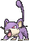

<!-- This file is generated by tools/generate_site.py. Edit the generator, not this file. -->

# #019 Rattata

{ .sprite-lg loading=lazy }

**Mouse Pokémon**

Normal

[:material-arrow-left: #018 Pidgeot](018.md) · [Pokédex](index.md) · [#020 Raticate :material-arrow-right:](020.md)

!!! note "No documented changes"

    Drayano's documentation lists no stat, type, ability, evolution or held item changes for this Pokémon. Its level-up moves are listed below as they appear in the hack.

## Location

[Route 101](../wild/route_101.md)

### Wild encounters

| Area | Method | Level | Note |
| --- | --- | --- | --- |
| [Route 101](../wild/route_101.md) | Grass | 5 |  |

## Type defenses

| Damage taken | Attacking types |
| --- | --- |
| Immune (×0) | Ghost |
| Neutral (×1) | Normal Flying Poison Ground Rock Bug Steel Fire Water Grass Electric Psychic Ice Dragon Dark Fairy |
| Weak (×2) | Fighting |

## Abilities

| Slot | Ability | Effect | Note |
| --- | --- | --- | --- |
| Ability 1 | **Run Away** | Ensures success fleeing from wild battles. |  |
| Ability 2 | **Guts** | Increases Attack to 1.5× with a major status ailment. |  |
| Hidden | **Hustle** | Strengthens physical moves to inflict 1.5× damage, but decreases their accuracy to 0.8×. |  |

## Base stats

| Form | HP | Atk | Def | SpA | SpD | Spe | BST |
| --- | --- | --- | --- | --- | --- | --- | --- |
| { .sprite-sm loading=lazy } Normal | 30 | 56 | 35 | 25 | 35 | 72 | **253** |

## Training & breeding

| Property | Value |
| --- | --- |
| EV yield | 1 Spe |
| Catch rate | 255 |
| Base friendship | 70 |
| Base experience | 51 |
| Growth rate | medium |
| Egg groups | Field |
| Hatch counter | 15 |
| Gender ratio | 50% ♂ / 50% ♀ |
| Height / weight | 0.3 m / 3.5 kg |

## Evolution

- { .icon loading=lazy } **[Rattata](../pokemon/019.md)** → { .icon loading=lazy } [Raticate](../pokemon/020.md): Lv. 20 / Lv. 20 during the night

## Wild held items

None.

## Level-up moves { data-search-exclude }

Moves marked &#42; are not normally learned by level up (they come from egg moves, TMs/HMs or tutors in the official games); moves marked &#42;&#42; cannot normally be learned by this Pokémon at all and are omitted from the legal-moves version of the hack.

| Lv. | Move | Type | Cat. | Power | Acc. | PP | Effect | Note |
| --- | --- | --- | --- | --- | --- | --- | --- | --- |
| 1 | Tackle | Normal | Physical | 50 | 100% | 35 | Inflicts regular damage with no additional effect. |  |
| 1 | Tail Whip | Normal | Status | — | 100% | 30 | Lowers the target’s Defense by one stage. |  |
| 4 | Quick Attack | Normal | Physical | 40 | 100% | 30 | Inflicts regular damage with no additional effect. |  |
| 7 | Focus Energy | Normal | Status | — | — | 30 | Increases the user’s chance to score a critical hit. |  |
| 10 | Bite | Dark | Physical | 60 | 100% | 25 | Has a chance to make the target flinch. |  |
| 13 | Hyper Fang | Normal | Physical | 80 | 90% | 15 | Has a chance to make the target flinch. |  |
| 16 | Flame Wheel | Fire | Physical | 60 | 100% | 25 | Has a chance to burn the target.  Lets frozen Pokémon thaw themselves. | &#42; |
| 19 | Pursuit | Dark | Physical | 40 | 100% | 20 | Has double power against, and can hit, Pokémon attempting to switch out. |  |
| 22 | Crunch | Dark | Physical | 80 | 100% | 15 | Has a chance to lower the target’s Defense by one stage. |  |
| 25 | Revenge | Fighting | Physical | 60 | 100% | 10 | Inflicts double damage if the user takes damage before attacking this turn. | &#42; |
| 28 | Sucker Punch | Dark | Physical | 80 | 100% | 5 | Only works if the target is about to use a damaging move. |  |
| 31 | Super Fang | Normal | Physical | — | 90% | 10 | Inflicts damage equal to half the target’s HP. |  |
| 34 | Assurance | Dark | Physical | 60 | 100% | 10 | Power is doubled if the target has already received damage this turn. |  |
| 37 | Reversal | Fighting | Physical | — | 100% | 15 | Inflicts more damage when the user has less HP remaining, with a maximum of 200 power. | &#42; |
| 40 | Double-Edge | Normal | Physical | 120 | 100% | 15 | User receives 1/3 the damage inflicted in recoil. |  |
| 43 | Endeavor | Normal | Physical | — | 100% | 5 | Lowers the target’s HP to equal the user’s. |  |

## TM & HM moves { data-search-exclude }

| Machine | Move | Type | Cat. | Power | Acc. | PP | Effect |
| --- | --- | --- | --- | --- | --- | --- | --- |
| HM01 | [Cut](../changes/moves.md#cut) changed | Grass | Physical | 70 | 100% | 15 | High Critical Rate. High Critical Rate |
| HM06 | [Rock Smash](../changes/moves.md#rock-smash) changed | Fighting | Physical | 65 | 100% | 15 | Has a chance to lower the target’s Defense by one stage. |
| TM06 | Toxic | Poison | Status | — | 90% | 10 | Badly poisons the target, inflicting more damage every turn. |
| TM10 | Hidden Power | Normal | Special | 60 | 100% | 15 | Power and type depend upon user’s IVs.  Power can range from 30 to 70. |
| TM100 | Confide | Normal | Status | — | — | 20 | Lowers the target’s Special Attack by one stage. |
| TM11 | Sunny Day | Fire | Status | — | — | 5 | Changes the weather to sunny for five turns. |
| TM12 | Taunt | Dark | Status | — | 100% | 20 | For the next few turns, the target can only use damaging moves. |
| TM13 | Ice Beam | Ice | Special | 90 | 100% | 10 | Has a chance to freeze the target. |
| TM14 | Blizzard | Ice | Special | 110 | 70% | 5 | Has a chance to freeze the target. |
| TM17 | Protect | Normal | Status | — | — | 10 | Prevents any moves from hitting the user this turn. |
| TM18 | Rain Dance | Water | Status | — | — | 5 | Changes the weather to rain for five turns. |
| TM21 | Frustration | Normal | Physical | — | 100% | 20 | Power increases as happiness decreases, up to a maximum of 102. |
| TM24 | Thunderbolt | Electric | Special | 90 | 100% | 15 | Has a chance to paralyze the target. |
| TM25 | Thunder | Electric | Special | 110 | 70% | 10 | Has a chance to paralyze the target. |
| TM27 | Return | Normal | Physical | — | 100% | 20 | Power increases with happiness, up to a maximum of 102. |
| TM28 | Dig | Ground | Physical | 80 | 100% | 10 | User digs underground, dodging all attacks, and hits next turn. |
| TM30 | Shadow Ball | Ghost | Special | 80 | 100% | 15 | Has a chance to lower the target’s Special Defense by one stage. |
| TM32 | Double Team | Normal | Status | — | — | 15 | Raises the user’s evasion by one stage. |
| TM42 | Facade | Normal | Physical | 70 | 100% | 20 | Power doubles if user is burned, paralyzed, or poisoned. |
| TM44 | Rest | Psychic | Status | — | — | 5 | User sleeps for two turns, completely healing itself. |
| TM45 | Attract | Normal | Status | — | 100% | 15 | Target falls in love if it has the opposite gender, and has a 50% chance to refuse attacking the user. |
| TM46 | Thief | Dark | Physical | 60 | 100% | 25 | Takes the target’s item. |
| TM48 | Round | Normal | Special | 60 | 100% | 15 | Has double power if it’s used more than once per turn. |
| TM57 | Charge Beam | Electric | Special | 50 | 90% | 10 | Has a chance to raise the user’s Special Attack by one stage. |
| TM67 | Retaliate | Normal | Physical | 70 | 100% | 5 | Has double power if a friendly Pokémon fainted last turn. |
| TM73 | Thunder Wave | Electric | Status | — | 100% | 20 | Paralyzes the target. |
| TM86 | Grass Knot | Grass | Special | — | 100% | 20 | Inflicts more damage to heavier targets, with a maximum of 120 power. |
| TM87 | Swagger | Normal | Status | — | 90% | 15 | Raises the target’s Attack by two stages and confuses the target. |
| TM88 | Sleep Talk | Normal | Status | — | — | 10 | Randomly uses one of the user’s other three moves.  Only works if the user is sleeping. |
| TM89 | U-turn | Bug | Physical | 70 | 100% | 20 | User must switch out after attacking. |
| TM90 | Substitute | Normal | Status | — | — | 10 | Transfers 1/4 of the user’s max HP into a doll, protecting the user from further damage or status changes until it breaks. |
| TM93 | Wild Charge | Electric | Physical | 90 | 100% | 15 | User receives 1/4 the damage it inflicts in recoil. |
| TM94 | Secret Power | Normal | Physical | 70 | 100% | 20 | Has a chance to inflict a status effect which depends upon the terrain. |

## Move tutor moves { data-search-exclude }

| Move | Type | Cat. | Power | Acc. | PP | Effect |
| --- | --- | --- | --- | --- | --- | --- |
| Covet | Normal | Physical | 60 | 100% | 25 | Takes the target’s item. |
| Endeavor | Normal | Physical | — | 100% | 5 | Lowers the target’s HP to equal the user’s. |
| Icy Wind | Ice | Special | 55 | 95% | 15 | Has a chance to lower the target’s Speed by one stage. |
| Iron Tail | Steel | Physical | 100 | 75% | 15 | Has a chance to lower the target’s Defense by one stage. |
| Last Resort | Normal | Physical | 140 | 100% | 5 | Can only be used after all of the user’s other moves have been used. |
| Shock Wave | Electric | Special | 60 | — | 20 | Never misses. |
| Snore | Normal | Special | 50 | 100% | 15 | Has a chance to make the target flinch.  Only works if the user is sleeping. |
| Super Fang | Normal | Physical | — | 90% | 10 | Inflicts damage equal to half the target’s HP. |
| Uproar | Normal | Special | 90 | 100% | 10 | Forced to use this move for several turns.  Pokémon cannot fall asleep in that time. |
| Zen Headbutt | Psychic | Physical | 80 | 90% | 15 | Has a chance to make the target flinch. |

## Egg moves { data-search-exclude }

| Move | Type | Cat. | Power | Acc. | PP | Effect |
| --- | --- | --- | --- | --- | --- | --- |
| Bite | Dark | Physical | 60 | 100% | 25 | Has a chance to make the target flinch. |
| Counter | Fighting | Physical | — | 100% | 20 | Inflicts twice the damage the user received from the last physical hit it took. |
| Final Gambit | Fighting | Special | — | 100% | 5 | Inflicts damage equal to the user’s remaining HP.  User faints. |
| Flame Wheel | Fire | Physical | 60 | 100% | 25 | Has a chance to burn the target.  Lets frozen Pokémon thaw themselves. |
| Fury Swipes | Normal | Physical | 18 | 80% | 15 | Hits 2-5 times in one turn. |
| Last Resort | Normal | Physical | 140 | 100% | 5 | Can only be used after all of the user’s other moves have been used. |
| Me First | Normal | Status | — | — | 20 | Uses the target’s move against it before it attacks, with power increased by half. |
| Revenge | Fighting | Physical | 60 | 100% | 10 | Inflicts double damage if the user takes damage before attacking this turn. |
| Reversal | Fighting | Physical | — | 100% | 15 | Inflicts more damage when the user has less HP remaining, with a maximum of 200 power. |
| Screech | Normal | Status | — | 85% | 40 | Lowers the target’s Defense by two stages. |
| Uproar | Normal | Special | 90 | 100% | 10 | Forced to use this move for several turns.  Pokémon cannot fall asleep in that time. |

??? note "Trainers using Rattata (1)"

    | Area | Trainer | Level |
    | --- | --- | --- |
    | [Route 116](../trainers/route_116.md#trainers) | Youngster Joey | Lv. 12 |

---

[:material-arrow-left: #018 Pidgeot](018.md) · [#020 Raticate :material-arrow-right:](020.md)
