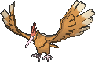

<!-- This file is generated by tools/generate_site.py. Edit the generator, not this file. -->

# #022 Fearow

{ .sprite-lg loading=lazy }

**Beak Pokémon**

Normal Flying

[:material-arrow-left: #021 Spearow](021.md) · [Pokédex](index.md) · [#023 Ekans :material-arrow-right:](023.md)

!!! info "Changes in Rising Ruby / Sinking Sapphire"

    - **Ability 2:** **Sniper** 
    - **Base stats:** Atk 90 → **100**, SpA 61 → **60**, SpD 61 → **60** (BST 442 → **450**)

## Location

[Mt. Pyre Summit](../wild/mt_pyre_summit_1.md)

### Wild encounters

| Area | Method | Level | Note |
| --- | --- | --- | --- |
| [Mt. Pyre Summit 2](../wild/mt_pyre_summit_2.md) | Walking | 45 |  |

## Type defenses

| Damage taken | Attacking types |
| --- | --- |
| Immune (×0) | Ground Ghost |
| Resistant (×½) | Bug Grass |
| Neutral (×1) | Normal Fighting Flying Poison Steel Fire Water Psychic Dragon Dark Fairy |
| Weak (×2) | Rock Electric Ice |

## Abilities

| Slot | Ability | Effect | Note |
| --- | --- | --- | --- |
| Ability 1 | **Keen Eye** | Prevents accuracy from being lowered. |  |
| Ability 2 | **Sniper** | Strengthens critical hits to inflict 3× damage rather than 2×. | changed  |
| Hidden | **Sniper** | Strengthens critical hits to inflict 3× damage rather than 2×. |  |

## Base stats

| Form | HP | Atk | Def | SpA | SpD | Spe | BST |
| --- | --- | --- | --- | --- | --- | --- | --- |
| { .sprite-sm loading=lazy } Normal | 65 | 100<small class="was">was 90</small> | 65 | 60<small class="was">was 61</small> | 60<small class="was">was 61</small> | 100 | 450<small class="was">was 442</small> |

## Training & breeding

| Property | Value |
| --- | --- |
| EV yield | 2 Spe |
| Catch rate | 90 |
| Base friendship | 70 |
| Base experience | 155 |
| Growth rate | medium |
| Egg groups | Flying |
| Hatch counter | 15 |
| Gender ratio | 50% ♂ / 50% ♀ |
| Height / weight | 1.2 m / 38 kg |

## Evolution

- { .icon loading=lazy } [Spearow](../pokemon/021.md) → { .icon loading=lazy } **[Fearow](../pokemon/022.md)**: Lv. 20

## Wild held items

| Item | Chance | Note |
| --- | --- | --- |
| { .item loading=lazy } Sharp Beak | 5% |  |

## Level-up moves { data-search-exclude }

Moves marked &#42; are not normally learned by level up (they come from egg moves, TMs/HMs or tutors in the official games); moves marked &#42;&#42; cannot normally be learned by this Pokémon at all and are omitted from the legal-moves version of the hack.

| Lv. | Move | Type | Cat. | Power | Acc. | PP | Effect | Note |
| --- | --- | --- | --- | --- | --- | --- | --- | --- |
| 1 | Drill Run | Ground | Physical | 80 | 95% | 10 | Has an increased chance for a critical hit. |  |
| 1 | Pluck | Flying | Physical | 60 | 100% | 20 | If target has a berry, inflicts double damage and uses the berry. |  |
| 1 | Peck | Flying | Physical | 35 | 100% | 35 | Inflicts regular damage with no additional effect. |  |
| 1 | Growl | Normal | Status | — | 100% | 40 | Lowers the target’s Attack by one stage. |  |
| 5 | Leer | Normal | Status | — | 100% | 30 | Lowers the target’s Defense by one stage. |  |
| 8 | Fury Attack | Normal | Physical | 15 | 85% | 20 | Hits 2-5 times in one turn. |  |
| 11 | Pursuit | Dark | Physical | 40 | 100% | 20 | Has double power against, and can hit, Pokémon attempting to switch out. |  |
| 14 | Aerial Ace | Flying | Physical | 60 | — | 20 | Never misses. |  |
| 17 | Quick Attack | Normal | Physical | 40 | 100% | 30 | Inflicts regular damage with no additional effect. | &#42; |
| 21 | Mirror Move | Flying | Status | — | — | 20 | Uses the target’s last used move. |  |
| 25 | Feint Attack | Dark | Physical | 60 | — | 20 | Never misses. | &#42; |
| 29 | Drill Peck | Flying | Physical | 80 | 100% | 20 | Inflicts regular damage with no additional effect. |  |
| 33 | Agility | Psychic | Status | — | — | 30 | Raises the user’s Speed by two stages. |  |
| 37 | Assurance | Dark | Physical | 60 | 100% | 10 | Power is doubled if the target has already received damage this turn. |  |
| 41 | Roost | Flying | Status | — | — | 5 | Heals the user by half its max HP. |  |
| 45 | Drill Run | Ground | Physical | 80 | 95% | 10 | Has an increased chance for a critical hit. |  |

## TM & HM moves { data-search-exclude }

| Machine | Move | Type | Cat. | Power | Acc. | PP | Effect |
| --- | --- | --- | --- | --- | --- | --- | --- |
| HM02 | [Fly](../changes/moves.md#fly) changed | Flying | Physical | 100 | 100% | 10 | User flies high into the air, dodging all attacks, and hits next turn. |
| TM06 | Toxic | Poison | Status | — | 90% | 10 | Badly poisons the target, inflicting more damage every turn. |
| TM10 | Hidden Power | Normal | Special | 60 | 100% | 15 | Power and type depend upon user’s IVs.  Power can range from 30 to 70. |
| TM100 | Confide | Normal | Status | — | — | 20 | Lowers the target’s Special Attack by one stage. |
| TM11 | Sunny Day | Fire | Status | — | — | 5 | Changes the weather to sunny for five turns. |
| TM15 | Hyper Beam | Normal | Special | 150 | 90% | 5 | User foregoes its next turn to recharge. |
| TM17 | Protect | Normal | Status | — | — | 10 | Prevents any moves from hitting the user this turn. |
| TM18 | Rain Dance | Water | Status | — | — | 5 | Changes the weather to rain for five turns. |
| TM19 | Roost | Flying | Status | — | — | 5 | Heals the user by half its max HP. |
| TM21 | Frustration | Normal | Physical | — | 100% | 20 | Power increases as happiness decreases, up to a maximum of 102. |
| TM27 | Return | Normal | Physical | — | 100% | 20 | Power increases with happiness, up to a maximum of 102. |
| TM32 | Double Team | Normal | Status | — | — | 15 | Raises the user’s evasion by one stage. |
| TM40 | Aerial Ace | Flying | Physical | 60 | — | 20 | Never misses. |
| TM42 | Facade | Normal | Physical | 70 | 100% | 20 | Power doubles if user is burned, paralyzed, or poisoned. |
| TM44 | Rest | Psychic | Status | — | — | 5 | User sleeps for two turns, completely healing itself. |
| TM45 | Attract | Normal | Status | — | 100% | 15 | Target falls in love if it has the opposite gender, and has a 50% chance to refuse attacking the user. |
| TM46 | Thief | Dark | Physical | 60 | 100% | 25 | Takes the target’s item. |
| TM48 | Round | Normal | Special | 60 | 100% | 15 | Has double power if it’s used more than once per turn. |
| TM49 | Echoed Voice | Normal | Special | 40 | 100% | 15 | Power increases by 100% for each consecutive use by any friendly Pokémon, to a maximum of 200. |
| TM51 | Steel Wing | Steel | Physical | 70 | 90% | 25 | Has a chance to raise the user’s Defense by one stage. |
| TM54 | False Swipe | Normal | Physical | 40 | 100% | 40 | Cannot lower the target’s HP below 1. |
| TM68 | Giga Impact | Normal | Physical | 150 | 90% | 5 | User foregoes its next turn to recharge. |
| TM87 | Swagger | Normal | Status | — | 90% | 15 | Raises the target’s Attack by two stages and confuses the target. |
| TM88 | Sleep Talk | Normal | Status | — | — | 10 | Randomly uses one of the user’s other three moves.  Only works if the user is sleeping. |
| TM89 | U-turn | Bug | Physical | 70 | 100% | 20 | User must switch out after attacking. |
| TM90 | Substitute | Normal | Status | — | — | 10 | Transfers 1/4 of the user’s max HP into a doll, protecting the user from further damage or status changes until it breaks. |
| TM94 | Secret Power | Normal | Physical | 70 | 100% | 20 | Has a chance to inflict a status effect which depends upon the terrain. |

## Move tutor moves { data-search-exclude }

| Move | Type | Cat. | Power | Acc. | PP | Effect |
| --- | --- | --- | --- | --- | --- | --- |
| Drill Run | Ground | Physical | 80 | 95% | 10 | Has an increased chance for a critical hit. |
| Heat Wave | Fire | Special | 95 | 90% | 10 | Has a chance to burn the target. |
| Sky Attack | Flying | Physical | 140 | 90% | 5 | User charges for one turn before attacking.  Has a chance to make the target flinch. |
| Snore | Normal | Special | 50 | 100% | 15 | Has a chance to make the target flinch.  Only works if the user is sleeping. |
| Tailwind | Flying | Status | — | — | 15 | For three turns, friendly Pokémon have doubled Speed. |
| Uproar | Normal | Special | 90 | 100% | 10 | Forced to use this move for several turns.  Pokémon cannot fall asleep in that time. |

## Egg moves { data-search-exclude }

No egg moves.

??? note "Trainers using Fearow (3)"

    | Area | Trainer | Level |
    | --- | --- | --- |
    | [Route 118](../trainers/route_118.md#trainers-east-of-inlet) | Bird Keeper Chester | Lv. 37 |
    | [Route 120 (Fortree)](../trainers/route_120_fortree.md#rematches) | Bird Keeper Robert (8) | Lv. 64 |
    | [Route 120 (Fortree)](../trainers/route_120_fortree.md#rematches) | Bird Keeper Robert (C) | Lv. 75 |

---

[:material-arrow-left: #021 Spearow](021.md) · [#023 Ekans :material-arrow-right:](023.md)
