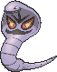

<!-- This file is generated by tools/generate_site.py. Edit the generator, not this file. -->

# #024 Arbok

{ .sprite-lg loading=lazy }

**Cobra Pokémon**

Poison

[:material-arrow-left: #023 Ekans](023.md) · [Pokédex](index.md) · [#025 Pikachu :material-arrow-right:](025.md)

!!! info "Changes in Rising Ruby / Sinking Sapphire"

    - **Base stats:** Atk 85 → **95**, Def 69 → **70**, SpA 65 → **55**, SpD 79 → **85**, Spe 80 → **85** (BST 438 → **450**)

## Location

[Route 119](../wild/route_119_mauville.md)

### Wild encounters

| Area | Method | Level | Note |
| --- | --- | --- | --- |
| [Route 119 (Mauville)](../wild/route_119_mauville.md) | Tall Grass | 36 |  |
| [Route 119 (Fortree)](../wild/route_119_fortree.md) | Tall Grass | 38 |  |

## Type defenses

| Damage taken | Attacking types |
| --- | --- |
| Resistant (×½) | Fighting Poison Bug Grass Fairy |
| Neutral (×1) | Normal Flying Rock Ghost Steel Fire Water Electric Ice Dragon Dark |
| Weak (×2) | Ground Psychic |

## Abilities

| Slot | Ability | Effect | Note |
| --- | --- | --- | --- |
| Ability 1 | **Intimidate** | Lowers opponents' Attack one stage upon entering battle. |  |
| Ability 2 | **Shed Skin** | Has a 33% chance of curing any major status ailment after each turn. |  |
| Hidden | **Unnerve** | Prevents opposing Pokémon from eating held Berries. |  |

## Base stats

| Form | HP | Atk | Def | SpA | SpD | Spe | BST |
| --- | --- | --- | --- | --- | --- | --- | --- |
| { .sprite-sm loading=lazy } Normal | 60 | 95<small class="was">was 85</small> | 70<small class="was">was 69</small> | 55<small class="was">was 65</small> | 85<small class="was">was 79</small> | 85<small class="was">was 80</small> | 450<small class="was">was 438</small> |

## Training & breeding

| Property | Value |
| --- | --- |
| EV yield | 2 Atk |
| Catch rate | 90 |
| Base friendship | 70 |
| Base experience | 157 |
| Growth rate | medium |
| Egg groups | Field, Dragon |
| Hatch counter | 20 |
| Gender ratio | 50% ♂ / 50% ♀ |
| Height / weight | 3.5 m / 65 kg |

## Evolution

- { .icon loading=lazy } [Ekans](../pokemon/023.md) → { .icon loading=lazy } **[Arbok](../pokemon/024.md)**: Lv. 22

## Wild held items

None.

## Level-up moves { data-search-exclude }

Moves marked &#42; are not normally learned by level up (they come from egg moves, TMs/HMs or tutors in the official games); moves marked &#42;&#42; cannot normally be learned by this Pokémon at all and are omitted from the legal-moves version of the hack.

| Lv. | Move | Type | Cat. | Power | Acc. | PP | Effect | Note |
| --- | --- | --- | --- | --- | --- | --- | --- | --- |
| 1 | Ice Fang | Ice | Physical | 65 | 95% | 15 | Has a chance to freeze the target and a chance to make the target flinch. |  |
| 1 | Thunder Fang | Electric | Physical | 65 | 95% | 15 | Has a chance to paralyze the target and a chance to make the target flinch. |  |
| 1 | Fire Fang | Fire | Physical | 65 | 95% | 15 | Has a chance to burn the target and a chance to make the target flinch. |  |
| 1 | Aqua Tail | Water | Physical | 90 | 90% | 10 | Inflicts regular damage with no additional effect. | &#42; |
| 1 | Wrap | Normal | Physical | 15 | 90% | 20 | Prevents the target from fleeing and inflicts damage for 2-5 turns. |  |
| 1 | Leer | Normal | Status | — | 100% | 30 | Lowers the target’s Defense by one stage. |  |
| 5 | Poison Sting | Poison | Physical | 15 | 100% | 35 | Has a chance to poison the target. |  |
| 8 | Bite | Dark | Physical | 60 | 100% | 25 | Has a chance to make the target flinch. |  |
| 11 | Glare | Normal | Status | — | 100% | 30 | Paralyzes the target. |  |
| 14 | Screech | Normal | Status | — | 85% | 40 | Lowers the target’s Defense by two stages. |  |
| 17 | Acid | Poison | Special | 40 | 100% | 30 | Has a chance to lower the target’s Special Defense by one stage. |  |
| 20 | Stockpile | Normal | Status | — | — | 20 | Stores energy up to three times for use with Spit Up and Swallow. |  |
| 20 | Swallow | Normal | Status | — | — | 10 | Recovers 1/4 HP after one Stockpile, 1/2 HP after two Stockpiles, or full HP after three Stockpiles. |  |
| 20 | Spit Up | Normal | Special | — | 100% | 10 | Power is 100 times the amount of energy Stockpiled. |  |
| 22 | Crunch | Dark | Physical | 80 | 100% | 15 | Has a chance to lower the target’s Defense by one stage. |  |
| 24 | Poison Tail | Poison | Physical | 50 | 100% | 25 | Has an increased chance for a critical hit and a chance to poison the target. | &#42; |
| 28 | Mud Bomb | Ground | Special | 65 | 85% | 10 | Has a chance to lower the target’s accuracy by one stage. |  |
| 32 | Acid Spray | Poison | Special | 40 | 100% | 20 | Lowers the target’s Special Defense by two stages. |  |
| 36 | Poison Jab | Poison | Physical | 80 | 100% | 20 | Has a chance to poison the target. |  |
| 40 | Gastro Acid | Poison | Status | — | 100% | 10 | Nullifies target’s ability until it leaves battle. |  |
| 44 | Sucker Punch | Dark | Physical | 80 | 100% | 5 | Only works if the target is about to use a damaging move. | &#42; |
| 48 | Belch | Poison | Special | 120 | 90% | 10 | Can only be used after the user has eaten a berry. |  |
| 52 | Gunk Shot | Poison | Physical | 120 | 80% | 5 | Has a chance to poison the target. |  |
| 56 | Haze | Ice | Status | — | — | 30 | Resets all Pokémon’s stats, accuracy, and evasion. |  |
| 60 | Coil | Poison | Status | — | — | 20 | Raises the user’s Attack, Defense, and accuracy by one stage each. |  |

## TM & HM moves { data-search-exclude }

| Machine | Move | Type | Cat. | Power | Acc. | PP | Effect |
| --- | --- | --- | --- | --- | --- | --- | --- |
| HM04 | [Strength](../changes/moves.md#strength) changed | Normal | Physical | 100 | 100% | 10 | Inflicts regular damage with no additional effect. |
| TM06 | Toxic | Poison | Status | — | 90% | 10 | Badly poisons the target, inflicting more damage every turn. |
| TM09 | Venoshock | Poison | Special | 65 | 100% | 10 | Inflicts double damage if the target is Poisoned. |
| TM10 | Hidden Power | Normal | Special | 60 | 100% | 15 | Power and type depend upon user’s IVs.  Power can range from 30 to 70. |
| TM100 | Confide | Normal | Status | — | — | 20 | Lowers the target’s Special Attack by one stage. |
| TM11 | Sunny Day | Fire | Status | — | — | 5 | Changes the weather to sunny for five turns. |
| TM15 | Hyper Beam | Normal | Special | 150 | 90% | 5 | User foregoes its next turn to recharge. |
| TM17 | Protect | Normal | Status | — | — | 10 | Prevents any moves from hitting the user this turn. |
| TM18 | Rain Dance | Water | Status | — | — | 5 | Changes the weather to rain for five turns. |
| TM21 | Frustration | Normal | Physical | — | 100% | 20 | Power increases as happiness decreases, up to a maximum of 102. |
| TM26 | Earthquake | Ground | Physical | 100 | 100% | 10 | Inflicts regular damage and can hit Dig users. |
| TM27 | Return | Normal | Physical | — | 100% | 20 | Power increases with happiness, up to a maximum of 102. |
| TM28 | Dig | Ground | Physical | 80 | 100% | 10 | User digs underground, dodging all attacks, and hits next turn. |
| TM32 | Double Team | Normal | Status | — | — | 15 | Raises the user’s evasion by one stage. |
| TM34 | Sludge Wave | Poison | Special | 95 | 100% | 10 | Has a chance to poison the target. |
| TM36 | Sludge Bomb | Poison | Special | 90 | 100% | 10 | Has a chance to poison the target. |
| TM39 | Rock Tomb | Rock | Physical | 60 | 95% | 15 | Has a chance to lower the target’s Speed by one stage. |
| TM41 | Torment | Dark | Status | — | 100% | 15 | Prevents the target from using the same move twice in a row. |
| TM42 | Facade | Normal | Physical | 70 | 100% | 20 | Power doubles if user is burned, paralyzed, or poisoned. |
| TM44 | Rest | Psychic | Status | — | — | 5 | User sleeps for two turns, completely healing itself. |
| TM45 | Attract | Normal | Status | — | 100% | 15 | Target falls in love if it has the opposite gender, and has a 50% chance to refuse attacking the user. |
| TM46 | Thief | Dark | Physical | 60 | 100% | 25 | Takes the target’s item. |
| TM48 | Round | Normal | Special | 60 | 100% | 15 | Has double power if it’s used more than once per turn. |
| TM66 | Payback | Dark | Physical | 50 | 100% | 10 | Power is doubled if the target has already moved this turn. |
| TM68 | Giga Impact | Normal | Physical | 150 | 90% | 5 | User foregoes its next turn to recharge. |
| TM78 | Bulldoze | Ground | Physical | 60 | 100% | 20 | Has a chance to lower the target’s Speed by one stage. |
| TM80 | Rock Slide | Rock | Physical | 75 | 90% | 10 | Has a chance to make the target flinch. |
| TM82 | Dragon Tail | Dragon | Physical | 60 | 90% | 10 | Ends wild battles.  Forces trainers to switch Pokémon. |
| TM83 | Infestation | Bug | Special | 20 | 100% | 20 | Prevents the target from fleeing and inflicts damage for 2-5 turns. |
| TM84 | Poison Jab | Poison | Physical | 80 | 100% | 20 | Has a chance to poison the target. |
| TM87 | Swagger | Normal | Status | — | 90% | 15 | Raises the target’s Attack by two stages and confuses the target. |
| TM88 | Sleep Talk | Normal | Status | — | — | 10 | Randomly uses one of the user’s other three moves.  Only works if the user is sleeping. |
| TM90 | Substitute | Normal | Status | — | — | 10 | Transfers 1/4 of the user’s max HP into a doll, protecting the user from further damage or status changes until it breaks. |
| TM94 | Secret Power | Normal | Physical | 70 | 100% | 20 | Has a chance to inflict a status effect which depends upon the terrain. |
| TM97 | Dark Pulse | Dark | Special | 80 | 100% | 15 | Has a chance to make the target flinch. |

## Move tutor moves { data-search-exclude }

| Move | Type | Cat. | Power | Acc. | PP | Effect |
| --- | --- | --- | --- | --- | --- | --- |
| Aqua Tail | Water | Physical | 90 | 90% | 10 | Inflicts regular damage with no additional effect. |
| Bind | Normal | Physical | 15 | 85% | 20 | Prevents the target from fleeing and inflicts damage for 2-5 turns. |
| Gastro Acid | Poison | Status | — | 100% | 10 | Nullifies target’s ability until it leaves battle. |
| Giga Drain | Grass | Special | 75 | 100% | 10 | Drains half the damage inflicted to heal the user. |
| Gunk Shot | Poison | Physical | 120 | 80% | 5 | Has a chance to poison the target. |
| Iron Tail | Steel | Physical | 100 | 75% | 15 | Has a chance to lower the target’s Defense by one stage. |
| Seed Bomb | Grass | Physical | 80 | 100% | 15 | Inflicts regular damage with no additional effect. |
| Snatch | Dark | Status | — | — | 10 | Steals the target’s move, if it’s self-targeted. |
| Snore | Normal | Special | 50 | 100% | 15 | Has a chance to make the target flinch.  Only works if the user is sleeping. |
| Spite | Ghost | Status | — | 100% | 10 | Lowers the PP of the target’s last used move by 4. |

## Egg moves { data-search-exclude }

No egg moves.

??? note "Trainers using Arbok (6)"

    | Area | Trainer | Level |
    | --- | --- | --- |
    | [Jagged Pass](../trainers/jagged_pass.md#trainers) | Camper Ethan | Lv. 32 |
    | [Jagged Pass](../trainers/jagged_pass.md#rematches) | Camper Ethan (5) | Lv. 39 |
    | [Jagged Pass](../trainers/jagged_pass.md#rematches) | Camper Ethan (6) | Lv. 47 |
    | [Jagged Pass](../trainers/jagged_pass.md#rematches) | Camper Ethan (7) | Lv. 59 |
    | [Jagged Pass](../trainers/jagged_pass.md#rematches) | Camper Ethan (C) | Lv. 75 |
    | [Victory Road B1F](../trainers/victory_road_b1f.md#trainers) | Dragon Tamer Egon | Lv. 65 |

---

[:material-arrow-left: #023 Ekans](023.md) · [#025 Pikachu :material-arrow-right:](025.md)
