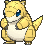

<!-- This file is generated by tools/generate_site.py. Edit the generator, not this file. -->

# #027 Sandshrew

{ .sprite-lg loading=lazy }

**Mouse Pokémon**

Ground

[:material-arrow-left: #026 Raichu](026.md) · [Pokédex](index.md) · [#028 Sandslash :material-arrow-right:](028.md)

!!! info "Changes in Rising Ruby / Sinking Sapphire"

    - **Ability 2:** **Sand Rush** 

## Location

[Route 113](../wild/route_113.md)

### Wild encounters

| Area | Method | Level | Note |
| --- | --- | --- | --- |
| [Route 113](../wild/route_113.md) | Grass | 24 |  |
| [Route 111 (Desert)](../wild/route_111_desert.md) | Horde | 18 |  |

## Type defenses

| Damage taken | Attacking types |
| --- | --- |
| Immune (×0) | Electric |
| Resistant (×½) | Poison Rock |
| Neutral (×1) | Normal Fighting Flying Ground Bug Ghost Steel Fire Psychic Dragon Dark Fairy |
| Weak (×2) | Water Grass Ice |

## Abilities

| Slot | Ability | Effect | Note |
| --- | --- | --- | --- |
| Ability 1 | **Sand Veil** | Increases evasion to 1.25× during a sandstorm.  Protects against sandstorm damage. |  |
| Ability 2 | **Sand Rush** | Doubles Speed during a sandstorm.  Protects against sandstorm damage. | changed  |
| Hidden | **Sand Rush** | Doubles Speed during a sandstorm.  Protects against sandstorm damage. |  |

## Base stats

| Form | HP | Atk | Def | SpA | SpD | Spe | BST |
| --- | --- | --- | --- | --- | --- | --- | --- |
| { .sprite-sm loading=lazy } Normal | 50 | 75 | 85 | 20 | 30 | 40 | **300** |

## Training & breeding

| Property | Value |
| --- | --- |
| EV yield | 1 Def |
| Catch rate | 255 |
| Base friendship | 70 |
| Base experience | 60 |
| Growth rate | medium |
| Egg groups | Field |
| Hatch counter | 20 |
| Gender ratio | 50% ♂ / 50% ♀ |
| Height / weight | 0.6 m / 12 kg |

## Evolution

- { .icon loading=lazy } **[Sandshrew](../pokemon/027.md)** → { .icon loading=lazy } [Sandslash](../pokemon/028.md): Lv. 22 / Use Ice Stone

## Wild held items

| Item | Chance | Note |
| --- | --- | --- |
| { .item loading=lazy } Grip Claw | 5% |  |

## Level-up moves { data-search-exclude }

Moves marked &#42; are not normally learned by level up (they come from egg moves, TMs/HMs or tutors in the official games); moves marked &#42;&#42; cannot normally be learned by this Pokémon at all and are omitted from the legal-moves version of the hack.

| Lv. | Move | Type | Cat. | Power | Acc. | PP | Effect | Note |
| --- | --- | --- | --- | --- | --- | --- | --- | --- |
| 1 | [Scratch](../changes/moves.md#scratch) changed | Normal | Physical | 50 | 100% | 35 | Inflicts regular damage with no additional effect. |  |
| 1 | Defense Curl | Normal | Status | — | — | 40 | Raises user’s Defense by one stage. |  |
| 3 | Sand Attack | Ground | Status | — | 100% | 15 | Lowers the target’s accuracy by one stage. |  |
| 5 | Poison Sting | Poison | Physical | 15 | 100% | 35 | Has a chance to poison the target. |  |
| 7 | Rollout | Rock | Physical | 30 | 90% | 20 | Power doubles every turn this move is used in succession after the first, resetting after five turns. |  |
| 9 | Rapid Spin | Normal | Physical | 20 | 100% | 40 | Frees the user from binding moves, removes Leech Seed, and blows away Spikes. |  |
| 11 | Fury Cutter | Bug | Physical | 40 | 95% | 20 | Power doubles every turn this move is used in succession after the first, maxing out after five turns. |  |
| 13 | Magnitude | Ground | Physical | — | 100% | 30 | Power varies randomly from 10 to 150. |  |
| 15 | Swift | Normal | Special | 60 | — | 20 | Never misses. |  |
| 17 | Metal Claw | Steel | Physical | 50 | 95% | 35 | Has a chance to raise the user’s Attack by one stage. | &#42; |
| 19 | Fury Swipes | Normal | Physical | 18 | 80% | 15 | Hits 2-5 times in one turn. |  |
| 22 | Sand Tomb | Ground | Physical | 35 | 85% | 15 | Prevents the target from fleeing and inflicts damage for 2-5 turns. |  |
| 25 | Slash | Normal | Physical | 70 | 100% | 20 | Has an increased chance for a critical hit. |  |
| 28 | Night Slash | Dark | Physical | 70 | 100% | 15 | Has an increased chance for a critical hit. | &#42; |
| 31 | Dig | Ground | Physical | 80 | 100% | 10 | User digs underground, dodging all attacks, and hits next turn. |  |
| 34 | Gyro Ball | Steel | Physical | — | 100% | 5 | Power raises when the user has lower Speed, up to a maximum of 150. |  |
| 37 | Super Fang | Normal | Physical | — | 90% | 10 | Inflicts damage equal to half the target’s HP. | &#42; |
| 40 | Earthquake | Ground | Physical | 100 | 100% | 10 | Inflicts regular damage and can hit Dig users. |  |
| 43 | Iron Tail | Steel | Physical | 100 | 75% | 15 | Has a chance to lower the target’s Defense by one stage. | &#42; |
| 46 | Swords Dance | Normal | Status | — | — | 20 | Raises the user’s Attack by two stages. |  |
| 49 | Sandstorm | Rock | Status | — | — | 10 | Changes the weather to a sandstorm for five turns. |  |

## TM & HM moves { data-search-exclude }

| Machine | Move | Type | Cat. | Power | Acc. | PP | Effect |
| --- | --- | --- | --- | --- | --- | --- | --- |
| HM01 | [Cut](../changes/moves.md#cut) changed | Grass | Physical | 70 | 100% | 15 | High Critical Rate. High Critical Rate |
| HM04 | [Strength](../changes/moves.md#strength) changed | Normal | Physical | 100 | 100% | 10 | Inflicts regular damage with no additional effect. |
| HM06 | [Rock Smash](../changes/moves.md#rock-smash) changed | Fighting | Physical | 65 | 100% | 15 | Has a chance to lower the target’s Defense by one stage. |
| TM01 | Hone Claws | Dark | Status | — | — | 15 | Raises the user’s Attack and accuracy by one stage. |
| TM06 | Toxic | Poison | Status | — | 90% | 10 | Badly poisons the target, inflicting more damage every turn. |
| TM10 | Hidden Power | Normal | Special | 60 | 100% | 15 | Power and type depend upon user’s IVs.  Power can range from 30 to 70. |
| TM100 | Confide | Normal | Status | — | — | 20 | Lowers the target’s Special Attack by one stage. |
| TM11 | Sunny Day | Fire | Status | — | — | 5 | Changes the weather to sunny for five turns. |
| TM17 | Protect | Normal | Status | — | — | 10 | Prevents any moves from hitting the user this turn. |
| TM20 | Safeguard | Normal | Status | — | — | 25 | Protects the user’s field from major status ailments and confusion for five turns. |
| TM21 | Frustration | Normal | Physical | — | 100% | 20 | Power increases as happiness decreases, up to a maximum of 102. |
| TM26 | Earthquake | Ground | Physical | 100 | 100% | 10 | Inflicts regular damage and can hit Dig users. |
| TM27 | Return | Normal | Physical | — | 100% | 20 | Power increases with happiness, up to a maximum of 102. |
| TM28 | Dig | Ground | Physical | 80 | 100% | 10 | User digs underground, dodging all attacks, and hits next turn. |
| TM31 | Brick Break | Fighting | Physical | 75 | 100% | 15 | Destroys Reflect and Light Screen. |
| TM32 | Double Team | Normal | Status | — | — | 15 | Raises the user’s evasion by one stage. |
| TM37 | Sandstorm | Rock | Status | — | — | 10 | Changes the weather to a sandstorm for five turns. |
| TM39 | Rock Tomb | Rock | Physical | 60 | 95% | 15 | Has a chance to lower the target’s Speed by one stage. |
| TM40 | Aerial Ace | Flying | Physical | 60 | — | 20 | Never misses. |
| TM42 | Facade | Normal | Physical | 70 | 100% | 20 | Power doubles if user is burned, paralyzed, or poisoned. |
| TM44 | Rest | Psychic | Status | — | — | 5 | User sleeps for two turns, completely healing itself. |
| TM45 | Attract | Normal | Status | — | 100% | 15 | Target falls in love if it has the opposite gender, and has a 50% chance to refuse attacking the user. |
| TM46 | Thief | Dark | Physical | 60 | 100% | 25 | Takes the target’s item. |
| TM48 | Round | Normal | Special | 60 | 100% | 15 | Has double power if it’s used more than once per turn. |
| TM56 | Fling | Dark | Physical | — | 100% | 10 | Throws held item at the target; power depends on the item. |
| TM65 | Shadow Claw | Ghost | Physical | 70 | 100% | 15 | Has an increased chance for a critical hit. |
| TM74 | Gyro Ball | Steel | Physical | — | 100% | 5 | Power raises when the user has lower Speed, up to a maximum of 150. |
| TM75 | Swords Dance | Normal | Status | — | — | 20 | Raises the user’s Attack by two stages. |
| TM78 | Bulldoze | Ground | Physical | 60 | 100% | 20 | Has a chance to lower the target’s Speed by one stage. |
| TM80 | Rock Slide | Rock | Physical | 75 | 90% | 10 | Has a chance to make the target flinch. |
| TM81 | X-Scissor | Bug | Physical | 80 | 100% | 15 | Inflicts regular damage with no additional effect. |
| TM84 | Poison Jab | Poison | Physical | 80 | 100% | 20 | Has a chance to poison the target. |
| TM87 | Swagger | Normal | Status | — | 90% | 15 | Raises the target’s Attack by two stages and confuses the target. |
| TM88 | Sleep Talk | Normal | Status | — | — | 10 | Randomly uses one of the user’s other three moves.  Only works if the user is sleeping. |
| TM90 | Substitute | Normal | Status | — | — | 10 | Transfers 1/4 of the user’s max HP into a doll, protecting the user from further damage or status changes until it breaks. |
| TM94 | Secret Power | Normal | Physical | 70 | 100% | 20 | Has a chance to inflict a status effect which depends upon the terrain. |

## Move tutor moves { data-search-exclude }

| Move | Type | Cat. | Power | Acc. | PP | Effect |
| --- | --- | --- | --- | --- | --- | --- |
| Covet | Normal | Physical | 60 | 100% | 25 | Takes the target’s item. |
| Earth Power | Ground | Special | 90 | 100% | 10 | Has a chance to lower the target’s Special Defense by one stage. |
| Focus Punch | Fighting | Physical | 150 | 100% | 20 | If the user takes damage before attacking, the attack is canceled. |
| Iron Tail | Steel | Physical | 100 | 75% | 15 | Has a chance to lower the target’s Defense by one stage. |
| Knock Off | Dark | Physical | 65 | 100% | 20 | Target drops its held item. |
| Snore | Normal | Special | 50 | 100% | 15 | Has a chance to make the target flinch.  Only works if the user is sleeping. |
| Stealth Rock | Rock | Status | — | — | 20 | Causes damage when opposing Pokémon switch in. |
| Super Fang | Normal | Physical | — | 90% | 10 | Inflicts damage equal to half the target’s HP. |

## Egg moves { data-search-exclude }

| Move | Type | Cat. | Power | Acc. | PP | Effect |
| --- | --- | --- | --- | --- | --- | --- |
| Chip Away | Normal | Physical | 70 | 100% | 20 | Ignores the target’s stat modifiers. |
| Counter | Fighting | Physical | — | 100% | 20 | Inflicts twice the damage the user received from the last physical hit it took. |
| Crush Claw | Normal | Physical | 75 | 95% | 10 | Has a chance to lower the target’s Defense by one stage. |
| Endure | Normal | Status | — | — | 10 | Prevents the user’s HP from lowering below 1 this turn. |
| Flail | Normal | Physical | — | 100% | 15 | Inflicts more damage when the user has less HP remaining, with a maximum of 200 power. |
| Metal Claw | Steel | Physical | 50 | 95% | 35 | Has a chance to raise the user’s Attack by one stage. |
| Mud Shot | Ground | Special | 55 | 95% | 15 | Has a chance to lower the target’s Speed by one stage. |
| Night Slash | Dark | Physical | 70 | 100% | 15 | Has an increased chance for a critical hit. |
| Rapid Spin | Normal | Physical | 20 | 100% | 40 | Frees the user from binding moves, removes Leech Seed, and blows away Spikes. |
| Rock Climb | Normal | Physical | 90 | 85% | 20 | Has a chance to confuse the target. |
| Rototiller | Ground | Status | — | — | 10 | Raises the Attack and Special Attack of all Grass Pokémon in battle. |

??? note "Trainers using Sandshrew (1)"

    | Area | Trainer | Level |
    | --- | --- | --- |
    | [Granite Cave B2F](../trainers/granite_cave_b2f.md#trainers) | Ruin Maniac Omari | Lv. 22 |

---

[:material-arrow-left: #026 Raichu](026.md) · [#028 Sandslash :material-arrow-right:](028.md)
