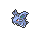
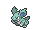

<!-- This file is generated by tools/generate_site.py. Edit the generator, not this file. -->

# #029 Nidoran♀

{ .sprite-lg loading=lazy }

**Poison Pin Pokémon**

Poison

[:material-arrow-left: #028 Sandslash](028.md) · [Pokédex](index.md) · [#030 Nidorina :material-arrow-right:](030.md)

!!! note "No documented changes"

    Drayano's documentation lists no stat, type, ability, evolution or held item changes for this Pokémon. Its level-up moves are listed below as they appear in the hack.

## Location

[Route 103](../wild/route_103.md)

### Wild encounters

| Area | Method | Level | Note |
| --- | --- | --- | --- |
| [Route 103](../wild/route_103.md) | Grass | 5 |  |

## Type defenses

| Damage taken | Attacking types |
| --- | --- |
| Resistant (×½) | Fighting Poison Bug Grass Fairy |
| Neutral (×1) | Normal Flying Rock Ghost Steel Fire Water Electric Ice Dragon Dark |
| Weak (×2) | Ground Psychic |

## Abilities

| Slot | Ability | Effect | Note |
| --- | --- | --- | --- |
| Ability 1 | **Poison Point** | Has a 30% chance of poisoning attacking Pokémon on contact. |  |
| Ability 2 | **Rivalry** | Increases damage inflicted to 1.25× against Pokémon of the same gender, but decreases damage to 0.75× against the opposite gender. |  |
| Hidden | **Hustle** | Strengthens physical moves to inflict 1.5× damage, but decreases their accuracy to 0.8×. |  |

## Base stats

| Form | HP | Atk | Def | SpA | SpD | Spe | BST |
| --- | --- | --- | --- | --- | --- | --- | --- |
| { .sprite-sm loading=lazy } Normal | 55 | 47 | 52 | 40 | 40 | 41 | **275** |

## Training & breeding

| Property | Value |
| --- | --- |
| EV yield | 1 HP |
| Catch rate | 235 |
| Base friendship | 70 |
| Base experience | 55 |
| Growth rate | medium slow |
| Egg groups | Monster, Field |
| Hatch counter | 20 |
| Gender ratio | 0% ♂ / 100% ♀ |
| Height / weight | 0.4 m / 7 kg |

## Evolution

- { .icon loading=lazy } **[Nidoran♀](../pokemon/029.md)** → { .icon loading=lazy } [Nidorina](../pokemon/030.md): Lv. 16
- { .icon loading=lazy } [Nidorina](../pokemon/030.md) → { .icon loading=lazy } [Nidoqueen](../pokemon/031.md): Moon Stone

## Wild held items

None.

## Level-up moves { data-search-exclude }

Moves marked &#42; are not normally learned by level up (they come from egg moves, TMs/HMs or tutors in the official games); moves marked &#42;&#42; cannot normally be learned by this Pokémon at all and are omitted from the legal-moves version of the hack.

| Lv. | Move | Type | Cat. | Power | Acc. | PP | Effect | Note |
| --- | --- | --- | --- | --- | --- | --- | --- | --- |
| 1 | Growl | Normal | Status | — | 100% | 40 | Lowers the target’s Attack by one stage. |  |
| 1 | [Scratch](../changes/moves.md#scratch) changed | Normal | Physical | 50 | 100% | 35 | Inflicts regular damage with no additional effect. |  |
| 1 | Poison Sting | Poison | Physical | 15 | 100% | 35 | Has a chance to poison the target. |  |
| 6 | Tail Whip | Normal | Status | — | 100% | 30 | Lowers the target’s Defense by one stage. |  |
| 9 | Double Kick | Fighting | Physical | 30 | 100% | 30 | Hits twice in one turn. |  |
| 12 | Poison Fang | Poison | Physical | 50 | 100% | 15 | Has a chance to badly poison the target. |  |
| 15 | Fury Swipes | Normal | Physical | 18 | 80% | 15 | Hits 2-5 times in one turn. |  |
| 18 | Bite | Dark | Physical | 60 | 100% | 25 | Has a chance to make the target flinch. |  |
| 21 | Poison Jab | Poison | Physical | 80 | 100% | 20 | Has a chance to poison the target. | &#42; |
| 24 | Helping Hand | Normal | Status | — | — | 20 | Ally’s next move inflicts half more damage. |  |
| 27 | Crunch | Dark | Physical | 80 | 100% | 15 | Has a chance to lower the target’s Defense by one stage. |  |
| 30 | Toxic Spikes | Poison | Status | — | — | 20 | Scatters poisoned spikes, poisoning opposing Pokémon that switch in. |  |
| 33 | Flatter | Dark | Status | — | 100% | 15 | Raises the target’s Special Attack by one stage and confuses the target. |  |
| 36 | Captivate | Normal | Status | — | 100% | 20 | Lowers the target’s Special Attack by two stages if it’s the opposite gender. |  |
| 39 | Skull Bash | Normal | Physical | 130 | 100% | 10 | Raises the user’s Defense by one stage.  User charges for one turn before attacking. | &#42; |
| 42 | Super Fang | Normal | Physical | — | 90% | 10 | Inflicts damage equal to half the target’s HP. | &#42; |

## TM & HM moves { data-search-exclude }

| Machine | Move | Type | Cat. | Power | Acc. | PP | Effect |
| --- | --- | --- | --- | --- | --- | --- | --- |
| HM01 | [Cut](../changes/moves.md#cut) changed | Grass | Physical | 70 | 100% | 15 | High Critical Rate. High Critical Rate |
| HM04 | [Strength](../changes/moves.md#strength) changed | Normal | Physical | 100 | 100% | 10 | Inflicts regular damage with no additional effect. |
| HM06 | [Rock Smash](../changes/moves.md#rock-smash) changed | Fighting | Physical | 65 | 100% | 15 | Has a chance to lower the target’s Defense by one stage. |
| TM01 | Hone Claws | Dark | Status | — | — | 15 | Raises the user’s Attack and accuracy by one stage. |
| TM06 | Toxic | Poison | Status | — | 90% | 10 | Badly poisons the target, inflicting more damage every turn. |
| TM09 | Venoshock | Poison | Special | 65 | 100% | 10 | Inflicts double damage if the target is Poisoned. |
| TM10 | Hidden Power | Normal | Special | 60 | 100% | 15 | Power and type depend upon user’s IVs.  Power can range from 30 to 70. |
| TM100 | Confide | Normal | Status | — | — | 20 | Lowers the target’s Special Attack by one stage. |
| TM11 | Sunny Day | Fire | Status | — | — | 5 | Changes the weather to sunny for five turns. |
| TM13 | Ice Beam | Ice | Special | 90 | 100% | 10 | Has a chance to freeze the target. |
| TM14 | Blizzard | Ice | Special | 110 | 70% | 5 | Has a chance to freeze the target. |
| TM17 | Protect | Normal | Status | — | — | 10 | Prevents any moves from hitting the user this turn. |
| TM18 | Rain Dance | Water | Status | — | — | 5 | Changes the weather to rain for five turns. |
| TM21 | Frustration | Normal | Physical | — | 100% | 20 | Power increases as happiness decreases, up to a maximum of 102. |
| TM24 | Thunderbolt | Electric | Special | 90 | 100% | 15 | Has a chance to paralyze the target. |
| TM25 | Thunder | Electric | Special | 110 | 70% | 10 | Has a chance to paralyze the target. |
| TM27 | Return | Normal | Physical | — | 100% | 20 | Power increases with happiness, up to a maximum of 102. |
| TM28 | Dig | Ground | Physical | 80 | 100% | 10 | User digs underground, dodging all attacks, and hits next turn. |
| TM32 | Double Team | Normal | Status | — | — | 15 | Raises the user’s evasion by one stage. |
| TM36 | Sludge Bomb | Poison | Special | 90 | 100% | 10 | Has a chance to poison the target. |
| TM40 | Aerial Ace | Flying | Physical | 60 | — | 20 | Never misses. |
| TM42 | Facade | Normal | Physical | 70 | 100% | 20 | Power doubles if user is burned, paralyzed, or poisoned. |
| TM44 | Rest | Psychic | Status | — | — | 5 | User sleeps for two turns, completely healing itself. |
| TM45 | Attract | Normal | Status | — | 100% | 15 | Target falls in love if it has the opposite gender, and has a 50% chance to refuse attacking the user. |
| TM46 | Thief | Dark | Physical | 60 | 100% | 25 | Takes the target’s item. |
| TM48 | Round | Normal | Special | 60 | 100% | 15 | Has double power if it’s used more than once per turn. |
| TM49 | Echoed Voice | Normal | Special | 40 | 100% | 15 | Power increases by 100% for each consecutive use by any friendly Pokémon, to a maximum of 200. |
| TM65 | Shadow Claw | Ghost | Physical | 70 | 100% | 15 | Has an increased chance for a critical hit. |
| TM84 | Poison Jab | Poison | Physical | 80 | 100% | 20 | Has a chance to poison the target. |
| TM87 | Swagger | Normal | Status | — | 90% | 15 | Raises the target’s Attack by two stages and confuses the target. |
| TM88 | Sleep Talk | Normal | Status | — | — | 10 | Randomly uses one of the user’s other three moves.  Only works if the user is sleeping. |
| TM90 | Substitute | Normal | Status | — | — | 10 | Transfers 1/4 of the user’s max HP into a doll, protecting the user from further damage or status changes until it breaks. |
| TM94 | Secret Power | Normal | Physical | 70 | 100% | 20 | Has a chance to inflict a status effect which depends upon the terrain. |

## Move tutor moves { data-search-exclude }

| Move | Type | Cat. | Power | Acc. | PP | Effect |
| --- | --- | --- | --- | --- | --- | --- |
| Helping Hand | Normal | Status | — | — | 20 | Ally’s next move inflicts half more damage. |
| Iron Tail | Steel | Physical | 100 | 75% | 15 | Has a chance to lower the target’s Defense by one stage. |
| Shock Wave | Electric | Special | 60 | — | 20 | Never misses. |
| Snore | Normal | Special | 50 | 100% | 15 | Has a chance to make the target flinch.  Only works if the user is sleeping. |
| Super Fang | Normal | Physical | — | 90% | 10 | Inflicts damage equal to half the target’s HP. |
| Water Pulse | Water | Special | 60 | 100% | 20 | Has a chance to confuse the target. |

## Egg moves { data-search-exclude }

| Move | Type | Cat. | Power | Acc. | PP | Effect |
| --- | --- | --- | --- | --- | --- | --- |
| Beat Up | Dark | Physical | — | 100% | 10 | Hits once for every conscious Pokémon the trainer has. |
| Charm | Fairy | Status | — | 100% | 20 | Lowers the target’s Attack by two stages. |
| Chip Away | Normal | Physical | 70 | 100% | 20 | Ignores the target’s stat modifiers. |
| Counter | Fighting | Physical | — | 100% | 20 | Inflicts twice the damage the user received from the last physical hit it took. |
| Disable | Normal | Status | — | 100% | 20 | Disables the target’s last used move for 1-8 turns. |
| Endure | Normal | Status | — | — | 10 | Prevents the user’s HP from lowering below 1 this turn. |
| Focus Energy | Normal | Status | — | — | 30 | Increases the user’s chance to score a critical hit. |
| Iron Tail | Steel | Physical | 100 | 75% | 15 | Has a chance to lower the target’s Defense by one stage. |
| Poison Tail | Poison | Physical | 50 | 100% | 25 | Has an increased chance for a critical hit and a chance to poison the target. |
| Pursuit | Dark | Physical | 40 | 100% | 20 | Has double power against, and can hit, Pokémon attempting to switch out. |
| Skull Bash | Normal | Physical | 130 | 100% | 10 | Raises the user’s Defense by one stage.  User charges for one turn before attacking. |
| Supersonic | Normal | Status | — | 55% | 20 | Confuses the target. |
| Take Down | Normal | Physical | 90 | 85% | 20 | User receives 1/4 the damage it inflicts in recoil. |
| Venom Drench | Poison | Status | — | 100% | 20 | Lowers the target’s Attack, Special Attack, and Speed by one stage if it is poisoned. |

---

[:material-arrow-left: #028 Sandslash](028.md) · [#030 Nidorina :material-arrow-right:](030.md)
