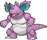

<!-- This file is generated by tools/generate_site.py. Edit the generator, not this file. -->

# #034 Nidoking

{ .sprite-lg loading=lazy }

**Drill Pokémon**

Poison Ground

[:material-arrow-left: #033 Nidorino](033.md) · [Pokédex](index.md) · [#035 Clefairy :material-arrow-right:](035.md)

!!! note "No documented changes"

    Drayano's documentation lists no stat, type, ability, evolution or held item changes for this Pokémon. Its level-up moves are listed below as they appear in the hack.

## Location

Evolve { .icon loading=lazy } [Nidorino](../pokemon/033.md) (Moon Stone)

## Type defenses

| Damage taken | Attacking types |
| --- | --- |
| Immune (×0) | Electric |
| Very resistant (×¼) | Poison |
| Resistant (×½) | Fighting Rock Bug Fairy |
| Neutral (×1) | Normal Flying Ghost Steel Fire Grass Dragon Dark |
| Weak (×2) | Ground Water Psychic Ice |

## Abilities

| Slot | Ability | Effect | Note |
| --- | --- | --- | --- |
| Ability 1 | **Poison Point** | Has a 30% chance of poisoning attacking Pokémon on contact. |  |
| Ability 2 | **Rivalry** | Increases damage inflicted to 1.25× against Pokémon of the same gender, but decreases damage to 0.75× against the opposite gender. |  |
| Hidden | **Sheer Force** | Strengthens moves with extra effects to 1.3× their power, but prevents their extra effects. |  |

## Base stats

| Form | HP | Atk | Def | SpA | SpD | Spe | BST |
| --- | --- | --- | --- | --- | --- | --- | --- |
| { .sprite-sm loading=lazy } Normal | 81 | 102 | 77 | 85 | 75 | 85 | **505** |

## Training & breeding

| Property | Value |
| --- | --- |
| EV yield | 3 Atk |
| Catch rate | 45 |
| Base friendship | 70 |
| Base experience | 227 |
| Growth rate | medium slow |
| Egg groups | Monster, Field |
| Hatch counter | 20 |
| Gender ratio | 100% ♂ / 0% ♀ |
| Height / weight | 1.4 m / 62 kg |

## Evolution

- { .icon loading=lazy } [Nidoran♂](../pokemon/032.md) → { .icon loading=lazy } [Nidorino](../pokemon/033.md): Lv. 16
- { .icon loading=lazy } [Nidorino](../pokemon/033.md) → { .icon loading=lazy } **[Nidoking](../pokemon/034.md)**: Moon Stone

## Wild held items

None.

## Level-up moves { data-search-exclude }

Moves marked &#42; are not normally learned by level up (they come from egg moves, TMs/HMs or tutors in the official games); moves marked &#42;&#42; cannot normally be learned by this Pokémon at all and are omitted from the legal-moves version of the hack.

| Lv. | Move | Type | Cat. | Power | Acc. | PP | Effect | Note |
| --- | --- | --- | --- | --- | --- | --- | --- | --- |
| 1 | Morning Sun | Normal | Status | — | — | 5 | Heals the user by half its max HP.  Affected by weather. | &#42;&#42; |
| 1 | Lovely Kiss | Normal | Status | — | 75% | 10 | Puts the target to sleep. | &#42;&#42; |
| 1 | Megahorn | Bug | Physical | 120 | 85% | 10 | Inflicts regular damage with no additional effect. |  |
| 1 | Peck | Flying | Physical | 35 | 100% | 35 | Inflicts regular damage with no additional effect. |  |
| 1 | Focus Energy | Normal | Status | — | — | 30 | Increases the user’s chance to score a critical hit. |  |
| 1 | Double Kick | Fighting | Physical | 30 | 100% | 30 | Hits twice in one turn. |  |
| 1 | Poison Sting | Poison | Physical | 15 | 100% | 35 | Has a chance to poison the target. |  |
| 23 | Chip Away | Normal | Physical | 70 | 100% | 20 | Ignores the target’s stat modifiers. |  |
| 35 | Thrash | Normal | Physical | 120 | 100% | 10 | Hits every turn for 2-3 turns, then confuses the user. |  |
| 43 | Earth Power | Ground | Special | 90 | 100% | 10 | Has a chance to lower the target’s Special Defense by one stage. |  |
| 58 | Megahorn | Bug | Physical | 120 | 85% | 10 | Inflicts regular damage with no additional effect. |  |

## TM & HM moves { data-search-exclude }

| Machine | Move | Type | Cat. | Power | Acc. | PP | Effect |
| --- | --- | --- | --- | --- | --- | --- | --- |
| HM01 | [Cut](../changes/moves.md#cut) changed | Grass | Physical | 70 | 100% | 15 | High Critical Rate. High Critical Rate |
| HM03 | Surf | Water | Special | 90 | 100% | 15 | Inflicts regular damage and can hit Dive users. |
| HM04 | [Strength](../changes/moves.md#strength) changed | Normal | Physical | 100 | 100% | 10 | Inflicts regular damage with no additional effect. |
| HM06 | [Rock Smash](../changes/moves.md#rock-smash) changed | Fighting | Physical | 65 | 100% | 15 | Has a chance to lower the target’s Defense by one stage. |
| TM01 | Hone Claws | Dark | Status | — | — | 15 | Raises the user’s Attack and accuracy by one stage. |
| TM05 | Roar | Normal | Status | — | — | 20 | Immediately ends wild battles.  Forces trainers to switch Pokémon. |
| TM06 | Toxic | Poison | Status | — | 90% | 10 | Badly poisons the target, inflicting more damage every turn. |
| TM09 | Venoshock | Poison | Special | 65 | 100% | 10 | Inflicts double damage if the target is Poisoned. |
| TM10 | Hidden Power | Normal | Special | 60 | 100% | 15 | Power and type depend upon user’s IVs.  Power can range from 30 to 70. |
| TM100 | Confide | Normal | Status | — | — | 20 | Lowers the target’s Special Attack by one stage. |
| TM11 | Sunny Day | Fire | Status | — | — | 5 | Changes the weather to sunny for five turns. |
| TM12 | Taunt | Dark | Status | — | 100% | 20 | For the next few turns, the target can only use damaging moves. |
| TM13 | Ice Beam | Ice | Special | 90 | 100% | 10 | Has a chance to freeze the target. |
| TM14 | Blizzard | Ice | Special | 110 | 70% | 5 | Has a chance to freeze the target. |
| TM15 | Hyper Beam | Normal | Special | 150 | 90% | 5 | User foregoes its next turn to recharge. |
| TM17 | Protect | Normal | Status | — | — | 10 | Prevents any moves from hitting the user this turn. |
| TM18 | Rain Dance | Water | Status | — | — | 5 | Changes the weather to rain for five turns. |
| TM21 | Frustration | Normal | Physical | — | 100% | 20 | Power increases as happiness decreases, up to a maximum of 102. |
| TM23 | Smack Down | Rock | Physical | 50 | 100% | 15 | Removes any immunity to Ground damage. |
| TM24 | Thunderbolt | Electric | Special | 90 | 100% | 15 | Has a chance to paralyze the target. |
| TM25 | Thunder | Electric | Special | 110 | 70% | 10 | Has a chance to paralyze the target. |
| TM26 | Earthquake | Ground | Physical | 100 | 100% | 10 | Inflicts regular damage and can hit Dig users. |
| TM27 | Return | Normal | Physical | — | 100% | 20 | Power increases with happiness, up to a maximum of 102. |
| TM28 | Dig | Ground | Physical | 80 | 100% | 10 | User digs underground, dodging all attacks, and hits next turn. |
| TM30 | Shadow Ball | Ghost | Special | 80 | 100% | 15 | Has a chance to lower the target’s Special Defense by one stage. |
| TM31 | Brick Break | Fighting | Physical | 75 | 100% | 15 | Destroys Reflect and Light Screen. |
| TM32 | Double Team | Normal | Status | — | — | 15 | Raises the user’s evasion by one stage. |
| TM34 | Sludge Wave | Poison | Special | 95 | 100% | 10 | Has a chance to poison the target. |
| TM35 | Flamethrower | Fire | Special | 90 | 100% | 15 | Has a chance to burn the target. |
| TM36 | Sludge Bomb | Poison | Special | 90 | 100% | 10 | Has a chance to poison the target. |
| TM37 | Sandstorm | Rock | Status | — | — | 10 | Changes the weather to a sandstorm for five turns. |
| TM38 | Fire Blast | Fire | Special | 110 | 85% | 5 | Has a chance to burn the target. |
| TM39 | Rock Tomb | Rock | Physical | 60 | 95% | 15 | Has a chance to lower the target’s Speed by one stage. |
| TM41 | Torment | Dark | Status | — | 100% | 15 | Prevents the target from using the same move twice in a row. |
| TM42 | Facade | Normal | Physical | 70 | 100% | 20 | Power doubles if user is burned, paralyzed, or poisoned. |
| TM44 | Rest | Psychic | Status | — | — | 5 | User sleeps for two turns, completely healing itself. |
| TM45 | Attract | Normal | Status | — | 100% | 15 | Target falls in love if it has the opposite gender, and has a 50% chance to refuse attacking the user. |
| TM46 | Thief | Dark | Physical | 60 | 100% | 25 | Takes the target’s item. |
| TM48 | Round | Normal | Special | 60 | 100% | 15 | Has double power if it’s used more than once per turn. |
| TM49 | Echoed Voice | Normal | Special | 40 | 100% | 15 | Power increases by 100% for each consecutive use by any friendly Pokémon, to a maximum of 200. |
| TM52 | Focus Blast | Fighting | Special | 120 | 70% | 5 | Has a chance to lower the target’s Special Defense by one stage. |
| TM56 | Fling | Dark | Physical | — | 100% | 10 | Throws held item at the target; power depends on the item. |
| TM59 | Incinerate | Fire | Special | 60 | 100% | 15 | Destroys the target’s held berry. |
| TM60 | Quash | Dark | Status | — | 100% | 15 | Makes the target act last this turn. |
| TM65 | Shadow Claw | Ghost | Physical | 70 | 100% | 15 | Has an increased chance for a critical hit. |
| TM68 | Giga Impact | Normal | Physical | 150 | 90% | 5 | User foregoes its next turn to recharge. |
| TM71 | Stone Edge | Rock | Physical | 100 | 80% | 5 | Has an increased chance for a critical hit. |
| TM78 | Bulldoze | Ground | Physical | 60 | 100% | 20 | Has a chance to lower the target’s Speed by one stage. |
| TM80 | Rock Slide | Rock | Physical | 75 | 90% | 10 | Has a chance to make the target flinch. |
| TM82 | Dragon Tail | Dragon | Physical | 60 | 90% | 10 | Ends wild battles.  Forces trainers to switch Pokémon. |
| TM84 | Poison Jab | Poison | Physical | 80 | 100% | 20 | Has a chance to poison the target. |
| TM87 | Swagger | Normal | Status | — | 90% | 15 | Raises the target’s Attack by two stages and confuses the target. |
| TM88 | Sleep Talk | Normal | Status | — | — | 10 | Randomly uses one of the user’s other three moves.  Only works if the user is sleeping. |
| TM90 | Substitute | Normal | Status | — | — | 10 | Transfers 1/4 of the user’s max HP into a doll, protecting the user from further damage or status changes until it breaks. |
| TM94 | Secret Power | Normal | Physical | 70 | 100% | 20 | Has a chance to inflict a status effect which depends upon the terrain. |
| TM98 | Power-Up Punch | Fighting | Physical | 40 | 100% | 20 | Raises the user’s Attack by one stage after inflicting damage. |

## Move tutor moves { data-search-exclude }

| Move | Type | Cat. | Power | Acc. | PP | Effect |
| --- | --- | --- | --- | --- | --- | --- |
| Aqua Tail | Water | Physical | 90 | 90% | 10 | Inflicts regular damage with no additional effect. |
| Dragon Pulse | Dragon | Special | 85 | 100% | 10 | Inflicts regular damage with no additional effect. |
| Drill Run | Ground | Physical | 80 | 95% | 10 | Has an increased chance for a critical hit. |
| Earth Power | Ground | Special | 90 | 100% | 10 | Has a chance to lower the target’s Special Defense by one stage. |
| Fire Punch | Fire | Physical | 75 | 100% | 15 | Has a chance to burn the target. |
| Focus Punch | Fighting | Physical | 150 | 100% | 20 | If the user takes damage before attacking, the attack is canceled. |
| Helping Hand | Normal | Status | — | — | 20 | Ally’s next move inflicts half more damage. |
| Ice Punch | Ice | Physical | 75 | 100% | 15 | Has a chance to freeze the target. |
| Icy Wind | Ice | Special | 55 | 95% | 15 | Has a chance to lower the target’s Speed by one stage. |
| Iron Tail | Steel | Physical | 100 | 75% | 15 | Has a chance to lower the target’s Defense by one stage. |
| Outrage | Dragon | Physical | 120 | 100% | 10 | Hits every turn for 2-3 turns, then confuses the user. |
| Shock Wave | Electric | Special | 60 | — | 20 | Never misses. |
| Snore | Normal | Special | 50 | 100% | 15 | Has a chance to make the target flinch.  Only works if the user is sleeping. |
| Stealth Rock | Rock | Status | — | — | 20 | Causes damage when opposing Pokémon switch in. |
| Super Fang | Normal | Physical | — | 90% | 10 | Inflicts damage equal to half the target’s HP. |
| Superpower | Fighting | Physical | 120 | 100% | 5 | Lowers the user’s Attack and Defense by one stage after inflicting damage. |
| Thunder Punch | Electric | Physical | 75 | 100% | 15 | Has a chance to paralyze the target. |
| Uproar | Normal | Special | 90 | 100% | 10 | Forced to use this move for several turns.  Pokémon cannot fall asleep in that time. |
| Water Pulse | Water | Special | 60 | 100% | 20 | Has a chance to confuse the target. |

## Egg moves { data-search-exclude }

No egg moves.

??? note "Trainers using Nidoking (9)"

    | Area | Trainer | Level |
    | --- | --- | --- |
    | [Route 120 South-West](../trainers/route_120_south_west.md#trainers) | Street Thug Gomez | Lv. 47 |
    | [Route 120 South-West](../trainers/route_120_south_west.md#rematches) | Street Thug Gomez (7) | Lv. 59 |
    | [Route 120 South-West](../trainers/route_120_south_west.md#rematches) | Street Thug Gomez (8) | Lv. 64 |
    | [Route 120 South-West](../trainers/route_120_south_west.md#rematches) | Street Thug Gomez (C) | Lv. 75 |
    | [Magma Hideout](../trainers/magma_hideout.md#trainers) | Magma Admin Courtney | Lv. 55 |
    | [Seafloor Cavern Front Rooms](../trainers/seafloor_cavern_front_rooms.md#trainers) | Team Magma Grunt | Lv. 60 |
    | [Petalburg City (Post Game)](../trainers/petalburg_city_post_game.md#trainers) | Magma Admin Courtney | Lv. 75 |
    | [Mossdeep City (Post Game)](../trainers/mossdeep_city_post_game.md#trainers) | Magma Admin Courtney | Lv. 77 |
    | [S.S Tidal](../trainers/s_s_tidal.md#trainers) | Young Couple Lea & Jed | Lv. 75 |

---

[:material-arrow-left: #033 Nidorino](033.md) · [#035 Clefairy :material-arrow-right:](035.md)
