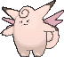
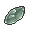

<!-- This file is generated by tools/generate_site.py. Edit the generator, not this file. -->

# #036 Clefable

{ .sprite-lg loading=lazy }

**Fairy Pokémon**

Fairy

[:material-arrow-left: #035 Clefairy](035.md) · [Pokédex](index.md) · [#037 Vulpix :material-arrow-right:](037.md)

!!! note "No documented changes"

    Drayano's documentation lists no stat, type, ability, evolution or held item changes for this Pokémon. Its level-up moves are listed below as they appear in the hack.

## Location

[Meteor Falls](../wild/meteor_falls_1f.md)

### Wild encounters

| Area | Method | Level | Note |
| --- | --- | --- | --- |
| [Meteor Falls 1F](../wild/meteor_falls_1f.md) | DexNav | 50 |  |
| [Meteor Falls 1F-2](../wild/meteor_falls_1f_2.md) | DexNav | 60 |  |

## Type defenses

| Damage taken | Attacking types |
| --- | --- |
| Immune (×0) | Dragon |
| Resistant (×½) | Fighting Bug Dark |
| Neutral (×1) | Normal Flying Ground Rock Ghost Fire Water Grass Electric Psychic Ice Fairy |
| Weak (×2) | Poison Steel |

## Abilities

| Slot | Ability | Effect | Note |
| --- | --- | --- | --- |
| Ability 1 | **Cute Charm** | Has a 30% chance of infatuating attacking Pokémon on contact. |  |
| Ability 2 | **Magic Guard** | Protects against damage not directly caused by a move. |  |
| Hidden | **Unaware** | Ignores other Pokémon's stat modifiers for damage and accuracy calculation. |  |

## Base stats

| Form | HP | Atk | Def | SpA | SpD | Spe | BST |
| --- | --- | --- | --- | --- | --- | --- | --- |
| { .sprite-sm loading=lazy } Normal | 95 | 70 | 73 | 95 | 90 | 60 | **483** |

## Training & breeding

| Property | Value |
| --- | --- |
| EV yield | 3 HP |
| Catch rate | 25 |
| Base friendship | 140 |
| Base experience | 217 |
| Growth rate | fast |
| Egg groups | Fairy |
| Hatch counter | 10 |
| Gender ratio | 25% ♂ / 75% ♀ |
| Height / weight | 1.3 m / 40 kg |

## Evolution

- { .icon loading=lazy } [Cleffa](../pokemon/173.md) → { .icon loading=lazy } [Clefairy](../pokemon/035.md): Level up with high friendship
- { .icon loading=lazy } [Clefairy](../pokemon/035.md) → { .icon loading=lazy } **[Clefable](../pokemon/036.md)**: Use Moon Stone

## Wild held items

| Item | Chance | Note |
| --- | --- | --- |
| { .item loading=lazy } Moon Stone | 5% |  |

## Level-up moves { data-search-exclude }

Moves marked &#42; are not normally learned by level up (they come from egg moves, TMs/HMs or tutors in the official games); moves marked &#42;&#42; cannot normally be learned by this Pokémon at all and are omitted from the legal-moves version of the hack.

| Lv. | Move | Type | Cat. | Power | Acc. | PP | Effect | Note |
| --- | --- | --- | --- | --- | --- | --- | --- | --- |
| 1 | Petal Dance | Grass | Special | 120 | 100% | 10 | Hits every turn for 2-3 turns, then confuses the user. | &#42;&#42; |
| 1 | [Disarming Voice](../changes/moves.md#disarming-voice) changed | Fairy | Special | 60 | — | 20 | Never misses. |  |
| 1 | Sing | Normal | Status | — | 55% | 15 | Puts the target to sleep. |  |
| 1 | Double Slap | Normal | Physical | 15 | 85% | 10 | Hits 2-5 times in one turn. |  |
| 1 | Minimize | Normal | Status | — | — | 10 | Raises the user’s evasion by two stages. |  |
| 1 | Metronome | Normal | Status | — | — | 10 | Randomly selects and uses any move in the game. |  |
| 25 | Psyshock | Psychic | Special | 80 | 100% | 10 | Inflicts damage based on the target’s Defense, not Special Defense. | &#42; |
| 35 | Moonblast | Fairy | Special | 95 | 100% | 15 | Has a chance to lower the target’s Special Attack by one stage. | &#42; |
| 45 | Meteor Mash | Steel | Physical | 90 | 90% | 10 | Has a chance to raise the user’s Attack by one stage. | &#42; |
| 55 | Wish | Normal | Status | — | — | 10 | User will recover half its max HP at the end of the next turn. | &#42; |

## TM & HM moves { data-search-exclude }

| Machine | Move | Type | Cat. | Power | Acc. | PP | Effect |
| --- | --- | --- | --- | --- | --- | --- | --- |
| HM04 | [Strength](../changes/moves.md#strength) changed | Normal | Physical | 100 | 100% | 10 | Inflicts regular damage with no additional effect. |
| HM06 | [Rock Smash](../changes/moves.md#rock-smash) changed | Fighting | Physical | 65 | 100% | 15 | Has a chance to lower the target’s Defense by one stage. |
| TM03 | Psyshock | Psychic | Special | 80 | 100% | 10 | Inflicts damage based on the target’s Defense, not Special Defense. |
| TM04 | Calm Mind | Psychic | Status | — | — | 20 | Raises the user’s Special Attack and Special Defense by one stage. |
| TM06 | Toxic | Poison | Status | — | 90% | 10 | Badly poisons the target, inflicting more damage every turn. |
| TM10 | Hidden Power | Normal | Special | 60 | 100% | 15 | Power and type depend upon user’s IVs.  Power can range from 30 to 70. |
| TM100 | Confide | Normal | Status | — | — | 20 | Lowers the target’s Special Attack by one stage. |
| TM11 | Sunny Day | Fire | Status | — | — | 5 | Changes the weather to sunny for five turns. |
| TM13 | Ice Beam | Ice | Special | 90 | 100% | 10 | Has a chance to freeze the target. |
| TM14 | Blizzard | Ice | Special | 110 | 70% | 5 | Has a chance to freeze the target. |
| TM15 | Hyper Beam | Normal | Special | 150 | 90% | 5 | User foregoes its next turn to recharge. |
| TM16 | Light Screen | Psychic | Status | — | — | 30 | Reduces damage from special attacks by 50% for five turns. |
| TM17 | Protect | Normal | Status | — | — | 10 | Prevents any moves from hitting the user this turn. |
| TM18 | Rain Dance | Water | Status | — | — | 5 | Changes the weather to rain for five turns. |
| TM20 | Safeguard | Normal | Status | — | — | 25 | Protects the user’s field from major status ailments and confusion for five turns. |
| TM21 | Frustration | Normal | Physical | — | 100% | 20 | Power increases as happiness decreases, up to a maximum of 102. |
| TM22 | Solar Beam | Grass | Special | 120 | 100% | 10 | Requires a turn to charge before attacking. |
| TM24 | Thunderbolt | Electric | Special | 90 | 100% | 15 | Has a chance to paralyze the target. |
| TM25 | Thunder | Electric | Special | 110 | 70% | 10 | Has a chance to paralyze the target. |
| TM27 | Return | Normal | Physical | — | 100% | 20 | Power increases with happiness, up to a maximum of 102. |
| TM28 | Dig | Ground | Physical | 80 | 100% | 10 | User digs underground, dodging all attacks, and hits next turn. |
| TM29 | Psychic | Psychic | Special | 90 | 100% | 10 | Has a chance to lower the target’s Special Defense by one stage. |
| TM30 | Shadow Ball | Ghost | Special | 80 | 100% | 15 | Has a chance to lower the target’s Special Defense by one stage. |
| TM31 | Brick Break | Fighting | Physical | 75 | 100% | 15 | Destroys Reflect and Light Screen. |
| TM32 | Double Team | Normal | Status | — | — | 15 | Raises the user’s evasion by one stage. |
| TM33 | Reflect | Psychic | Status | — | — | 20 | Reduces damage from physical attacks by half. |
| TM35 | Flamethrower | Fire | Special | 90 | 100% | 15 | Has a chance to burn the target. |
| TM38 | Fire Blast | Fire | Special | 110 | 85% | 5 | Has a chance to burn the target. |
| TM42 | Facade | Normal | Physical | 70 | 100% | 20 | Power doubles if user is burned, paralyzed, or poisoned. |
| TM44 | Rest | Psychic | Status | — | — | 5 | User sleeps for two turns, completely healing itself. |
| TM45 | Attract | Normal | Status | — | 100% | 15 | Target falls in love if it has the opposite gender, and has a 50% chance to refuse attacking the user. |
| TM48 | Round | Normal | Special | 60 | 100% | 15 | Has double power if it’s used more than once per turn. |
| TM49 | Echoed Voice | Normal | Special | 40 | 100% | 15 | Power increases by 100% for each consecutive use by any friendly Pokémon, to a maximum of 200. |
| TM52 | Focus Blast | Fighting | Special | 120 | 70% | 5 | Has a chance to lower the target’s Special Defense by one stage. |
| TM56 | Fling | Dark | Physical | — | 100% | 10 | Throws held item at the target; power depends on the item. |
| TM57 | Charge Beam | Electric | Special | 50 | 90% | 10 | Has a chance to raise the user’s Special Attack by one stage. |
| TM59 | Incinerate | Fire | Special | 60 | 100% | 15 | Destroys the target’s held berry. |
| TM67 | Retaliate | Normal | Physical | 70 | 100% | 5 | Has double power if a friendly Pokémon fainted last turn. |
| TM68 | Giga Impact | Normal | Physical | 150 | 90% | 5 | User foregoes its next turn to recharge. |
| TM70 | Flash | Normal | Status | — | 100% | 20 | Lowers the target’s accuracy by one stage. |
| TM73 | Thunder Wave | Electric | Status | — | 100% | 20 | Paralyzes the target. |
| TM77 | Psych Up | Normal | Status | — | — | 10 | Discards the user’s stat changes and copies the target’s. |
| TM85 | Dream Eater | Psychic | Special | 100 | 100% | 15 | Only works on sleeping Pokémon.  Drains half the damage inflicted to heal the user. |
| TM86 | Grass Knot | Grass | Special | — | 100% | 20 | Inflicts more damage to heavier targets, with a maximum of 120 power. |
| TM87 | Swagger | Normal | Status | — | 90% | 15 | Raises the target’s Attack by two stages and confuses the target. |
| TM88 | Sleep Talk | Normal | Status | — | — | 10 | Randomly uses one of the user’s other three moves.  Only works if the user is sleeping. |
| TM90 | Substitute | Normal | Status | — | — | 10 | Transfers 1/4 of the user’s max HP into a doll, protecting the user from further damage or status changes until it breaks. |
| TM94 | Secret Power | Normal | Physical | 70 | 100% | 20 | Has a chance to inflict a status effect which depends upon the terrain. |
| TM98 | Power-Up Punch | Fighting | Physical | 40 | 100% | 20 | Raises the user’s Attack by one stage after inflicting damage. |
| TM99 | Dazzling Gleam | Fairy | Special | 80 | 100% | 10 | Inflicts regular damage with no additional effect. |

## Move tutor moves { data-search-exclude }

| Move | Type | Cat. | Power | Acc. | PP | Effect |
| --- | --- | --- | --- | --- | --- | --- |
| After You | Normal | Status | — | — | 15 | Makes the target act next this turn. |
| Bounce | Flying | Physical | 85 | 85% | 5 | User bounces high into the air, dodging all attacks, and hits next turn. |
| Covet | Normal | Physical | 60 | 100% | 25 | Takes the target’s item. |
| Drain Punch | Fighting | Physical | 75 | 100% | 10 | Drains half the damage inflicted to heal the user. |
| Endeavor | Normal | Physical | — | 100% | 5 | Lowers the target’s HP to equal the user’s. |
| Fire Punch | Fire | Physical | 75 | 100% | 15 | Has a chance to burn the target. |
| Focus Punch | Fighting | Physical | 150 | 100% | 20 | If the user takes damage before attacking, the attack is canceled. |
| Gravity | Psychic | Status | — | — | 5 | Disables moves and immunities that involve flying or levitating for five turns. |
| Heal Bell | Normal | Status | — | — | 5 | Cures the entire party of major status effects. |
| Helping Hand | Normal | Status | — | — | 20 | Ally’s next move inflicts half more damage. |
| Hyper Voice | Normal | Special | 90 | 100% | 10 | Inflicts regular damage with no additional effect. |
| Ice Punch | Ice | Physical | 75 | 100% | 15 | Has a chance to freeze the target. |
| Icy Wind | Ice | Special | 55 | 95% | 15 | Has a chance to lower the target’s Speed by one stage. |
| Iron Tail | Steel | Physical | 100 | 75% | 15 | Has a chance to lower the target’s Defense by one stage. |
| Knock Off | Dark | Physical | 65 | 100% | 20 | Target drops its held item. |
| Last Resort | Normal | Physical | 140 | 100% | 5 | Can only be used after all of the user’s other moves have been used. |
| Magic Coat | Psychic | Status | — | — | 15 | Reflects back the first effect move used on the user this turn. |
| Recycle | Normal | Status | — | — | 10 | User recovers the item it last used up. |
| Role Play | Psychic | Status | — | — | 10 | Copies the target’s ability. |
| Shock Wave | Electric | Special | 60 | — | 20 | Never misses. |
| Signal Beam | Bug | Special | 75 | 100% | 15 | Has a chance to confuse the target. |
| Snatch | Dark | Status | — | — | 10 | Steals the target’s move, if it’s self-targeted. |
| Snore | Normal | Special | 50 | 100% | 15 | Has a chance to make the target flinch.  Only works if the user is sleeping. |
| Stealth Rock | Rock | Status | — | — | 20 | Causes damage when opposing Pokémon switch in. |
| Thunder Punch | Electric | Physical | 75 | 100% | 15 | Has a chance to paralyze the target. |
| Trick | Psychic | Status | — | 100% | 10 | User and target swap items. |
| Water Pulse | Water | Special | 60 | 100% | 20 | Has a chance to confuse the target. |
| Wonder Room | Psychic | Status | — | — | 10 | All Pokémon’s Defense and Special Defense are swapped for 5 turns. |
| Zen Headbutt | Psychic | Physical | 80 | 90% | 15 | Has a chance to make the target flinch. |

## Egg moves { data-search-exclude }

No egg moves.

??? note "Trainers using Clefable (10)"

    | Area | Trainer | Level |
    | --- | --- | --- |
    | [Route 103](../trainers/route_103.md#rematches) | Twins Amy & Liv (4) | Lv. 35 |
    | [Route 103](../trainers/route_103.md#rematches) | Twins Amy & Liv (6) | Lv. 47 |
    | [Route 103](../trainers/route_103.md#rematches) | Twins Amy & Liv (7) | Lv. 59 |
    | [Route 103](../trainers/route_103.md#rematches) | Twins Amy & Liv (C) | Lv. 75 |
    | [Route 117](../trainers/route_117.md#rematches) | PKMN Breeder Lydia (7) | Lv. 59 |
    | [Route 117](../trainers/route_117.md#rematches) | PKMN Breeder Lydia (C) | Lv. 75 |
    | [Mt. Pyre 1F / 2F](../trainers/mt_pyre_1f_2f.md#trainers) | Fairy Tale Girl Momo | Lv. 49 |
    | [Mt. Pyre 1F / 2F](../trainers/mt_pyre_1f_2f.md#rematches) | Fairy Tale Girl Momo (7) | Lv. 59 |
    | [Mt. Pyre 1F / 2F](../trainers/mt_pyre_1f_2f.md#rematches) | Fairy Tale Girl Momo (8) | Lv. 64 |
    | [Mt. Pyre 1F / 2F](../trainers/mt_pyre_1f_2f.md#rematches) | Fairy Tale Girl Momo (C) | Lv. 75 |

---

[:material-arrow-left: #035 Clefairy](035.md) · [#037 Vulpix :material-arrow-right:](037.md)
