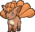

<!-- This file is generated by tools/generate_site.py. Edit the generator, not this file. -->

# #037 Vulpix

{ .sprite-lg loading=lazy }

**Fox Pokémon**

Fire

[:material-arrow-left: #036 Clefable](036.md) · [Pokédex](index.md) · [#038 Ninetales :material-arrow-right:](038.md)

!!! info "Changes in Rising Ruby / Sinking Sapphire"

    - **Ability 2:** **Drought** 

## Location

[Route 112 North](../wild/route_112_north.md), [Mt. Pyre](../wild/mt_pyre_1f_2f.md)

### Wild encounters

| Area | Method | Level | Note |
| --- | --- | --- | --- |
| [Route 112 North](../wild/route_112_north.md) | Grass | 24 |  |
| [Mt. Pyre Summit 1](../wild/mt_pyre_summit_1.md) | Walking | 40 |  |
| [Mt. Pyre Summit 2](../wild/mt_pyre_summit_2.md) | Walking | 45 |  |

## Type defenses

| Damage taken | Attacking types |
| --- | --- |
| Resistant (×½) | Bug Steel Fire Grass Ice Fairy |
| Neutral (×1) | Normal Fighting Flying Poison Ghost Electric Psychic Dragon Dark |
| Weak (×2) | Ground Rock Water |

## Abilities

| Slot | Ability | Effect | Note |
| --- | --- | --- | --- |
| Ability 1 | **Flash Fire** | Protects against Fire moves.  Once one has been blocked, the Pokémon's own Fire moves inflict 1.5× damage until it leaves battle. |  |
| Ability 2 | **Drought** | Summons strong sunlight that lasts indefinitely upon entering battle. | changed  |
| Hidden | **Drought** | Summons strong sunlight that lasts indefinitely upon entering battle. |  |

## Base stats

| Form | HP | Atk | Def | SpA | SpD | Spe | BST |
| --- | --- | --- | --- | --- | --- | --- | --- |
| { .sprite-sm loading=lazy } Normal | 38 | 41 | 40 | 50 | 65 | 65 | **299** |

## Training & breeding

| Property | Value |
| --- | --- |
| EV yield | 1 Spe |
| Catch rate | 190 |
| Base friendship | 70 |
| Base experience | 60 |
| Growth rate | medium |
| Egg groups | Field |
| Hatch counter | 20 |
| Gender ratio | 25% ♂ / 75% ♀ |
| Height / weight | 0.6 m / 9.9 kg |

## Evolution

- { .icon loading=lazy } **[Vulpix](../pokemon/037.md)** → { .icon loading=lazy } [Ninetales](../pokemon/038.md): Use Fire Stone / Use Ice Stone

## Wild held items

| Item | Chance | Note |
| --- | --- | --- |
| { .item loading=lazy } Charcoal | 5% |  |

## Level-up moves { data-search-exclude }

Moves marked &#42; are not normally learned by level up (they come from egg moves, TMs/HMs or tutors in the official games); moves marked &#42;&#42; cannot normally be learned by this Pokémon at all and are omitted from the legal-moves version of the hack.

| Lv. | Move | Type | Cat. | Power | Acc. | PP | Effect | Note |
| --- | --- | --- | --- | --- | --- | --- | --- | --- |
| 1 | Ember | Fire | Special | 40 | 100% | 25 | Has a chance to burn the target. |  |
| 4 | Tail Whip | Normal | Status | — | 100% | 30 | Lowers the target’s Defense by one stage. |  |
| 7 | Roar | Normal | Status | — | — | 20 | Immediately ends wild battles.  Forces trainers to switch Pokémon. |  |
| 9 | Baby-Doll Eyes | Fairy | Status | — | 100% | 30 | Lowers the target’s Attack by one stage. |  |
| 10 | Quick Attack | Normal | Physical | 40 | 100% | 30 | Inflicts regular damage with no additional effect. |  |
| 12 | Confuse Ray | Ghost | Status | — | 100% | 10 | Confuses the target. |  |
| 15 | Fire Spin | Fire | Special | 35 | 85% | 15 | Prevents the target from fleeing and inflicts damage for 2-5 turns. |  |
| 18 | Payback | Dark | Physical | 50 | 100% | 10 | Power is doubled if the target has already moved this turn. |  |
| 20 | Will-O-Wisp | Fire | Status | — | 85% | 15 | Burns the target. |  |
| 23 | Flame Burst | Fire | Special | 70 | 100% | 15 | Deals splash damage to Pokémon next to the target. |  |
| 26 | Hex | Ghost | Special | 65 | 100% | 10 | Has double power if the target has a major status ailment. |  |
| 28 | Feint Attack | Dark | Physical | 60 | — | 20 | Never misses. |  |
| 31 | Extrasensory | Psychic | Special | 80 | 100% | 20 | Has a chance to make the target flinch. |  |
| 34 | Flamethrower | Fire | Special | 90 | 100% | 15 | Has a chance to burn the target. |  |
| 36 | Hypnosis | Psychic | Status | — | 60% | 20 | Puts the target to sleep. | &#42; |
| 39 | Safeguard | Normal | Status | — | — | 25 | Protects the user’s field from major status ailments and confusion for five turns. |  |
| 42 | Imprison | Psychic | Status | — | — | 10 | Prevents the target from using any moves that the user also knows. |  |
| 44 | Fire Blast | Fire | Special | 110 | 85% | 5 | Has a chance to burn the target. |  |
| 47 | Grudge | Ghost | Status | — | — | 5 | If the user faints this turn, the PP of the move that fainted it drops to 0. |  |
| 50 | Captivate | Normal | Status | — | 100% | 20 | Lowers the target’s Special Attack by two stages if it’s the opposite gender. |  |
| 53 | Inferno | Fire | Special | 100 | 50% | 5 | Has a chance to burn the target. |  |

## TM & HM moves { data-search-exclude }

| Machine | Move | Type | Cat. | Power | Acc. | PP | Effect |
| --- | --- | --- | --- | --- | --- | --- | --- |
| TM05 | Roar | Normal | Status | — | — | 20 | Immediately ends wild battles.  Forces trainers to switch Pokémon. |
| TM06 | Toxic | Poison | Status | — | 90% | 10 | Badly poisons the target, inflicting more damage every turn. |
| TM10 | Hidden Power | Normal | Special | 60 | 100% | 15 | Power and type depend upon user’s IVs.  Power can range from 30 to 70. |
| TM100 | Confide | Normal | Status | — | — | 20 | Lowers the target’s Special Attack by one stage. |
| TM11 | Sunny Day | Fire | Status | — | — | 5 | Changes the weather to sunny for five turns. |
| TM17 | Protect | Normal | Status | — | — | 10 | Prevents any moves from hitting the user this turn. |
| TM20 | Safeguard | Normal | Status | — | — | 25 | Protects the user’s field from major status ailments and confusion for five turns. |
| TM21 | Frustration | Normal | Physical | — | 100% | 20 | Power increases as happiness decreases, up to a maximum of 102. |
| TM27 | Return | Normal | Physical | — | 100% | 20 | Power increases with happiness, up to a maximum of 102. |
| TM28 | Dig | Ground | Physical | 80 | 100% | 10 | User digs underground, dodging all attacks, and hits next turn. |
| TM32 | Double Team | Normal | Status | — | — | 15 | Raises the user’s evasion by one stage. |
| TM35 | Flamethrower | Fire | Special | 90 | 100% | 15 | Has a chance to burn the target. |
| TM38 | Fire Blast | Fire | Special | 110 | 85% | 5 | Has a chance to burn the target. |
| TM42 | Facade | Normal | Physical | 70 | 100% | 20 | Power doubles if user is burned, paralyzed, or poisoned. |
| TM43 | Flame Charge | Fire | Physical | 50 | 100% | 20 | Inflicts regular damage.  Raises the user’s Speed by one stage. |
| TM44 | Rest | Psychic | Status | — | — | 5 | User sleeps for two turns, completely healing itself. |
| TM45 | Attract | Normal | Status | — | 100% | 15 | Target falls in love if it has the opposite gender, and has a 50% chance to refuse attacking the user. |
| TM48 | Round | Normal | Special | 60 | 100% | 15 | Has double power if it’s used more than once per turn. |
| TM50 | Overheat | Fire | Special | 130 | 90% | 5 | Lowers the user’s Special Attack by two stages after inflicting damage. |
| TM53 | Energy Ball | Grass | Special | 90 | 100% | 10 | Has a chance to lower the target’s Special Defense by one stage. |
| TM59 | Incinerate | Fire | Special | 60 | 100% | 15 | Destroys the target’s held berry. |
| TM61 | Will-O-Wisp | Fire | Status | — | 85% | 15 | Burns the target. |
| TM66 | Payback | Dark | Physical | 50 | 100% | 10 | Power is doubled if the target has already moved this turn. |
| TM77 | Psych Up | Normal | Status | — | — | 10 | Discards the user’s stat changes and copies the target’s. |
| TM87 | Swagger | Normal | Status | — | 90% | 15 | Raises the target’s Attack by two stages and confuses the target. |
| TM88 | Sleep Talk | Normal | Status | — | — | 10 | Randomly uses one of the user’s other three moves.  Only works if the user is sleeping. |
| TM90 | Substitute | Normal | Status | — | — | 10 | Transfers 1/4 of the user’s max HP into a doll, protecting the user from further damage or status changes until it breaks. |
| TM94 | Secret Power | Normal | Physical | 70 | 100% | 20 | Has a chance to inflict a status effect which depends upon the terrain. |
| TM97 | Dark Pulse | Dark | Special | 80 | 100% | 15 | Has a chance to make the target flinch. |

## Move tutor moves { data-search-exclude }

| Move | Type | Cat. | Power | Acc. | PP | Effect |
| --- | --- | --- | --- | --- | --- | --- |
| Covet | Normal | Physical | 60 | 100% | 25 | Takes the target’s item. |
| Foul Play | Dark | Physical | 95 | 100% | 15 | Calculates damage with the target’s attacking stat. |
| Heat Wave | Fire | Special | 95 | 90% | 10 | Has a chance to burn the target. |
| Iron Tail | Steel | Physical | 100 | 75% | 15 | Has a chance to lower the target’s Defense by one stage. |
| Pain Split | Normal | Status | — | — | 20 | Sets the user’s and targets’s HP to the average of their current HP. |
| Role Play | Psychic | Status | — | — | 10 | Copies the target’s ability. |
| Snore | Normal | Special | 50 | 100% | 15 | Has a chance to make the target flinch.  Only works if the user is sleeping. |
| Spite | Ghost | Status | — | 100% | 10 | Lowers the PP of the target’s last used move by 4. |
| Zen Headbutt | Psychic | Physical | 80 | 90% | 15 | Has a chance to make the target flinch. |

## Egg moves { data-search-exclude }

| Move | Type | Cat. | Power | Acc. | PP | Effect |
| --- | --- | --- | --- | --- | --- | --- |
| Captivate | Normal | Status | — | 100% | 20 | Lowers the target’s Special Attack by two stages if it’s the opposite gender. |
| Disable | Normal | Status | — | 100% | 20 | Disables the target’s last used move for 1-8 turns. |
| Extrasensory | Psychic | Special | 80 | 100% | 20 | Has a chance to make the target flinch. |
| Feint Attack | Dark | Physical | 60 | — | 20 | Never misses. |
| Flail | Normal | Physical | — | 100% | 15 | Inflicts more damage when the user has less HP remaining, with a maximum of 200 power. |
| Flare Blitz | Fire | Physical | 120 | 100% | 15 | User takes 1/3 the damage inflicted in recoil.  Has a chance to burn the target. |
| Heat Wave | Fire | Special | 95 | 90% | 10 | Has a chance to burn the target. |
| Hex | Ghost | Special | 65 | 100% | 10 | Has double power if the target has a major status ailment. |
| Howl | Normal | Status | — | — | 40 | Raises the user’s Attack by one stage. |
| Hypnosis | Psychic | Status | — | 60% | 20 | Puts the target to sleep. |
| Power Swap | Psychic | Status | — | — | 10 | User swaps Attack and Special Attack changes with the target. |
| Secret Power | Normal | Physical | 70 | 100% | 20 | Has a chance to inflict a status effect which depends upon the terrain. |
| Spite | Ghost | Status | — | 100% | 10 | Lowers the PP of the target’s last used move by 4. |
| Tail Slap | Normal | Physical | 25 | 85% | 10 | Hits 2-5 times in one turn. |

??? note "Trainers using Vulpix (3)"

    | Area | Trainer | Level |
    | --- | --- | --- |
    | [Route 104 North](../trainers/route_104_north.md#trainers) | Lady Cindy | Lv. 12 |
    | [Route 104 North](../trainers/route_104_north.md#rematches) | Lady Cindy (1) | Lv. 13 |
    | [Route 104 North](../trainers/route_104_north.md#rematches) | Lady Cindy (3) | Lv. 25 |

---

[:material-arrow-left: #036 Clefable](036.md) · [#038 Ninetales :material-arrow-right:](038.md)
