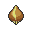

<!-- This file is generated by tools/generate_site.py. Edit the generator, not this file. -->

# #045 Vileplume

{ .sprite-lg loading=lazy }

**Flower Pokémon**

Grass Poison

[:material-arrow-left: #044 Gloom](044.md) · [Pokédex](index.md) · [#046 Paras :material-arrow-right:](046.md)

!!! info "Changes in Rising Ruby / Sinking Sapphire"

    - **Ability 2:** **Effect Spore** 

## Location

Evolve { .icon loading=lazy } [Gloom](../pokemon/044.md) (Leaf Stone)

## Type defenses

| Damage taken | Attacking types |
| --- | --- |
| Very resistant (×¼) | Grass |
| Resistant (×½) | Fighting Water Electric Fairy |
| Neutral (×1) | Normal Poison Ground Rock Bug Ghost Steel Dragon Dark |
| Weak (×2) | Flying Fire Psychic Ice |

## Abilities

| Slot | Ability | Effect | Note |
| --- | --- | --- | --- |
| Ability 1 | **Chlorophyll** | Doubles Speed during strong sunlight. |  |
| Ability 2 | **Effect Spore** | Has a 30% chance of inflcting either paralysis, poison, or sleep on attacking Pokémon on contact. | changed  |
| Hidden | **Effect Spore** | Has a 30% chance of inflcting either paralysis, poison, or sleep on attacking Pokémon on contact. |  |

## Base stats

| Form | HP | Atk | Def | SpA | SpD | Spe | BST |
| --- | --- | --- | --- | --- | --- | --- | --- |
| { .sprite-sm loading=lazy } Normal | 75 | 80 | 85 | 110 | 90 | 50 | **490** |

## Training & breeding

| Property | Value |
| --- | --- |
| EV yield | 3 SpA |
| Catch rate | 45 |
| Base friendship | 70 |
| Base experience | 221 |
| Growth rate | medium slow |
| Egg groups | Grass |
| Hatch counter | 20 |
| Gender ratio | 50% ♂ / 50% ♀ |
| Height / weight | 1.2 m / 18.6 kg |

## Evolution

- { .icon loading=lazy } [Oddish](../pokemon/043.md) → { .icon loading=lazy } [Gloom](../pokemon/044.md): Lv. 21
- { .icon loading=lazy } [Gloom](../pokemon/044.md) → { .icon loading=lazy } **[Vileplume](../pokemon/045.md)**: Leaf Stone
- { .icon loading=lazy } [Gloom](../pokemon/044.md) → { .icon loading=lazy } [Bellossom](../pokemon/182.md): Sun Stone

## Wild held items

| Item | Chance | Note |
| --- | --- | --- |
| { .item loading=lazy } Absorb Bulb | 5% |  |

## Level-up moves { data-search-exclude }

Moves marked &#42; are not normally learned by level up (they come from egg moves, TMs/HMs or tutors in the official games); moves marked &#42;&#42; cannot normally be learned by this Pokémon at all and are omitted from the legal-moves version of the hack.

| Lv. | Move | Type | Cat. | Power | Acc. | PP | Effect | Note |
| --- | --- | --- | --- | --- | --- | --- | --- | --- |
| 1 | Moonblast | Fairy | Special | 95 | 100% | 15 | Has a chance to lower the target’s Special Attack by one stage. | &#42; |
| 1 | Mega Drain | Grass | Special | 40 | 100% | 15 | Drains half the damage inflicted to heal the user. |  |
| 1 | Aromatherapy | Grass | Status | — | — | 5 | Cures the entire party of major status effects. |  |
| 1 | Poison Powder | Poison | Status | — | 75% | 35 | Poisons the target. |  |
| 1 | Stun Spore | Grass | Status | — | 75% | 30 | Paralyzes the target. |  |
| 34 | Petal Blizzard | Grass | Physical | 90 | 100% | 15 | Inflicts regular damage. |  |
| 44 | Petal Dance | Grass | Special | 120 | 100% | 10 | Hits every turn for 2-3 turns, then confuses the user. |  |
| 54 | Solar Beam | Grass | Special | 120 | 100% | 10 | Requires a turn to charge before attacking. |  |

## TM & HM moves { data-search-exclude }

| Machine | Move | Type | Cat. | Power | Acc. | PP | Effect |
| --- | --- | --- | --- | --- | --- | --- | --- |
| HM01 | [Cut](../changes/moves.md#cut) changed | Grass | Physical | 70 | 100% | 15 | High Critical Rate. High Critical Rate |
| TM06 | Toxic | Poison | Status | — | 90% | 10 | Badly poisons the target, inflicting more damage every turn. |
| TM09 | Venoshock | Poison | Special | 65 | 100% | 10 | Inflicts double damage if the target is Poisoned. |
| TM10 | Hidden Power | Normal | Special | 60 | 100% | 15 | Power and type depend upon user’s IVs.  Power can range from 30 to 70. |
| TM100 | Confide | Normal | Status | — | — | 20 | Lowers the target’s Special Attack by one stage. |
| TM11 | Sunny Day | Fire | Status | — | — | 5 | Changes the weather to sunny for five turns. |
| TM15 | Hyper Beam | Normal | Special | 150 | 90% | 5 | User foregoes its next turn to recharge. |
| TM17 | Protect | Normal | Status | — | — | 10 | Prevents any moves from hitting the user this turn. |
| TM20 | Safeguard | Normal | Status | — | — | 25 | Protects the user’s field from major status ailments and confusion for five turns. |
| TM21 | Frustration | Normal | Physical | — | 100% | 20 | Power increases as happiness decreases, up to a maximum of 102. |
| TM22 | Solar Beam | Grass | Special | 120 | 100% | 10 | Requires a turn to charge before attacking. |
| TM27 | Return | Normal | Physical | — | 100% | 20 | Power increases with happiness, up to a maximum of 102. |
| TM32 | Double Team | Normal | Status | — | — | 15 | Raises the user’s evasion by one stage. |
| TM36 | Sludge Bomb | Poison | Special | 90 | 100% | 10 | Has a chance to poison the target. |
| TM42 | Facade | Normal | Physical | 70 | 100% | 20 | Power doubles if user is burned, paralyzed, or poisoned. |
| TM44 | Rest | Psychic | Status | — | — | 5 | User sleeps for two turns, completely healing itself. |
| TM45 | Attract | Normal | Status | — | 100% | 15 | Target falls in love if it has the opposite gender, and has a 50% chance to refuse attacking the user. |
| TM48 | Round | Normal | Special | 60 | 100% | 15 | Has double power if it’s used more than once per turn. |
| TM53 | Energy Ball | Grass | Special | 90 | 100% | 10 | Has a chance to lower the target’s Special Defense by one stage. |
| TM56 | Fling | Dark | Physical | — | 100% | 10 | Throws held item at the target; power depends on the item. |
| TM68 | Giga Impact | Normal | Physical | 150 | 90% | 5 | User foregoes its next turn to recharge. |
| TM70 | Flash | Normal | Status | — | 100% | 20 | Lowers the target’s accuracy by one stage. |
| TM75 | Swords Dance | Normal | Status | — | — | 20 | Raises the user’s Attack by two stages. |
| TM83 | Infestation | Bug | Special | 20 | 100% | 20 | Prevents the target from fleeing and inflicts damage for 2-5 turns. |
| TM86 | Grass Knot | Grass | Special | — | 100% | 20 | Inflicts more damage to heavier targets, with a maximum of 120 power. |
| TM87 | Swagger | Normal | Status | — | 90% | 15 | Raises the target’s Attack by two stages and confuses the target. |
| TM88 | Sleep Talk | Normal | Status | — | — | 10 | Randomly uses one of the user’s other three moves.  Only works if the user is sleeping. |
| TM90 | Substitute | Normal | Status | — | — | 10 | Transfers 1/4 of the user’s max HP into a doll, protecting the user from further damage or status changes until it breaks. |
| TM94 | Secret Power | Normal | Physical | 70 | 100% | 20 | Has a chance to inflict a status effect which depends upon the terrain. |
| TM96 | Nature Power | Normal | Status | — | — | 20 | Uses a move which depends upon the terrain. |
| TM99 | Dazzling Gleam | Fairy | Special | 80 | 100% | 10 | Inflicts regular damage with no additional effect. |

## Move tutor moves { data-search-exclude }

| Move | Type | Cat. | Power | Acc. | PP | Effect |
| --- | --- | --- | --- | --- | --- | --- |
| After You | Normal | Status | — | — | 15 | Makes the target act next this turn. |
| Drain Punch | Fighting | Physical | 75 | 100% | 10 | Drains half the damage inflicted to heal the user. |
| Gastro Acid | Poison | Status | — | 100% | 10 | Nullifies target’s ability until it leaves battle. |
| Giga Drain | Grass | Special | 75 | 100% | 10 | Drains half the damage inflicted to heal the user. |
| Seed Bomb | Grass | Physical | 80 | 100% | 15 | Inflicts regular damage with no additional effect. |
| Snore | Normal | Special | 50 | 100% | 15 | Has a chance to make the target flinch.  Only works if the user is sleeping. |
| Synthesis | Grass | Status | — | — | 5 | Heals the user by half its max HP.  Affected by weather. |
| Worry Seed | Grass | Status | — | 100% | 10 | Changes the target’s ability to Insomnia. |

## Egg moves { data-search-exclude }

No egg moves.

??? note "Trainers using Vileplume (6)"

    | Area | Trainer | Level |
    | --- | --- | --- |
    | [Sea Mauville Inside](../trainers/sea_mauville_inside.md#rematches) | Young Couple Lois & Hal (7) | Lv. 59 |
    | [Sea Mauville Inside](../trainers/sea_mauville_inside.md#rematches) | Young Couple Lois & Hal (8) | Lv. 64 |
    | [Sea Mauville Inside](../trainers/sea_mauville_inside.md#rematches) | Young Couple Lois & Hal (C) | Lv. 75 |
    | [Route 123](../trainers/route_123.md#trainers) | Aroma Lady Violet | Lv. 39 |
    | [Aqua Hideout](../trainers/aqua_hideout.md#trainers) | Team Aqua Grunt | Lv. 54 |
    | [Seafloor Cavern Front Rooms](../trainers/seafloor_cavern_front_rooms.md#trainers) | Team Aqua Grunt | Lv. 60 |

---

[:material-arrow-left: #044 Gloom](044.md) · [#046 Paras :material-arrow-right:](046.md)
