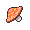

<!-- This file is generated by tools/generate_site.py. Edit the generator, not this file. -->

# #046 Paras

{ .sprite-lg loading=lazy }

**Mushroom Pokémon**

Bug Grass

[:material-arrow-left: #045 Vileplume](045.md) · [Pokédex](index.md) · [#047 Parasect :material-arrow-right:](047.md)

!!! info "Changes in Rising Ruby / Sinking Sapphire"

    - **Base stats:** Atk 70 → **80** (BST 285 → **295**)

## Location

[Rusturf Tunnel](../wild/rusturf_tunnel.md)

### Wild encounters

| Area | Method | Level | Note |
| --- | --- | --- | --- |
| [Rusturf Tunnel](../wild/rusturf_tunnel.md) | Walking | 10 |  |

## Type defenses

| Damage taken | Attacking types |
| --- | --- |
| Very resistant (×¼) | Ground Grass |
| Resistant (×½) | Fighting Water Electric |
| Neutral (×1) | Normal Ghost Steel Psychic Dragon Dark Fairy |
| Weak (×2) | Poison Rock Bug Ice |
| Very weak (×4) | Flying Fire |

## Abilities

| Slot | Ability | Effect | Note |
| --- | --- | --- | --- |
| Ability 1 | **Effect Spore** | Has a 30% chance of inflcting either paralysis, poison, or sleep on attacking Pokémon on contact. |  |
| Ability 2 | **Dry Skin** | Causes 1/8 max HP in damage each turn during strong sunlight, but heals for 1/8 max HP during rain.  Increases damage from Fire moves to 1.25×, but absorbs Water moves, healing for 1/4 max HP. |  |
| Hidden | **Damp** | Prevents Self-Destruct, Explosion, and Aftermath from working while the Pokémon is in battle. |  |

## Base stats

| Form | HP | Atk | Def | SpA | SpD | Spe | BST |
| --- | --- | --- | --- | --- | --- | --- | --- |
| { .sprite-sm loading=lazy } Normal | 35 | 80<small class="was">was 70</small> | 55 | 45 | 55 | 25 | 295<small class="was">was 285</small> |

## Training & breeding

| Property | Value |
| --- | --- |
| EV yield | 1 Atk |
| Catch rate | 190 |
| Base friendship | 70 |
| Base experience | 57 |
| Growth rate | medium |
| Egg groups | Bug, Grass |
| Hatch counter | 20 |
| Gender ratio | 50% ♂ / 50% ♀ |
| Height / weight | 0.3 m / 5.4 kg |

## Evolution

- { .icon loading=lazy } **[Paras](../pokemon/046.md)** → { .icon loading=lazy } [Parasect](../pokemon/047.md): Lv. 24

## Wild held items

| Item | Chance | Note |
| --- | --- | --- |
| { .item loading=lazy } Tiny Mushroom | 50% |  |
| { .item loading=lazy } Big Mushroom | 5% |  |

## Level-up moves { data-search-exclude }

Moves marked &#42; are not normally learned by level up (they come from egg moves, TMs/HMs or tutors in the official games); moves marked &#42;&#42; cannot normally be learned by this Pokémon at all and are omitted from the legal-moves version of the hack.

| Lv. | Move | Type | Cat. | Power | Acc. | PP | Effect | Note |
| --- | --- | --- | --- | --- | --- | --- | --- | --- |
| 1 | [Scratch](../changes/moves.md#scratch) changed | Normal | Physical | 50 | 100% | 35 | Inflicts regular damage with no additional effect. |  |
| 1 | Bug Bite | Bug | Physical | 60 | 100% | 20 | If target has a berry, inflicts double damage and uses the berry. | &#42; |
| 3 | Stun Spore | Grass | Status | — | 75% | 30 | Paralyzes the target. |  |
| 6 | Poison Powder | Poison | Status | — | 75% | 35 | Poisons the target. |  |
| 9 | Leech Life | Bug | Physical | 20 | 100% | 15 | Drains half the damage inflicted to heal the user. |  |
| 12 | Bullet Seed | Grass | Physical | 25 | 100% | 30 | Hits 2-5 times in one turn. | &#42; |
| 15 | Fury Cutter | Bug | Physical | 40 | 95% | 20 | Power doubles every turn this move is used in succession after the first, maxing out after five turns. |  |
| 18 | Cross Poison | Poison | Physical | 70 | 100% | 20 | Has an increased chance for a critical hit and a chance to poison the target. | &#42; |
| 21 | Spore | Grass | Status | — | 100% | 15 | Puts the target to sleep. |  |
| 24 | Slash | Normal | Physical | 70 | 100% | 20 | Has an increased chance for a critical hit. |  |
| 27 | Growth | Normal | Status | — | — | 20 | Raises the user’s Attack and Special Attack by one stage. |  |
| 30 | X-Scissor | Bug | Physical | 80 | 100% | 15 | Inflicts regular damage with no additional effect. |  |
| 33 | Giga Drain | Grass | Special | 75 | 100% | 10 | Drains half the damage inflicted to heal the user. |  |
| 36 | Aromatherapy | Grass | Status | — | — | 5 | Cures the entire party of major status effects. |  |
| 39 | Rage Powder | Bug | Status | — | — | 20 | Redirects the target’s single-target effects to the user for this turn. |  |
| 42 | Seed Bomb | Grass | Physical | 80 | 100% | 15 | Inflicts regular damage with no additional effect. | &#42; |

## TM & HM moves { data-search-exclude }

| Machine | Move | Type | Cat. | Power | Acc. | PP | Effect |
| --- | --- | --- | --- | --- | --- | --- | --- |
| HM01 | [Cut](../changes/moves.md#cut) changed | Grass | Physical | 70 | 100% | 15 | High Critical Rate. High Critical Rate |
| HM06 | [Rock Smash](../changes/moves.md#rock-smash) changed | Fighting | Physical | 65 | 100% | 15 | Has a chance to lower the target’s Defense by one stage. |
| TM01 | Hone Claws | Dark | Status | — | — | 15 | Raises the user’s Attack and accuracy by one stage. |
| TM06 | Toxic | Poison | Status | — | 90% | 10 | Badly poisons the target, inflicting more damage every turn. |
| TM09 | Venoshock | Poison | Special | 65 | 100% | 10 | Inflicts double damage if the target is Poisoned. |
| TM10 | Hidden Power | Normal | Special | 60 | 100% | 15 | Power and type depend upon user’s IVs.  Power can range from 30 to 70. |
| TM100 | Confide | Normal | Status | — | — | 20 | Lowers the target’s Special Attack by one stage. |
| TM11 | Sunny Day | Fire | Status | — | — | 5 | Changes the weather to sunny for five turns. |
| TM16 | Light Screen | Psychic | Status | — | — | 30 | Reduces damage from special attacks by 50% for five turns. |
| TM17 | Protect | Normal | Status | — | — | 10 | Prevents any moves from hitting the user this turn. |
| TM21 | Frustration | Normal | Physical | — | 100% | 20 | Power increases as happiness decreases, up to a maximum of 102. |
| TM22 | Solar Beam | Grass | Special | 120 | 100% | 10 | Requires a turn to charge before attacking. |
| TM27 | Return | Normal | Physical | — | 100% | 20 | Power increases with happiness, up to a maximum of 102. |
| TM28 | Dig | Ground | Physical | 80 | 100% | 10 | User digs underground, dodging all attacks, and hits next turn. |
| TM31 | Brick Break | Fighting | Physical | 75 | 100% | 15 | Destroys Reflect and Light Screen. |
| TM32 | Double Team | Normal | Status | — | — | 15 | Raises the user’s evasion by one stage. |
| TM36 | Sludge Bomb | Poison | Special | 90 | 100% | 10 | Has a chance to poison the target. |
| TM40 | Aerial Ace | Flying | Physical | 60 | — | 20 | Never misses. |
| TM42 | Facade | Normal | Physical | 70 | 100% | 20 | Power doubles if user is burned, paralyzed, or poisoned. |
| TM44 | Rest | Psychic | Status | — | — | 5 | User sleeps for two turns, completely healing itself. |
| TM45 | Attract | Normal | Status | — | 100% | 15 | Target falls in love if it has the opposite gender, and has a 50% chance to refuse attacking the user. |
| TM46 | Thief | Dark | Physical | 60 | 100% | 25 | Takes the target’s item. |
| TM48 | Round | Normal | Special | 60 | 100% | 15 | Has double power if it’s used more than once per turn. |
| TM53 | Energy Ball | Grass | Special | 90 | 100% | 10 | Has a chance to lower the target’s Special Defense by one stage. |
| TM54 | False Swipe | Normal | Physical | 40 | 100% | 40 | Cannot lower the target’s HP below 1. |
| TM70 | Flash | Normal | Status | — | 100% | 20 | Lowers the target’s accuracy by one stage. |
| TM75 | Swords Dance | Normal | Status | — | — | 20 | Raises the user’s Attack by two stages. |
| TM76 | Struggle Bug | Bug | Special | 50 | 100% | 20 | Has a chance to lower the target’s Special Attack by one stage. |
| TM81 | X-Scissor | Bug | Physical | 80 | 100% | 15 | Inflicts regular damage with no additional effect. |
| TM86 | Grass Knot | Grass | Special | — | 100% | 20 | Inflicts more damage to heavier targets, with a maximum of 120 power. |
| TM87 | Swagger | Normal | Status | — | 90% | 15 | Raises the target’s Attack by two stages and confuses the target. |
| TM88 | Sleep Talk | Normal | Status | — | — | 10 | Randomly uses one of the user’s other three moves.  Only works if the user is sleeping. |
| TM90 | Substitute | Normal | Status | — | — | 10 | Transfers 1/4 of the user’s max HP into a doll, protecting the user from further damage or status changes until it breaks. |
| TM94 | Secret Power | Normal | Physical | 70 | 100% | 20 | Has a chance to inflict a status effect which depends upon the terrain. |
| TM96 | Nature Power | Normal | Status | — | — | 20 | Uses a move which depends upon the terrain. |

## Move tutor moves { data-search-exclude }

| Move | Type | Cat. | Power | Acc. | PP | Effect |
| --- | --- | --- | --- | --- | --- | --- |
| After You | Normal | Status | — | — | 15 | Makes the target act next this turn. |
| Bug Bite | Bug | Physical | 60 | 100% | 20 | If target has a berry, inflicts double damage and uses the berry. |
| Giga Drain | Grass | Special | 75 | 100% | 10 | Drains half the damage inflicted to heal the user. |
| Knock Off | Dark | Physical | 65 | 100% | 20 | Target drops its held item. |
| Seed Bomb | Grass | Physical | 80 | 100% | 15 | Inflicts regular damage with no additional effect. |
| Snore | Normal | Special | 50 | 100% | 15 | Has a chance to make the target flinch.  Only works if the user is sleeping. |
| Synthesis | Grass | Status | — | — | 5 | Heals the user by half its max HP.  Affected by weather. |
| Worry Seed | Grass | Status | — | 100% | 10 | Changes the target’s ability to Insomnia. |

## Egg moves { data-search-exclude }

| Move | Type | Cat. | Power | Acc. | PP | Effect |
| --- | --- | --- | --- | --- | --- | --- |
| Agility | Psychic | Status | — | — | 30 | Raises the user’s Speed by two stages. |
| Bug Bite | Bug | Physical | 60 | 100% | 20 | If target has a berry, inflicts double damage and uses the berry. |
| Counter | Fighting | Physical | — | 100% | 20 | Inflicts twice the damage the user received from the last physical hit it took. |
| Cross Poison | Poison | Physical | 70 | 100% | 20 | Has an increased chance for a critical hit and a chance to poison the target. |
| Endure | Normal | Status | — | — | 10 | Prevents the user’s HP from lowering below 1 this turn. |
| Fell Stinger | Bug | Physical | 30 | 100% | 25 | Raises the user’s Attack by two stages if it KOs the target. |
| Flail | Normal | Physical | — | 100% | 15 | Inflicts more damage when the user has less HP remaining, with a maximum of 200 power. |
| Leech Seed | Grass | Status | — | 90% | 10 | Seeds the target, stealing HP from it every turn. |
| Metal Claw | Steel | Physical | 50 | 95% | 35 | Has a chance to raise the user’s Attack by one stage. |
| Natural Gift | Normal | Physical | — | 100% | 15 | Power and type depend on the held berry. |
| Psybeam | Psychic | Special | 65 | 100% | 20 | Has a chance to confuse the target. |
| Pursuit | Dark | Physical | 40 | 100% | 20 | Has double power against, and can hit, Pokémon attempting to switch out. |
| Rototiller | Ground | Status | — | — | 10 | Raises the Attack and Special Attack of all Grass Pokémon in battle. |
| Screech | Normal | Status | — | 85% | 40 | Lowers the target’s Defense by two stages. |
| Sweet Scent | Normal | Status | — | 100% | 20 | Lowers the target’s evasion by one stage. |
| Wide Guard | Rock | Status | — | — | 10 | Prevents any multi-target moves from hitting friendly Pokémon this turn. |

??? note "Trainers using Paras (1)"

    | Area | Trainer | Level |
    | --- | --- | --- |
    | [Route 110](../trainers/route_110.md#trainers-trick-house-dark-room) | Lass Robin | Lv. 24 |

---

[:material-arrow-left: #045 Vileplume](045.md) · [#047 Parasect :material-arrow-right:](047.md)
