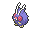

<!-- This file is generated by tools/generate_site.py. Edit the generator, not this file. -->

# #048 Venonat

{ .sprite-lg loading=lazy }

**Insect Pokémon**

Bug Poison

[:material-arrow-left: #047 Parasect](047.md) · [Pokédex](index.md) · [#049 Venomoth :material-arrow-right:](049.md)

!!! note "No documented changes"

    Drayano's documentation lists no stat, type, ability, evolution or held item changes for this Pokémon. Its level-up moves are listed below as they appear in the hack.

## Location

[Petalburg Woods](../wild/petalburg_woods.md)

### Wild encounters

| Area | Method | Level | Note |
| --- | --- | --- | --- |
| [Petalburg Woods](../wild/petalburg_woods.md) | Grass | 9 |  |

## Type defenses

| Damage taken | Attacking types |
| --- | --- |
| Very resistant (×¼) | Fighting Grass |
| Resistant (×½) | Poison Bug Fairy |
| Neutral (×1) | Normal Ground Ghost Steel Water Electric Ice Dragon Dark |
| Weak (×2) | Flying Rock Fire Psychic |

## Abilities

| Slot | Ability | Effect | Note |
| --- | --- | --- | --- |
| Ability 1 | **Compound Eyes** | Increases moves' accuracy to 1.3×. |  |
| Ability 2 | **Tinted Lens** | Doubles damage inflicted with not-very-effective moves. |  |
| Hidden | **Run Away** | Ensures success fleeing from wild battles. |  |

## Base stats

| Form | HP | Atk | Def | SpA | SpD | Spe | BST |
| --- | --- | --- | --- | --- | --- | --- | --- |
| { .sprite-sm loading=lazy } Normal | 60 | 55 | 50 | 40 | 55 | 45 | **305** |

## Training & breeding

| Property | Value |
| --- | --- |
| EV yield | 1 SpD |
| Catch rate | 190 |
| Base friendship | 70 |
| Base experience | 61 |
| Growth rate | medium |
| Egg groups | Bug |
| Hatch counter | 20 |
| Gender ratio | 50% ♂ / 50% ♀ |
| Height / weight | 1 m / 30 kg |

## Evolution

- { .icon loading=lazy } **[Venonat](../pokemon/048.md)** → { .icon loading=lazy } [Venomoth](../pokemon/049.md): Lv. 31

## Wild held items

None.

## Level-up moves { data-search-exclude }

Moves marked &#42; are not normally learned by level up (they come from egg moves, TMs/HMs or tutors in the official games); moves marked &#42;&#42; cannot normally be learned by this Pokémon at all and are omitted from the legal-moves version of the hack.

| Lv. | Move | Type | Cat. | Power | Acc. | PP | Effect | Note |
| --- | --- | --- | --- | --- | --- | --- | --- | --- |
| 1 | Tackle | Normal | Physical | 50 | 100% | 35 | Inflicts regular damage with no additional effect. |  |
| 1 | Disable | Normal | Status | — | 100% | 20 | Disables the target’s last used move for 1-8 turns. |  |
| 1 | Foresight | Normal | Status | — | — | 40 | Forces the target to have no Evade, and allows it to be hit by Normal and Fighting moves even if it’s a Ghost. |  |
| 5 | Leech Life | Bug | Physical | 20 | 100% | 15 | Drains half the damage inflicted to heal the user. |  |
| 8 | Supersonic | Normal | Status | — | 55% | 20 | Confuses the target. |  |
| 11 | Poison Fang | Poison | Physical | 50 | 100% | 15 | Has a chance to badly poison the target. |  |
| 14 | Bug Bite | Bug | Physical | 60 | 100% | 20 | If target has a berry, inflicts double damage and uses the berry. | &#42; |
| 17 | Confusion | Psychic | Special | 50 | 100% | 25 | Has a chance to confuse the target. |  |
| 20 | Poison Powder | Poison | Status | — | 75% | 35 | Poisons the target. |  |
| 23 | Stun Spore | Grass | Status | — | 75% | 30 | Paralyzes the target. |  |
| 26 | Sleep Powder | Grass | Status | — | 75% | 15 | Puts the target to sleep. |  |
| 29 | Zen Headbutt | Psychic | Physical | 80 | 90% | 15 | Has a chance to make the target flinch. |  |
| 32 | Signal Beam | Bug | Special | 75 | 100% | 15 | Has a chance to confuse the target. |  |
| 35 | Venoshock | Poison | Special | 65 | 100% | 10 | Inflicts double damage if the target is Poisoned. | &#42; |
| 38 | Energy Ball | Grass | Special | 90 | 100% | 10 | Has a chance to lower the target’s Special Defense by one stage. | &#42; |
| 41 | Psychic | Psychic | Special | 90 | 100% | 10 | Has a chance to lower the target’s Special Defense by one stage. |  |

## TM & HM moves { data-search-exclude }

| Machine | Move | Type | Cat. | Power | Acc. | PP | Effect |
| --- | --- | --- | --- | --- | --- | --- | --- |
| TM06 | Toxic | Poison | Status | — | 90% | 10 | Badly poisons the target, inflicting more damage every turn. |
| TM09 | Venoshock | Poison | Special | 65 | 100% | 10 | Inflicts double damage if the target is Poisoned. |
| TM10 | Hidden Power | Normal | Special | 60 | 100% | 15 | Power and type depend upon user’s IVs.  Power can range from 30 to 70. |
| TM100 | Confide | Normal | Status | — | — | 20 | Lowers the target’s Special Attack by one stage. |
| TM11 | Sunny Day | Fire | Status | — | — | 5 | Changes the weather to sunny for five turns. |
| TM17 | Protect | Normal | Status | — | — | 10 | Prevents any moves from hitting the user this turn. |
| TM21 | Frustration | Normal | Physical | — | 100% | 20 | Power increases as happiness decreases, up to a maximum of 102. |
| TM22 | Solar Beam | Grass | Special | 120 | 100% | 10 | Requires a turn to charge before attacking. |
| TM27 | Return | Normal | Physical | — | 100% | 20 | Power increases with happiness, up to a maximum of 102. |
| TM29 | Psychic | Psychic | Special | 90 | 100% | 10 | Has a chance to lower the target’s Special Defense by one stage. |
| TM32 | Double Team | Normal | Status | — | — | 15 | Raises the user’s evasion by one stage. |
| TM36 | Sludge Bomb | Poison | Special | 90 | 100% | 10 | Has a chance to poison the target. |
| TM42 | Facade | Normal | Physical | 70 | 100% | 20 | Power doubles if user is burned, paralyzed, or poisoned. |
| TM44 | Rest | Psychic | Status | — | — | 5 | User sleeps for two turns, completely healing itself. |
| TM45 | Attract | Normal | Status | — | 100% | 15 | Target falls in love if it has the opposite gender, and has a 50% chance to refuse attacking the user. |
| TM46 | Thief | Dark | Physical | 60 | 100% | 25 | Takes the target’s item. |
| TM48 | Round | Normal | Special | 60 | 100% | 15 | Has double power if it’s used more than once per turn. |
| TM70 | Flash | Normal | Status | — | 100% | 20 | Lowers the target’s accuracy by one stage. |
| TM76 | Struggle Bug | Bug | Special | 50 | 100% | 20 | Has a chance to lower the target’s Special Attack by one stage. |
| TM83 | Infestation | Bug | Special | 20 | 100% | 20 | Prevents the target from fleeing and inflicts damage for 2-5 turns. |
| TM87 | Swagger | Normal | Status | — | 90% | 15 | Raises the target’s Attack by two stages and confuses the target. |
| TM88 | Sleep Talk | Normal | Status | — | — | 10 | Randomly uses one of the user’s other three moves.  Only works if the user is sleeping. |
| TM90 | Substitute | Normal | Status | — | — | 10 | Transfers 1/4 of the user’s max HP into a doll, protecting the user from further damage or status changes until it breaks. |
| TM94 | Secret Power | Normal | Physical | 70 | 100% | 20 | Has a chance to inflict a status effect which depends upon the terrain. |

## Move tutor moves { data-search-exclude }

| Move | Type | Cat. | Power | Acc. | PP | Effect |
| --- | --- | --- | --- | --- | --- | --- |
| Bug Bite | Bug | Physical | 60 | 100% | 20 | If target has a berry, inflicts double damage and uses the berry. |
| Giga Drain | Grass | Special | 75 | 100% | 10 | Drains half the damage inflicted to heal the user. |
| Signal Beam | Bug | Special | 75 | 100% | 15 | Has a chance to confuse the target. |
| Skill Swap | Psychic | Status | — | — | 10 | User and target swap abilities. |
| Snore | Normal | Special | 50 | 100% | 15 | Has a chance to make the target flinch.  Only works if the user is sleeping. |
| Zen Headbutt | Psychic | Physical | 80 | 90% | 15 | Has a chance to make the target flinch. |

## Egg moves { data-search-exclude }

| Move | Type | Cat. | Power | Acc. | PP | Effect |
| --- | --- | --- | --- | --- | --- | --- |
| Agility | Psychic | Status | — | — | 30 | Raises the user’s Speed by two stages. |
| Baton Pass | Normal | Status | — | — | 40 | Allows the trainer to switch out the user and pass effects along to its replacement. |
| Bug Bite | Bug | Physical | 60 | 100% | 20 | If target has a berry, inflicts double damage and uses the berry. |
| Giga Drain | Grass | Special | 75 | 100% | 10 | Drains half the damage inflicted to heal the user. |
| Morning Sun | Normal | Status | — | — | 5 | Heals the user by half its max HP.  Affected by weather. |
| Rage Powder | Bug | Status | — | — | 20 | Redirects the target’s single-target effects to the user for this turn. |
| Screech | Normal | Status | — | 85% | 40 | Lowers the target’s Defense by two stages. |
| Secret Power | Normal | Physical | 70 | 100% | 20 | Has a chance to inflict a status effect which depends upon the terrain. |
| Signal Beam | Bug | Special | 75 | 100% | 15 | Has a chance to confuse the target. |
| Skill Swap | Psychic | Status | — | — | 10 | User and target swap abilities. |
| Toxic Spikes | Poison | Status | — | — | 20 | Scatters poisoned spikes, poisoning opposing Pokémon that switch in. |

??? note "Trainers using Venonat (1)"

    | Area | Trainer | Level |
    | --- | --- | --- |
    | [Petalburg Woods](../trainers/petalburg_woods.md#trainers) | Bug Catcher Lyle | Lv. 10 |

---

[:material-arrow-left: #047 Parasect](047.md) · [#049 Venomoth :material-arrow-right:](049.md)
