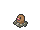

<!-- This file is generated by tools/generate_site.py. Edit the generator, not this file. -->

# #051 Dugtrio

{ .sprite-lg loading=lazy }

**Mole Pokémon**

Ground

[:material-arrow-left: #050 Diglett](050.md) · [Pokédex](index.md) · [#052 Meowth :material-arrow-right:](052.md)

!!! info "Changes in Rising Ruby / Sinking Sapphire"

    - **Base stats:** HP 35 → **45**, Atk 80 → **100**, Def 50 → **60**, SpD 70 → **80** (BST 405 → **455**)

## Location

[Route 123](../wild/route_123.md)

### Wild encounters

| Area | Method | Level | Note |
| --- | --- | --- | --- |
| [Route 123](../wild/route_123.md) | Tall Grass | 45 |  |

## Type defenses

| Damage taken | Attacking types |
| --- | --- |
| Immune (×0) | Electric |
| Resistant (×½) | Poison Rock |
| Neutral (×1) | Normal Fighting Flying Ground Bug Ghost Steel Fire Psychic Dragon Dark Fairy |
| Weak (×2) | Water Grass Ice |

## Abilities

| Slot | Ability | Effect | Note |
| --- | --- | --- | --- |
| Ability 1 | **Sand Veil** | Increases evasion to 1.25× during a sandstorm.  Protects against sandstorm damage. |  |
| Ability 2 | **Arena Trap** | Prevents opponents from fleeing or switching out.  Eluded by Flying-types and Pokémon in the air. |  |
| Hidden | **Sand Force** | Strengthens Rock, Ground, and Steel moves to 1.3× their power during a sandstorm.  Protects against sandstorm damage. |  |

## Base stats

| Form | HP | Atk | Def | SpA | SpD | Spe | BST |
| --- | --- | --- | --- | --- | --- | --- | --- |
| { .sprite-sm loading=lazy } Normal | 45<small class="was">was 35</small> | 100<small class="was">was 80</small> | 60<small class="was">was 50</small> | 50 | 80<small class="was">was 70</small> | 120 | 455<small class="was">was 405</small> |

## Training & breeding

| Property | Value |
| --- | --- |
| EV yield | 2 Spe |
| Catch rate | 50 |
| Base friendship | 70 |
| Base experience | 149 |
| Growth rate | medium |
| Egg groups | Field |
| Hatch counter | 20 |
| Gender ratio | 50% ♂ / 50% ♀ |
| Height / weight | 0.7 m / 33.3 kg |

## Evolution

- { .icon loading=lazy } [Diglett](../pokemon/050.md) → { .icon loading=lazy } **[Dugtrio](../pokemon/051.md)**: Lv. 26

## Wild held items

| Item | Chance | Note |
| --- | --- | --- |
| { .item loading=lazy } Soft Sand | 5% |  |

## Level-up moves { data-search-exclude }

Moves marked &#42; are not normally learned by level up (they come from egg moves, TMs/HMs or tutors in the official games); moves marked &#42;&#42; cannot normally be learned by this Pokémon at all and are omitted from the legal-moves version of the hack.

| Lv. | Move | Type | Cat. | Power | Acc. | PP | Effect | Note |
| --- | --- | --- | --- | --- | --- | --- | --- | --- |
| 1 | Rototiller | Ground | Status | — | — | 10 | Raises the Attack and Special Attack of all Grass Pokémon in battle. |  |
| 1 | Tri Attack | Normal | Special | 80 | 100% | 10 | Has a chance to burn, freeze, or paralyze the target. |  |
| 1 | [Scratch](../changes/moves.md#scratch) changed | Normal | Physical | 50 | 100% | 35 | Inflicts regular damage with no additional effect. |  |
| 1 | Sand Attack | Ground | Status | — | 100% | 15 | Lowers the target’s accuracy by one stage. |  |
| 4 | Growl | Normal | Status | — | 100% | 40 | Lowers the target’s Attack by one stage. |  |
| 7 | Astonish | Ghost | Physical | 30 | 100% | 15 | Has a chance to make the target flinch. |  |
| 10 | Mud-Slap | Ground | Special | 20 | 100% | 10 | Has a chance to lower the target’s accuracy by one stage. |  |
| 13 | Magnitude | Ground | Physical | — | 100% | 30 | Power varies randomly from 10 to 150. |  |
| 16 | Bulldoze | Ground | Physical | 60 | 100% | 20 | Has a chance to lower the target’s Speed by one stage. |  |
| 19 | Sucker Punch | Dark | Physical | 80 | 100% | 5 | Only works if the target is about to use a damaging move. |  |
| 22 | Mud Bomb | Ground | Special | 65 | 85% | 10 | Has a chance to lower the target’s accuracy by one stage. |  |
| 25 | Dig | Ground | Physical | 80 | 100% | 10 | User digs underground, dodging all attacks, and hits next turn. |  |
| 26 | Sand Tomb | Ground | Physical | 35 | 85% | 15 | Prevents the target from fleeing and inflicts damage for 2-5 turns. |  |
| 29 | Earth Power | Ground | Special | 90 | 100% | 10 | Has a chance to lower the target’s Special Defense by one stage. |  |
| 33 | Slash | Normal | Physical | 70 | 100% | 20 | Has an increased chance for a critical hit. |  |
| 37 | Earthquake | Ground | Physical | 100 | 100% | 10 | Inflicts regular damage and can hit Dig users. |  |
| 41 | Rock Slide | Rock | Physical | 75 | 90% | 10 | Has a chance to make the target flinch. |  |
| 45 | Night Slash | Dark | Physical | 70 | 100% | 15 | Has an increased chance for a critical hit. |  |
| 49 | Fissure | Ground | Physical | — | 30% | 5 | Causes a one-hit KO. |  |

## TM & HM moves { data-search-exclude }

| Machine | Move | Type | Cat. | Power | Acc. | PP | Effect |
| --- | --- | --- | --- | --- | --- | --- | --- |
| HM01 | [Cut](../changes/moves.md#cut) changed | Grass | Physical | 70 | 100% | 15 | High Critical Rate. High Critical Rate |
| HM06 | [Rock Smash](../changes/moves.md#rock-smash) changed | Fighting | Physical | 65 | 100% | 15 | Has a chance to lower the target’s Defense by one stage. |
| TM01 | Hone Claws | Dark | Status | — | — | 15 | Raises the user’s Attack and accuracy by one stage. |
| TM06 | Toxic | Poison | Status | — | 90% | 10 | Badly poisons the target, inflicting more damage every turn. |
| TM10 | Hidden Power | Normal | Special | 60 | 100% | 15 | Power and type depend upon user’s IVs.  Power can range from 30 to 70. |
| TM100 | Confide | Normal | Status | — | — | 20 | Lowers the target’s Special Attack by one stage. |
| TM11 | Sunny Day | Fire | Status | — | — | 5 | Changes the weather to sunny for five turns. |
| TM15 | Hyper Beam | Normal | Special | 150 | 90% | 5 | User foregoes its next turn to recharge. |
| TM17 | Protect | Normal | Status | — | — | 10 | Prevents any moves from hitting the user this turn. |
| TM21 | Frustration | Normal | Physical | — | 100% | 20 | Power increases as happiness decreases, up to a maximum of 102. |
| TM26 | Earthquake | Ground | Physical | 100 | 100% | 10 | Inflicts regular damage and can hit Dig users. |
| TM27 | Return | Normal | Physical | — | 100% | 20 | Power increases with happiness, up to a maximum of 102. |
| TM28 | Dig | Ground | Physical | 80 | 100% | 10 | User digs underground, dodging all attacks, and hits next turn. |
| TM32 | Double Team | Normal | Status | — | — | 15 | Raises the user’s evasion by one stage. |
| TM34 | Sludge Wave | Poison | Special | 95 | 100% | 10 | Has a chance to poison the target. |
| TM36 | Sludge Bomb | Poison | Special | 90 | 100% | 10 | Has a chance to poison the target. |
| TM37 | Sandstorm | Rock | Status | — | — | 10 | Changes the weather to a sandstorm for five turns. |
| TM39 | Rock Tomb | Rock | Physical | 60 | 95% | 15 | Has a chance to lower the target’s Speed by one stage. |
| TM40 | Aerial Ace | Flying | Physical | 60 | — | 20 | Never misses. |
| TM42 | Facade | Normal | Physical | 70 | 100% | 20 | Power doubles if user is burned, paralyzed, or poisoned. |
| TM44 | Rest | Psychic | Status | — | — | 5 | User sleeps for two turns, completely healing itself. |
| TM45 | Attract | Normal | Status | — | 100% | 15 | Target falls in love if it has the opposite gender, and has a 50% chance to refuse attacking the user. |
| TM46 | Thief | Dark | Physical | 60 | 100% | 25 | Takes the target’s item. |
| TM48 | Round | Normal | Special | 60 | 100% | 15 | Has double power if it’s used more than once per turn. |
| TM49 | Echoed Voice | Normal | Special | 40 | 100% | 15 | Power increases by 100% for each consecutive use by any friendly Pokémon, to a maximum of 200. |
| TM65 | Shadow Claw | Ghost | Physical | 70 | 100% | 15 | Has an increased chance for a critical hit. |
| TM68 | Giga Impact | Normal | Physical | 150 | 90% | 5 | User foregoes its next turn to recharge. |
| TM71 | Stone Edge | Rock | Physical | 100 | 80% | 5 | Has an increased chance for a critical hit. |
| TM78 | Bulldoze | Ground | Physical | 60 | 100% | 20 | Has a chance to lower the target’s Speed by one stage. |
| TM80 | Rock Slide | Rock | Physical | 75 | 90% | 10 | Has a chance to make the target flinch. |
| TM87 | Swagger | Normal | Status | — | 90% | 15 | Raises the target’s Attack by two stages and confuses the target. |
| TM88 | Sleep Talk | Normal | Status | — | — | 10 | Randomly uses one of the user’s other three moves.  Only works if the user is sleeping. |
| TM90 | Substitute | Normal | Status | — | — | 10 | Transfers 1/4 of the user’s max HP into a doll, protecting the user from further damage or status changes until it breaks. |
| TM94 | Secret Power | Normal | Physical | 70 | 100% | 20 | Has a chance to inflict a status effect which depends upon the terrain. |

## Move tutor moves { data-search-exclude }

| Move | Type | Cat. | Power | Acc. | PP | Effect |
| --- | --- | --- | --- | --- | --- | --- |
| Earth Power | Ground | Special | 90 | 100% | 10 | Has a chance to lower the target’s Special Defense by one stage. |
| Snore | Normal | Special | 50 | 100% | 15 | Has a chance to make the target flinch.  Only works if the user is sleeping. |
| Stealth Rock | Rock | Status | — | — | 20 | Causes damage when opposing Pokémon switch in. |

## Egg moves { data-search-exclude }

No egg moves.

??? note "Trainers using Dugtrio (2)"

    | Area | Trainer | Level |
    | --- | --- | --- |
    | [Route 112 South](../trainers/route_112_south.md#trainers) | Hiker Brice | Lv. 26 |
    | [Mt. Pyre 3F / 4F](../trainers/mt_pyre_3f_4f.md#trainers) | Backpacker Darnell | Lv. 49 |

---

[:material-arrow-left: #050 Diglett](050.md) · [#052 Meowth :material-arrow-right:](052.md)
