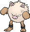
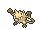

<!-- This file is generated by tools/generate_site.py. Edit the generator, not this file. -->

# #057 Primeape

{ .sprite-lg loading=lazy }

**Pig Monkey Pokémon**

Fighting

[:material-arrow-left: #056 Mankey](056.md) · [Pokédex](index.md) · [#058 Growlithe :material-arrow-right:](058.md)

!!! note "No documented changes"

    Drayano's documentation lists no stat, type, ability, evolution or held item changes for this Pokémon. Its level-up moves are listed below as they appear in the hack.

## Location

[Jagged Pass](../wild/jagged_pass.md), [Route 123](../wild/route_123.md)

### Wild encounters

| Area | Method | Level | Note |
| --- | --- | --- | --- |
| [Jagged Pass](../wild/jagged_pass.md) | Grass | 28 |  |
| [Route 123](../wild/route_123.md) | Tall Grass | 45 |  |

## Type defenses

| Damage taken | Attacking types |
| --- | --- |
| Resistant (×½) | Rock Bug Dark |
| Neutral (×1) | Normal Fighting Poison Ground Ghost Steel Fire Water Grass Electric Ice Dragon |
| Weak (×2) | Flying Psychic Fairy |

## Abilities

| Slot | Ability | Effect | Note |
| --- | --- | --- | --- |
| Ability 1 | **Vital Spirit** | Prevents sleep. |  |
| Ability 2 | **Anger Point** | Raises Attack to the maximum of six stages upon receiving a critical hit. |  |
| Hidden | **Defiant** | Raises Attack two stages upon having any stat lowered. |  |

## Base stats

| Form | HP | Atk | Def | SpA | SpD | Spe | BST |
| --- | --- | --- | --- | --- | --- | --- | --- |
| { .sprite-sm loading=lazy } Normal | 65 | 105 | 60 | 60 | 70 | 95 | **455** |

## Training & breeding

| Property | Value |
| --- | --- |
| EV yield | 2 Atk |
| Catch rate | 75 |
| Base friendship | 70 |
| Base experience | 159 |
| Growth rate | medium |
| Egg groups | Field |
| Hatch counter | 20 |
| Gender ratio | 50% ♂ / 50% ♀ |
| Height / weight | 1 m / 32 kg |

## Evolution

- { .icon loading=lazy } [Mankey](../pokemon/056.md) → { .icon loading=lazy } **[Primeape](../pokemon/057.md)**: Lv. 28

## Wild held items

None.

## Level-up moves { data-search-exclude }

Moves marked &#42; are not normally learned by level up (they come from egg moves, TMs/HMs or tutors in the official games); moves marked &#42;&#42; cannot normally be learned by this Pokémon at all and are omitted from the legal-moves version of the hack.

| Lv. | Move | Type | Cat. | Power | Acc. | PP | Effect | Note |
| --- | --- | --- | --- | --- | --- | --- | --- | --- |
| 1 | Ice Punch | Ice | Physical | 75 | 100% | 15 | Has a chance to freeze the target. | &#42; |
| 1 | Fire Punch | Fire | Physical | 75 | 100% | 15 | Has a chance to burn the target. | &#42; |
| 1 | Thunder Punch | Electric | Physical | 75 | 100% | 15 | Has a chance to paralyze the target. | &#42; |
| 1 | [Scratch](../changes/moves.md#scratch) changed | Normal | Physical | 50 | 100% | 35 | Inflicts regular damage with no additional effect. |  |
| 1 | Low Kick | Fighting | Physical | — | 100% | 20 | Inflicts more damage to heavier targets, with a maximum of 120 power. |  |
| 1 | Leer | Normal | Status | — | 100% | 30 | Lowers the target’s Defense by one stage. |  |
| 1 | Focus Energy | Normal | Status | — | — | 30 | Increases the user’s chance to score a critical hit. |  |
| 5 | Fury Swipes | Normal | Physical | 18 | 80% | 15 | Hits 2-5 times in one turn. |  |
| 8 | Karate Chop | Fighting | Physical | 50 | 100% | 25 | Has an increased chance for a critical hit. |  |
| 11 | Seismic Toss | Fighting | Physical | — | 100% | 20 | Inflicts damage equal to the user’s level. |  |
| 14 | Screech | Normal | Status | — | 85% | 40 | Lowers the target’s Defense by two stages. |  |
| 17 | Assurance | Dark | Physical | 60 | 100% | 10 | Power is doubled if the target has already received damage this turn. |  |
| 20 | Swagger | Normal | Status | — | 90% | 15 | Raises the target’s Attack by two stages and confuses the target. |  |
| 23 | Night Slash | Dark | Physical | 70 | 100% | 15 | Has an increased chance for a critical hit. | &#42; |
| 26 | Low Sweep | Fighting | Physical | 65 | 100% | 20 | Lowers the target’s Speed by one stage. | &#42; |
| 28 | Rage | Normal | Physical | 20 | 100% | 20 | If the user is hit after using this move, its Attack rises by one stage. |  |
| 30 | Fling | Dark | Physical | — | 100% | 10 | Throws held item at the target; power depends on the item. |  |
| 34 | Cross Chop | Fighting | Physical | 100 | 80% | 5 | Has an increased chance for a critical hit. |  |
| 38 | Thrash | Normal | Physical | 120 | 100% | 10 | Hits every turn for 2-3 turns, then confuses the user. |  |
| 42 | Acrobatics | Flying | Physical | 55 | 100% | 15 | Has double power if the user has no held item. | &#42; |
| 46 | Dual Chop | Dragon | Physical | 40 | 90% | 15 | Hits twice in one turn. | &#42; |
| 50 | Close Combat | Fighting | Physical | 120 | 100% | 5 | Lowers the user’s Defense and Special Defense by one stage after inflicting damage. |  |
| 54 | Punishment | Dark | Physical | — | 100% | 5 | Power increases against targets with more raised stats, up to a maximum of 200. |  |
| 58 | Gunk Shot | Poison | Physical | 120 | 80% | 5 | Has a chance to poison the target. | &#42; |
| 62 | Final Gambit | Fighting | Special | — | 100% | 5 | Inflicts damage equal to the user’s remaining HP.  User faints. |  |

## TM & HM moves { data-search-exclude }

| Machine | Move | Type | Cat. | Power | Acc. | PP | Effect |
| --- | --- | --- | --- | --- | --- | --- | --- |
| HM04 | [Strength](../changes/moves.md#strength) changed | Normal | Physical | 100 | 100% | 10 | Inflicts regular damage with no additional effect. |
| HM06 | [Rock Smash](../changes/moves.md#rock-smash) changed | Fighting | Physical | 65 | 100% | 15 | Has a chance to lower the target’s Defense by one stage. |
| TM01 | Hone Claws | Dark | Status | — | — | 15 | Raises the user’s Attack and accuracy by one stage. |
| TM06 | Toxic | Poison | Status | — | 90% | 10 | Badly poisons the target, inflicting more damage every turn. |
| TM08 | Bulk Up | Fighting | Status | — | — | 20 | Raises the user’s Attack and Defense by one stage. |
| TM10 | Hidden Power | Normal | Special | 60 | 100% | 15 | Power and type depend upon user’s IVs.  Power can range from 30 to 70. |
| TM100 | Confide | Normal | Status | — | — | 20 | Lowers the target’s Special Attack by one stage. |
| TM11 | Sunny Day | Fire | Status | — | — | 5 | Changes the weather to sunny for five turns. |
| TM12 | Taunt | Dark | Status | — | 100% | 20 | For the next few turns, the target can only use damaging moves. |
| TM15 | Hyper Beam | Normal | Special | 150 | 90% | 5 | User foregoes its next turn to recharge. |
| TM17 | Protect | Normal | Status | — | — | 10 | Prevents any moves from hitting the user this turn. |
| TM18 | Rain Dance | Water | Status | — | — | 5 | Changes the weather to rain for five turns. |
| TM21 | Frustration | Normal | Physical | — | 100% | 20 | Power increases as happiness decreases, up to a maximum of 102. |
| TM23 | Smack Down | Rock | Physical | 50 | 100% | 15 | Removes any immunity to Ground damage. |
| TM24 | Thunderbolt | Electric | Special | 90 | 100% | 15 | Has a chance to paralyze the target. |
| TM25 | Thunder | Electric | Special | 110 | 70% | 10 | Has a chance to paralyze the target. |
| TM26 | Earthquake | Ground | Physical | 100 | 100% | 10 | Inflicts regular damage and can hit Dig users. |
| TM27 | Return | Normal | Physical | — | 100% | 20 | Power increases with happiness, up to a maximum of 102. |
| TM28 | Dig | Ground | Physical | 80 | 100% | 10 | User digs underground, dodging all attacks, and hits next turn. |
| TM31 | Brick Break | Fighting | Physical | 75 | 100% | 15 | Destroys Reflect and Light Screen. |
| TM32 | Double Team | Normal | Status | — | — | 15 | Raises the user’s evasion by one stage. |
| TM39 | Rock Tomb | Rock | Physical | 60 | 95% | 15 | Has a chance to lower the target’s Speed by one stage. |
| TM40 | Aerial Ace | Flying | Physical | 60 | — | 20 | Never misses. |
| TM42 | Facade | Normal | Physical | 70 | 100% | 20 | Power doubles if user is burned, paralyzed, or poisoned. |
| TM44 | Rest | Psychic | Status | — | — | 5 | User sleeps for two turns, completely healing itself. |
| TM45 | Attract | Normal | Status | — | 100% | 15 | Target falls in love if it has the opposite gender, and has a 50% chance to refuse attacking the user. |
| TM46 | Thief | Dark | Physical | 60 | 100% | 25 | Takes the target’s item. |
| TM47 | Low Sweep | Fighting | Physical | 65 | 100% | 20 | Lowers the target’s Speed by one stage. |
| TM48 | Round | Normal | Special | 60 | 100% | 15 | Has double power if it’s used more than once per turn. |
| TM50 | Overheat | Fire | Special | 130 | 90% | 5 | Lowers the user’s Special Attack by two stages after inflicting damage. |
| TM52 | Focus Blast | Fighting | Special | 120 | 70% | 5 | Has a chance to lower the target’s Special Defense by one stage. |
| TM56 | Fling | Dark | Physical | — | 100% | 10 | Throws held item at the target; power depends on the item. |
| TM62 | Acrobatics | Flying | Physical | 55 | 100% | 15 | Has double power if the user has no held item. |
| TM66 | Payback | Dark | Physical | 50 | 100% | 10 | Power is doubled if the target has already moved this turn. |
| TM67 | Retaliate | Normal | Physical | 70 | 100% | 5 | Has double power if a friendly Pokémon fainted last turn. |
| TM68 | Giga Impact | Normal | Physical | 150 | 90% | 5 | User foregoes its next turn to recharge. |
| TM71 | Stone Edge | Rock | Physical | 100 | 80% | 5 | Has an increased chance for a critical hit. |
| TM78 | Bulldoze | Ground | Physical | 60 | 100% | 20 | Has a chance to lower the target’s Speed by one stage. |
| TM80 | Rock Slide | Rock | Physical | 75 | 90% | 10 | Has a chance to make the target flinch. |
| TM84 | Poison Jab | Poison | Physical | 80 | 100% | 20 | Has a chance to poison the target. |
| TM87 | Swagger | Normal | Status | — | 90% | 15 | Raises the target’s Attack by two stages and confuses the target. |
| TM88 | Sleep Talk | Normal | Status | — | — | 10 | Randomly uses one of the user’s other three moves.  Only works if the user is sleeping. |
| TM89 | U-turn | Bug | Physical | 70 | 100% | 20 | User must switch out after attacking. |
| TM90 | Substitute | Normal | Status | — | — | 10 | Transfers 1/4 of the user’s max HP into a doll, protecting the user from further damage or status changes until it breaks. |
| TM94 | Secret Power | Normal | Physical | 70 | 100% | 20 | Has a chance to inflict a status effect which depends upon the terrain. |
| TM98 | Power-Up Punch | Fighting | Physical | 40 | 100% | 20 | Raises the user’s Attack by one stage after inflicting damage. |

## Move tutor moves { data-search-exclude }

| Move | Type | Cat. | Power | Acc. | PP | Effect |
| --- | --- | --- | --- | --- | --- | --- |
| Covet | Normal | Physical | 60 | 100% | 25 | Takes the target’s item. |
| Dual Chop | Dragon | Physical | 40 | 90% | 15 | Hits twice in one turn. |
| Endeavor | Normal | Physical | — | 100% | 5 | Lowers the target’s HP to equal the user’s. |
| Fire Punch | Fire | Physical | 75 | 100% | 15 | Has a chance to burn the target. |
| Focus Punch | Fighting | Physical | 150 | 100% | 20 | If the user takes damage before attacking, the attack is canceled. |
| Gunk Shot | Poison | Physical | 120 | 80% | 5 | Has a chance to poison the target. |
| Helping Hand | Normal | Status | — | — | 20 | Ally’s next move inflicts half more damage. |
| Ice Punch | Ice | Physical | 75 | 100% | 15 | Has a chance to freeze the target. |
| Iron Tail | Steel | Physical | 100 | 75% | 15 | Has a chance to lower the target’s Defense by one stage. |
| Low Kick | Fighting | Physical | — | 100% | 20 | Inflicts more damage to heavier targets, with a maximum of 120 power. |
| Outrage | Dragon | Physical | 120 | 100% | 10 | Hits every turn for 2-3 turns, then confuses the user. |
| Role Play | Psychic | Status | — | — | 10 | Copies the target’s ability. |
| Seed Bomb | Grass | Physical | 80 | 100% | 15 | Inflicts regular damage with no additional effect. |
| Snore | Normal | Special | 50 | 100% | 15 | Has a chance to make the target flinch.  Only works if the user is sleeping. |
| Spite | Ghost | Status | — | 100% | 10 | Lowers the PP of the target’s last used move by 4. |
| Thunder Punch | Electric | Physical | 75 | 100% | 15 | Has a chance to paralyze the target. |
| Uproar | Normal | Special | 90 | 100% | 10 | Forced to use this move for several turns.  Pokémon cannot fall asleep in that time. |

## Egg moves { data-search-exclude }

No egg moves.

??? note "Trainers using Primeape (7)"

    | Area | Trainer | Level |
    | --- | --- | --- |
    | [Jagged Pass](../trainers/jagged_pass.md#trainers) | Expert Shelby | Lv. 35 |
    | [Jagged Pass](../trainers/jagged_pass.md#rematches) | Expert Shelby (6) | Lv. 47 |
    | [Jagged Pass](../trainers/jagged_pass.md#rematches) | Expert Shelby (7) | Lv. 59 |
    | [Jagged Pass](../trainers/jagged_pass.md#rematches) | Expert Shelby (8) | Lv. 64 |
    | [Jagged Pass](../trainers/jagged_pass.md#rematches) | Expert Shelby (C) | Lv. 75 |
    | [Meteor Falls B1F](../trainers/meteor_falls_b1f.md#trainers) | Battle Girl Tess | Lv. 65 |
    | [Victory Road 1F](../trainers/victory_road_1f.md#trainers) | Brains & Brawn Aden & Finn | Lv. 65 |

---

[:material-arrow-left: #056 Mankey](056.md) · [#058 Growlithe :material-arrow-right:](058.md)
