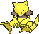
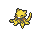
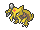
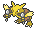
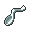

<!-- This file is generated by tools/generate_site.py. Edit the generator, not this file. -->

# #063 Abra

{ .sprite-lg loading=lazy }

**Psi Pokémon**

Psychic

[:material-arrow-left: #062 Poliwrath](062.md) · [Pokédex](index.md) · [#064 Kadabra :material-arrow-right:](064.md)

!!! note "No documented changes"

    Drayano's documentation lists no stat, type, ability, evolution or held item changes for this Pokémon. Its level-up moves are listed below as they appear in the hack.

## Location

[Granite Cave](../wild/granite_cave_1f.md)

### Wild encounters

| Area | Method | Level | Note |
| --- | --- | --- | --- |
| [Granite Cave 1F](../wild/granite_cave_1f.md) | Walking | 13 |  |

## Type defenses

| Damage taken | Attacking types |
| --- | --- |
| Resistant (×½) | Fighting Psychic |
| Neutral (×1) | Normal Flying Poison Ground Rock Steel Fire Water Grass Electric Ice Dragon Fairy |
| Weak (×2) | Bug Ghost Dark |

## Abilities

| Slot | Ability | Effect | Note |
| --- | --- | --- | --- |
| Ability 1 | **Synchronize** | Copies burns, paralysis, and poison received onto the Pokémon that inflicted them. |  |
| Ability 2 | **Inner Focus** | Prevents flinching. |  |
| Hidden | **Magic Guard** | Protects against damage not directly caused by a move. |  |

## Base stats

| Form | HP | Atk | Def | SpA | SpD | Spe | BST |
| --- | --- | --- | --- | --- | --- | --- | --- |
| { .sprite-sm loading=lazy } Normal | 25 | 20 | 15 | 105 | 55 | 90 | **310** |

## Training & breeding

| Property | Value |
| --- | --- |
| EV yield | 1 SpA |
| Catch rate | 200 |
| Base friendship | 70 |
| Base experience | 62 |
| Growth rate | medium slow |
| Egg groups | Human-Like |
| Hatch counter | 20 |
| Gender ratio | 75% ♂ / 25% ♀ |
| Height / weight | 0.9 m / 19.5 kg |

## Evolution

- { .icon loading=lazy } **[Abra](../pokemon/063.md)** → { .icon loading=lazy } [Kadabra](../pokemon/064.md): Lv. 16
- { .icon loading=lazy } [Kadabra](../pokemon/064.md) → { .icon loading=lazy } [Alakazam](../pokemon/065.md): Happiness / Lv. 36 changed <small>(vanilla: Trade)</small>

## Wild held items

| Item | Chance | Note |
| --- | --- | --- |
| { .item loading=lazy } Twisted Spoon | 5% |  |

## Level-up moves { data-search-exclude }

Moves marked &#42; are not normally learned by level up (they come from egg moves, TMs/HMs or tutors in the official games); moves marked &#42;&#42; cannot normally be learned by this Pokémon at all and are omitted from the legal-moves version of the hack.

| Lv. | Move | Type | Cat. | Power | Acc. | PP | Effect | Note |
| --- | --- | --- | --- | --- | --- | --- | --- | --- |
| 1 | Teleport | Psychic | Status | — | — | 20 | Immediately ends wild battles.  No effect otherwise. |  |

## TM & HM moves { data-search-exclude }

| Machine | Move | Type | Cat. | Power | Acc. | PP | Effect |
| --- | --- | --- | --- | --- | --- | --- | --- |
| TM03 | Psyshock | Psychic | Special | 80 | 100% | 10 | Inflicts damage based on the target’s Defense, not Special Defense. |
| TM04 | Calm Mind | Psychic | Status | — | — | 20 | Raises the user’s Special Attack and Special Defense by one stage. |
| TM06 | Toxic | Poison | Status | — | 90% | 10 | Badly poisons the target, inflicting more damage every turn. |
| TM10 | Hidden Power | Normal | Special | 60 | 100% | 15 | Power and type depend upon user’s IVs.  Power can range from 30 to 70. |
| TM100 | Confide | Normal | Status | — | — | 20 | Lowers the target’s Special Attack by one stage. |
| TM11 | Sunny Day | Fire | Status | — | — | 5 | Changes the weather to sunny for five turns. |
| TM12 | Taunt | Dark | Status | — | 100% | 20 | For the next few turns, the target can only use damaging moves. |
| TM16 | Light Screen | Psychic | Status | — | — | 30 | Reduces damage from special attacks by 50% for five turns. |
| TM17 | Protect | Normal | Status | — | — | 10 | Prevents any moves from hitting the user this turn. |
| TM18 | Rain Dance | Water | Status | — | — | 5 | Changes the weather to rain for five turns. |
| TM20 | Safeguard | Normal | Status | — | — | 25 | Protects the user’s field from major status ailments and confusion for five turns. |
| TM21 | Frustration | Normal | Physical | — | 100% | 20 | Power increases as happiness decreases, up to a maximum of 102. |
| TM27 | Return | Normal | Physical | — | 100% | 20 | Power increases with happiness, up to a maximum of 102. |
| TM29 | Psychic | Psychic | Special | 90 | 100% | 10 | Has a chance to lower the target’s Special Defense by one stage. |
| TM30 | Shadow Ball | Ghost | Special | 80 | 100% | 15 | Has a chance to lower the target’s Special Defense by one stage. |
| TM32 | Double Team | Normal | Status | — | — | 15 | Raises the user’s evasion by one stage. |
| TM33 | Reflect | Psychic | Status | — | — | 20 | Reduces damage from physical attacks by half. |
| TM41 | Torment | Dark | Status | — | 100% | 15 | Prevents the target from using the same move twice in a row. |
| TM42 | Facade | Normal | Physical | 70 | 100% | 20 | Power doubles if user is burned, paralyzed, or poisoned. |
| TM44 | Rest | Psychic | Status | — | — | 5 | User sleeps for two turns, completely healing itself. |
| TM45 | Attract | Normal | Status | — | 100% | 15 | Target falls in love if it has the opposite gender, and has a 50% chance to refuse attacking the user. |
| TM46 | Thief | Dark | Physical | 60 | 100% | 25 | Takes the target’s item. |
| TM48 | Round | Normal | Special | 60 | 100% | 15 | Has double power if it’s used more than once per turn. |
| TM53 | Energy Ball | Grass | Special | 90 | 100% | 10 | Has a chance to lower the target’s Special Defense by one stage. |
| TM56 | Fling | Dark | Physical | — | 100% | 10 | Throws held item at the target; power depends on the item. |
| TM57 | Charge Beam | Electric | Special | 50 | 90% | 10 | Has a chance to raise the user’s Special Attack by one stage. |
| TM63 | Embargo | Dark | Status | — | 100% | 15 | Target cannot use held items. |
| TM70 | Flash | Normal | Status | — | 100% | 20 | Lowers the target’s accuracy by one stage. |
| TM73 | Thunder Wave | Electric | Status | — | 100% | 20 | Paralyzes the target. |
| TM77 | Psych Up | Normal | Status | — | — | 10 | Discards the user’s stat changes and copies the target’s. |
| TM85 | Dream Eater | Psychic | Special | 100 | 100% | 15 | Only works on sleeping Pokémon.  Drains half the damage inflicted to heal the user. |
| TM86 | Grass Knot | Grass | Special | — | 100% | 20 | Inflicts more damage to heavier targets, with a maximum of 120 power. |
| TM87 | Swagger | Normal | Status | — | 90% | 15 | Raises the target’s Attack by two stages and confuses the target. |
| TM88 | Sleep Talk | Normal | Status | — | — | 10 | Randomly uses one of the user’s other three moves.  Only works if the user is sleeping. |
| TM90 | Substitute | Normal | Status | — | — | 10 | Transfers 1/4 of the user’s max HP into a doll, protecting the user from further damage or status changes until it breaks. |
| TM92 | Trick Room | Psychic | Status | — | — | 5 | For five turns, slower Pokémon will act before faster Pokémon. |
| TM94 | Secret Power | Normal | Physical | 70 | 100% | 20 | Has a chance to inflict a status effect which depends upon the terrain. |
| TM99 | Dazzling Gleam | Fairy | Special | 80 | 100% | 10 | Inflicts regular damage with no additional effect. |

## Move tutor moves { data-search-exclude }

| Move | Type | Cat. | Power | Acc. | PP | Effect |
| --- | --- | --- | --- | --- | --- | --- |
| Drain Punch | Fighting | Physical | 75 | 100% | 10 | Drains half the damage inflicted to heal the user. |
| Fire Punch | Fire | Physical | 75 | 100% | 15 | Has a chance to burn the target. |
| Focus Punch | Fighting | Physical | 150 | 100% | 20 | If the user takes damage before attacking, the attack is canceled. |
| Foul Play | Dark | Physical | 95 | 100% | 15 | Calculates damage with the target’s attacking stat. |
| Gravity | Psychic | Status | — | — | 5 | Disables moves and immunities that involve flying or levitating for five turns. |
| Ice Punch | Ice | Physical | 75 | 100% | 15 | Has a chance to freeze the target. |
| Iron Tail | Steel | Physical | 100 | 75% | 15 | Has a chance to lower the target’s Defense by one stage. |
| Knock Off | Dark | Physical | 65 | 100% | 20 | Target drops its held item. |
| Magic Coat | Psychic | Status | — | — | 15 | Reflects back the first effect move used on the user this turn. |
| Magic Room | Psychic | Status | — | — | 10 | Negates held items for five turns. |
| Recycle | Normal | Status | — | — | 10 | User recovers the item it last used up. |
| Role Play | Psychic | Status | — | — | 10 | Copies the target’s ability. |
| Shock Wave | Electric | Special | 60 | — | 20 | Never misses. |
| Signal Beam | Bug | Special | 75 | 100% | 15 | Has a chance to confuse the target. |
| Skill Swap | Psychic | Status | — | — | 10 | User and target swap abilities. |
| Snatch | Dark | Status | — | — | 10 | Steals the target’s move, if it’s self-targeted. |
| Snore | Normal | Special | 50 | 100% | 15 | Has a chance to make the target flinch.  Only works if the user is sleeping. |
| Thunder Punch | Electric | Physical | 75 | 100% | 15 | Has a chance to paralyze the target. |
| Trick | Psychic | Status | — | 100% | 10 | User and target swap items. |
| Wonder Room | Psychic | Status | — | — | 10 | All Pokémon’s Defense and Special Defense are swapped for 5 turns. |
| Zen Headbutt | Psychic | Physical | 80 | 90% | 15 | Has a chance to make the target flinch. |

## Egg moves { data-search-exclude }

| Move | Type | Cat. | Power | Acc. | PP | Effect |
| --- | --- | --- | --- | --- | --- | --- |
| Ally Switch | Psychic | Status | — | — | 15 | User switches places with the friendly Pokémon opposite it. |
| Barrier | Psychic | Status | — | — | 20 | Raises the user’s Defense by two stages. |
| Encore | Normal | Status | — | 100% | 5 | Forces the target to repeat its last used move every turn for 2 to 6 turns. |
| Fire Punch | Fire | Physical | 75 | 100% | 15 | Has a chance to burn the target. |
| Guard Split | Psychic | Status | — | — | 10 | Averages Defense and Special Defense with the target. |
| Guard Swap | Psychic | Status | — | — | 10 | User swaps Defense and Special Defense changes with the target. |
| Ice Punch | Ice | Physical | 75 | 100% | 15 | Has a chance to freeze the target. |
| Knock Off | Dark | Physical | 65 | 100% | 20 | Target drops its held item. |
| Power Trick | Psychic | Status | — | — | 10 | User swaps Attack and Defense. |
| Psycho Shift | Psychic | Status | — | 100% | 10 | Transfers the user’s major status effect to the target. |
| Skill Swap | Psychic | Status | — | — | 10 | User and target swap abilities. |
| Thunder Punch | Electric | Physical | 75 | 100% | 15 | Has a chance to paralyze the target. |

??? note "Trainers using Abra (1)"

    | Area | Trainer | Level |
    | --- | --- | --- |
    | [Route 110](../trainers/route_110.md#trainers-main-area) | Psychic Edward | Lv. 20 |

---

[:material-arrow-left: #062 Poliwrath](062.md) · [#064 Kadabra :material-arrow-right:](064.md)
