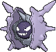

<!-- This file is generated by tools/generate_site.py. Edit the generator, not this file. -->

# #091 Cloyster

{ .sprite-lg loading=lazy }

**Bivalve Pokémon**

Water Ice

[:material-arrow-left: #090 Shellder](090.md) · [Pokédex](index.md) · [#092 Gastly :material-arrow-right:](092.md)

!!! note "No documented changes"

    Drayano's documentation lists no stat, type, ability, evolution or held item changes for this Pokémon. Its level-up moves are listed below as they appear in the hack.

## Location

[Dewford Town](../wild/dewford_town.md), [Route 125](../wild/route_125.md), [Shoal Cave](../wild/shoal_cave_1f.md)

### Wild encounters

| Area | Method | Level | Note |
| --- | --- | --- | --- |
| [Dewford Town](../wild/dewford_town.md) | Super Rod | 55 |  |
| [Route 125](../wild/route_125.md) | Super Rod | 55 |  |
| [Shoal Cave 1F](../wild/shoal_cave_1f.md) | Super Rod | 55 |  |
| [Shoal Cave B1F, B2F, B3F](../wild/shoal_cave_b1f_b2f_b3f.md) | Super Rod | 55 |  |

## Type defenses

| Damage taken | Attacking types |
| --- | --- |
| Very resistant (×¼) | Ice |
| Resistant (×½) | Water |
| Neutral (×1) | Normal Flying Poison Ground Bug Ghost Steel Fire Psychic Dragon Dark Fairy |
| Weak (×2) | Fighting Rock Grass Electric |

## Abilities

| Slot | Ability | Effect | Note |
| --- | --- | --- | --- |
| Ability 1 | **Shell Armor** | Protects against critical hits. |  |
| Ability 2 | **Skill Link** | Extends two-to-five-hit moves and Triple Kick to their full length every time. |  |
| Hidden | **Overcoat** | Protects against damage from weather. |  |

## Base stats

| Form | HP | Atk | Def | SpA | SpD | Spe | BST |
| --- | --- | --- | --- | --- | --- | --- | --- |
| { .sprite-sm loading=lazy } Normal | 50 | 95 | 180 | 85 | 45 | 70 | **525** |

## Training & breeding

| Property | Value |
| --- | --- |
| EV yield | 2 Def |
| Catch rate | 60 |
| Base friendship | 70 |
| Base experience | 184 |
| Growth rate | slow |
| Egg groups | Water 3 |
| Hatch counter | 20 |
| Gender ratio | 50% ♂ / 50% ♀ |
| Height / weight | 1.5 m / 132.5 kg |

## Evolution

- { .icon loading=lazy } [Shellder](../pokemon/090.md) → { .icon loading=lazy } **[Cloyster](../pokemon/091.md)**: Use Water Stone

## Wild held items

| Item | Chance | Note |
| --- | --- | --- |
| { .item loading=lazy } Pearl | 50% |  |
| { .item loading=lazy } Big Pearl | 5% |  |

## Level-up moves { data-search-exclude }

Moves marked &#42; are not normally learned by level up (they come from egg moves, TMs/HMs or tutors in the official games); moves marked &#42;&#42; cannot normally be learned by this Pokémon at all and are omitted from the legal-moves version of the hack.

| Lv. | Move | Type | Cat. | Power | Acc. | PP | Effect | Note |
| --- | --- | --- | --- | --- | --- | --- | --- | --- |
| 1 | Hydro Pump | Water | Special | 110 | 80% | 5 | Inflicts regular damage with no additional effect. |  |
| 1 | Shell Smash | Normal | Status | — | — | 15 | Raises user’s Attack, Special Attack, and Speed by two stages.  Lower user’s Defense and Special Defense by one stage. |  |
| 1 | Toxic Spikes | Poison | Status | — | — | 20 | Scatters poisoned spikes, poisoning opposing Pokémon that switch in. |  |
| 1 | Withdraw | Water | Status | — | — | 40 | Raises the user’s Defense by one stage. |  |
| 1 | Supersonic | Normal | Status | — | 55% | 20 | Confuses the target. |  |
| 1 | Protect | Normal | Status | — | — | 10 | Prevents any moves from hitting the user this turn. |  |
| 1 | Aurora Beam | Ice | Special | 65 | 100% | 20 | Has a chance to lower the target’s Attack by one stage. |  |
| 16 | Spike Cannon | Normal | Physical | 20 | 100% | 15 | Hits 2-5 times in one turn. |  |
| 22 | Spikes | Ground | Status | — | — | 20 | Scatters Spikes, hurting opposing Pokémon that switch in. |  |
| 28 | Razor Shell | Water | Physical | 75 | 95% | 10 | Has a chance to lower the target’s Defense by one stage. | &#42; |
| 34 | Rock Blast | Rock | Physical | 25 | 90% | 10 | Hits 2-5 times in one turn. | &#42; |
| 40 | Icicle Crash | Ice | Physical | 85 | 90% | 10 | Has a chance to make the target flinch. |  |

## TM & HM moves { data-search-exclude }

| Machine | Move | Type | Cat. | Power | Acc. | PP | Effect |
| --- | --- | --- | --- | --- | --- | --- | --- |
| HM03 | Surf | Water | Special | 90 | 100% | 15 | Inflicts regular damage and can hit Dive users. |
| HM07 | Dive | Water | Physical | 80 | 100% | 10 | User dives underwater, dodging all attacks, and hits next turn. |
| TM06 | Toxic | Poison | Status | — | 90% | 10 | Badly poisons the target, inflicting more damage every turn. |
| TM07 | Hail | Ice | Status | — | — | 10 | Changes the weather to a hailstorm for five turns. |
| TM10 | Hidden Power | Normal | Special | 60 | 100% | 15 | Power and type depend upon user’s IVs.  Power can range from 30 to 70. |
| TM100 | Confide | Normal | Status | — | — | 20 | Lowers the target’s Special Attack by one stage. |
| TM13 | Ice Beam | Ice | Special | 90 | 100% | 10 | Has a chance to freeze the target. |
| TM14 | Blizzard | Ice | Special | 110 | 70% | 5 | Has a chance to freeze the target. |
| TM15 | Hyper Beam | Normal | Special | 150 | 90% | 5 | User foregoes its next turn to recharge. |
| TM17 | Protect | Normal | Status | — | — | 10 | Prevents any moves from hitting the user this turn. |
| TM18 | Rain Dance | Water | Status | — | — | 5 | Changes the weather to rain for five turns. |
| TM21 | Frustration | Normal | Physical | — | 100% | 20 | Power increases as happiness decreases, up to a maximum of 102. |
| TM27 | Return | Normal | Physical | — | 100% | 20 | Power increases with happiness, up to a maximum of 102. |
| TM32 | Double Team | Normal | Status | — | — | 15 | Raises the user’s evasion by one stage. |
| TM41 | Torment | Dark | Status | — | 100% | 15 | Prevents the target from using the same move twice in a row. |
| TM42 | Facade | Normal | Physical | 70 | 100% | 20 | Power doubles if user is burned, paralyzed, or poisoned. |
| TM44 | Rest | Psychic | Status | — | — | 5 | User sleeps for two turns, completely healing itself. |
| TM45 | Attract | Normal | Status | — | 100% | 15 | Target falls in love if it has the opposite gender, and has a 50% chance to refuse attacking the user. |
| TM48 | Round | Normal | Special | 60 | 100% | 15 | Has double power if it’s used more than once per turn. |
| TM64 | Explosion | Normal | Physical | 250 | 100% | 5 | User faints. |
| TM66 | Payback | Dark | Physical | 50 | 100% | 10 | Power is doubled if the target has already moved this turn. |
| TM68 | Giga Impact | Normal | Physical | 150 | 90% | 5 | User foregoes its next turn to recharge. |
| TM79 | Frost Breath | Ice | Special | 60 | 90% | 10 | Always scores a critical hit. |
| TM84 | Poison Jab | Poison | Physical | 80 | 100% | 20 | Has a chance to poison the target. |
| TM87 | Swagger | Normal | Status | — | 90% | 15 | Raises the target’s Attack by two stages and confuses the target. |
| TM88 | Sleep Talk | Normal | Status | — | — | 10 | Randomly uses one of the user’s other three moves.  Only works if the user is sleeping. |
| TM90 | Substitute | Normal | Status | — | — | 10 | Transfers 1/4 of the user’s max HP into a doll, protecting the user from further damage or status changes until it breaks. |
| TM94 | Secret Power | Normal | Physical | 70 | 100% | 20 | Has a chance to inflict a status effect which depends upon the terrain. |

## Move tutor moves { data-search-exclude }

| Move | Type | Cat. | Power | Acc. | PP | Effect |
| --- | --- | --- | --- | --- | --- | --- |
| Icy Wind | Ice | Special | 55 | 95% | 15 | Has a chance to lower the target’s Speed by one stage. |
| Iron Defense | Steel | Status | — | — | 15 | Raises the user’s Defense by two stages. |
| Signal Beam | Bug | Special | 75 | 100% | 15 | Has a chance to confuse the target. |
| Snore | Normal | Special | 50 | 100% | 15 | Has a chance to make the target flinch.  Only works if the user is sleeping. |
| Water Pulse | Water | Special | 60 | 100% | 20 | Has a chance to confuse the target. |

## Egg moves { data-search-exclude }

No egg moves.

??? note "Trainers using Cloyster (5)"

    | Area | Trainer | Level |
    | --- | --- | --- |
    | [Route 109](../trainers/route_109.md#trainers) | Swimmer David | Lv. 37 |
    | [Route 111](../trainers/route_111.md#trainers) | The Winstrates' Vivi | Lv. 25 |
    | [Route 131](../trainers/route_131.md#trainers) | Swimmer Richard | Lv. 54 |
    | [Sootopolis Gym](../trainers/sootopolis_gym.md#trainers) | Beauty Tiffany | Lv. 62 |
    | [Aqua Hideout (Post Game)](../trainers/aqua_hideout_post_game.md#trainers) | Team Aqua Grunt | Lv. 75 |

---

[:material-arrow-left: #090 Shellder](090.md) · [#092 Gastly :material-arrow-right:](092.md)
