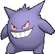
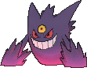

<!-- This file is generated by tools/generate_site.py. Edit the generator, not this file. -->

# #094 Gengar

{ .sprite-lg loading=lazy }

**Shadow Pokémon**

Ghost Poison

[:material-arrow-left: #093 Haunter](093.md) · [Pokédex](index.md) · [#095 Onix :material-arrow-right:](095.md)

!!! info "Changes in Rising Ruby / Sinking Sapphire"

    - **New TM/HM compatibility:** Sludge Wave

## Location

Evolve { .icon loading=lazy } [Haunter](../pokemon/093.md) (Happiness / Lv. 36)

## Type defenses

| Damage taken | Attacking types |
| --- | --- |
| Immune (×0) | Normal Fighting |
| Very resistant (×¼) | Poison Bug |
| Resistant (×½) | Grass Fairy |
| Neutral (×1) | Flying Rock Steel Fire Water Electric Ice Dragon |
| Weak (×2) | Ground Ghost Psychic Dark |

## Abilities

| Slot | Ability | Effect | Note |
| --- | --- | --- | --- |
| Ability 1 | **Levitate** | Evades Ground moves. |  |

## Base stats

| Form | HP | Atk | Def | SpA | SpD | Spe | BST |
| --- | --- | --- | --- | --- | --- | --- | --- |
| { .sprite-sm loading=lazy } Normal | 60 | 65 | 60 | 130 | 75 | 110 | **500** |
| { .sprite-sm loading=lazy } Mega Gengar | 60 | 65 | 80 | 170 | 95 | 130 | **600** |

## Training & breeding

| Property | Value |
| --- | --- |
| EV yield | 3 SpA |
| Catch rate | 45 |
| Base friendship | 70 |
| Base experience | 225 |
| Growth rate | medium slow |
| Egg groups | Amorphous |
| Hatch counter | 20 |
| Gender ratio | 50% ♂ / 50% ♀ |
| Height / weight | 1.5 m / 40.5 kg |

## Evolution

- { .icon loading=lazy } [Gastly](../pokemon/092.md) → { .icon loading=lazy } [Haunter](../pokemon/093.md): Lv. 25
- { .icon loading=lazy } [Haunter](../pokemon/093.md) → { .icon loading=lazy } **[Gengar](../pokemon/094.md)**: Happiness / Lv. 36 changed <small>(vanilla: Trade)</small>
- { .sprite-sm loading=lazy } **Mega Gengar**: Mega Evolves by holding the { .item loading=lazy } Gengarite

## Wild held items

None.

## Level-up moves { data-search-exclude }

Moves marked &#42; are not normally learned by level up (they come from egg moves, TMs/HMs or tutors in the official games); moves marked &#42;&#42; cannot normally be learned by this Pokémon at all and are omitted from the legal-moves version of the hack.

| Lv. | Move | Type | Cat. | Power | Acc. | PP | Effect | Note |
| --- | --- | --- | --- | --- | --- | --- | --- | --- |
| 1 | Icy Wind | Ice | Special | 55 | 95% | 15 | Has a chance to lower the target’s Speed by one stage. | &#42; |
| 1 | Giga Drain | Grass | Special | 75 | 100% | 10 | Drains half the damage inflicted to heal the user. | &#42; |
| 1 | Hypnosis | Psychic | Status | — | 60% | 20 | Puts the target to sleep. |  |
| 1 | Lick | Ghost | Physical | 30 | 100% | 30 | Has a chance to paralyze the target. |  |
| 1 | Spite | Ghost | Status | — | 100% | 10 | Lowers the PP of the target’s last used move by 4. |  |
| 5 | Mean Look | Normal | Status | — | — | 5 | Prevents the target from leaving battle. |  |
| 8 | Clear Smog | Poison | Special | 50 | — | 15 | Removes all of the target’s stat modifiers. | &#42; |
| 11 | Night Shade | Ghost | Special | — | 100% | 15 | Inflicts damage equal to the user’s level. |  |
| 14 | Hex | Ghost | Special | 65 | 100% | 10 | Has double power if the target has a major status ailment. | &#42; |
| 17 | Curse | Ghost | Status | — | — | 10 | Ghosts pay half their max HP to hurt the target every turn.  Others decrease Speed but raise Attack and Defense. |  |
| 20 | Confuse Ray | Ghost | Status | — | 100% | 10 | Confuses the target. |  |
| 23 | Dark Pulse | Dark | Special | 80 | 100% | 15 | Has a chance to make the target flinch. |  |
| 25 | Shadow Punch | Ghost | Physical | 60 | — | 20 | Never misses. |  |
| 27 | Payback | Dark | Physical | 50 | 100% | 10 | Power is doubled if the target has already moved this turn. |  |
| 31 | Shadow Ball | Ghost | Special | 80 | 100% | 15 | Has a chance to lower the target’s Special Defense by one stage. |  |
| 35 | Sucker Punch | Dark | Physical | 80 | 100% | 5 | Only works if the target is about to use a damaging move. |  |
| 39 | Dream Eater | Psychic | Special | 100 | 100% | 15 | Only works on sleeping Pokémon.  Drains half the damage inflicted to heal the user. |  |
| 43 | Destiny Bond | Ghost | Status | — | — | 5 | If the user faints this turn, the target automatically will, too. |  |
| 47 | Nightmare | Ghost | Status | — | 100% | 15 | Target loses 1/4 its max HP every turn as long as it’s asleep. |  |

## TM & HM moves { data-search-exclude }

| Machine | Move | Type | Cat. | Power | Acc. | PP | Effect |
| --- | --- | --- | --- | --- | --- | --- | --- |
| HM04 | [Strength](../changes/moves.md#strength) changed | Normal | Physical | 100 | 100% | 10 | Inflicts regular damage with no additional effect. |
| HM06 | [Rock Smash](../changes/moves.md#rock-smash) changed | Fighting | Physical | 65 | 100% | 15 | Has a chance to lower the target’s Defense by one stage. |
| TM06 | Toxic | Poison | Status | — | 90% | 10 | Badly poisons the target, inflicting more damage every turn. |
| TM09 | Venoshock | Poison | Special | 65 | 100% | 10 | Inflicts double damage if the target is Poisoned. |
| TM10 | Hidden Power | Normal | Special | 60 | 100% | 15 | Power and type depend upon user’s IVs.  Power can range from 30 to 70. |
| TM100 | Confide | Normal | Status | — | — | 20 | Lowers the target’s Special Attack by one stage. |
| TM11 | Sunny Day | Fire | Status | — | — | 5 | Changes the weather to sunny for five turns. |
| TM12 | Taunt | Dark | Status | — | 100% | 20 | For the next few turns, the target can only use damaging moves. |
| TM15 | Hyper Beam | Normal | Special | 150 | 90% | 5 | User foregoes its next turn to recharge. |
| TM17 | Protect | Normal | Status | — | — | 10 | Prevents any moves from hitting the user this turn. |
| TM18 | Rain Dance | Water | Status | — | — | 5 | Changes the weather to rain for five turns. |
| TM21 | Frustration | Normal | Physical | — | 100% | 20 | Power increases as happiness decreases, up to a maximum of 102. |
| TM24 | Thunderbolt | Electric | Special | 90 | 100% | 15 | Has a chance to paralyze the target. |
| TM25 | Thunder | Electric | Special | 110 | 70% | 10 | Has a chance to paralyze the target. |
| TM27 | Return | Normal | Physical | — | 100% | 20 | Power increases with happiness, up to a maximum of 102. |
| TM29 | Psychic | Psychic | Special | 90 | 100% | 10 | Has a chance to lower the target’s Special Defense by one stage. |
| TM30 | Shadow Ball | Ghost | Special | 80 | 100% | 15 | Has a chance to lower the target’s Special Defense by one stage. |
| TM31 | Brick Break | Fighting | Physical | 75 | 100% | 15 | Destroys Reflect and Light Screen. |
| TM32 | Double Team | Normal | Status | — | — | 15 | Raises the user’s evasion by one stage. |
| TM34 new | Sludge Wave | Poison | Special | 95 | 100% | 10 | Has a chance to poison the target. |
| TM36 | Sludge Bomb | Poison | Special | 90 | 100% | 10 | Has a chance to poison the target. |
| TM41 | Torment | Dark | Status | — | 100% | 15 | Prevents the target from using the same move twice in a row. |
| TM42 | Facade | Normal | Physical | 70 | 100% | 20 | Power doubles if user is burned, paralyzed, or poisoned. |
| TM44 | Rest | Psychic | Status | — | — | 5 | User sleeps for two turns, completely healing itself. |
| TM45 | Attract | Normal | Status | — | 100% | 15 | Target falls in love if it has the opposite gender, and has a 50% chance to refuse attacking the user. |
| TM46 | Thief | Dark | Physical | 60 | 100% | 25 | Takes the target’s item. |
| TM48 | Round | Normal | Special | 60 | 100% | 15 | Has double power if it’s used more than once per turn. |
| TM52 | Focus Blast | Fighting | Special | 120 | 70% | 5 | Has a chance to lower the target’s Special Defense by one stage. |
| TM53 | Energy Ball | Grass | Special | 90 | 100% | 10 | Has a chance to lower the target’s Special Defense by one stage. |
| TM56 | Fling | Dark | Physical | — | 100% | 10 | Throws held item at the target; power depends on the item. |
| TM61 | Will-O-Wisp | Fire | Status | — | 85% | 15 | Burns the target. |
| TM63 | Embargo | Dark | Status | — | 100% | 15 | Target cannot use held items. |
| TM64 | Explosion | Normal | Physical | 250 | 100% | 5 | User faints. |
| TM65 | Shadow Claw | Ghost | Physical | 70 | 100% | 15 | Has an increased chance for a critical hit. |
| TM66 | Payback | Dark | Physical | 50 | 100% | 10 | Power is doubled if the target has already moved this turn. |
| TM68 | Giga Impact | Normal | Physical | 150 | 90% | 5 | User foregoes its next turn to recharge. |
| TM77 | Psych Up | Normal | Status | — | — | 10 | Discards the user’s stat changes and copies the target’s. |
| TM83 | Infestation | Bug | Special | 20 | 100% | 20 | Prevents the target from fleeing and inflicts damage for 2-5 turns. |
| TM84 | Poison Jab | Poison | Physical | 80 | 100% | 20 | Has a chance to poison the target. |
| TM85 | Dream Eater | Psychic | Special | 100 | 100% | 15 | Only works on sleeping Pokémon.  Drains half the damage inflicted to heal the user. |
| TM87 | Swagger | Normal | Status | — | 90% | 15 | Raises the target’s Attack by two stages and confuses the target. |
| TM88 | Sleep Talk | Normal | Status | — | — | 10 | Randomly uses one of the user’s other three moves.  Only works if the user is sleeping. |
| TM90 | Substitute | Normal | Status | — | — | 10 | Transfers 1/4 of the user’s max HP into a doll, protecting the user from further damage or status changes until it breaks. |
| TM92 | Trick Room | Psychic | Status | — | — | 5 | For five turns, slower Pokémon will act before faster Pokémon. |
| TM94 | Secret Power | Normal | Physical | 70 | 100% | 20 | Has a chance to inflict a status effect which depends upon the terrain. |
| TM97 | Dark Pulse | Dark | Special | 80 | 100% | 15 | Has a chance to make the target flinch. |
| TM98 | Power-Up Punch | Fighting | Physical | 40 | 100% | 20 | Raises the user’s Attack by one stage after inflicting damage. |
| TM99 | Dazzling Gleam | Fairy | Special | 80 | 100% | 10 | Inflicts regular damage with no additional effect. |

## Move tutor moves { data-search-exclude }

| Move | Type | Cat. | Power | Acc. | PP | Effect |
| --- | --- | --- | --- | --- | --- | --- |
| Drain Punch | Fighting | Physical | 75 | 100% | 10 | Drains half the damage inflicted to heal the user. |
| Fire Punch | Fire | Physical | 75 | 100% | 15 | Has a chance to burn the target. |
| Focus Punch | Fighting | Physical | 150 | 100% | 20 | If the user takes damage before attacking, the attack is canceled. |
| Foul Play | Dark | Physical | 95 | 100% | 15 | Calculates damage with the target’s attacking stat. |
| Giga Drain | Grass | Special | 75 | 100% | 10 | Drains half the damage inflicted to heal the user. |
| Ice Punch | Ice | Physical | 75 | 100% | 15 | Has a chance to freeze the target. |
| Icy Wind | Ice | Special | 55 | 95% | 15 | Has a chance to lower the target’s Speed by one stage. |
| Knock Off | Dark | Physical | 65 | 100% | 20 | Target drops its held item. |
| Pain Split | Normal | Status | — | — | 20 | Sets the user’s and targets’s HP to the average of their current HP. |
| Role Play | Psychic | Status | — | — | 10 | Copies the target’s ability. |
| Skill Swap | Psychic | Status | — | — | 10 | User and target swap abilities. |
| Snatch | Dark | Status | — | — | 10 | Steals the target’s move, if it’s self-targeted. |
| Snore | Normal | Special | 50 | 100% | 15 | Has a chance to make the target flinch.  Only works if the user is sleeping. |
| Spite | Ghost | Status | — | 100% | 10 | Lowers the PP of the target’s last used move by 4. |
| Thunder Punch | Electric | Physical | 75 | 100% | 15 | Has a chance to paralyze the target. |
| Trick | Psychic | Status | — | 100% | 10 | User and target swap items. |
| Uproar | Normal | Special | 90 | 100% | 10 | Forced to use this move for several turns.  Pokémon cannot fall asleep in that time. |
| Wonder Room | Psychic | Status | — | — | 10 | All Pokémon’s Defense and Special Defense are swapped for 5 turns. |

## Egg moves { data-search-exclude }

No egg moves.

??? note "Trainers using Gengar (3)"

    | Area | Trainer | Level |
    | --- | --- | --- |
    | [Route 123](../trainers/route_123.md#trainers) | Ace Trainer Clyde | Lv. 50 |
    | [Pokémon League](../trainers/pokemon_league.md#trainers) | Elite Four Phoebe | Lv. 71 |
    | [Pokémon League (Post Game)](../trainers/pokemon_league_post_game.md#trainers) | Elite Four Phoebe | Lv. 83 |

---

[:material-arrow-left: #093 Haunter](093.md) · [#095 Onix :material-arrow-right:](095.md)
