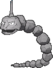

<!-- This file is generated by tools/generate_site.py. Edit the generator, not this file. -->

# #095 Onix

{ .sprite-lg loading=lazy }

**Rock Snake Pokémon**

Rock Ground

[:material-arrow-left: #094 Gengar](094.md) · [Pokédex](index.md) · [#096 Drowzee :material-arrow-right:](096.md)

!!! info "Changes in Rising Ruby / Sinking Sapphire"

    - **Base stats:** HP 35 → **65**, Atk 45 → **75**, Spe 70 → **100** (BST 385 → **475**)
    - **Evolution:** Use a Metal Coat

## Location

[Granite Cave](../wild/granite_cave_1f.md), [Scorched Slab](../wild/scorched_slab.md)

### Wild encounters

| Area | Method | Level | Note |
| --- | --- | --- | --- |
| [Granite Cave 1F](../wild/granite_cave_1f.md) | Walking | 13 |  |
| [Granite Cave B1F](../wild/granite_cave_b1f.md) | Walking | 18 |  |
| [Scorched Slab](../wild/scorched_slab.md) | Walking | 35 |  |

## Type defenses

| Damage taken | Attacking types |
| --- | --- |
| Immune (×0) | Electric |
| Very resistant (×¼) | Poison |
| Resistant (×½) | Normal Flying Rock Fire |
| Neutral (×1) | Bug Ghost Psychic Dragon Dark Fairy |
| Weak (×2) | Fighting Ground Steel Ice |
| Very weak (×4) | Water Grass |

## Abilities

| Slot | Ability | Effect | Note |
| --- | --- | --- | --- |
| Ability 1 | **Rock Head** | Protects against recoil damage. |  |
| Ability 2 | **Sturdy** | Prevents being KOed from full HP, leaving 1 HP instead.  Protects against the one-hit KO moves regardless of HP. |  |
| Hidden | **Weak Armor** | Raises Speed and lowers Defense by one stage each upon being hit by a physical move. |  |

## Base stats

| Form | HP | Atk | Def | SpA | SpD | Spe | BST |
| --- | --- | --- | --- | --- | --- | --- | --- |
| { .sprite-sm loading=lazy } Normal | 65<small class="was">was 35</small> | 75<small class="was">was 45</small> | 160 | 30 | 45 | 100<small class="was">was 70</small> | 475<small class="was">was 385</small> |

## Training & breeding

| Property | Value |
| --- | --- |
| EV yield | 1 Def |
| Catch rate | 45 |
| Base friendship | 70 |
| Base experience | 77 |
| Growth rate | medium |
| Egg groups | Mineral |
| Hatch counter | 25 |
| Gender ratio | 50% ♂ / 50% ♀ |
| Height / weight | 8.8 m / 210 kg |

## Evolution

- { .icon loading=lazy } **[Onix](../pokemon/095.md)** → { .icon loading=lazy } [Steelix](../pokemon/208.md): Use a Metal Coat changed <small>(vanilla: Trade holding Metal Coat)</small>

## Wild held items

None.

## Level-up moves { data-search-exclude }

Moves marked &#42; are not normally learned by level up (they come from egg moves, TMs/HMs or tutors in the official games); moves marked &#42;&#42; cannot normally be learned by this Pokémon at all and are omitted from the legal-moves version of the hack.

| Lv. | Move | Type | Cat. | Power | Acc. | PP | Effect | Note |
| --- | --- | --- | --- | --- | --- | --- | --- | --- |
| 1 | Mud Sport | Ground | Status | — | — | 15 | Halves all Electric-type damage. |  |
| 1 | Tackle | Normal | Physical | 50 | 100% | 35 | Inflicts regular damage with no additional effect. |  |
| 1 | Harden | Normal | Status | — | — | 30 | Raises the user’s Defense by one stage. |  |
| 1 | Bind | Normal | Physical | 15 | 85% | 20 | Prevents the target from fleeing and inflicts damage for 2-5 turns. |  |
| 4 | Curse | Ghost | Status | — | — | 10 | Ghosts pay half their max HP to hurt the target every turn.  Others decrease Speed but raise Attack and Defense. |  |
| 7 | Rock Throw | Rock | Physical | 50 | 90% | 15 | Inflicts regular damage with no additional effect. |  |
| 10 | Rock Tomb | Rock | Physical | 60 | 95% | 15 | Has a chance to lower the target’s Speed by one stage. |  |
| 13 | Rage | Normal | Physical | 20 | 100% | 20 | If the user is hit after using this move, its Attack rises by one stage. |  |
| 16 | Smack Down | Rock | Physical | 50 | 100% | 15 | Removes any immunity to Ground damage. |  |
| 19 | Rock Polish | Rock | Status | — | — | 20 | Raises the user’s Speed by two stages. |  |
| 20 | Dig | Ground | Physical | 80 | 100% | 10 | User digs underground, dodging all attacks, and hits next turn. |  |
| 22 | Rock Slide | Rock | Physical | 75 | 90% | 10 | Has a chance to make the target flinch. |  |
| 25 | Gyro Ball | Steel | Physical | — | 100% | 5 | Power raises when the user has lower Speed, up to a maximum of 150. |  |
| 28 | Slam | Normal | Physical | 80 | 75% | 20 | Inflicts regular damage with no additional effect. |  |
| 31 | Dragon Breath | Dragon | Special | 60 | 100% | 20 | Has a chance to paralyze the target. |  |
| 34 | Screech | Normal | Status | — | 85% | 40 | Lowers the target’s Defense by two stages. |  |
| 37 | Sand Tomb | Ground | Physical | 35 | 85% | 15 | Prevents the target from fleeing and inflicts damage for 2-5 turns. |  |
| 40 | Iron Tail | Steel | Physical | 100 | 75% | 15 | Has a chance to lower the target’s Defense by one stage. |  |
| 43 | Stealth Rock | Rock | Status | — | — | 20 | Causes damage when opposing Pokémon switch in. |  |
| 46 | Stone Edge | Rock | Physical | 100 | 80% | 5 | Has an increased chance for a critical hit. |  |
| 49 | Double-Edge | Normal | Physical | 120 | 100% | 15 | User receives 1/3 the damage inflicted in recoil. |  |
| 52 | Sandstorm | Rock | Status | — | — | 10 | Changes the weather to a sandstorm for five turns. |  |

## TM & HM moves { data-search-exclude }

| Machine | Move | Type | Cat. | Power | Acc. | PP | Effect |
| --- | --- | --- | --- | --- | --- | --- | --- |
| HM04 | [Strength](../changes/moves.md#strength) changed | Normal | Physical | 100 | 100% | 10 | Inflicts regular damage with no additional effect. |
| HM06 | [Rock Smash](../changes/moves.md#rock-smash) changed | Fighting | Physical | 65 | 100% | 15 | Has a chance to lower the target’s Defense by one stage. |
| TM05 | Roar | Normal | Status | — | — | 20 | Immediately ends wild battles.  Forces trainers to switch Pokémon. |
| TM06 | Toxic | Poison | Status | — | 90% | 10 | Badly poisons the target, inflicting more damage every turn. |
| TM10 | Hidden Power | Normal | Special | 60 | 100% | 15 | Power and type depend upon user’s IVs.  Power can range from 30 to 70. |
| TM100 | Confide | Normal | Status | — | — | 20 | Lowers the target’s Special Attack by one stage. |
| TM11 | Sunny Day | Fire | Status | — | — | 5 | Changes the weather to sunny for five turns. |
| TM12 | Taunt | Dark | Status | — | 100% | 20 | For the next few turns, the target can only use damaging moves. |
| TM17 | Protect | Normal | Status | — | — | 10 | Prevents any moves from hitting the user this turn. |
| TM21 | Frustration | Normal | Physical | — | 100% | 20 | Power increases as happiness decreases, up to a maximum of 102. |
| TM23 | Smack Down | Rock | Physical | 50 | 100% | 15 | Removes any immunity to Ground damage. |
| TM26 | Earthquake | Ground | Physical | 100 | 100% | 10 | Inflicts regular damage and can hit Dig users. |
| TM27 | Return | Normal | Physical | — | 100% | 20 | Power increases with happiness, up to a maximum of 102. |
| TM28 | Dig | Ground | Physical | 80 | 100% | 10 | User digs underground, dodging all attacks, and hits next turn. |
| TM32 | Double Team | Normal | Status | — | — | 15 | Raises the user’s evasion by one stage. |
| TM37 | Sandstorm | Rock | Status | — | — | 10 | Changes the weather to a sandstorm for five turns. |
| TM39 | Rock Tomb | Rock | Physical | 60 | 95% | 15 | Has a chance to lower the target’s Speed by one stage. |
| TM41 | Torment | Dark | Status | — | 100% | 15 | Prevents the target from using the same move twice in a row. |
| TM42 | Facade | Normal | Physical | 70 | 100% | 20 | Power doubles if user is burned, paralyzed, or poisoned. |
| TM44 | Rest | Psychic | Status | — | — | 5 | User sleeps for two turns, completely healing itself. |
| TM45 | Attract | Normal | Status | — | 100% | 15 | Target falls in love if it has the opposite gender, and has a 50% chance to refuse attacking the user. |
| TM48 | Round | Normal | Special | 60 | 100% | 15 | Has double power if it’s used more than once per turn. |
| TM64 | Explosion | Normal | Physical | 250 | 100% | 5 | User faints. |
| TM66 | Payback | Dark | Physical | 50 | 100% | 10 | Power is doubled if the target has already moved this turn. |
| TM69 | Rock Polish | Rock | Status | — | — | 20 | Raises the user’s Speed by two stages. |
| TM71 | Stone Edge | Rock | Physical | 100 | 80% | 5 | Has an increased chance for a critical hit. |
| TM74 | Gyro Ball | Steel | Physical | — | 100% | 5 | Power raises when the user has lower Speed, up to a maximum of 150. |
| TM77 | Psych Up | Normal | Status | — | — | 10 | Discards the user’s stat changes and copies the target’s. |
| TM78 | Bulldoze | Ground | Physical | 60 | 100% | 20 | Has a chance to lower the target’s Speed by one stage. |
| TM80 | Rock Slide | Rock | Physical | 75 | 90% | 10 | Has a chance to make the target flinch. |
| TM82 | Dragon Tail | Dragon | Physical | 60 | 90% | 10 | Ends wild battles.  Forces trainers to switch Pokémon. |
| TM87 | Swagger | Normal | Status | — | 90% | 15 | Raises the target’s Attack by two stages and confuses the target. |
| TM88 | Sleep Talk | Normal | Status | — | — | 10 | Randomly uses one of the user’s other three moves.  Only works if the user is sleeping. |
| TM90 | Substitute | Normal | Status | — | — | 10 | Transfers 1/4 of the user’s max HP into a doll, protecting the user from further damage or status changes until it breaks. |
| TM91 | Flash Cannon | Steel | Special | 80 | 100% | 10 | Has a chance to lower the target’s Special Defense by one stage. |
| TM94 | Secret Power | Normal | Physical | 70 | 100% | 20 | Has a chance to inflict a status effect which depends upon the terrain. |
| TM96 | Nature Power | Normal | Status | — | — | 20 | Uses a move which depends upon the terrain. |

## Move tutor moves { data-search-exclude }

| Move | Type | Cat. | Power | Acc. | PP | Effect |
| --- | --- | --- | --- | --- | --- | --- |
| Bind | Normal | Physical | 15 | 85% | 20 | Prevents the target from fleeing and inflicts damage for 2-5 turns. |
| Block | Normal | Status | — | — | 5 | Prevents the target from leaving battle. |
| Dragon Pulse | Dragon | Special | 85 | 100% | 10 | Inflicts regular damage with no additional effect. |
| Earth Power | Ground | Special | 90 | 100% | 10 | Has a chance to lower the target’s Special Defense by one stage. |
| Iron Head | Steel | Physical | 80 | 100% | 15 | Has a chance to make the target flinch. |
| Iron Tail | Steel | Physical | 100 | 75% | 15 | Has a chance to lower the target’s Defense by one stage. |
| Snore | Normal | Special | 50 | 100% | 15 | Has a chance to make the target flinch.  Only works if the user is sleeping. |
| Stealth Rock | Rock | Status | — | — | 20 | Causes damage when opposing Pokémon switch in. |

## Egg moves { data-search-exclude }

| Move | Type | Cat. | Power | Acc. | PP | Effect |
| --- | --- | --- | --- | --- | --- | --- |
| Block | Normal | Status | — | — | 5 | Prevents the target from leaving battle. |
| Defense Curl | Normal | Status | — | — | 40 | Raises user’s Defense by one stage. |
| Flail | Normal | Physical | — | 100% | 15 | Inflicts more damage when the user has less HP remaining, with a maximum of 200 power. |
| Heavy Slam | Steel | Physical | — | 100% | 10 | Power is higher when the user weighs more than the target, up to a maximum of 120. |
| Rock Blast | Rock | Physical | 25 | 90% | 10 | Hits 2-5 times in one turn. |
| Rock Climb | Normal | Physical | 90 | 85% | 20 | Has a chance to confuse the target. |
| Rollout | Rock | Physical | 30 | 90% | 20 | Power doubles every turn this move is used in succession after the first, resetting after five turns. |
| Rototiller | Ground | Status | — | — | 10 | Raises the Attack and Special Attack of all Grass Pokémon in battle. |
| Stealth Rock | Rock | Status | — | — | 20 | Causes damage when opposing Pokémon switch in. |

??? note "Trainers using Onix (2)"

    | Area | Trainer | Level |
    | --- | --- | --- |
    | [Granite Cave B2F](../trainers/granite_cave_b2f.md#trainers) | Hiker Davian | Lv. 23 |
    | [Meteor Falls 1F](../trainers/meteor_falls_1f.md#trainers) | Team Magma Grunt | Lv. 30 |

---

[:material-arrow-left: #094 Gengar](094.md) · [#096 Drowzee :material-arrow-right:](096.md)
