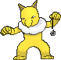

<!-- This file is generated by tools/generate_site.py. Edit the generator, not this file. -->

# #097 Hypno

{ .sprite-lg loading=lazy }

**Hypnosis Pokémon**

Psychic

[:material-arrow-left: #096 Drowzee](096.md) · [Pokédex](index.md) · [#098 Krabby :material-arrow-right:](098.md)

!!! note "No documented changes"

    Drayano's documentation lists no stat, type, ability, evolution or held item changes for this Pokémon. Its level-up moves are listed below as they appear in the hack.

## Location

[Route 121](../wild/route_121.md)

### Wild encounters

| Area | Method | Level | Note |
| --- | --- | --- | --- |
| [Route 121](../wild/route_121.md) | Tall Grass | 44 |  |

## Type defenses

| Damage taken | Attacking types |
| --- | --- |
| Resistant (×½) | Fighting Psychic |
| Neutral (×1) | Normal Flying Poison Ground Rock Steel Fire Water Grass Electric Ice Dragon Fairy |
| Weak (×2) | Bug Ghost Dark |

## Abilities

| Slot | Ability | Effect | Note |
| --- | --- | --- | --- |
| Ability 1 | **Insomnia** | Prevents sleep. |  |
| Ability 2 | **Forewarn** | Reveals the opponents' strongest move upon entering battle. |  |
| Hidden | **Inner Focus** | Prevents flinching. |  |

## Base stats

| Form | HP | Atk | Def | SpA | SpD | Spe | BST |
| --- | --- | --- | --- | --- | --- | --- | --- |
| { .sprite-sm loading=lazy } Normal | 85 | 73 | 70 | 73 | 115 | 67 | **483** |

## Training & breeding

| Property | Value |
| --- | --- |
| EV yield | 2 SpD |
| Catch rate | 75 |
| Base friendship | 70 |
| Base experience | 169 |
| Growth rate | medium |
| Egg groups | Human-Like |
| Hatch counter | 20 |
| Gender ratio | 50% ♂ / 50% ♀ |
| Height / weight | 1.6 m / 75.6 kg |

## Evolution

- { .icon loading=lazy } [Drowzee](../pokemon/096.md) → { .icon loading=lazy } **[Hypno](../pokemon/097.md)**: Lv. 26

## Wild held items

None.

## Level-up moves { data-search-exclude }

Moves marked &#42; are not normally learned by level up (they come from egg moves, TMs/HMs or tutors in the official games); moves marked &#42;&#42; cannot normally be learned by this Pokémon at all and are omitted from the legal-moves version of the hack.

| Lv. | Move | Type | Cat. | Power | Acc. | PP | Effect | Note |
| --- | --- | --- | --- | --- | --- | --- | --- | --- |
| 1 | Future Sight | Psychic | Special | 120 | 100% | 10 | Hits the target two turns later. |  |
| 1 | Nasty Plot | Dark | Status | — | — | 20 | Raises the user’s Special Attack by two stages. |  |
| 1 | Nightmare | Ghost | Status | — | 100% | 15 | Target loses 1/4 its max HP every turn as long as it’s asleep. |  |
| 1 | Switcheroo | Dark | Status | — | 100% | 10 | User and target swap items. |  |
| 1 | [Pound](../changes/moves.md#pound) changed | Normal | Physical | 50 | 100% | 35 | Inflicts regular damage with no additional effect. |  |
| 1 | Hypnosis | Psychic | Status | — | 60% | 20 | Puts the target to sleep. |  |
| 1 | Disable | Normal | Status | — | 100% | 20 | Disables the target’s last used move for 1-8 turns. |  |
| 5 | Confusion | Psychic | Special | 50 | 100% | 25 | Has a chance to confuse the target. |  |
| 8 | Headbutt | Normal | Physical | 70 | 100% | 15 | Has a chance to make the target flinch. |  |
| 11 | Poison Gas | Poison | Status | — | 90% | 40 | Poisons the target. |  |
| 14 | Meditate | Psychic | Status | — | — | 40 | Raises the user’s Attack by one stage. |  |
| 17 | Psybeam | Psychic | Special | 65 | 100% | 20 | Has a chance to confuse the target. |  |
| 20 | Headbutt | Normal | Physical | 70 | 100% | 15 | Has a chance to make the target flinch. |  |
| 23 | Zen Headbutt | Psychic | Physical | 80 | 90% | 15 | Has a chance to make the target flinch. |  |
| 26 | Shadow Ball | Ghost | Special | 80 | 100% | 15 | Has a chance to lower the target’s Special Defense by one stage. | &#42; |
| 29 | Psyshock | Psychic | Special | 80 | 100% | 10 | Inflicts damage based on the target’s Defense, not Special Defense. |  |
| 32 | Psych Up | Normal | Status | — | — | 10 | Discards the user’s stat changes and copies the target’s. |  |
| 35 | Synchronoise | Psychic | Special | 120 | 100% | 10 | Hits any Pokémon that shares a type with the user. |  |
| 38 | Psychic | Psychic | Special | 90 | 100% | 10 | Has a chance to lower the target’s Special Defense by one stage. |  |
| 41 | Swagger | Normal | Status | — | 90% | 15 | Raises the target’s Attack by two stages and confuses the target. |  |
| 44 | Nasty Plot | Dark | Status | — | — | 20 | Raises the user’s Special Attack by two stages. |  |
| 47 | Future Sight | Psychic | Special | 120 | 100% | 10 | Hits the target two turns later. |  |

## TM & HM moves { data-search-exclude }

| Machine | Move | Type | Cat. | Power | Acc. | PP | Effect |
| --- | --- | --- | --- | --- | --- | --- | --- |
| TM03 | Psyshock | Psychic | Special | 80 | 100% | 10 | Inflicts damage based on the target’s Defense, not Special Defense. |
| TM04 | Calm Mind | Psychic | Status | — | — | 20 | Raises the user’s Special Attack and Special Defense by one stage. |
| TM06 | Toxic | Poison | Status | — | 90% | 10 | Badly poisons the target, inflicting more damage every turn. |
| TM10 | Hidden Power | Normal | Special | 60 | 100% | 15 | Power and type depend upon user’s IVs.  Power can range from 30 to 70. |
| TM100 | Confide | Normal | Status | — | — | 20 | Lowers the target’s Special Attack by one stage. |
| TM11 | Sunny Day | Fire | Status | — | — | 5 | Changes the weather to sunny for five turns. |
| TM12 | Taunt | Dark | Status | — | 100% | 20 | For the next few turns, the target can only use damaging moves. |
| TM15 | Hyper Beam | Normal | Special | 150 | 90% | 5 | User foregoes its next turn to recharge. |
| TM16 | Light Screen | Psychic | Status | — | — | 30 | Reduces damage from special attacks by 50% for five turns. |
| TM17 | Protect | Normal | Status | — | — | 10 | Prevents any moves from hitting the user this turn. |
| TM18 | Rain Dance | Water | Status | — | — | 5 | Changes the weather to rain for five turns. |
| TM20 | Safeguard | Normal | Status | — | — | 25 | Protects the user’s field from major status ailments and confusion for five turns. |
| TM21 | Frustration | Normal | Physical | — | 100% | 20 | Power increases as happiness decreases, up to a maximum of 102. |
| TM27 | Return | Normal | Physical | — | 100% | 20 | Power increases with happiness, up to a maximum of 102. |
| TM29 | Psychic | Psychic | Special | 90 | 100% | 10 | Has a chance to lower the target’s Special Defense by one stage. |
| TM30 | Shadow Ball | Ghost | Special | 80 | 100% | 15 | Has a chance to lower the target’s Special Defense by one stage. |
| TM31 | Brick Break | Fighting | Physical | 75 | 100% | 15 | Destroys Reflect and Light Screen. |
| TM32 | Double Team | Normal | Status | — | — | 15 | Raises the user’s evasion by one stage. |
| TM33 | Reflect | Psychic | Status | — | — | 20 | Reduces damage from physical attacks by half. |
| TM41 | Torment | Dark | Status | — | 100% | 15 | Prevents the target from using the same move twice in a row. |
| TM42 | Facade | Normal | Physical | 70 | 100% | 20 | Power doubles if user is burned, paralyzed, or poisoned. |
| TM44 | Rest | Psychic | Status | — | — | 5 | User sleeps for two turns, completely healing itself. |
| TM45 | Attract | Normal | Status | — | 100% | 15 | Target falls in love if it has the opposite gender, and has a 50% chance to refuse attacking the user. |
| TM46 | Thief | Dark | Physical | 60 | 100% | 25 | Takes the target’s item. |
| TM47 | Low Sweep | Fighting | Physical | 65 | 100% | 20 | Lowers the target’s Speed by one stage. |
| TM48 | Round | Normal | Special | 60 | 100% | 15 | Has double power if it’s used more than once per turn. |
| TM52 | Focus Blast | Fighting | Special | 120 | 70% | 5 | Has a chance to lower the target’s Special Defense by one stage. |
| TM56 | Fling | Dark | Physical | — | 100% | 10 | Throws held item at the target; power depends on the item. |
| TM68 | Giga Impact | Normal | Physical | 150 | 90% | 5 | User foregoes its next turn to recharge. |
| TM70 | Flash | Normal | Status | — | 100% | 20 | Lowers the target’s accuracy by one stage. |
| TM73 | Thunder Wave | Electric | Status | — | 100% | 20 | Paralyzes the target. |
| TM77 | Psych Up | Normal | Status | — | — | 10 | Discards the user’s stat changes and copies the target’s. |
| TM85 | Dream Eater | Psychic | Special | 100 | 100% | 15 | Only works on sleeping Pokémon.  Drains half the damage inflicted to heal the user. |
| TM86 | Grass Knot | Grass | Special | — | 100% | 20 | Inflicts more damage to heavier targets, with a maximum of 120 power. |
| TM87 | Swagger | Normal | Status | — | 90% | 15 | Raises the target’s Attack by two stages and confuses the target. |
| TM88 | Sleep Talk | Normal | Status | — | — | 10 | Randomly uses one of the user’s other three moves.  Only works if the user is sleeping. |
| TM90 | Substitute | Normal | Status | — | — | 10 | Transfers 1/4 of the user’s max HP into a doll, protecting the user from further damage or status changes until it breaks. |
| TM92 | Trick Room | Psychic | Status | — | — | 5 | For five turns, slower Pokémon will act before faster Pokémon. |
| TM94 | Secret Power | Normal | Physical | 70 | 100% | 20 | Has a chance to inflict a status effect which depends upon the terrain. |
| TM98 | Power-Up Punch | Fighting | Physical | 40 | 100% | 20 | Raises the user’s Attack by one stage after inflicting damage. |
| TM99 | Dazzling Gleam | Fairy | Special | 80 | 100% | 10 | Inflicts regular damage with no additional effect. |

## Move tutor moves { data-search-exclude }

| Move | Type | Cat. | Power | Acc. | PP | Effect |
| --- | --- | --- | --- | --- | --- | --- |
| Drain Punch | Fighting | Physical | 75 | 100% | 10 | Drains half the damage inflicted to heal the user. |
| Fire Punch | Fire | Physical | 75 | 100% | 15 | Has a chance to burn the target. |
| Focus Punch | Fighting | Physical | 150 | 100% | 20 | If the user takes damage before attacking, the attack is canceled. |
| Foul Play | Dark | Physical | 95 | 100% | 15 | Calculates damage with the target’s attacking stat. |
| Ice Punch | Ice | Physical | 75 | 100% | 15 | Has a chance to freeze the target. |
| Low Kick | Fighting | Physical | — | 100% | 20 | Inflicts more damage to heavier targets, with a maximum of 120 power. |
| Magic Coat | Psychic | Status | — | — | 15 | Reflects back the first effect move used on the user this turn. |
| Magic Room | Psychic | Status | — | — | 10 | Negates held items for five turns. |
| Recycle | Normal | Status | — | — | 10 | User recovers the item it last used up. |
| Role Play | Psychic | Status | — | — | 10 | Copies the target’s ability. |
| Signal Beam | Bug | Special | 75 | 100% | 15 | Has a chance to confuse the target. |
| Skill Swap | Psychic | Status | — | — | 10 | User and target swap abilities. |
| Snatch | Dark | Status | — | — | 10 | Steals the target’s move, if it’s self-targeted. |
| Snore | Normal | Special | 50 | 100% | 15 | Has a chance to make the target flinch.  Only works if the user is sleeping. |
| Thunder Punch | Electric | Physical | 75 | 100% | 15 | Has a chance to paralyze the target. |
| Trick | Psychic | Status | — | 100% | 10 | User and target swap items. |
| Zen Headbutt | Psychic | Physical | 80 | 90% | 15 | Has a chance to make the target flinch. |

## Egg moves { data-search-exclude }

No egg moves.

??? note "Trainers using Hypno (4)"

    | Area | Trainer | Level |
    | --- | --- | --- |
    | [Mt. Pyre 1F / 2F](../trainers/mt_pyre_1f_2f.md#trainers) | Psychic William | Lv. 50 |
    | [Mossdeep Gym](../trainers/mossdeep_gym.md#trainers) | Psychic Preston | Lv. 59 |
    | [Battle Resort](../trainers/battle_resort.md#trainers) | Leader Josephine [Tate] | Lv. 77 |
    | [Battle Resort](../trainers/battle_resort.md#trainers) | Leader Josephine [Tate] | Lv. 77 |

---

[:material-arrow-left: #096 Drowzee](096.md) · [#098 Krabby :material-arrow-right:](098.md)
