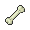

<!-- This file is generated by tools/generate_site.py. Edit the generator, not this file. -->

# #105 Marowak

{ .sprite-lg loading=lazy }

**Bone Keeper Pokémon**

Ground

[:material-arrow-left: #104 Cubone](104.md) · [Pokédex](index.md) · [#106 Hitmonlee :material-arrow-right:](106.md)

!!! info "Changes in Rising Ruby / Sinking Sapphire"

    - **Base stats:** HP 60 → **70**, Spe 45 → **60** (BST 425 → **450**)

## Location

[Granite Cave](../wild/granite_cave_1f.md), [Victory Road](../wild/victory_road_1f.md)

### Wild encounters

| Area | Method | Level | Note |
| --- | --- | --- | --- |
| [Granite Cave B2F](../wild/granite_cave_b2f.md) | Walking | 20 |  |
| [Victory Road 1F](../wild/victory_road_1f.md) | Walking | 59 |  |

## Type defenses

| Damage taken | Attacking types |
| --- | --- |
| Immune (×0) | Electric |
| Resistant (×½) | Poison Rock |
| Neutral (×1) | Normal Fighting Flying Ground Bug Ghost Steel Fire Psychic Dragon Dark Fairy |
| Weak (×2) | Water Grass Ice |

## Abilities

| Slot | Ability | Effect | Note |
| --- | --- | --- | --- |
| Ability 1 | **Rock Head** | Protects against recoil damage. |  |
| Ability 2 | **Lightning Rod** | Redirects single-target Electric moves to this Pokémon where possible.  Absorbs Electric moves, raising Special Attack one stage. |  |
| Hidden | **Battle Armor** | Protects against critical hits. |  |

## Base stats

| Form | HP | Atk | Def | SpA | SpD | Spe | BST |
| --- | --- | --- | --- | --- | --- | --- | --- |
| { .sprite-sm loading=lazy } Normal | 70<small class="was">was 60</small> | 80 | 110 | 50 | 80 | 60<small class="was">was 45</small> | 450<small class="was">was 425</small> |

## Training & breeding

| Property | Value |
| --- | --- |
| EV yield | 2 Def |
| Catch rate | 75 |
| Base friendship | 70 |
| Base experience | 149 |
| Growth rate | medium |
| Egg groups | Monster |
| Hatch counter | 20 |
| Gender ratio | 50% ♂ / 50% ♀ |
| Height / weight | 1 m / 45 kg |

## Evolution

- { .icon loading=lazy } [Cubone](../pokemon/104.md) → { .icon loading=lazy } **[Marowak](../pokemon/105.md)**: Lv. 28 / Lv. 28 during the night

## Wild held items

| Item | Chance | Note |
| --- | --- | --- |
| { .item loading=lazy } Thick Club | 5% |  |

## Level-up moves { data-search-exclude }

Moves marked &#42; are not normally learned by level up (they come from egg moves, TMs/HMs or tutors in the official games); moves marked &#42;&#42; cannot normally be learned by this Pokémon at all and are omitted from the legal-moves version of the hack.

| Lv. | Move | Type | Cat. | Power | Acc. | PP | Effect | Note |
| --- | --- | --- | --- | --- | --- | --- | --- | --- |
| 1 | Fire Punch | Fire | Physical | 75 | 100% | 15 | Has a chance to burn the target. | &#42; |
| 1 | Thunder Punch | Electric | Physical | 75 | 100% | 15 | Has a chance to paralyze the target. | &#42; |
| 1 | Sing | Normal | Status | — | 55% | 15 | Puts the target to sleep. | &#42;&#42; |
| 1 | Growl | Normal | Status | — | 100% | 40 | Lowers the target’s Attack by one stage. |  |
| 4 | Tail Whip | Normal | Status | — | 100% | 30 | Lowers the target’s Defense by one stage. |  |
| 7 | Bone Club | Ground | Physical | 65 | 85% | 20 | Has a chance to make the target flinch. |  |
| 10 | Headbutt | Normal | Physical | 70 | 100% | 15 | Has a chance to make the target flinch. |  |
| 13 | Leer | Normal | Status | — | 100% | 30 | Lowers the target’s Defense by one stage. |  |
| 16 | Focus Energy | Normal | Status | — | — | 30 | Increases the user’s chance to score a critical hit. |  |
| 19 | Bonemerang | Ground | Physical | 50 | 90% | 10 | Hits twice in one turn. |  |
| 22 | Double Kick | Fighting | Physical | 30 | 100% | 30 | Hits twice in one turn. | &#42; |
| 25 | Rage | Normal | Physical | 20 | 100% | 20 | If the user is hit after using this move, its Attack rises by one stage. |  |
| 28 | False Swipe | Normal | Physical | 40 | 100% | 40 | Cannot lower the target’s HP below 1. |  |
| 31 | Thrash | Normal | Physical | 120 | 100% | 10 | Hits every turn for 2-3 turns, then confuses the user. |  |
| 35 | Iron Head | Steel | Physical | 80 | 100% | 15 | Has a chance to make the target flinch. | &#42; |
| 39 | Bone Rush | Ground | Physical | 25 | 90% | 10 | Hits 2-5 times in one turn. |  |
| 43 | Fling | Dark | Physical | — | 100% | 10 | Throws held item at the target; power depends on the item. |  |
| 47 | Endeavor | Normal | Physical | — | 100% | 5 | Lowers the target’s HP to equal the user’s. |  |
| 51 | Skull Bash | Normal | Physical | 130 | 100% | 10 | Raises the user’s Defense by one stage.  User charges for one turn before attacking. | &#42; |
| 55 | Double-Edge | Normal | Physical | 120 | 100% | 15 | User receives 1/3 the damage inflicted in recoil. |  |
| 59 | Retaliate | Normal | Physical | 70 | 100% | 5 | Has double power if a friendly Pokémon fainted last turn. |  |
| 63 | Earthquake | Ground | Physical | 100 | 100% | 10 | Inflicts regular damage and can hit Dig users. | &#42; |

## TM & HM moves { data-search-exclude }

| Machine | Move | Type | Cat. | Power | Acc. | PP | Effect |
| --- | --- | --- | --- | --- | --- | --- | --- |
| HM04 | [Strength](../changes/moves.md#strength) changed | Normal | Physical | 100 | 100% | 10 | Inflicts regular damage with no additional effect. |
| HM06 | [Rock Smash](../changes/moves.md#rock-smash) changed | Fighting | Physical | 65 | 100% | 15 | Has a chance to lower the target’s Defense by one stage. |
| TM06 | Toxic | Poison | Status | — | 90% | 10 | Badly poisons the target, inflicting more damage every turn. |
| TM10 | Hidden Power | Normal | Special | 60 | 100% | 15 | Power and type depend upon user’s IVs.  Power can range from 30 to 70. |
| TM100 | Confide | Normal | Status | — | — | 20 | Lowers the target’s Special Attack by one stage. |
| TM11 | Sunny Day | Fire | Status | — | — | 5 | Changes the weather to sunny for five turns. |
| TM13 | Ice Beam | Ice | Special | 90 | 100% | 10 | Has a chance to freeze the target. |
| TM14 | Blizzard | Ice | Special | 110 | 70% | 5 | Has a chance to freeze the target. |
| TM15 | Hyper Beam | Normal | Special | 150 | 90% | 5 | User foregoes its next turn to recharge. |
| TM17 | Protect | Normal | Status | — | — | 10 | Prevents any moves from hitting the user this turn. |
| TM21 | Frustration | Normal | Physical | — | 100% | 20 | Power increases as happiness decreases, up to a maximum of 102. |
| TM23 | Smack Down | Rock | Physical | 50 | 100% | 15 | Removes any immunity to Ground damage. |
| TM26 | Earthquake | Ground | Physical | 100 | 100% | 10 | Inflicts regular damage and can hit Dig users. |
| TM27 | Return | Normal | Physical | — | 100% | 20 | Power increases with happiness, up to a maximum of 102. |
| TM28 | Dig | Ground | Physical | 80 | 100% | 10 | User digs underground, dodging all attacks, and hits next turn. |
| TM31 | Brick Break | Fighting | Physical | 75 | 100% | 15 | Destroys Reflect and Light Screen. |
| TM32 | Double Team | Normal | Status | — | — | 15 | Raises the user’s evasion by one stage. |
| TM35 | Flamethrower | Fire | Special | 90 | 100% | 15 | Has a chance to burn the target. |
| TM37 | Sandstorm | Rock | Status | — | — | 10 | Changes the weather to a sandstorm for five turns. |
| TM38 | Fire Blast | Fire | Special | 110 | 85% | 5 | Has a chance to burn the target. |
| TM39 | Rock Tomb | Rock | Physical | 60 | 95% | 15 | Has a chance to lower the target’s Speed by one stage. |
| TM40 | Aerial Ace | Flying | Physical | 60 | — | 20 | Never misses. |
| TM42 | Facade | Normal | Physical | 70 | 100% | 20 | Power doubles if user is burned, paralyzed, or poisoned. |
| TM44 | Rest | Psychic | Status | — | — | 5 | User sleeps for two turns, completely healing itself. |
| TM45 | Attract | Normal | Status | — | 100% | 15 | Target falls in love if it has the opposite gender, and has a 50% chance to refuse attacking the user. |
| TM46 | Thief | Dark | Physical | 60 | 100% | 25 | Takes the target’s item. |
| TM48 | Round | Normal | Special | 60 | 100% | 15 | Has double power if it’s used more than once per turn. |
| TM49 | Echoed Voice | Normal | Special | 40 | 100% | 15 | Power increases by 100% for each consecutive use by any friendly Pokémon, to a maximum of 200. |
| TM52 | Focus Blast | Fighting | Special | 120 | 70% | 5 | Has a chance to lower the target’s Special Defense by one stage. |
| TM54 | False Swipe | Normal | Physical | 40 | 100% | 40 | Cannot lower the target’s HP below 1. |
| TM56 | Fling | Dark | Physical | — | 100% | 10 | Throws held item at the target; power depends on the item. |
| TM59 | Incinerate | Fire | Special | 60 | 100% | 15 | Destroys the target’s held berry. |
| TM67 | Retaliate | Normal | Physical | 70 | 100% | 5 | Has double power if a friendly Pokémon fainted last turn. |
| TM68 | Giga Impact | Normal | Physical | 150 | 90% | 5 | User foregoes its next turn to recharge. |
| TM71 | Stone Edge | Rock | Physical | 100 | 80% | 5 | Has an increased chance for a critical hit. |
| TM75 | Swords Dance | Normal | Status | — | — | 20 | Raises the user’s Attack by two stages. |
| TM78 | Bulldoze | Ground | Physical | 60 | 100% | 20 | Has a chance to lower the target’s Speed by one stage. |
| TM80 | Rock Slide | Rock | Physical | 75 | 90% | 10 | Has a chance to make the target flinch. |
| TM87 | Swagger | Normal | Status | — | 90% | 15 | Raises the target’s Attack by two stages and confuses the target. |
| TM88 | Sleep Talk | Normal | Status | — | — | 10 | Randomly uses one of the user’s other three moves.  Only works if the user is sleeping. |
| TM90 | Substitute | Normal | Status | — | — | 10 | Transfers 1/4 of the user’s max HP into a doll, protecting the user from further damage or status changes until it breaks. |
| TM94 | Secret Power | Normal | Physical | 70 | 100% | 20 | Has a chance to inflict a status effect which depends upon the terrain. |
| TM98 | Power-Up Punch | Fighting | Physical | 40 | 100% | 20 | Raises the user’s Attack by one stage after inflicting damage. |

## Move tutor moves { data-search-exclude }

| Move | Type | Cat. | Power | Acc. | PP | Effect |
| --- | --- | --- | --- | --- | --- | --- |
| Earth Power | Ground | Special | 90 | 100% | 10 | Has a chance to lower the target’s Special Defense by one stage. |
| Endeavor | Normal | Physical | — | 100% | 5 | Lowers the target’s HP to equal the user’s. |
| Fire Punch | Fire | Physical | 75 | 100% | 15 | Has a chance to burn the target. |
| Focus Punch | Fighting | Physical | 150 | 100% | 20 | If the user takes damage before attacking, the attack is canceled. |
| Icy Wind | Ice | Special | 55 | 95% | 15 | Has a chance to lower the target’s Speed by one stage. |
| Iron Defense | Steel | Status | — | — | 15 | Raises the user’s Defense by two stages. |
| Iron Head | Steel | Physical | 80 | 100% | 15 | Has a chance to make the target flinch. |
| Iron Tail | Steel | Physical | 100 | 75% | 15 | Has a chance to lower the target’s Defense by one stage. |
| Knock Off | Dark | Physical | 65 | 100% | 20 | Target drops its held item. |
| Low Kick | Fighting | Physical | — | 100% | 20 | Inflicts more damage to heavier targets, with a maximum of 120 power. |
| Outrage | Dragon | Physical | 120 | 100% | 10 | Hits every turn for 2-3 turns, then confuses the user. |
| Snore | Normal | Special | 50 | 100% | 15 | Has a chance to make the target flinch.  Only works if the user is sleeping. |
| Stealth Rock | Rock | Status | — | — | 20 | Causes damage when opposing Pokémon switch in. |
| Thunder Punch | Electric | Physical | 75 | 100% | 15 | Has a chance to paralyze the target. |
| Uproar | Normal | Special | 90 | 100% | 10 | Forced to use this move for several turns.  Pokémon cannot fall asleep in that time. |

## Egg moves { data-search-exclude }

No egg moves.

??? note "Trainers using Marowak (5)"

    | Area | Trainer | Level |
    | --- | --- | --- |
    | [Route 110](../trainers/route_110.md#rematches) | Collector Edwin (4) | Lv. 35 |
    | [Route 110](../trainers/route_110.md#rematches) | Collector Edwin (7) | Lv. 59 |
    | [Route 110](../trainers/route_110.md#rematches) | Collector Edwin (8) | Lv. 64 |
    | [Route 110](../trainers/route_110.md#rematches) | Collector Edwin (C) | Lv. 75 |
    | [Route 114](../trainers/route_114.md#trainers) | Hiker Lenny | Lv. 29 |

---

[:material-arrow-left: #104 Cubone](104.md) · [#106 Hitmonlee :material-arrow-right:](106.md)
