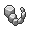

<!-- This file is generated by tools/generate_site.py. Edit the generator, not this file. -->

# #108 Lickitung

{ .sprite-lg loading=lazy }

**Licking Pokémon**

Normal

[:material-arrow-left: #107 Hitmonchan](107.md) · [Pokédex](index.md) · [#109 Koffing :material-arrow-right:](109.md)

!!! note "No documented changes"

    Drayano's documentation lists no stat, type, ability, evolution or held item changes for this Pokémon. Its level-up moves are listed below as they appear in the hack.

## Location

[Route 114](../wild/route_114.md)

### Wild encounters

| Area | Method | Level | Note |
| --- | --- | --- | --- |
| [Route 114](../wild/route_114.md) | Grass | 25 |  |

## Type defenses

| Damage taken | Attacking types |
| --- | --- |
| Immune (×0) | Ghost |
| Neutral (×1) | Normal Flying Poison Ground Rock Bug Steel Fire Water Grass Electric Psychic Ice Dragon Dark Fairy |
| Weak (×2) | Fighting |

## Abilities

| Slot | Ability | Effect | Note |
| --- | --- | --- | --- |
| Ability 1 | **Own Tempo** | Prevents confusion. |  |
| Ability 2 | **Oblivious** | Prevents infatuation and protects against Captivate. |  |
| Hidden | **Cloud Nine** | Negates all effects of weather, but does not prevent the weather itself. |  |

## Base stats

| Form | HP | Atk | Def | SpA | SpD | Spe | BST |
| --- | --- | --- | --- | --- | --- | --- | --- |
| { .sprite-sm loading=lazy } Normal | 90 | 55 | 75 | 60 | 75 | 30 | **385** |

## Training & breeding

| Property | Value |
| --- | --- |
| EV yield | 2 HP |
| Catch rate | 45 |
| Base friendship | 70 |
| Base experience | 77 |
| Growth rate | medium |
| Egg groups | Monster |
| Hatch counter | 20 |
| Gender ratio | 50% ♂ / 50% ♀ |
| Height / weight | 1.2 m / 65.5 kg |

## Evolution

- { .icon loading=lazy } **[Lickitung](../pokemon/108.md)** → { .icon loading=lazy } [Lickilicky](../pokemon/463.md): Level up knowing Rollout

## Wild held items

| Item | Chance | Note |
| --- | --- | --- |
| { .item loading=lazy } Lagging Tail | 5% |  |

## Level-up moves { data-search-exclude }

Moves marked &#42; are not normally learned by level up (they come from egg moves, TMs/HMs or tutors in the official games); moves marked &#42;&#42; cannot normally be learned by this Pokémon at all and are omitted from the legal-moves version of the hack.

| Lv. | Move | Type | Cat. | Power | Acc. | PP | Effect | Note |
| --- | --- | --- | --- | --- | --- | --- | --- | --- |
| 1 | Lick | Ghost | Physical | 30 | 100% | 30 | Has a chance to paralyze the target. |  |
| 4 | Supersonic | Normal | Status | — | 55% | 20 | Confuses the target. |  |
| 7 | Defense Curl | Normal | Status | — | — | 40 | Raises user’s Defense by one stage. |  |
| 10 | Wrap | Normal | Physical | 15 | 90% | 20 | Prevents the target from fleeing and inflicts damage for 2-5 turns. |  |
| 13 | Knock Off | Dark | Physical | 65 | 100% | 20 | Target drops its held item. |  |
| 16 | Disable | Normal | Status | — | 100% | 20 | Disables the target’s last used move for 1-8 turns. |  |
| 19 | Stomp | Normal | Physical | 65 | 100% | 20 | Has a chance to make the target flinch. |  |
| 22 | Magnitude | Ground | Physical | — | 100% | 30 | Power varies randomly from 10 to 150. | &#42; |
| 25 | Zen Headbutt | Psychic | Physical | 80 | 90% | 15 | Has a chance to make the target flinch. | &#42; |
| 28 | Slam | Normal | Physical | 80 | 75% | 20 | Inflicts regular damage with no additional effect. |  |
| 31 | Rollout | Rock | Physical | 30 | 90% | 20 | Power doubles every turn this move is used in succession after the first, resetting after five turns. |  |
| 34 | Chip Away | Normal | Physical | 70 | 100% | 20 | Ignores the target’s stat modifiers. |  |
| 37 | Body Slam | Normal | Physical | 85 | 100% | 15 | Has a chance to paralyze the target. | &#42; |
| 40 | Me First | Normal | Status | — | — | 20 | Uses the target’s move against it before it attacks, with power increased by half. |  |
| 43 | Muddy Water | Water | Special | 90 | 85% | 10 | Has a chance to lower the target’s accuracy by one stage. | &#42; |
| 46 | Power Whip | Grass | Physical | 120 | 85% | 10 | Inflicts regular damage with no additional effect. |  |
| 49 | Screech | Normal | Status | — | 85% | 40 | Lowers the target’s Defense by two stages. |  |
| 52 | Refresh | Normal | Status | — | — | 20 | Cleanses the user of a burn, paralysis, or poison. |  |
| 55 | Wring Out | Normal | Special | — | 100% | 5 | Power increases against targets with more HP remaining, up to a maximum of 121 power. |  |

## TM & HM moves { data-search-exclude }

| Machine | Move | Type | Cat. | Power | Acc. | PP | Effect |
| --- | --- | --- | --- | --- | --- | --- | --- |
| HM01 | [Cut](../changes/moves.md#cut) changed | Grass | Physical | 70 | 100% | 15 | High Critical Rate. High Critical Rate |
| HM03 | Surf | Water | Special | 90 | 100% | 15 | Inflicts regular damage and can hit Dive users. |
| HM04 | [Strength](../changes/moves.md#strength) changed | Normal | Physical | 100 | 100% | 10 | Inflicts regular damage with no additional effect. |
| HM06 | [Rock Smash](../changes/moves.md#rock-smash) changed | Fighting | Physical | 65 | 100% | 15 | Has a chance to lower the target’s Defense by one stage. |
| TM06 | Toxic | Poison | Status | — | 90% | 10 | Badly poisons the target, inflicting more damage every turn. |
| TM10 | Hidden Power | Normal | Special | 60 | 100% | 15 | Power and type depend upon user’s IVs.  Power can range from 30 to 70. |
| TM100 | Confide | Normal | Status | — | — | 20 | Lowers the target’s Special Attack by one stage. |
| TM11 | Sunny Day | Fire | Status | — | — | 5 | Changes the weather to sunny for five turns. |
| TM13 | Ice Beam | Ice | Special | 90 | 100% | 10 | Has a chance to freeze the target. |
| TM14 | Blizzard | Ice | Special | 110 | 70% | 5 | Has a chance to freeze the target. |
| TM15 | Hyper Beam | Normal | Special | 150 | 90% | 5 | User foregoes its next turn to recharge. |
| TM17 | Protect | Normal | Status | — | — | 10 | Prevents any moves from hitting the user this turn. |
| TM18 | Rain Dance | Water | Status | — | — | 5 | Changes the weather to rain for five turns. |
| TM21 | Frustration | Normal | Physical | — | 100% | 20 | Power increases as happiness decreases, up to a maximum of 102. |
| TM22 | Solar Beam | Grass | Special | 120 | 100% | 10 | Requires a turn to charge before attacking. |
| TM24 | Thunderbolt | Electric | Special | 90 | 100% | 15 | Has a chance to paralyze the target. |
| TM25 | Thunder | Electric | Special | 110 | 70% | 10 | Has a chance to paralyze the target. |
| TM26 | Earthquake | Ground | Physical | 100 | 100% | 10 | Inflicts regular damage and can hit Dig users. |
| TM27 | Return | Normal | Physical | — | 100% | 20 | Power increases with happiness, up to a maximum of 102. |
| TM28 | Dig | Ground | Physical | 80 | 100% | 10 | User digs underground, dodging all attacks, and hits next turn. |
| TM30 | Shadow Ball | Ghost | Special | 80 | 100% | 15 | Has a chance to lower the target’s Special Defense by one stage. |
| TM31 | Brick Break | Fighting | Physical | 75 | 100% | 15 | Destroys Reflect and Light Screen. |
| TM32 | Double Team | Normal | Status | — | — | 15 | Raises the user’s evasion by one stage. |
| TM35 | Flamethrower | Fire | Special | 90 | 100% | 15 | Has a chance to burn the target. |
| TM37 | Sandstorm | Rock | Status | — | — | 10 | Changes the weather to a sandstorm for five turns. |
| TM38 | Fire Blast | Fire | Special | 110 | 85% | 5 | Has a chance to burn the target. |
| TM39 | Rock Tomb | Rock | Physical | 60 | 95% | 15 | Has a chance to lower the target’s Speed by one stage. |
| TM42 | Facade | Normal | Physical | 70 | 100% | 20 | Power doubles if user is burned, paralyzed, or poisoned. |
| TM44 | Rest | Psychic | Status | — | — | 5 | User sleeps for two turns, completely healing itself. |
| TM45 | Attract | Normal | Status | — | 100% | 15 | Target falls in love if it has the opposite gender, and has a 50% chance to refuse attacking the user. |
| TM46 | Thief | Dark | Physical | 60 | 100% | 25 | Takes the target’s item. |
| TM48 | Round | Normal | Special | 60 | 100% | 15 | Has double power if it’s used more than once per turn. |
| TM56 | Fling | Dark | Physical | — | 100% | 10 | Throws held item at the target; power depends on the item. |
| TM59 | Incinerate | Fire | Special | 60 | 100% | 15 | Destroys the target’s held berry. |
| TM67 | Retaliate | Normal | Physical | 70 | 100% | 5 | Has double power if a friendly Pokémon fainted last turn. |
| TM68 | Giga Impact | Normal | Physical | 150 | 90% | 5 | User foregoes its next turn to recharge. |
| TM75 | Swords Dance | Normal | Status | — | — | 20 | Raises the user’s Attack by two stages. |
| TM77 | Psych Up | Normal | Status | — | — | 10 | Discards the user’s stat changes and copies the target’s. |
| TM78 | Bulldoze | Ground | Physical | 60 | 100% | 20 | Has a chance to lower the target’s Speed by one stage. |
| TM80 | Rock Slide | Rock | Physical | 75 | 90% | 10 | Has a chance to make the target flinch. |
| TM82 | Dragon Tail | Dragon | Physical | 60 | 90% | 10 | Ends wild battles.  Forces trainers to switch Pokémon. |
| TM85 | Dream Eater | Psychic | Special | 100 | 100% | 15 | Only works on sleeping Pokémon.  Drains half the damage inflicted to heal the user. |
| TM87 | Swagger | Normal | Status | — | 90% | 15 | Raises the target’s Attack by two stages and confuses the target. |
| TM88 | Sleep Talk | Normal | Status | — | — | 10 | Randomly uses one of the user’s other three moves.  Only works if the user is sleeping. |
| TM90 | Substitute | Normal | Status | — | — | 10 | Transfers 1/4 of the user’s max HP into a doll, protecting the user from further damage or status changes until it breaks. |
| TM94 | Secret Power | Normal | Physical | 70 | 100% | 20 | Has a chance to inflict a status effect which depends upon the terrain. |
| TM98 | Power-Up Punch | Fighting | Physical | 40 | 100% | 20 | Raises the user’s Attack by one stage after inflicting damage. |

## Move tutor moves { data-search-exclude }

| Move | Type | Cat. | Power | Acc. | PP | Effect |
| --- | --- | --- | --- | --- | --- | --- |
| Aqua Tail | Water | Physical | 90 | 90% | 10 | Inflicts regular damage with no additional effect. |
| Bind | Normal | Physical | 15 | 85% | 20 | Prevents the target from fleeing and inflicts damage for 2-5 turns. |
| Fire Punch | Fire | Physical | 75 | 100% | 15 | Has a chance to burn the target. |
| Focus Punch | Fighting | Physical | 150 | 100% | 20 | If the user takes damage before attacking, the attack is canceled. |
| Ice Punch | Ice | Physical | 75 | 100% | 15 | Has a chance to freeze the target. |
| Icy Wind | Ice | Special | 55 | 95% | 15 | Has a chance to lower the target’s Speed by one stage. |
| Iron Tail | Steel | Physical | 100 | 75% | 15 | Has a chance to lower the target’s Defense by one stage. |
| Knock Off | Dark | Physical | 65 | 100% | 20 | Target drops its held item. |
| Shock Wave | Electric | Special | 60 | — | 20 | Never misses. |
| Snore | Normal | Special | 50 | 100% | 15 | Has a chance to make the target flinch.  Only works if the user is sleeping. |
| Thunder Punch | Electric | Physical | 75 | 100% | 15 | Has a chance to paralyze the target. |
| Water Pulse | Water | Special | 60 | 100% | 20 | Has a chance to confuse the target. |
| Zen Headbutt | Psychic | Physical | 80 | 90% | 15 | Has a chance to make the target flinch. |

## Egg moves { data-search-exclude }

| Move | Type | Cat. | Power | Acc. | PP | Effect |
| --- | --- | --- | --- | --- | --- | --- |
| Amnesia | Psychic | Status | — | — | 20 | Raises the user’s Special Defense by two stages. |
| Belch | Poison | Special | 120 | 90% | 10 | Can only be used after the user has eaten a berry. |
| Belly Drum | Normal | Status | — | — | 10 | User pays half its max HP to max out its Attack. |
| Body Slam | Normal | Physical | 85 | 100% | 15 | Has a chance to paralyze the target. |
| Curse | Ghost | Status | — | — | 10 | Ghosts pay half their max HP to hurt the target every turn.  Others decrease Speed but raise Attack and Defense. |
| Hammer Arm | Fighting | Physical | 100 | 90% | 10 | Lowers user’s Speed by one stage. |
| Magnitude | Ground | Physical | — | 100% | 30 | Power varies randomly from 10 to 150. |
| Muddy Water | Water | Special | 90 | 85% | 10 | Has a chance to lower the target’s accuracy by one stage. |
| Sleep Talk | Normal | Status | — | — | 10 | Randomly uses one of the user’s other three moves.  Only works if the user is sleeping. |
| Smelling Salts | Normal | Physical | 70 | 100% | 10 | If the target is paralyzed, inflicts double damage and cures the paralysis. |
| Snore | Normal | Special | 50 | 100% | 15 | Has a chance to make the target flinch.  Only works if the user is sleeping. |
| Zen Headbutt | Psychic | Physical | 80 | 90% | 15 | Has a chance to make the target flinch. |

??? note "Trainers using Lickitung (1)"

    | Area | Trainer | Level |
    | --- | --- | --- |
    | [Route 114](../trainers/route_114.md#trainers) | Poké Maniac Steve | Lv. 28 |

---

[:material-arrow-left: #107 Hitmonchan](107.md) · [#109 Koffing :material-arrow-right:](109.md)
