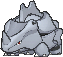

<!-- This file is generated by tools/generate_site.py. Edit the generator, not this file. -->

# #111 Rhyhorn

{ .sprite-lg loading=lazy }

**Spikes Pokémon**

Ground Rock

[:material-arrow-left: #110 Weezing](110.md) · [Pokédex](index.md) · [#112 Rhydon :material-arrow-right:](112.md)

!!! info "Changes in Rising Ruby / Sinking Sapphire"

    - **Evolution level:** 42 → **39**

## Location

[Granite Cave](../wild/granite_cave_1f.md), [Scorched Slab](../wild/scorched_slab.md)

### Wild encounters

| Area | Method | Level | Note |
| --- | --- | --- | --- |
| [Granite Cave 1F](../wild/granite_cave_1f.md) | Walking | 13 |  |
| [Granite Cave B1F](../wild/granite_cave_b1f.md) | Walking | 18 |  |
| [Scorched Slab](../wild/scorched_slab.md) | Walking | 35 |  |

## Type defenses

| Damage taken | Attacking types |
| --- | --- |
| Immune (×0) | Electric |
| Very resistant (×¼) | Poison |
| Resistant (×½) | Normal Flying Rock Fire |
| Neutral (×1) | Bug Ghost Psychic Dragon Dark Fairy |
| Weak (×2) | Fighting Ground Steel Ice |
| Very weak (×4) | Water Grass |

## Abilities

| Slot | Ability | Effect | Note |
| --- | --- | --- | --- |
| Ability 1 | **Lightning Rod** | Redirects single-target Electric moves to this Pokémon where possible.  Absorbs Electric moves, raising Special Attack one stage. |  |
| Ability 2 | **Rock Head** | Protects against recoil damage. |  |
| Hidden | **Reckless** | Strengthens recoil moves to 1.2× their power. |  |

## Base stats

| Form | HP | Atk | Def | SpA | SpD | Spe | BST |
| --- | --- | --- | --- | --- | --- | --- | --- |
| { .sprite-sm loading=lazy } Normal | 80 | 85 | 95 | 30 | 30 | 25 | **345** |

## Training & breeding

| Property | Value |
| --- | --- |
| EV yield | 1 Def |
| Catch rate | 120 |
| Base friendship | 70 |
| Base experience | 69 |
| Growth rate | slow |
| Egg groups | Monster, Field |
| Hatch counter | 20 |
| Gender ratio | 50% ♂ / 50% ♀ |
| Height / weight | 1 m / 115 kg |

## Evolution

- { .icon loading=lazy } **[Rhyhorn](../pokemon/111.md)** → { .icon loading=lazy } [Rhydon](../pokemon/112.md): Lv. 39 changed <small>(vanilla: Lv. 42)</small>
- { .icon loading=lazy } [Rhydon](../pokemon/112.md) → { .icon loading=lazy } [Rhyperior](../pokemon/464.md): Protector changed <small>(vanilla: Trade holding Protector)</small>

## Wild held items

None.

## Level-up moves { data-search-exclude }

Moves marked &#42; are not normally learned by level up (they come from egg moves, TMs/HMs or tutors in the official games); moves marked &#42;&#42; cannot normally be learned by this Pokémon at all and are omitted from the legal-moves version of the hack.

| Lv. | Move | Type | Cat. | Power | Acc. | PP | Effect | Note |
| --- | --- | --- | --- | --- | --- | --- | --- | --- |
| 1 | Horn Attack | Normal | Physical | 65 | 100% | 25 | Inflicts regular damage with no additional effect. |  |
| 1 | Tail Whip | Normal | Status | — | 100% | 30 | Lowers the target’s Defense by one stage. |  |
| 1 | Fury Attack | Normal | Physical | 15 | 85% | 20 | Hits 2-5 times in one turn. |  |
| 5 | Scary Face | Normal | Status | — | 100% | 10 | Lowers the target’s Speed by two stages. |  |
| 9 | Smack Down | Rock | Physical | 50 | 100% | 15 | Removes any immunity to Ground damage. |  |
| 13 | Bulldoze | Ground | Physical | 60 | 100% | 20 | Has a chance to lower the target’s Speed by one stage. |  |
| 17 | Stomp | Normal | Physical | 65 | 100% | 20 | Has a chance to make the target flinch. |  |
| 21 | Magnitude | Ground | Physical | — | 100% | 30 | Power varies randomly from 10 to 150. | &#42; |
| 25 | Chip Away | Normal | Physical | 70 | 100% | 20 | Ignores the target’s stat modifiers. |  |
| 29 | Rock Blast | Rock | Physical | 25 | 90% | 10 | Hits 2-5 times in one turn. |  |
| 33 | Drill Run | Ground | Physical | 80 | 95% | 10 | Has an increased chance for a critical hit. |  |
| 37 | Take Down | Normal | Physical | 90 | 85% | 20 | User receives 1/4 the damage it inflicts in recoil. |  |
| 41 | Stone Edge | Rock | Physical | 100 | 80% | 5 | Has an increased chance for a critical hit. |  |
| 45 | Earthquake | Ground | Physical | 100 | 100% | 10 | Inflicts regular damage and can hit Dig users. |  |
| 49 | Megahorn | Bug | Physical | 120 | 85% | 10 | Inflicts regular damage with no additional effect. |  |
| 53 | Horn Drill | Normal | Physical | — | 30% | 5 | Causes a one-hit KO. |  |

## TM & HM moves { data-search-exclude }

| Machine | Move | Type | Cat. | Power | Acc. | PP | Effect |
| --- | --- | --- | --- | --- | --- | --- | --- |
| HM04 | [Strength](../changes/moves.md#strength) changed | Normal | Physical | 100 | 100% | 10 | Inflicts regular damage with no additional effect. |
| HM06 | [Rock Smash](../changes/moves.md#rock-smash) changed | Fighting | Physical | 65 | 100% | 15 | Has a chance to lower the target’s Defense by one stage. |
| TM05 | Roar | Normal | Status | — | — | 20 | Immediately ends wild battles.  Forces trainers to switch Pokémon. |
| TM06 | Toxic | Poison | Status | — | 90% | 10 | Badly poisons the target, inflicting more damage every turn. |
| TM10 | Hidden Power | Normal | Special | 60 | 100% | 15 | Power and type depend upon user’s IVs.  Power can range from 30 to 70. |
| TM100 | Confide | Normal | Status | — | — | 20 | Lowers the target’s Special Attack by one stage. |
| TM11 | Sunny Day | Fire | Status | — | — | 5 | Changes the weather to sunny for five turns. |
| TM13 | Ice Beam | Ice | Special | 90 | 100% | 10 | Has a chance to freeze the target. |
| TM14 | Blizzard | Ice | Special | 110 | 70% | 5 | Has a chance to freeze the target. |
| TM17 | Protect | Normal | Status | — | — | 10 | Prevents any moves from hitting the user this turn. |
| TM18 | Rain Dance | Water | Status | — | — | 5 | Changes the weather to rain for five turns. |
| TM21 | Frustration | Normal | Physical | — | 100% | 20 | Power increases as happiness decreases, up to a maximum of 102. |
| TM23 | Smack Down | Rock | Physical | 50 | 100% | 15 | Removes any immunity to Ground damage. |
| TM24 | Thunderbolt | Electric | Special | 90 | 100% | 15 | Has a chance to paralyze the target. |
| TM25 | Thunder | Electric | Special | 110 | 70% | 10 | Has a chance to paralyze the target. |
| TM26 | Earthquake | Ground | Physical | 100 | 100% | 10 | Inflicts regular damage and can hit Dig users. |
| TM27 | Return | Normal | Physical | — | 100% | 20 | Power increases with happiness, up to a maximum of 102. |
| TM28 | Dig | Ground | Physical | 80 | 100% | 10 | User digs underground, dodging all attacks, and hits next turn. |
| TM32 | Double Team | Normal | Status | — | — | 15 | Raises the user’s evasion by one stage. |
| TM35 | Flamethrower | Fire | Special | 90 | 100% | 15 | Has a chance to burn the target. |
| TM37 | Sandstorm | Rock | Status | — | — | 10 | Changes the weather to a sandstorm for five turns. |
| TM38 | Fire Blast | Fire | Special | 110 | 85% | 5 | Has a chance to burn the target. |
| TM39 | Rock Tomb | Rock | Physical | 60 | 95% | 15 | Has a chance to lower the target’s Speed by one stage. |
| TM42 | Facade | Normal | Physical | 70 | 100% | 20 | Power doubles if user is burned, paralyzed, or poisoned. |
| TM44 | Rest | Psychic | Status | — | — | 5 | User sleeps for two turns, completely healing itself. |
| TM45 | Attract | Normal | Status | — | 100% | 15 | Target falls in love if it has the opposite gender, and has a 50% chance to refuse attacking the user. |
| TM46 | Thief | Dark | Physical | 60 | 100% | 25 | Takes the target’s item. |
| TM48 | Round | Normal | Special | 60 | 100% | 15 | Has double power if it’s used more than once per turn. |
| TM59 | Incinerate | Fire | Special | 60 | 100% | 15 | Destroys the target’s held berry. |
| TM66 | Payback | Dark | Physical | 50 | 100% | 10 | Power is doubled if the target has already moved this turn. |
| TM69 | Rock Polish | Rock | Status | — | — | 20 | Raises the user’s Speed by two stages. |
| TM71 | Stone Edge | Rock | Physical | 100 | 80% | 5 | Has an increased chance for a critical hit. |
| TM75 | Swords Dance | Normal | Status | — | — | 20 | Raises the user’s Attack by two stages. |
| TM78 | Bulldoze | Ground | Physical | 60 | 100% | 20 | Has a chance to lower the target’s Speed by one stage. |
| TM80 | Rock Slide | Rock | Physical | 75 | 90% | 10 | Has a chance to make the target flinch. |
| TM84 | Poison Jab | Poison | Physical | 80 | 100% | 20 | Has a chance to poison the target. |
| TM87 | Swagger | Normal | Status | — | 90% | 15 | Raises the target’s Attack by two stages and confuses the target. |
| TM88 | Sleep Talk | Normal | Status | — | — | 10 | Randomly uses one of the user’s other three moves.  Only works if the user is sleeping. |
| TM90 | Substitute | Normal | Status | — | — | 10 | Transfers 1/4 of the user’s max HP into a doll, protecting the user from further damage or status changes until it breaks. |
| TM94 | Secret Power | Normal | Physical | 70 | 100% | 20 | Has a chance to inflict a status effect which depends upon the terrain. |

## Move tutor moves { data-search-exclude }

| Move | Type | Cat. | Power | Acc. | PP | Effect |
| --- | --- | --- | --- | --- | --- | --- |
| Aqua Tail | Water | Physical | 90 | 90% | 10 | Inflicts regular damage with no additional effect. |
| Dragon Pulse | Dragon | Special | 85 | 100% | 10 | Inflicts regular damage with no additional effect. |
| Drill Run | Ground | Physical | 80 | 95% | 10 | Has an increased chance for a critical hit. |
| Earth Power | Ground | Special | 90 | 100% | 10 | Has a chance to lower the target’s Special Defense by one stage. |
| Endeavor | Normal | Physical | — | 100% | 5 | Lowers the target’s HP to equal the user’s. |
| Icy Wind | Ice | Special | 55 | 95% | 15 | Has a chance to lower the target’s Speed by one stage. |
| Iron Tail | Steel | Physical | 100 | 75% | 15 | Has a chance to lower the target’s Defense by one stage. |
| Shock Wave | Electric | Special | 60 | — | 20 | Never misses. |
| Snore | Normal | Special | 50 | 100% | 15 | Has a chance to make the target flinch.  Only works if the user is sleeping. |
| Spite | Ghost | Status | — | 100% | 10 | Lowers the PP of the target’s last used move by 4. |
| Stealth Rock | Rock | Status | — | — | 20 | Causes damage when opposing Pokémon switch in. |
| Superpower | Fighting | Physical | 120 | 100% | 5 | Lowers the user’s Attack and Defense by one stage after inflicting damage. |
| Uproar | Normal | Special | 90 | 100% | 10 | Forced to use this move for several turns.  Pokémon cannot fall asleep in that time. |

## Egg moves { data-search-exclude }

| Move | Type | Cat. | Power | Acc. | PP | Effect |
| --- | --- | --- | --- | --- | --- | --- |
| Counter | Fighting | Physical | — | 100% | 20 | Inflicts twice the damage the user received from the last physical hit it took. |
| Crunch | Dark | Physical | 80 | 100% | 15 | Has a chance to lower the target’s Defense by one stage. |
| Crush Claw | Normal | Physical | 75 | 95% | 10 | Has a chance to lower the target’s Defense by one stage. |
| Curse | Ghost | Status | — | — | 10 | Ghosts pay half their max HP to hurt the target every turn.  Others decrease Speed but raise Attack and Defense. |
| Dragon Rush | Dragon | Physical | 100 | 75% | 10 | Has a chance to make the target flinch. |
| Fire Fang | Fire | Physical | 65 | 95% | 15 | Has a chance to burn the target and a chance to make the target flinch. |
| Guard Split | Psychic | Status | — | — | 10 | Averages Defense and Special Defense with the target. |
| Ice Fang | Ice | Physical | 65 | 95% | 15 | Has a chance to freeze the target and a chance to make the target flinch. |
| Iron Tail | Steel | Physical | 100 | 75% | 15 | Has a chance to lower the target’s Defense by one stage. |
| Magnitude | Ground | Physical | — | 100% | 30 | Power varies randomly from 10 to 150. |
| Metal Burst | Steel | Physical | — | 100% | 10 | Strikes back at the last Pokémon to hit the user this turn with 1.5× the damage. |
| Reversal | Fighting | Physical | — | 100% | 15 | Inflicts more damage when the user has less HP remaining, with a maximum of 200 power. |
| Rock Climb | Normal | Physical | 90 | 85% | 20 | Has a chance to confuse the target. |
| Rototiller | Ground | Status | — | — | 10 | Raises the Attack and Special Attack of all Grass Pokémon in battle. |
| Skull Bash | Normal | Physical | 130 | 100% | 10 | Raises the user’s Defense by one stage.  User charges for one turn before attacking. |
| Thunder Fang | Electric | Physical | 65 | 95% | 15 | Has a chance to paralyze the target and a chance to make the target flinch. |

??? note "Trainers using Rhyhorn (1)"

    | Area | Trainer | Level |
    | --- | --- | --- |
    | [Route 116](../trainers/route_116.md#trainers) | Hiker Clark | Lv. 12 |

---

[:material-arrow-left: #110 Weezing](110.md) · [#112 Rhydon :material-arrow-right:](112.md)
