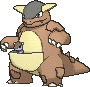
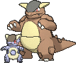

<!-- This file is generated by tools/generate_site.py. Edit the generator, not this file. -->

# #115 Kangaskhan

{ .sprite-lg loading=lazy }

**Parent Pokémon**

Normal

[:material-arrow-left: #114 Tangela](114.md) · [Pokédex](index.md) · [#116 Horsea :material-arrow-right:](116.md)

!!! note "No documented changes"

    Drayano's documentation lists no stat, type, ability, evolution or held item changes for this Pokémon. Its level-up moves are listed below as they appear in the hack.

## Location

[Granite Cave](../wild/granite_cave_1f.md), [Safari Zone](../wild/safari_zone_1.md)

### Wild encounters

| Area | Method | Level | Note |
| --- | --- | --- | --- |
| [Granite Cave B2F](../wild/granite_cave_b2f.md) | Walking | 20 |  |

## Type defenses

| Damage taken | Attacking types |
| --- | --- |
| Immune (×0) | Ghost |
| Neutral (×1) | Normal Flying Poison Ground Rock Bug Steel Fire Water Grass Electric Psychic Ice Dragon Dark Fairy |
| Weak (×2) | Fighting |

## Abilities

| Slot | Ability | Effect | Note |
| --- | --- | --- | --- |
| Ability 1 | **Early Bird** | Makes sleep pass twice as quickly. |  |
| Ability 2 | **Scrappy** | Lets the Pokémon's Normal and Fighting moves hit Ghost Pokémon. |  |
| Hidden | **Inner Focus** | Prevents flinching. |  |

## Base stats

| Form | HP | Atk | Def | SpA | SpD | Spe | BST |
| --- | --- | --- | --- | --- | --- | --- | --- |
| { .sprite-sm loading=lazy } Normal | 105 | 95 | 80 | 40 | 80 | 90 | **490** |
| { .sprite-sm loading=lazy } Mega Kangaskhan | 105 | 125 | 100 | 60 | 100 | 100 | **590** |

## Training & breeding

| Property | Value |
| --- | --- |
| EV yield | 2 HP |
| Catch rate | 45 |
| Base friendship | 70 |
| Base experience | 172 |
| Growth rate | medium |
| Egg groups | Monster |
| Hatch counter | 20 |
| Gender ratio | 0% ♂ / 100% ♀ |
| Height / weight | 2.2 m / 80 kg |

## Evolution

This Pokémon does not evolve.
- { .sprite-sm loading=lazy } **Mega Kangaskhan**: Mega Evolves by holding the { .item loading=lazy } Kangaskhanite

## Wild held items

None.

## Level-up moves { data-search-exclude }

Moves marked &#42; are not normally learned by level up (they come from egg moves, TMs/HMs or tutors in the official games); moves marked &#42;&#42; cannot normally be learned by this Pokémon at all and are omitted from the legal-moves version of the hack.

| Lv. | Move | Type | Cat. | Power | Acc. | PP | Effect | Note |
| --- | --- | --- | --- | --- | --- | --- | --- | --- |
| 1 | Double-Edge | Normal | Physical | 120 | 100% | 15 | User receives 1/3 the damage inflicted in recoil. | &#42; |
| 1 | Hammer Arm | Fighting | Physical | 100 | 90% | 10 | Lowers user’s Speed by one stage. | &#42; |
| 1 | Comet Punch | Normal | Physical | 18 | 85% | 15 | Hits 2-5 times in one turn. |  |
| 1 | Leer | Normal | Status | — | 100% | 30 | Lowers the target’s Defense by one stage. |  |
| 6 | Fake Out | Normal | Physical | 40 | 100% | 10 | Can only be used as the first move after the user enters battle.  Causes the target to flinch. |  |
| 10 | Tail Whip | Normal | Status | — | 100% | 30 | Lowers the target’s Defense by one stage. |  |
| 14 | Bite | Dark | Physical | 60 | 100% | 25 | Has a chance to make the target flinch. |  |
| 18 | Double Hit | Normal | Physical | 35 | 90% | 10 | Hits twice in one turn. |  |
| 22 | Rage | Normal | Physical | 20 | 100% | 20 | If the user is hit after using this move, its Attack rises by one stage. |  |
| 26 | Mega Punch | Normal | Physical | 80 | 85% | 20 | Inflicts regular damage with no additional effect. |  |
| 30 | Chip Away | Normal | Physical | 70 | 100% | 20 | Ignores the target’s stat modifiers. |  |
| 34 | Dizzy Punch | Normal | Physical | 70 | 100% | 10 | Has a chance to confuse the target. |  |
| 38 | Crunch | Dark | Physical | 80 | 100% | 15 | Has a chance to lower the target’s Defense by one stage. |  |
| 42 | Endure | Normal | Status | — | — | 10 | Prevents the user’s HP from lowering below 1 this turn. |  |
| 42 | Reversal | Fighting | Physical | — | 100% | 15 | Inflicts more damage when the user has less HP remaining, with a maximum of 200 power. |  |
| 46 | Outrage | Dragon | Physical | 120 | 100% | 10 | Hits every turn for 2-3 turns, then confuses the user. |  |
| 50 | Sucker Punch | Dark | Physical | 80 | 100% | 5 | Only works if the target is about to use a damaging move. |  |
| 54 | Hammer Arm | Fighting | Physical | 100 | 90% | 10 | Lowers user’s Speed by one stage. | &#42; |
| 58 | Double-Edge | Normal | Physical | 120 | 100% | 15 | User receives 1/3 the damage inflicted in recoil. | &#42; |

## TM & HM moves { data-search-exclude }

| Machine | Move | Type | Cat. | Power | Acc. | PP | Effect |
| --- | --- | --- | --- | --- | --- | --- | --- |
| HM01 | [Cut](../changes/moves.md#cut) changed | Grass | Physical | 70 | 100% | 15 | High Critical Rate. High Critical Rate |
| HM03 | Surf | Water | Special | 90 | 100% | 15 | Inflicts regular damage and can hit Dive users. |
| HM04 | [Strength](../changes/moves.md#strength) changed | Normal | Physical | 100 | 100% | 10 | Inflicts regular damage with no additional effect. |
| HM06 | [Rock Smash](../changes/moves.md#rock-smash) changed | Fighting | Physical | 65 | 100% | 15 | Has a chance to lower the target’s Defense by one stage. |
| TM05 | Roar | Normal | Status | — | — | 20 | Immediately ends wild battles.  Forces trainers to switch Pokémon. |
| TM06 | Toxic | Poison | Status | — | 90% | 10 | Badly poisons the target, inflicting more damage every turn. |
| TM07 | Hail | Ice | Status | — | — | 10 | Changes the weather to a hailstorm for five turns. |
| TM10 | Hidden Power | Normal | Special | 60 | 100% | 15 | Power and type depend upon user’s IVs.  Power can range from 30 to 70. |
| TM100 | Confide | Normal | Status | — | — | 20 | Lowers the target’s Special Attack by one stage. |
| TM11 | Sunny Day | Fire | Status | — | — | 5 | Changes the weather to sunny for five turns. |
| TM13 | Ice Beam | Ice | Special | 90 | 100% | 10 | Has a chance to freeze the target. |
| TM14 | Blizzard | Ice | Special | 110 | 70% | 5 | Has a chance to freeze the target. |
| TM15 | Hyper Beam | Normal | Special | 150 | 90% | 5 | User foregoes its next turn to recharge. |
| TM17 | Protect | Normal | Status | — | — | 10 | Prevents any moves from hitting the user this turn. |
| TM18 | Rain Dance | Water | Status | — | — | 5 | Changes the weather to rain for five turns. |
| TM20 | Safeguard | Normal | Status | — | — | 25 | Protects the user’s field from major status ailments and confusion for five turns. |
| TM21 | Frustration | Normal | Physical | — | 100% | 20 | Power increases as happiness decreases, up to a maximum of 102. |
| TM22 | Solar Beam | Grass | Special | 120 | 100% | 10 | Requires a turn to charge before attacking. |
| TM24 | Thunderbolt | Electric | Special | 90 | 100% | 15 | Has a chance to paralyze the target. |
| TM25 | Thunder | Electric | Special | 110 | 70% | 10 | Has a chance to paralyze the target. |
| TM26 | Earthquake | Ground | Physical | 100 | 100% | 10 | Inflicts regular damage and can hit Dig users. |
| TM27 | Return | Normal | Physical | — | 100% | 20 | Power increases with happiness, up to a maximum of 102. |
| TM28 | Dig | Ground | Physical | 80 | 100% | 10 | User digs underground, dodging all attacks, and hits next turn. |
| TM30 | Shadow Ball | Ghost | Special | 80 | 100% | 15 | Has a chance to lower the target’s Special Defense by one stage. |
| TM31 | Brick Break | Fighting | Physical | 75 | 100% | 15 | Destroys Reflect and Light Screen. |
| TM32 | Double Team | Normal | Status | — | — | 15 | Raises the user’s evasion by one stage. |
| TM35 | Flamethrower | Fire | Special | 90 | 100% | 15 | Has a chance to burn the target. |
| TM37 | Sandstorm | Rock | Status | — | — | 10 | Changes the weather to a sandstorm for five turns. |
| TM38 | Fire Blast | Fire | Special | 110 | 85% | 5 | Has a chance to burn the target. |
| TM39 | Rock Tomb | Rock | Physical | 60 | 95% | 15 | Has a chance to lower the target’s Speed by one stage. |
| TM40 | Aerial Ace | Flying | Physical | 60 | — | 20 | Never misses. |
| TM42 | Facade | Normal | Physical | 70 | 100% | 20 | Power doubles if user is burned, paralyzed, or poisoned. |
| TM44 | Rest | Psychic | Status | — | — | 5 | User sleeps for two turns, completely healing itself. |
| TM45 | Attract | Normal | Status | — | 100% | 15 | Target falls in love if it has the opposite gender, and has a 50% chance to refuse attacking the user. |
| TM46 | Thief | Dark | Physical | 60 | 100% | 25 | Takes the target’s item. |
| TM48 | Round | Normal | Special | 60 | 100% | 15 | Has double power if it’s used more than once per turn. |
| TM52 | Focus Blast | Fighting | Special | 120 | 70% | 5 | Has a chance to lower the target’s Special Defense by one stage. |
| TM56 | Fling | Dark | Physical | — | 100% | 10 | Throws held item at the target; power depends on the item. |
| TM59 | Incinerate | Fire | Special | 60 | 100% | 15 | Destroys the target’s held berry. |
| TM65 | Shadow Claw | Ghost | Physical | 70 | 100% | 15 | Has an increased chance for a critical hit. |
| TM67 | Retaliate | Normal | Physical | 70 | 100% | 5 | Has double power if a friendly Pokémon fainted last turn. |
| TM68 | Giga Impact | Normal | Physical | 150 | 90% | 5 | User foregoes its next turn to recharge. |
| TM78 | Bulldoze | Ground | Physical | 60 | 100% | 20 | Has a chance to lower the target’s Speed by one stage. |
| TM80 | Rock Slide | Rock | Physical | 75 | 90% | 10 | Has a chance to make the target flinch. |
| TM87 | Swagger | Normal | Status | — | 90% | 15 | Raises the target’s Attack by two stages and confuses the target. |
| TM88 | Sleep Talk | Normal | Status | — | — | 10 | Randomly uses one of the user’s other three moves.  Only works if the user is sleeping. |
| TM90 | Substitute | Normal | Status | — | — | 10 | Transfers 1/4 of the user’s max HP into a doll, protecting the user from further damage or status changes until it breaks. |
| TM94 | Secret Power | Normal | Physical | 70 | 100% | 20 | Has a chance to inflict a status effect which depends upon the terrain. |
| TM98 | Power-Up Punch | Fighting | Physical | 40 | 100% | 20 | Raises the user’s Attack by one stage after inflicting damage. |

## Move tutor moves { data-search-exclude }

| Move | Type | Cat. | Power | Acc. | PP | Effect |
| --- | --- | --- | --- | --- | --- | --- |
| Aqua Tail | Water | Physical | 90 | 90% | 10 | Inflicts regular damage with no additional effect. |
| Covet | Normal | Physical | 60 | 100% | 25 | Takes the target’s item. |
| Drain Punch | Fighting | Physical | 75 | 100% | 10 | Drains half the damage inflicted to heal the user. |
| Endeavor | Normal | Physical | — | 100% | 5 | Lowers the target’s HP to equal the user’s. |
| Fire Punch | Fire | Physical | 75 | 100% | 15 | Has a chance to burn the target. |
| Focus Punch | Fighting | Physical | 150 | 100% | 20 | If the user takes damage before attacking, the attack is canceled. |
| Helping Hand | Normal | Status | — | — | 20 | Ally’s next move inflicts half more damage. |
| Ice Punch | Ice | Physical | 75 | 100% | 15 | Has a chance to freeze the target. |
| Icy Wind | Ice | Special | 55 | 95% | 15 | Has a chance to lower the target’s Speed by one stage. |
| Iron Tail | Steel | Physical | 100 | 75% | 15 | Has a chance to lower the target’s Defense by one stage. |
| Low Kick | Fighting | Physical | — | 100% | 20 | Inflicts more damage to heavier targets, with a maximum of 120 power. |
| Outrage | Dragon | Physical | 120 | 100% | 10 | Hits every turn for 2-3 turns, then confuses the user. |
| Shock Wave | Electric | Special | 60 | — | 20 | Never misses. |
| Snore | Normal | Special | 50 | 100% | 15 | Has a chance to make the target flinch.  Only works if the user is sleeping. |
| Spite | Ghost | Status | — | 100% | 10 | Lowers the PP of the target’s last used move by 4. |
| Thunder Punch | Electric | Physical | 75 | 100% | 15 | Has a chance to paralyze the target. |
| Uproar | Normal | Special | 90 | 100% | 10 | Forced to use this move for several turns.  Pokémon cannot fall asleep in that time. |
| Water Pulse | Water | Special | 60 | 100% | 20 | Has a chance to confuse the target. |

## Egg moves { data-search-exclude }

| Move | Type | Cat. | Power | Acc. | PP | Effect |
| --- | --- | --- | --- | --- | --- | --- |
| Circle Throw | Fighting | Physical | 60 | 90% | 10 | Ends wild battles.  Forces trainers to switch Pokémon. |
| Counter | Fighting | Physical | — | 100% | 20 | Inflicts twice the damage the user received from the last physical hit it took. |
| Crush Claw | Normal | Physical | 75 | 95% | 10 | Has a chance to lower the target’s Defense by one stage. |
| Disable | Normal | Status | — | 100% | 20 | Disables the target’s last used move for 1-8 turns. |
| Double-Edge | Normal | Physical | 120 | 100% | 15 | User receives 1/3 the damage inflicted in recoil. |
| Endeavor | Normal | Physical | — | 100% | 5 | Lowers the target’s HP to equal the user’s. |
| Focus Energy | Normal | Status | — | — | 30 | Increases the user’s chance to score a critical hit. |
| Focus Punch | Fighting | Physical | 150 | 100% | 20 | If the user takes damage before attacking, the attack is canceled. |
| Foresight | Normal | Status | — | — | 40 | Forces the target to have no Evade, and allows it to be hit by Normal and Fighting moves even if it’s a Ghost. |
| Hammer Arm | Fighting | Physical | 100 | 90% | 10 | Lowers user’s Speed by one stage. |
| Stomp | Normal | Physical | 65 | 100% | 20 | Has a chance to make the target flinch. |
| Trump Card | Normal | Special | — | — | 5 | Power increases when this move has less PP, up to a maximum of 200. |
| Uproar | Normal | Special | 90 | 100% | 10 | Forced to use this move for several turns.  Pokémon cannot fall asleep in that time. |

??? note "Trainers using Kangaskhan (7)"

    | Area | Trainer | Level |
    | --- | --- | --- |
    | [Route 110](../trainers/route_110.md#rematches) | Collector Edwin (4) | Lv. 35 |
    | [Route 110](../trainers/route_110.md#rematches) | Collector Edwin (7) | Lv. 59 |
    | [Route 110](../trainers/route_110.md#rematches) | Collector Edwin (8) | Lv. 64 |
    | [Route 110](../trainers/route_110.md#rematches) | Collector Edwin (C) | Lv. 75 |
    | [Petalburg Gym](../trainers/petalburg_gym.md#trainers) | Ace Trainer Jody | Lv. 37 |
    | [Battle Resort](../trainers/battle_resort.md#trainers) | Leader Antonin [Norman] | Lv. 79 |
    | [Battle Resort](../trainers/battle_resort.md#trainers) | Leader Antonin [Norman] | Lv. 79 |

---

[:material-arrow-left: #114 Tangela](114.md) · [#116 Horsea :material-arrow-right:](116.md)
