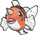

<!-- This file is generated by tools/generate_site.py. Edit the generator, not this file. -->

# #119 Seaking

{ .sprite-lg loading=lazy }

**Goldfish Pokémon**

Water

[:material-arrow-left: #118 Goldeen](118.md) · [Pokédex](index.md) · [#120 Staryu :material-arrow-right:](120.md)

!!! info "Changes in Rising Ruby / Sinking Sapphire"

    - **Base stats:** Atk 92 → **100**, Def 65 → **80**, SpA 65 → **40**, Spe 68 → **80** (BST 450 → **460**)

## Location

[Petalburg City](../wild/petalburg_city.md), [Safari Zone](../wild/safari_zone_1.md)

### Wild encounters

| Area | Method | Level | Note |
| --- | --- | --- | --- |
| [Petalburg City](../wild/petalburg_city.md) | Super Rod | 55 |  |
| [Safari Zone (4)](../wild/safari_zone_4.md) | Super Rod | 55 |  |

## Type defenses

| Damage taken | Attacking types |
| --- | --- |
| Resistant (×½) | Steel Fire Water Ice |
| Neutral (×1) | Normal Fighting Flying Poison Ground Rock Bug Ghost Psychic Dragon Dark Fairy |
| Weak (×2) | Grass Electric |

## Abilities

| Slot | Ability | Effect | Note |
| --- | --- | --- | --- |
| Ability 1 | **Swift Swim** | Doubles Speed during rain. |  |
| Ability 2 | **Water Veil** | Prevents burns. |  |
| Hidden | **Lightning Rod** | Redirects single-target Electric moves to this Pokémon where possible.  Absorbs Electric moves, raising Special Attack one stage. |  |

## Base stats

| Form | HP | Atk | Def | SpA | SpD | Spe | BST |
| --- | --- | --- | --- | --- | --- | --- | --- |
| { .sprite-sm loading=lazy } Normal | 80 | 100<small class="was">was 92</small> | 80<small class="was">was 65</small> | 40<small class="was">was 65</small> | 80 | 80<small class="was">was 68</small> | 460<small class="was">was 450</small> |

## Training & breeding

| Property | Value |
| --- | --- |
| EV yield | 2 Atk |
| Catch rate | 60 |
| Base friendship | 70 |
| Base experience | 158 |
| Growth rate | medium |
| Egg groups | Water 2 |
| Hatch counter | 20 |
| Gender ratio | 50% ♂ / 50% ♀ |
| Height / weight | 1.3 m / 39 kg |

## Evolution

- { .icon loading=lazy } [Goldeen](../pokemon/118.md) → { .icon loading=lazy } **[Seaking](../pokemon/119.md)**: Lv. 33

## Wild held items

| Item | Chance | Note |
| --- | --- | --- |
| { .item loading=lazy } Mystic Water | 5% |  |

## Level-up moves { data-search-exclude }

Moves marked &#42; are not normally learned by level up (they come from egg moves, TMs/HMs or tutors in the official games); moves marked &#42;&#42; cannot normally be learned by this Pokémon at all and are omitted from the legal-moves version of the hack.

| Lv. | Move | Type | Cat. | Power | Acc. | PP | Effect | Note |
| --- | --- | --- | --- | --- | --- | --- | --- | --- |
| 1 | Megahorn | Bug | Physical | 120 | 85% | 10 | Inflicts regular damage with no additional effect. |  |
| 1 | Poison Jab | Poison | Physical | 80 | 100% | 20 | Has a chance to poison the target. |  |
| 1 | Peck | Flying | Physical | 35 | 100% | 35 | Inflicts regular damage with no additional effect. |  |
| 1 | Tail Whip | Normal | Status | — | 100% | 30 | Lowers the target’s Defense by one stage. |  |
| 1 | Water Sport | Water | Status | — | — | 15 | Halves all Fire-type damage. |  |
| 5 | Supersonic | Normal | Status | — | 55% | 20 | Confuses the target. |  |
| 8 | Horn Attack | Normal | Physical | 65 | 100% | 25 | Inflicts regular damage with no additional effect. |  |
| 11 | Flail | Normal | Physical | — | 100% | 15 | Inflicts more damage when the user has less HP remaining, with a maximum of 200 power. |  |
| 14 | Water Pulse | Water | Special | 60 | 100% | 20 | Has a chance to confuse the target. |  |
| 17 | Aqua Ring | Water | Status | — | — | 20 | Restores 1/16 of the user’s max HP each turn. |  |
| 20 | Waterfall | Water | Physical | 80 | 100% | 15 | Has a chance to make the target flinch. |  |
| 23 | Fury Attack | Normal | Physical | 15 | 85% | 20 | Hits 2-5 times in one turn. |  |
| 26 | Knock Off | Dark | Physical | 65 | 100% | 20 | Target drops its held item. | &#42; |
| 29 | Agility | Psychic | Status | — | — | 30 | Raises the user’s Speed by two stages. |  |
| 32 | Aqua Tail | Water | Physical | 90 | 90% | 10 | Inflicts regular damage with no additional effect. | &#42; |
| 36 | Drill Run | Ground | Physical | 80 | 95% | 10 | Has an increased chance for a critical hit. | &#42; |
| 40 | Soak | Water | Status | — | 100% | 20 | Changes the target’s type to Water. |  |
| 44 | Skull Bash | Normal | Physical | 130 | 100% | 10 | Raises the user’s Defense by one stage.  User charges for one turn before attacking. | &#42; |
| 48 | Bounce | Flying | Physical | 85 | 85% | 5 | User bounces high into the air, dodging all attacks, and hits next turn. | &#42; |
| 52 | Horn Drill | Normal | Physical | — | 30% | 5 | Causes a one-hit KO. |  |
| 56 | Megahorn | Bug | Physical | 120 | 85% | 10 | Inflicts regular damage with no additional effect. |  |

## TM & HM moves { data-search-exclude }

| Machine | Move | Type | Cat. | Power | Acc. | PP | Effect |
| --- | --- | --- | --- | --- | --- | --- | --- |
| HM03 | Surf | Water | Special | 90 | 100% | 15 | Inflicts regular damage and can hit Dive users. |
| HM05 | Waterfall | Water | Physical | 80 | 100% | 15 | Has a chance to make the target flinch. |
| HM07 | Dive | Water | Physical | 80 | 100% | 10 | User dives underwater, dodging all attacks, and hits next turn. |
| TM06 | Toxic | Poison | Status | — | 90% | 10 | Badly poisons the target, inflicting more damage every turn. |
| TM07 | Hail | Ice | Status | — | — | 10 | Changes the weather to a hailstorm for five turns. |
| TM10 | Hidden Power | Normal | Special | 60 | 100% | 15 | Power and type depend upon user’s IVs.  Power can range from 30 to 70. |
| TM100 | Confide | Normal | Status | — | — | 20 | Lowers the target’s Special Attack by one stage. |
| TM13 | Ice Beam | Ice | Special | 90 | 100% | 10 | Has a chance to freeze the target. |
| TM14 | Blizzard | Ice | Special | 110 | 70% | 5 | Has a chance to freeze the target. |
| TM15 | Hyper Beam | Normal | Special | 150 | 90% | 5 | User foregoes its next turn to recharge. |
| TM17 | Protect | Normal | Status | — | — | 10 | Prevents any moves from hitting the user this turn. |
| TM18 | Rain Dance | Water | Status | — | — | 5 | Changes the weather to rain for five turns. |
| TM21 | Frustration | Normal | Physical | — | 100% | 20 | Power increases as happiness decreases, up to a maximum of 102. |
| TM27 | Return | Normal | Physical | — | 100% | 20 | Power increases with happiness, up to a maximum of 102. |
| TM32 | Double Team | Normal | Status | — | — | 15 | Raises the user’s evasion by one stage. |
| TM42 | Facade | Normal | Physical | 70 | 100% | 20 | Power doubles if user is burned, paralyzed, or poisoned. |
| TM44 | Rest | Psychic | Status | — | — | 5 | User sleeps for two turns, completely healing itself. |
| TM45 | Attract | Normal | Status | — | 100% | 15 | Target falls in love if it has the opposite gender, and has a 50% chance to refuse attacking the user. |
| TM48 | Round | Normal | Special | 60 | 100% | 15 | Has double power if it’s used more than once per turn. |
| TM55 | Scald | Water | Special | 80 | 100% | 15 | Has a chance to burn the target. |
| TM68 | Giga Impact | Normal | Physical | 150 | 90% | 5 | User foregoes its next turn to recharge. |
| TM84 | Poison Jab | Poison | Physical | 80 | 100% | 20 | Has a chance to poison the target. |
| TM87 | Swagger | Normal | Status | — | 90% | 15 | Raises the target’s Attack by two stages and confuses the target. |
| TM88 | Sleep Talk | Normal | Status | — | — | 10 | Randomly uses one of the user’s other three moves.  Only works if the user is sleeping. |
| TM90 | Substitute | Normal | Status | — | — | 10 | Transfers 1/4 of the user’s max HP into a doll, protecting the user from further damage or status changes until it breaks. |
| TM94 | Secret Power | Normal | Physical | 70 | 100% | 20 | Has a chance to inflict a status effect which depends upon the terrain. |

## Move tutor moves { data-search-exclude }

| Move | Type | Cat. | Power | Acc. | PP | Effect |
| --- | --- | --- | --- | --- | --- | --- |
| Aqua Tail | Water | Physical | 90 | 90% | 10 | Inflicts regular damage with no additional effect. |
| Bounce | Flying | Physical | 85 | 85% | 5 | User bounces high into the air, dodging all attacks, and hits next turn. |
| Drill Run | Ground | Physical | 80 | 95% | 10 | Has an increased chance for a critical hit. |
| Icy Wind | Ice | Special | 55 | 95% | 15 | Has a chance to lower the target’s Speed by one stage. |
| Knock Off | Dark | Physical | 65 | 100% | 20 | Target drops its held item. |
| Signal Beam | Bug | Special | 75 | 100% | 15 | Has a chance to confuse the target. |
| Snore | Normal | Special | 50 | 100% | 15 | Has a chance to make the target flinch.  Only works if the user is sleeping. |
| Water Pulse | Water | Special | 60 | 100% | 20 | Has a chance to confuse the target. |

## Egg moves { data-search-exclude }

No egg moves.

??? note "Trainers using Seaking (5)"

    | Area | Trainer | Level |
    | --- | --- | --- |
    | [Route 106](../trainers/route_106.md#trainers) | Swimmer Nicole | Lv. 36 |
    | [Route 123](../trainers/route_123.md#trainers) | Fisherman Timin | Lv. 51 |
    | [Route 133](../trainers/route_133.md#trainers) | Swimmer Linda | Lv. 59 |
    | [Underwater 124](../trainers/underwater_124.md#trainers) | Free Diver Rischel | Lv. 60 |
    | [Sootopolis Gym](../trainers/sootopolis_gym.md#trainers) | Beauty Tiffany | Lv. 62 |

---

[:material-arrow-left: #118 Goldeen](118.md) · [#120 Staryu :material-arrow-right:](120.md)
