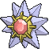

<!-- This file is generated by tools/generate_site.py. Edit the generator, not this file. -->

# #121 Starmie

{ .sprite-lg loading=lazy }

**Mysterious Pokémon**

Water Psychic

[:material-arrow-left: #120 Staryu](120.md) · [Pokédex](index.md) · [#122 Mr. Mime :material-arrow-right:](122.md)

!!! note "No documented changes"

    Drayano's documentation lists no stat, type, ability, evolution or held item changes for this Pokémon. Its level-up moves are listed below as they appear in the hack.

## Location

[Route 105](../wild/route_105.md), [Route 106](../wild/route_106.md), [Lilycove City](../wild/lilycove_city.md), [Underwater](../wild/underwater_107.md)

### Wild encounters

| Area | Method | Level | Note |
| --- | --- | --- | --- |
| [Route 106](../wild/route_106.md) | Super Rod | 55 |  |
| [Route 105](../wild/route_105.md) | Super Rod | 55 |  |
| [Lilycove City](../wild/lilycove_city.md) | Super Rod | 55 |  |
| [Underwater 107](../wild/underwater_107.md) | Grass | 55 |  |
| [Underwater 124](../wild/underwater_124.md) | Grass | 55 |  |
| [Underwater 126](../wild/underwater_126.md) | Grass | 55 |  |
| [Underwater 128](../wild/underwater_128.md) | Grass | 55 |  |
| [Underwater 129](../wild/underwater_129.md) | Grass | 55 |  |
| [Underwater 130](../wild/underwater_130.md) | Grass | 55 |  |

## Type defenses

| Damage taken | Attacking types |
| --- | --- |
| Resistant (×½) | Fighting Steel Fire Water Psychic Ice |
| Neutral (×1) | Normal Flying Poison Ground Rock Dragon Fairy |
| Weak (×2) | Bug Ghost Grass Electric Dark |

## Abilities

| Slot | Ability | Effect | Note |
| --- | --- | --- | --- |
| Ability 1 | **Illuminate** | Doubles the wild encounter rate. |  |
| Ability 2 | **Natural Cure** | Cures any major status ailment upon switching out. |  |
| Hidden | **Analytic** | Strengthens moves to 1.3× their power when moving last. |  |

## Base stats

| Form | HP | Atk | Def | SpA | SpD | Spe | BST |
| --- | --- | --- | --- | --- | --- | --- | --- |
| { .sprite-sm loading=lazy } Normal | 60 | 75 | 85 | 100 | 85 | 115 | **520** |

## Training & breeding

| Property | Value |
| --- | --- |
| EV yield | 2 Spe |
| Catch rate | 60 |
| Base friendship | 70 |
| Base experience | 182 |
| Growth rate | slow |
| Egg groups | Water 3 |
| Hatch counter | 20 |
| Gender ratio | Genderless |
| Height / weight | 1.1 m / 80 kg |

## Evolution

- { .icon loading=lazy } [Staryu](../pokemon/120.md) → { .icon loading=lazy } **[Starmie](../pokemon/121.md)**: Use Water Stone

## Wild held items

| Item | Chance | Note |
| --- | --- | --- |
| { .item loading=lazy } Stardust | 50% |  |
| { .item loading=lazy } Star Piece | 5% |  |

## Level-up moves { data-search-exclude }

Moves marked &#42; are not normally learned by level up (they come from egg moves, TMs/HMs or tutors in the official games); moves marked &#42;&#42; cannot normally be learned by this Pokémon at all and are omitted from the legal-moves version of the hack.

| Lv. | Move | Type | Cat. | Power | Acc. | PP | Effect | Note |
| --- | --- | --- | --- | --- | --- | --- | --- | --- |
| 1 | Hydro Pump | Water | Special | 110 | 80% | 5 | Inflicts regular damage with no additional effect. |  |
| 1 | Water Gun | Water | Special | 40 | 100% | 25 | Inflicts regular damage with no additional effect. |  |
| 1 | Rapid Spin | Normal | Physical | 20 | 100% | 40 | Frees the user from binding moves, removes Leech Seed, and blows away Spikes. |  |
| 1 | Recover | Normal | Status | — | — | 5 | Heals the user by half its max HP. |  |
| 1 | Swift | Normal | Special | 60 | — | 20 | Never misses. |  |
| 40 | Confuse Ray | Ghost | Status | — | 100% | 10 | Confuses the target. |  |

## TM & HM moves { data-search-exclude }

| Machine | Move | Type | Cat. | Power | Acc. | PP | Effect |
| --- | --- | --- | --- | --- | --- | --- | --- |
| HM03 | Surf | Water | Special | 90 | 100% | 15 | Inflicts regular damage and can hit Dive users. |
| HM05 | Waterfall | Water | Physical | 80 | 100% | 15 | Has a chance to make the target flinch. |
| HM07 | Dive | Water | Physical | 80 | 100% | 10 | User dives underwater, dodging all attacks, and hits next turn. |
| TM03 | Psyshock | Psychic | Special | 80 | 100% | 10 | Inflicts damage based on the target’s Defense, not Special Defense. |
| TM06 | Toxic | Poison | Status | — | 90% | 10 | Badly poisons the target, inflicting more damage every turn. |
| TM07 | Hail | Ice | Status | — | — | 10 | Changes the weather to a hailstorm for five turns. |
| TM10 | Hidden Power | Normal | Special | 60 | 100% | 15 | Power and type depend upon user’s IVs.  Power can range from 30 to 70. |
| TM100 | Confide | Normal | Status | — | — | 20 | Lowers the target’s Special Attack by one stage. |
| TM13 | Ice Beam | Ice | Special | 90 | 100% | 10 | Has a chance to freeze the target. |
| TM14 | Blizzard | Ice | Special | 110 | 70% | 5 | Has a chance to freeze the target. |
| TM15 | Hyper Beam | Normal | Special | 150 | 90% | 5 | User foregoes its next turn to recharge. |
| TM16 | Light Screen | Psychic | Status | — | — | 30 | Reduces damage from special attacks by 50% for five turns. |
| TM17 | Protect | Normal | Status | — | — | 10 | Prevents any moves from hitting the user this turn. |
| TM18 | Rain Dance | Water | Status | — | — | 5 | Changes the weather to rain for five turns. |
| TM21 | Frustration | Normal | Physical | — | 100% | 20 | Power increases as happiness decreases, up to a maximum of 102. |
| TM24 | Thunderbolt | Electric | Special | 90 | 100% | 15 | Has a chance to paralyze the target. |
| TM25 | Thunder | Electric | Special | 110 | 70% | 10 | Has a chance to paralyze the target. |
| TM27 | Return | Normal | Physical | — | 100% | 20 | Power increases with happiness, up to a maximum of 102. |
| TM29 | Psychic | Psychic | Special | 90 | 100% | 10 | Has a chance to lower the target’s Special Defense by one stage. |
| TM32 | Double Team | Normal | Status | — | — | 15 | Raises the user’s evasion by one stage. |
| TM33 | Reflect | Psychic | Status | — | — | 20 | Reduces damage from physical attacks by half. |
| TM42 | Facade | Normal | Physical | 70 | 100% | 20 | Power doubles if user is burned, paralyzed, or poisoned. |
| TM44 | Rest | Psychic | Status | — | — | 5 | User sleeps for two turns, completely healing itself. |
| TM48 | Round | Normal | Special | 60 | 100% | 15 | Has double power if it’s used more than once per turn. |
| TM55 | Scald | Water | Special | 80 | 100% | 15 | Has a chance to burn the target. |
| TM68 | Giga Impact | Normal | Physical | 150 | 90% | 5 | User foregoes its next turn to recharge. |
| TM70 | Flash | Normal | Status | — | 100% | 20 | Lowers the target’s accuracy by one stage. |
| TM73 | Thunder Wave | Electric | Status | — | 100% | 20 | Paralyzes the target. |
| TM74 | Gyro Ball | Steel | Physical | — | 100% | 5 | Power raises when the user has lower Speed, up to a maximum of 150. |
| TM77 | Psych Up | Normal | Status | — | — | 10 | Discards the user’s stat changes and copies the target’s. |
| TM85 | Dream Eater | Psychic | Special | 100 | 100% | 15 | Only works on sleeping Pokémon.  Drains half the damage inflicted to heal the user. |
| TM86 | Grass Knot | Grass | Special | — | 100% | 20 | Inflicts more damage to heavier targets, with a maximum of 120 power. |
| TM87 | Swagger | Normal | Status | — | 90% | 15 | Raises the target’s Attack by two stages and confuses the target. |
| TM88 | Sleep Talk | Normal | Status | — | — | 10 | Randomly uses one of the user’s other three moves.  Only works if the user is sleeping. |
| TM90 | Substitute | Normal | Status | — | — | 10 | Transfers 1/4 of the user’s max HP into a doll, protecting the user from further damage or status changes until it breaks. |
| TM91 | Flash Cannon | Steel | Special | 80 | 100% | 10 | Has a chance to lower the target’s Special Defense by one stage. |
| TM92 | Trick Room | Psychic | Status | — | — | 5 | For five turns, slower Pokémon will act before faster Pokémon. |
| TM94 | Secret Power | Normal | Physical | 70 | 100% | 20 | Has a chance to inflict a status effect which depends upon the terrain. |
| TM99 | Dazzling Gleam | Fairy | Special | 80 | 100% | 10 | Inflicts regular damage with no additional effect. |

## Move tutor moves { data-search-exclude }

| Move | Type | Cat. | Power | Acc. | PP | Effect |
| --- | --- | --- | --- | --- | --- | --- |
| Gravity | Psychic | Status | — | — | 5 | Disables moves and immunities that involve flying or levitating for five turns. |
| Icy Wind | Ice | Special | 55 | 95% | 15 | Has a chance to lower the target’s Speed by one stage. |
| Magic Coat | Psychic | Status | — | — | 15 | Reflects back the first effect move used on the user this turn. |
| Pain Split | Normal | Status | — | — | 20 | Sets the user’s and targets’s HP to the average of their current HP. |
| Recycle | Normal | Status | — | — | 10 | User recovers the item it last used up. |
| Signal Beam | Bug | Special | 75 | 100% | 15 | Has a chance to confuse the target. |
| Skill Swap | Psychic | Status | — | — | 10 | User and target swap abilities. |
| Snore | Normal | Special | 50 | 100% | 15 | Has a chance to make the target flinch.  Only works if the user is sleeping. |
| Trick | Psychic | Status | — | 100% | 10 | User and target swap items. |
| Water Pulse | Water | Special | 60 | 100% | 20 | Has a chance to confuse the target. |
| Wonder Room | Psychic | Status | — | — | 10 | All Pokémon’s Defense and Special Defense are swapped for 5 turns. |

## Egg moves { data-search-exclude }

No egg moves.

??? note "Trainers using Starmie (20)"

    | Area | Trainer | Level |
    | --- | --- | --- |
    | [Route 106](../trainers/route_106.md#trainers) | Triathlete Caleb | Lv. 36 |
    | [Route 106](../trainers/route_106.md#rematches) | Fisherman Elliot (5) | Lv. 39 |
    | [Route 106](../trainers/route_106.md#rematches) | Fisherman Elliot (7) | Lv. 59 |
    | [Route 106](../trainers/route_106.md#rematches) | Fisherman Elliot (C) | Lv. 75 |
    | [Route 109](../trainers/route_109.md#rematches) | Tuber Lola (6) | Lv. 47 |
    | [Route 109](../trainers/route_109.md#rematches) | Tuber Lola (7) | Lv. 59 |
    | [Route 109](../trainers/route_109.md#rematches) | Tuber Lola (C) | Lv. 75 |
    | [Route 111](../trainers/route_111.md#trainers) | The Winstrates' Vivi | Lv. 25 |
    | [Route 113](../trainers/route_113.md#rematches) | Parasol Lady Madeline (6) | Lv. 47 |
    | [Route 113](../trainers/route_113.md#rematches) | Parasol Lady Madeline (8) | Lv. 64 |
    | [Route 113](../trainers/route_113.md#rematches) | Parasol Lady Madeline (C) | Lv. 75 |
    | [Route 126](../trainers/route_126.md#trainers) | Triathlete Denzel | Lv. 55 |
    | [Route 128](../trainers/route_128.md#rematches) | Triathlete Isaiah (7) | Lv. 59 |
    | [Route 128](../trainers/route_128.md#rematches) | Triathlete Isaiah (8) | Lv. 64 |
    | [Route 128](../trainers/route_128.md#rematches) | Triathlete Isaiah (C) | Lv. 75 |
    | [Mossdeep Gym](../trainers/mossdeep_gym.md#trainers) | Psychic Fritz | Lv. 59 |
    | [Underwater 124](../trainers/underwater_124.md#trainers) | Scuba Diver Dmitry | Lv. 60 |
    | [Sootopolis Gym](../trainers/sootopolis_gym.md#trainers) | Leader Wallace | Lv. 65 |
    | [Rustboro City](../trainers/rustboro_city.md#trainers) | Team Aqua Grunt | Lv. 75 |
    | [Battle Resort](../trainers/battle_resort.md#trainers) | Leader Kelvin [Siebold] | Lv. 82 |

---

[:material-arrow-left: #120 Staryu](120.md) · [#122 Mr. Mime :material-arrow-right:](122.md)
