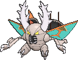

<!-- This file is generated by tools/generate_site.py. Edit the generator, not this file. -->

# #127 Pinsir

{ .sprite-lg loading=lazy }

**Stag Beetle Pokémon**

Bug

[:material-arrow-left: #126 Magmar](126.md) · [Pokédex](index.md) · [#128 Tauros :material-arrow-right:](128.md)

!!! note "No documented changes"

    Drayano's documentation lists no stat, type, ability, evolution or held item changes for this Pokémon. Its level-up moves are listed below as they appear in the hack.

## Location

[Route 112 North](../wild/route_112_north.md)

### Wild encounters

| Area | Method | Level | Note |
| --- | --- | --- | --- |
| [Route 112 North](../wild/route_112_north.md) | Grass | 24 |  |

## Type defenses

| Damage taken | Attacking types |
| --- | --- |
| Resistant (×½) | Fighting Ground Grass |
| Neutral (×1) | Normal Poison Bug Ghost Steel Water Electric Psychic Ice Dragon Dark Fairy |
| Weak (×2) | Flying Rock Fire |

## Abilities

| Slot | Ability | Effect | Note |
| --- | --- | --- | --- |
| Ability 1 | **Hyper Cutter** | Prevents Attack from being lowered by other Pokémon. |  |
| Ability 2 | **Mold Breaker** | Bypasses targets' abilities if they could hinder or prevent a move. |  |
| Hidden | **Moxie** | Raises Attack one stage upon KOing a Pokémon. |  |

## Base stats

| Form | HP | Atk | Def | SpA | SpD | Spe | BST |
| --- | --- | --- | --- | --- | --- | --- | --- |
| { .sprite-sm loading=lazy } Normal | 65 | 125 | 100 | 55 | 70 | 85 | **500** |
| { .sprite-sm loading=lazy } Mega Pinsir | 65 | 155 | 120 | 65 | 90 | 105 | **600** |

## Training & breeding

| Property | Value |
| --- | --- |
| EV yield | 2 Atk |
| Catch rate | 45 |
| Base friendship | 70 |
| Base experience | 175 |
| Growth rate | slow |
| Egg groups | Bug |
| Hatch counter | 25 |
| Gender ratio | 50% ♂ / 50% ♀ |
| Height / weight | 1.5 m / 55 kg |

## Evolution

This Pokémon does not evolve.
- { .sprite-sm loading=lazy } **Mega Pinsir**: Mega Evolves by holding the { .item loading=lazy } Pinsirite

## Wild held items

None.

## Level-up moves { data-search-exclude }

Moves marked &#42; are not normally learned by level up (they come from egg moves, TMs/HMs or tutors in the official games); moves marked &#42;&#42; cannot normally be learned by this Pokémon at all and are omitted from the legal-moves version of the hack.

| Lv. | Move | Type | Cat. | Power | Acc. | PP | Effect | Note |
| --- | --- | --- | --- | --- | --- | --- | --- | --- |
| 1 | Vise Grip | Normal | Physical | 55 | 100% | 30 | Inflicts regular damage with no additional effect. |  |
| 1 | Focus Energy | Normal | Status | — | — | 30 | Increases the user’s chance to score a critical hit. |  |
| 4 | Bind | Normal | Physical | 15 | 85% | 20 | Prevents the target from fleeing and inflicts damage for 2-5 turns. |  |
| 8 | Seismic Toss | Fighting | Physical | — | 100% | 20 | Inflicts damage equal to the user’s level. |  |
| 11 | Harden | Normal | Status | — | — | 30 | Raises the user’s Defense by one stage. |  |
| 14 | Revenge | Fighting | Physical | 60 | 100% | 10 | Inflicts double damage if the user takes damage before attacking this turn. |  |
| 17 | Vital Throw | Fighting | Physical | 70 | — | 10 | Never misses. |  |
| 20 | Bug Bite | Bug | Physical | 60 | 100% | 20 | If target has a berry, inflicts double damage and uses the berry. | &#42; |
| 23 | Double Hit | Normal | Physical | 35 | 90% | 10 | Hits twice in one turn. |  |
| 26 | Brick Break | Fighting | Physical | 75 | 100% | 15 | Destroys Reflect and Light Screen. |  |
| 29 | X-Scissor | Bug | Physical | 80 | 100% | 15 | Inflicts regular damage with no additional effect. |  |
| 32 | Quick Attack | Normal | Physical | 40 | 100% | 30 | Inflicts regular damage with no additional effect. | &#42; |
| 35 | Submission | Fighting | Physical | 80 | 80% | 20 | User receives 1/4 the damage it inflicts in recoil. |  |
| 38 | Storm Throw | Fighting | Physical | 60 | 100% | 10 | Always scores a critical hit. |  |
| 41 | Swords Dance | Normal | Status | — | — | 20 | Raises the user’s Attack by two stages. |  |
| 44 | Close Combat | Fighting | Physical | 120 | 100% | 5 | Lowers the user’s Defense and Special Defense by one stage after inflicting damage. | &#42; |
| 47 | Thrash | Normal | Physical | 120 | 100% | 10 | Hits every turn for 2-3 turns, then confuses the user. |  |
| 50 | Superpower | Fighting | Physical | 120 | 100% | 5 | Lowers the user’s Attack and Defense by one stage after inflicting damage. |  |
| 53 | Guillotine | Normal | Physical | — | 30% | 5 | Causes a one-hit KO. |  |
| 56 | Megahorn | Bug | Physical | 120 | 85% | 10 | Inflicts regular damage with no additional effect. | &#42;&#42; |

## TM & HM moves { data-search-exclude }

| Machine | Move | Type | Cat. | Power | Acc. | PP | Effect |
| --- | --- | --- | --- | --- | --- | --- | --- |
| HM01 | [Cut](../changes/moves.md#cut) changed | Grass | Physical | 70 | 100% | 15 | High Critical Rate. High Critical Rate |
| HM04 | [Strength](../changes/moves.md#strength) changed | Normal | Physical | 100 | 100% | 10 | Inflicts regular damage with no additional effect. |
| HM06 | [Rock Smash](../changes/moves.md#rock-smash) changed | Fighting | Physical | 65 | 100% | 15 | Has a chance to lower the target’s Defense by one stage. |
| TM06 | Toxic | Poison | Status | — | 90% | 10 | Badly poisons the target, inflicting more damage every turn. |
| TM08 | Bulk Up | Fighting | Status | — | — | 20 | Raises the user’s Attack and Defense by one stage. |
| TM10 | Hidden Power | Normal | Special | 60 | 100% | 15 | Power and type depend upon user’s IVs.  Power can range from 30 to 70. |
| TM100 | Confide | Normal | Status | — | — | 20 | Lowers the target’s Special Attack by one stage. |
| TM11 | Sunny Day | Fire | Status | — | — | 5 | Changes the weather to sunny for five turns. |
| TM15 | Hyper Beam | Normal | Special | 150 | 90% | 5 | User foregoes its next turn to recharge. |
| TM17 | Protect | Normal | Status | — | — | 10 | Prevents any moves from hitting the user this turn. |
| TM18 | Rain Dance | Water | Status | — | — | 5 | Changes the weather to rain for five turns. |
| TM21 | Frustration | Normal | Physical | — | 100% | 20 | Power increases as happiness decreases, up to a maximum of 102. |
| TM23 | Smack Down | Rock | Physical | 50 | 100% | 15 | Removes any immunity to Ground damage. |
| TM26 | Earthquake | Ground | Physical | 100 | 100% | 10 | Inflicts regular damage and can hit Dig users. |
| TM27 | Return | Normal | Physical | — | 100% | 20 | Power increases with happiness, up to a maximum of 102. |
| TM28 | Dig | Ground | Physical | 80 | 100% | 10 | User digs underground, dodging all attacks, and hits next turn. |
| TM31 | Brick Break | Fighting | Physical | 75 | 100% | 15 | Destroys Reflect and Light Screen. |
| TM32 | Double Team | Normal | Status | — | — | 15 | Raises the user’s evasion by one stage. |
| TM39 | Rock Tomb | Rock | Physical | 60 | 95% | 15 | Has a chance to lower the target’s Speed by one stage. |
| TM42 | Facade | Normal | Physical | 70 | 100% | 20 | Power doubles if user is burned, paralyzed, or poisoned. |
| TM44 | Rest | Psychic | Status | — | — | 5 | User sleeps for two turns, completely healing itself. |
| TM45 | Attract | Normal | Status | — | 100% | 15 | Target falls in love if it has the opposite gender, and has a 50% chance to refuse attacking the user. |
| TM46 | Thief | Dark | Physical | 60 | 100% | 25 | Takes the target’s item. |
| TM48 | Round | Normal | Special | 60 | 100% | 15 | Has double power if it’s used more than once per turn. |
| TM52 | Focus Blast | Fighting | Special | 120 | 70% | 5 | Has a chance to lower the target’s Special Defense by one stage. |
| TM54 | False Swipe | Normal | Physical | 40 | 100% | 40 | Cannot lower the target’s HP below 1. |
| TM56 | Fling | Dark | Physical | — | 100% | 10 | Throws held item at the target; power depends on the item. |
| TM68 | Giga Impact | Normal | Physical | 150 | 90% | 5 | User foregoes its next turn to recharge. |
| TM71 | Stone Edge | Rock | Physical | 100 | 80% | 5 | Has an increased chance for a critical hit. |
| TM75 | Swords Dance | Normal | Status | — | — | 20 | Raises the user’s Attack by two stages. |
| TM76 | Struggle Bug | Bug | Special | 50 | 100% | 20 | Has a chance to lower the target’s Special Attack by one stage. |
| TM78 | Bulldoze | Ground | Physical | 60 | 100% | 20 | Has a chance to lower the target’s Speed by one stage. |
| TM80 | Rock Slide | Rock | Physical | 75 | 90% | 10 | Has a chance to make the target flinch. |
| TM81 | X-Scissor | Bug | Physical | 80 | 100% | 15 | Inflicts regular damage with no additional effect. |
| TM87 | Swagger | Normal | Status | — | 90% | 15 | Raises the target’s Attack by two stages and confuses the target. |
| TM88 | Sleep Talk | Normal | Status | — | — | 10 | Randomly uses one of the user’s other three moves.  Only works if the user is sleeping. |
| TM90 | Substitute | Normal | Status | — | — | 10 | Transfers 1/4 of the user’s max HP into a doll, protecting the user from further damage or status changes until it breaks. |
| TM94 | Secret Power | Normal | Physical | 70 | 100% | 20 | Has a chance to inflict a status effect which depends upon the terrain. |

## Move tutor moves { data-search-exclude }

| Move | Type | Cat. | Power | Acc. | PP | Effect |
| --- | --- | --- | --- | --- | --- | --- |
| Bind | Normal | Physical | 15 | 85% | 20 | Prevents the target from fleeing and inflicts damage for 2-5 turns. |
| Bug Bite | Bug | Physical | 60 | 100% | 20 | If target has a berry, inflicts double damage and uses the berry. |
| Focus Punch | Fighting | Physical | 150 | 100% | 20 | If the user takes damage before attacking, the attack is canceled. |
| Iron Defense | Steel | Status | — | — | 15 | Raises the user’s Defense by two stages. |
| Knock Off | Dark | Physical | 65 | 100% | 20 | Target drops its held item. |
| Snore | Normal | Special | 50 | 100% | 15 | Has a chance to make the target flinch.  Only works if the user is sleeping. |
| Stealth Rock | Rock | Status | — | — | 20 | Causes damage when opposing Pokémon switch in. |
| Superpower | Fighting | Physical | 120 | 100% | 5 | Lowers the user’s Attack and Defense by one stage after inflicting damage. |

## Egg moves { data-search-exclude }

| Move | Type | Cat. | Power | Acc. | PP | Effect |
| --- | --- | --- | --- | --- | --- | --- |
| Bug Bite | Bug | Physical | 60 | 100% | 20 | If target has a berry, inflicts double damage and uses the berry. |
| Close Combat | Fighting | Physical | 120 | 100% | 5 | Lowers the user’s Defense and Special Defense by one stage after inflicting damage. |
| Feint | Normal | Physical | 30 | 100% | 10 | Hits through Protect and Detect. |
| Feint Attack | Dark | Physical | 60 | — | 20 | Never misses. |
| Flail | Normal | Physical | — | 100% | 15 | Inflicts more damage when the user has less HP remaining, with a maximum of 200 power. |
| Fury Attack | Normal | Physical | 15 | 85% | 20 | Hits 2-5 times in one turn. |
| Me First | Normal | Status | — | — | 20 | Uses the target’s move against it before it attacks, with power increased by half. |
| Quick Attack | Normal | Physical | 40 | 100% | 30 | Inflicts regular damage with no additional effect. |
| Superpower | Fighting | Physical | 120 | 100% | 5 | Lowers the user’s Attack and Defense by one stage after inflicting damage. |

??? note "Trainers using Pinsir (2)"

    | Area | Trainer | Level |
    | --- | --- | --- |
    | [Route 119 (Mauville)](../trainers/route_119_mauville.md#trainers) | Bug Maniac Donald | Lv. 40 |
    | [Battle Resort](../trainers/battle_resort.md#trainers) | Leader Felix [Viola] | Lv. 79 |

---

[:material-arrow-left: #126 Magmar](126.md) · [#128 Tauros :material-arrow-right:](128.md)
