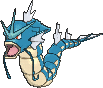
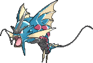

<!-- This file is generated by tools/generate_site.py. Edit the generator, not this file. -->

# #130 Gyarados

{ .sprite-lg loading=lazy }

**Atrocious Pokémon**

Water Flying

[:material-arrow-left: #129 Magikarp](129.md) · [Pokédex](index.md) · [#131 Lapras :material-arrow-right:](131.md)

!!! info "Changes in Rising Ruby / Sinking Sapphire"

    - **Ability 2:** **Moxie** 

## Location

[Route 111](../wild/route_111.md), [Route 115](../wild/route_115.md), [Sootopolis City](../wild/sootopolis_city.md)

### Wild encounters

| Area | Method | Level | Note |
| --- | --- | --- | --- |
| [Route 111](../wild/route_111.md) | Super Rod | 55 |  |
| [Route 115](../wild/route_115.md) | Super Rod | 55 |  |
| [Sootopolis City](../wild/sootopolis_city.md) | Surfing | 45 - 55 |  |
| [Sootopolis City](../wild/sootopolis_city.md) | Old Rod | 15 |  |
| [Sootopolis City](../wild/sootopolis_city.md) | Good Rod | 35 |  |
| [Sootopolis City](../wild/sootopolis_city.md) | Super Rod | 55 |  |

## Type defenses

| Damage taken | Attacking types |
| --- | --- |
| Immune (×0) | Ground |
| Resistant (×½) | Fighting Bug Steel Fire Water |
| Neutral (×1) | Normal Flying Poison Ghost Grass Psychic Ice Dragon Dark Fairy |
| Weak (×2) | Rock |
| Very weak (×4) | Electric |

## Abilities

| Slot | Ability | Effect | Note |
| --- | --- | --- | --- |
| Ability 1 | **Intimidate** | Lowers opponents' Attack one stage upon entering battle. |  |
| Ability 2 | **Moxie** | Raises Attack one stage upon KOing a Pokémon. | changed  |
| Hidden | **Moxie** | Raises Attack one stage upon KOing a Pokémon. |  |

## Base stats

| Form | HP | Atk | Def | SpA | SpD | Spe | BST |
| --- | --- | --- | --- | --- | --- | --- | --- |
| { .sprite-sm loading=lazy } Normal | 95 | 125 | 79 | 60 | 100 | 81 | **540** |
| { .sprite-sm loading=lazy } Mega Gyarados | 95 | 155 | 109 | 70 | 130 | 81 | **640** |

## Training & breeding

| Property | Value |
| --- | --- |
| EV yield | 2 Atk |
| Catch rate | 45 |
| Base friendship | 70 |
| Base experience | 189 |
| Growth rate | slow |
| Egg groups | Water 2, Dragon |
| Hatch counter | 5 |
| Gender ratio | 50% ♂ / 50% ♀ |
| Height / weight | 6.5 m / 235 kg |

## Evolution

- { .icon loading=lazy } [Magikarp](../pokemon/129.md) → { .icon loading=lazy } **[Gyarados](../pokemon/130.md)**: Lv. 20
- { .sprite-sm loading=lazy } **Mega Gyarados**: Mega Evolves by holding the { .item loading=lazy } Gyaradosite

## Wild held items

None.

## Level-up moves { data-search-exclude }

Moves marked &#42; are not normally learned by level up (they come from egg moves, TMs/HMs or tutors in the official games); moves marked &#42;&#42; cannot normally be learned by this Pokémon at all and are omitted from the legal-moves version of the hack.

| Lv. | Move | Type | Cat. | Power | Acc. | PP | Effect | Note |
| --- | --- | --- | --- | --- | --- | --- | --- | --- |
| 1 | Thrash | Normal | Physical | 120 | 100% | 10 | Hits every turn for 2-3 turns, then confuses the user. |  |
| 20 | Bite | Dark | Physical | 60 | 100% | 25 | Has a chance to make the target flinch. |  |
| 23 | Dragon Rage | Dragon | Special | — | 100% | 10 | Inflicts 40 points of damage. |  |
| 26 | Aqua Tail | Water | Physical | 90 | 90% | 10 | Inflicts regular damage with no additional effect. |  |
| 29 | Leer | Normal | Status | — | 100% | 30 | Lowers the target’s Defense by one stage. |  |
| 32 | Twister | Dragon | Special | 40 | 100% | 20 | Has a chance to make the target flinch. |  |
| 35 | Ice Fang | Ice | Physical | 65 | 95% | 15 | Has a chance to freeze the target and a chance to make the target flinch. |  |
| 38 | Crunch | Dark | Physical | 80 | 100% | 15 | Has a chance to lower the target’s Defense by one stage. |  |
| 41 | Rain Dance | Water | Status | — | — | 5 | Changes the weather to rain for five turns. |  |
| 44 | Hydro Pump | Water | Special | 110 | 80% | 5 | Inflicts regular damage with no additional effect. |  |
| 47 | Dragon Dance | Dragon | Status | — | — | 20 | Raises the user’s Attack and Speed by one stage. |  |
| 50 | Hyper Beam | Normal | Special | 150 | 90% | 5 | User foregoes its next turn to recharge. |  |
| 53 | Outrage | Dragon | Physical | 120 | 100% | 10 | Hits every turn for 2-3 turns, then confuses the user. | &#42; |

## TM & HM moves { data-search-exclude }

| Machine | Move | Type | Cat. | Power | Acc. | PP | Effect |
| --- | --- | --- | --- | --- | --- | --- | --- |
| HM03 | Surf | Water | Special | 90 | 100% | 15 | Inflicts regular damage and can hit Dive users. |
| HM04 | [Strength](../changes/moves.md#strength) changed | Normal | Physical | 100 | 100% | 10 | Inflicts regular damage with no additional effect. |
| HM05 | Waterfall | Water | Physical | 80 | 100% | 15 | Has a chance to make the target flinch. |
| HM06 | [Rock Smash](../changes/moves.md#rock-smash) changed | Fighting | Physical | 65 | 100% | 15 | Has a chance to lower the target’s Defense by one stage. |
| HM07 | Dive | Water | Physical | 80 | 100% | 10 | User dives underwater, dodging all attacks, and hits next turn. |
| TM05 | Roar | Normal | Status | — | — | 20 | Immediately ends wild battles.  Forces trainers to switch Pokémon. |
| TM06 | Toxic | Poison | Status | — | 90% | 10 | Badly poisons the target, inflicting more damage every turn. |
| TM07 | Hail | Ice | Status | — | — | 10 | Changes the weather to a hailstorm for five turns. |
| TM10 | Hidden Power | Normal | Special | 60 | 100% | 15 | Power and type depend upon user’s IVs.  Power can range from 30 to 70. |
| TM100 | Confide | Normal | Status | — | — | 20 | Lowers the target’s Special Attack by one stage. |
| TM12 | Taunt | Dark | Status | — | 100% | 20 | For the next few turns, the target can only use damaging moves. |
| TM13 | Ice Beam | Ice | Special | 90 | 100% | 10 | Has a chance to freeze the target. |
| TM14 | Blizzard | Ice | Special | 110 | 70% | 5 | Has a chance to freeze the target. |
| TM15 | Hyper Beam | Normal | Special | 150 | 90% | 5 | User foregoes its next turn to recharge. |
| TM17 | Protect | Normal | Status | — | — | 10 | Prevents any moves from hitting the user this turn. |
| TM18 | Rain Dance | Water | Status | — | — | 5 | Changes the weather to rain for five turns. |
| TM21 | Frustration | Normal | Physical | — | 100% | 20 | Power increases as happiness decreases, up to a maximum of 102. |
| TM24 | Thunderbolt | Electric | Special | 90 | 100% | 15 | Has a chance to paralyze the target. |
| TM25 | Thunder | Electric | Special | 110 | 70% | 10 | Has a chance to paralyze the target. |
| TM26 | Earthquake | Ground | Physical | 100 | 100% | 10 | Inflicts regular damage and can hit Dig users. |
| TM27 | Return | Normal | Physical | — | 100% | 20 | Power increases with happiness, up to a maximum of 102. |
| TM32 | Double Team | Normal | Status | — | — | 15 | Raises the user’s evasion by one stage. |
| TM35 | Flamethrower | Fire | Special | 90 | 100% | 15 | Has a chance to burn the target. |
| TM37 | Sandstorm | Rock | Status | — | — | 10 | Changes the weather to a sandstorm for five turns. |
| TM38 | Fire Blast | Fire | Special | 110 | 85% | 5 | Has a chance to burn the target. |
| TM41 | Torment | Dark | Status | — | 100% | 15 | Prevents the target from using the same move twice in a row. |
| TM42 | Facade | Normal | Physical | 70 | 100% | 20 | Power doubles if user is burned, paralyzed, or poisoned. |
| TM44 | Rest | Psychic | Status | — | — | 5 | User sleeps for two turns, completely healing itself. |
| TM45 | Attract | Normal | Status | — | 100% | 15 | Target falls in love if it has the opposite gender, and has a 50% chance to refuse attacking the user. |
| TM48 | Round | Normal | Special | 60 | 100% | 15 | Has double power if it’s used more than once per turn. |
| TM55 | Scald | Water | Special | 80 | 100% | 15 | Has a chance to burn the target. |
| TM59 | Incinerate | Fire | Special | 60 | 100% | 15 | Destroys the target’s held berry. |
| TM66 | Payback | Dark | Physical | 50 | 100% | 10 | Power is doubled if the target has already moved this turn. |
| TM68 | Giga Impact | Normal | Physical | 150 | 90% | 5 | User foregoes its next turn to recharge. |
| TM71 | Stone Edge | Rock | Physical | 100 | 80% | 5 | Has an increased chance for a critical hit. |
| TM73 | Thunder Wave | Electric | Status | — | 100% | 20 | Paralyzes the target. |
| TM78 | Bulldoze | Ground | Physical | 60 | 100% | 20 | Has a chance to lower the target’s Speed by one stage. |
| TM82 | Dragon Tail | Dragon | Physical | 60 | 90% | 10 | Ends wild battles.  Forces trainers to switch Pokémon. |
| TM87 | Swagger | Normal | Status | — | 90% | 15 | Raises the target’s Attack by two stages and confuses the target. |
| TM88 | Sleep Talk | Normal | Status | — | — | 10 | Randomly uses one of the user’s other three moves.  Only works if the user is sleeping. |
| TM90 | Substitute | Normal | Status | — | — | 10 | Transfers 1/4 of the user’s max HP into a doll, protecting the user from further damage or status changes until it breaks. |
| TM94 | Secret Power | Normal | Physical | 70 | 100% | 20 | Has a chance to inflict a status effect which depends upon the terrain. |
| TM97 | Dark Pulse | Dark | Special | 80 | 100% | 15 | Has a chance to make the target flinch. |

## Move tutor moves { data-search-exclude }

| Move | Type | Cat. | Power | Acc. | PP | Effect |
| --- | --- | --- | --- | --- | --- | --- |
| Aqua Tail | Water | Physical | 90 | 90% | 10 | Inflicts regular damage with no additional effect. |
| Bounce | Flying | Physical | 85 | 85% | 5 | User bounces high into the air, dodging all attacks, and hits next turn. |
| Dragon Pulse | Dragon | Special | 85 | 100% | 10 | Inflicts regular damage with no additional effect. |
| Icy Wind | Ice | Special | 55 | 95% | 15 | Has a chance to lower the target’s Speed by one stage. |
| Iron Head | Steel | Physical | 80 | 100% | 15 | Has a chance to make the target flinch. |
| Iron Tail | Steel | Physical | 100 | 75% | 15 | Has a chance to lower the target’s Defense by one stage. |
| Outrage | Dragon | Physical | 120 | 100% | 10 | Hits every turn for 2-3 turns, then confuses the user. |
| Snore | Normal | Special | 50 | 100% | 15 | Has a chance to make the target flinch.  Only works if the user is sleeping. |
| Spite | Ghost | Status | — | 100% | 10 | Lowers the PP of the target’s last used move by 4. |
| Uproar | Normal | Special | 90 | 100% | 10 | Forced to use this move for several turns.  Pokémon cannot fall asleep in that time. |
| Water Pulse | Water | Special | 60 | 100% | 20 | Has a chance to confuse the target. |

## Egg moves { data-search-exclude }

No egg moves.

??? note "Trainers using Gyarados (17)"

    | Area | Trainer | Level |
    | --- | --- | --- |
    | [Route 106](../trainers/route_106.md#rematches) | Fisherman Elliot (5) | Lv. 39 |
    | [Route 106](../trainers/route_106.md#rematches) | Fisherman Elliot (7) | Lv. 59 |
    | [Route 106](../trainers/route_106.md#rematches) | Fisherman Elliot (C) | Lv. 75 |
    | [Route 114](../trainers/route_114.md#trainers) | Fisherman Nolan | Lv. 31 |
    | [Fortree Gym](../trainers/fortree_gym.md#trainers) | Leader Winona | Lv. 48 |
    | [Route 126](../trainers/route_126.md#trainers) | Swimmer Barry | Lv. 56 |
    | [Underwater 124](../trainers/underwater_124.md#rematches) | Free Diver Arzu (8) | Lv. 64 |
    | [Underwater 124](../trainers/underwater_124.md#rematches) | Free Diver Arzu (C) | Lv. 75 |
    | [Underwater 129](../trainers/underwater_129.md#trainers) | Scuba Diver Jason | Lv. 60 |
    | [Meteor Falls 1F-2](../trainers/meteor_falls_1f_2.md#trainers) | Dragon Tamer Nicolas | Lv. 65 |
    | [Meteor Falls 1F-2](../trainers/meteor_falls_1f_2.md#rematches) | Dragon Tamer Nicolas (C) | Lv. 75 |
    | [Route 131 (Post Game)](../trainers/route_131_post_game.md#trainers) | Sootopolitan Wallace | Lv. 77 |
    | [Battle Resort](../trainers/battle_resort.md#trainers) | Dragon Tamer Antonin [Lance] | Lv. 86 |
    | [Battle Resort](../trainers/battle_resort.md#trainers) | Leader Josephine [Wallace] | Lv. 77 |
    | [Battle Resort](../trainers/battle_resort.md#trainers) | Leader Josephine [Wallace] | Lv. 77 |
    | [Battle Resort](../trainers/battle_resort.md#trainers) | Ace Trainer Kelvin [Blue] | Lv. 86 |
    | [Battle Resort](../trainers/battle_resort.md#trainers) | Leader Kelvin [Siebold] | Lv. 82 |

---

[:material-arrow-left: #129 Magikarp](129.md) · [#131 Lapras :material-arrow-right:](131.md)
