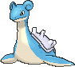

<!-- This file is generated by tools/generate_site.py. Edit the generator, not this file. -->

# #131 Lapras

{ .sprite-lg loading=lazy }

**Transport Pokémon**

Water Ice

[:material-arrow-left: #130 Gyarados](130.md) · [Pokédex](index.md) · [#132 Ditto :material-arrow-right:](132.md)

!!! note "No documented changes"

    Drayano's documentation lists no stat, type, ability, evolution or held item changes for this Pokémon. Its level-up moves are listed below as they appear in the hack.

## Location

[Sea Mauville](../wild/sea_mauville_outside.md), [Route 125](../wild/route_125.md)

### Wild encounters

| Area | Method | Level | Note |
| --- | --- | --- | --- |
| [Sea Mauville Outside](../wild/sea_mauville_outside.md) | Surfing | 25 - 40 |  |
| [Route 125](../wild/route_125.md) | Surfing | 40 - 50 |  |

## Type defenses

| Damage taken | Attacking types |
| --- | --- |
| Very resistant (×¼) | Ice |
| Resistant (×½) | Water |
| Neutral (×1) | Normal Flying Poison Ground Bug Ghost Steel Fire Psychic Dragon Dark Fairy |
| Weak (×2) | Fighting Rock Grass Electric |

## Abilities

| Slot | Ability | Effect | Note |
| --- | --- | --- | --- |
| Ability 1 | **Water Absorb** | Absorbs Water moves, healing for 1/4 max HP. |  |
| Ability 2 | **Shell Armor** | Protects against critical hits. |  |
| Hidden | **Hydration** | Cures any major status ailment after each turn during rain. |  |

## Base stats

| Form | HP | Atk | Def | SpA | SpD | Spe | BST |
| --- | --- | --- | --- | --- | --- | --- | --- |
| { .sprite-sm loading=lazy } Normal | 130 | 85 | 80 | 85 | 95 | 60 | **535** |

## Training & breeding

| Property | Value |
| --- | --- |
| EV yield | 2 HP |
| Catch rate | 45 |
| Base friendship | 70 |
| Base experience | 187 |
| Growth rate | slow |
| Egg groups | Monster, Water 1 |
| Hatch counter | 40 |
| Gender ratio | 50% ♂ / 50% ♀ |
| Height / weight | 2.5 m / 220 kg |

## Evolution

This Pokémon does not evolve.

## Wild held items

| Item | Chance | Note |
| --- | --- | --- |
| { .item loading=lazy } Mystic Water | 100% |  |

## Level-up moves { data-search-exclude }

Moves marked &#42; are not normally learned by level up (they come from egg moves, TMs/HMs or tutors in the official games); moves marked &#42;&#42; cannot normally be learned by this Pokémon at all and are omitted from the legal-moves version of the hack.

| Lv. | Move | Type | Cat. | Power | Acc. | PP | Effect | Note |
| --- | --- | --- | --- | --- | --- | --- | --- | --- |
| 1 | Sing | Normal | Status | — | 55% | 15 | Puts the target to sleep. |  |
| 1 | Growl | Normal | Status | — | 100% | 40 | Lowers the target’s Attack by one stage. |  |
| 1 | Water Gun | Water | Special | 40 | 100% | 25 | Inflicts regular damage with no additional effect. |  |
| 4 | Mist | Ice | Status | — | — | 30 | Protects the user’s stats from being changed by enemy moves. |  |
| 7 | Confuse Ray | Ghost | Status | — | 100% | 10 | Confuses the target. |  |
| 10 | Ice Shard | Ice | Physical | 40 | 100% | 30 | Inflicts regular damage with no additional effect. |  |
| 13 | Water Pulse | Water | Special | 60 | 100% | 20 | Has a chance to confuse the target. |  |
| 16 | Body Slam | Normal | Physical | 85 | 100% | 15 | Has a chance to paralyze the target. |  |
| 20 | Rain Dance | Water | Status | — | — | 5 | Changes the weather to rain for five turns. |  |
| 24 | Perish Song | Normal | Status | — | — | 5 | User and target both faint after three turns. |  |
| 28 | Ice Beam | Ice | Special | 90 | 100% | 10 | Has a chance to freeze the target. |  |
| 32 | Brine | Water | Special | 65 | 100% | 10 | Has double power against Pokémon that have less than half their max HP remaining. |  |
| 36 | Freeze-Dry | Ice | Special | 70 | 100% | 20 | Super-effective against Water. | &#42; |
| 40 | Safeguard | Normal | Status | — | — | 25 | Protects the user’s field from major status ailments and confusion for five turns. |  |
| 44 | Hydro Pump | Water | Special | 110 | 80% | 5 | Inflicts regular damage with no additional effect. |  |
| 48 | Sheer Cold | Ice | Special | — | 30% | 5 | Causes a one-hit KO. |  |
| 52 | Dragon Dance | Dragon | Status | — | — | 20 | Raises the user’s Attack and Speed by one stage. | &#42; |
| 56 | Shell Smash | Normal | Status | — | — | 15 | Raises user’s Attack, Special Attack, and Speed by two stages.  Lower user’s Defense and Special Defense by one stage. | &#42;&#42; |

## TM & HM moves { data-search-exclude }

| Machine | Move | Type | Cat. | Power | Acc. | PP | Effect |
| --- | --- | --- | --- | --- | --- | --- | --- |
| HM03 | Surf | Water | Special | 90 | 100% | 15 | Inflicts regular damage and can hit Dive users. |
| HM04 | [Strength](../changes/moves.md#strength) changed | Normal | Physical | 100 | 100% | 10 | Inflicts regular damage with no additional effect. |
| HM05 | Waterfall | Water | Physical | 80 | 100% | 15 | Has a chance to make the target flinch. |
| HM06 | [Rock Smash](../changes/moves.md#rock-smash) changed | Fighting | Physical | 65 | 100% | 15 | Has a chance to lower the target’s Defense by one stage. |
| HM07 | Dive | Water | Physical | 80 | 100% | 10 | User dives underwater, dodging all attacks, and hits next turn. |
| TM05 | Roar | Normal | Status | — | — | 20 | Immediately ends wild battles.  Forces trainers to switch Pokémon. |
| TM06 | Toxic | Poison | Status | — | 90% | 10 | Badly poisons the target, inflicting more damage every turn. |
| TM07 | Hail | Ice | Status | — | — | 10 | Changes the weather to a hailstorm for five turns. |
| TM10 | Hidden Power | Normal | Special | 60 | 100% | 15 | Power and type depend upon user’s IVs.  Power can range from 30 to 70. |
| TM100 | Confide | Normal | Status | — | — | 20 | Lowers the target’s Special Attack by one stage. |
| TM13 | Ice Beam | Ice | Special | 90 | 100% | 10 | Has a chance to freeze the target. |
| TM14 | Blizzard | Ice | Special | 110 | 70% | 5 | Has a chance to freeze the target. |
| TM15 | Hyper Beam | Normal | Special | 150 | 90% | 5 | User foregoes its next turn to recharge. |
| TM17 | Protect | Normal | Status | — | — | 10 | Prevents any moves from hitting the user this turn. |
| TM18 | Rain Dance | Water | Status | — | — | 5 | Changes the weather to rain for five turns. |
| TM20 | Safeguard | Normal | Status | — | — | 25 | Protects the user’s field from major status ailments and confusion for five turns. |
| TM21 | Frustration | Normal | Physical | — | 100% | 20 | Power increases as happiness decreases, up to a maximum of 102. |
| TM24 | Thunderbolt | Electric | Special | 90 | 100% | 15 | Has a chance to paralyze the target. |
| TM25 | Thunder | Electric | Special | 110 | 70% | 10 | Has a chance to paralyze the target. |
| TM27 | Return | Normal | Physical | — | 100% | 20 | Power increases with happiness, up to a maximum of 102. |
| TM29 | Psychic | Psychic | Special | 90 | 100% | 10 | Has a chance to lower the target’s Special Defense by one stage. |
| TM32 | Double Team | Normal | Status | — | — | 15 | Raises the user’s evasion by one stage. |
| TM42 | Facade | Normal | Physical | 70 | 100% | 20 | Power doubles if user is burned, paralyzed, or poisoned. |
| TM44 | Rest | Psychic | Status | — | — | 5 | User sleeps for two turns, completely healing itself. |
| TM45 | Attract | Normal | Status | — | 100% | 15 | Target falls in love if it has the opposite gender, and has a 50% chance to refuse attacking the user. |
| TM48 | Round | Normal | Special | 60 | 100% | 15 | Has double power if it’s used more than once per turn. |
| TM49 | Echoed Voice | Normal | Special | 40 | 100% | 15 | Power increases by 100% for each consecutive use by any friendly Pokémon, to a maximum of 200. |
| TM68 | Giga Impact | Normal | Physical | 150 | 90% | 5 | User foregoes its next turn to recharge. |
| TM78 | Bulldoze | Ground | Physical | 60 | 100% | 20 | Has a chance to lower the target’s Speed by one stage. |
| TM79 | Frost Breath | Ice | Special | 60 | 90% | 10 | Always scores a critical hit. |
| TM85 | Dream Eater | Psychic | Special | 100 | 100% | 15 | Only works on sleeping Pokémon.  Drains half the damage inflicted to heal the user. |
| TM87 | Swagger | Normal | Status | — | 90% | 15 | Raises the target’s Attack by two stages and confuses the target. |
| TM88 | Sleep Talk | Normal | Status | — | — | 10 | Randomly uses one of the user’s other three moves.  Only works if the user is sleeping. |
| TM90 | Substitute | Normal | Status | — | — | 10 | Transfers 1/4 of the user’s max HP into a doll, protecting the user from further damage or status changes until it breaks. |
| TM94 | Secret Power | Normal | Physical | 70 | 100% | 20 | Has a chance to inflict a status effect which depends upon the terrain. |

## Move tutor moves { data-search-exclude }

| Move | Type | Cat. | Power | Acc. | PP | Effect |
| --- | --- | --- | --- | --- | --- | --- |
| Aqua Tail | Water | Physical | 90 | 90% | 10 | Inflicts regular damage with no additional effect. |
| Block | Normal | Status | — | — | 5 | Prevents the target from leaving battle. |
| Dragon Pulse | Dragon | Special | 85 | 100% | 10 | Inflicts regular damage with no additional effect. |
| Drill Run | Ground | Physical | 80 | 95% | 10 | Has an increased chance for a critical hit. |
| Heal Bell | Normal | Status | — | — | 5 | Cures the entire party of major status effects. |
| Hyper Voice | Normal | Special | 90 | 100% | 10 | Inflicts regular damage with no additional effect. |
| Icy Wind | Ice | Special | 55 | 95% | 15 | Has a chance to lower the target’s Speed by one stage. |
| Iron Head | Steel | Physical | 80 | 100% | 15 | Has a chance to make the target flinch. |
| Iron Tail | Steel | Physical | 100 | 75% | 15 | Has a chance to lower the target’s Defense by one stage. |
| Outrage | Dragon | Physical | 120 | 100% | 10 | Hits every turn for 2-3 turns, then confuses the user. |
| Shock Wave | Electric | Special | 60 | — | 20 | Never misses. |
| Signal Beam | Bug | Special | 75 | 100% | 15 | Has a chance to confuse the target. |
| Snore | Normal | Special | 50 | 100% | 15 | Has a chance to make the target flinch.  Only works if the user is sleeping. |
| Water Pulse | Water | Special | 60 | 100% | 20 | Has a chance to confuse the target. |
| Zen Headbutt | Psychic | Physical | 80 | 90% | 15 | Has a chance to make the target flinch. |

## Egg moves { data-search-exclude }

| Move | Type | Cat. | Power | Acc. | PP | Effect |
| --- | --- | --- | --- | --- | --- | --- |
| [Ancient Power](../changes/moves.md#ancient-power) changed | Rock | Special | 80 | 100% | 10 | Has a chance to raise all of the user’s stats by one stage. |
| Avalanche | Ice | Physical | 60 | 100% | 10 | Inflicts double damage if the user takes damage before attacking this turn. |
| Curse | Ghost | Status | — | — | 10 | Ghosts pay half their max HP to hurt the target every turn.  Others decrease Speed but raise Attack and Defense. |
| Dragon Dance | Dragon | Status | — | — | 20 | Raises the user’s Attack and Speed by one stage. |
| Dragon Pulse | Dragon | Special | 85 | 100% | 10 | Inflicts regular damage with no additional effect. |
| Fissure | Ground | Physical | — | 30% | 5 | Causes a one-hit KO. |
| Foresight | Normal | Status | — | — | 40 | Forces the target to have no Evade, and allows it to be hit by Normal and Fighting moves even if it’s a Ghost. |
| Freeze-Dry | Ice | Special | 70 | 100% | 20 | Super-effective against Water. |
| Future Sight | Psychic | Special | 120 | 100% | 10 | Hits the target two turns later. |
| Horn Drill | Normal | Physical | — | 30% | 5 | Causes a one-hit KO. |
| Refresh | Normal | Status | — | — | 20 | Cleanses the user of a burn, paralysis, or poison. |
| Sleep Talk | Normal | Status | — | — | 10 | Randomly uses one of the user’s other three moves.  Only works if the user is sleeping. |
| Tickle | Normal | Status | — | 100% | 20 | Lowers the target’s Attack and Defense by one stage. |
| Whirlpool | Water | Special | 35 | 85% | 15 | Prevents the target from leaving battle and inflicts 1/16 its max HP in damage for 2-5 turns. |

??? note "Trainers using Lapras (10)"

    | Area | Trainer | Level |
    | --- | --- | --- |
    | [Route 111](../trainers/route_111.md#rematches) | Ace Trainer Brooke (4) | Lv. 35 |
    | [Route 111](../trainers/route_111.md#rematches) | Ace Trainer Brooke (6) | Lv. 47 |
    | [Route 111](../trainers/route_111.md#rematches) | Ace Trainer Brooke (8) | Lv. 64 |
    | [Route 111](../trainers/route_111.md#rematches) | Ace Trainer Brooke (C) | Lv. 75 |
    | [Mt. Chimney](../trainers/mt_chimney.md#trainers) | Aqua Admin Shelly | Lv. 33 |
    | [Weather Institute](../trainers/weather_institute.md#trainers) | Aqua Admin Shelly | Lv. 46 |
    | [Route 125](../trainers/route_125.md#trainers) | Swimmer Sharon | Lv. 56 |
    | [Victory Road 1F](../trainers/victory_road_1f.md#trainers) | Ace Trainer Edgar | Lv. 65 |
    | [Aqua Hideout (Post Game)](../trainers/aqua_hideout_post_game.md#trainers) | Team Aqua Grunt | Lv. 75 |
    | [Battle Resort](../trainers/battle_resort.md#trainers) | Furisode Girl Felix [Iris] | Lv. 86 |

---

[:material-arrow-left: #130 Gyarados](130.md) · [#132 Ditto :material-arrow-right:](132.md)
