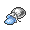

<!-- This file is generated by tools/generate_site.py. Edit the generator, not this file. -->

# #132 Ditto

{ .sprite-lg loading=lazy }

**Transform Pokémon**

Normal

[:material-arrow-left: #131 Lapras](131.md) · [Pokédex](index.md) · [#133 Eevee :material-arrow-right:](133.md)

!!! info "Changes in Rising Ruby / Sinking Sapphire"

    - **Ability 2:** **Imposter** 

## Location

[Route 115](../wild/route_115.md), [Mirage Island](../wild/mirage_island_any.md), [Mirage Forest](../wild/mirage_forest_any.md), [Mirage Cave](../wild/mirage_cave_any.md), [Mirage Mountain](../wild/mirage_mountain_any.md)

### Wild encounters

| Area | Method | Level | Note |
| --- | --- | --- | --- |
| [Route 115](../wild/route_115.md) | Grass | 35 |  |
| [Route 115](../wild/route_115.md) | Horde | 22 |  |
| [Mirage Forest (Any)](../wild/mirage_forest_any.md) | Rock Smash | 60 |  |
| [Mirage Cave (Any)](../wild/mirage_cave_any.md) | Rock Smash | 60 |  |
| [Mirage Mountain (Any)](../wild/mirage_mountain_any.md) | Rock Smash | 60 |  |
| [Mirage Island (Any)](../wild/mirage_island_any.md) | Rock Smash | 50 |  |

## Type defenses

| Damage taken | Attacking types |
| --- | --- |
| Immune (×0) | Ghost |
| Neutral (×1) | Normal Flying Poison Ground Rock Bug Steel Fire Water Grass Electric Psychic Ice Dragon Dark Fairy |
| Weak (×2) | Fighting |

## Abilities

| Slot | Ability | Effect | Note |
| --- | --- | --- | --- |
| Ability 1 | **Limber** | Prevents paralysis. |  |
| Ability 2 | **Imposter** | Transforms upon entering battle. | changed  |
| Hidden | **Imposter** | Transforms upon entering battle. |  |

## Base stats

| Form | HP | Atk | Def | SpA | SpD | Spe | BST |
| --- | --- | --- | --- | --- | --- | --- | --- |
| { .sprite-sm loading=lazy } Normal | 48 | 48 | 48 | 48 | 48 | 48 | **288** |

## Training & breeding

| Property | Value |
| --- | --- |
| EV yield | 1 HP |
| Catch rate | 35 |
| Base friendship | 70 |
| Base experience | 101 |
| Growth rate | medium |
| Egg groups | Ditto |
| Hatch counter | 20 |
| Gender ratio | Genderless |
| Height / weight | 0.3 m / 4 kg |

## Evolution

This Pokémon does not evolve.

## Wild held items

| Item | Chance | Note |
| --- | --- | --- |
| { .item loading=lazy } Metal Powder | 5% |  |
| { .item loading=lazy } Quick Powder | 50% |  |

## Level-up moves { data-search-exclude }

Moves marked &#42; are not normally learned by level up (they come from egg moves, TMs/HMs or tutors in the official games); moves marked &#42;&#42; cannot normally be learned by this Pokémon at all and are omitted from the legal-moves version of the hack.

| Lv. | Move | Type | Cat. | Power | Acc. | PP | Effect | Note |
| --- | --- | --- | --- | --- | --- | --- | --- | --- |
| 1 | Transform | Normal | Status | — | — | 10 | User becomes a copy of the target until it leaves battle. |  |

## TM & HM moves { data-search-exclude }

This Pokémon cannot learn any TM or HM moves.

## Move tutor moves { data-search-exclude }

No tutor moves in Omega Ruby / Alpha Sapphire.

## Egg moves { data-search-exclude }

No egg moves.

??? note "Trainers using Ditto (1)"

    | Area | Trainer | Level |
    | --- | --- | --- |
    | [Route 133](../trainers/route_133.md#trainers) | Backpacker Grayson | Lv. 59 |

---

[:material-arrow-left: #131 Lapras](131.md) · [#133 Eevee :material-arrow-right:](133.md)
