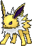

<!-- This file is generated by tools/generate_site.py. Edit the generator, not this file. -->

# #135 Jolteon

{ .sprite-lg loading=lazy }

**Lightning Pokémon**

Electric

[:material-arrow-left: #134 Vaporeon](134.md) · [Pokédex](index.md) · [#136 Flareon :material-arrow-right:](136.md)

!!! info "Changes in Rising Ruby / Sinking Sapphire"

    - **Ability 2:** **Quick Feet** 

## Location

Evolve { .icon loading=lazy } [Eevee](../pokemon/133.md) (Thunder Stone)

## Type defenses

| Damage taken | Attacking types |
| --- | --- |
| Resistant (×½) | Flying Steel Electric |
| Neutral (×1) | Normal Fighting Poison Rock Bug Ghost Fire Water Grass Psychic Ice Dragon Dark Fairy |
| Weak (×2) | Ground |

## Abilities

| Slot | Ability | Effect | Note |
| --- | --- | --- | --- |
| Ability 1 | **Volt Absorb** | Absorbs Electric moves, healing for 1/4 max HP. |  |
| Ability 2 | **Quick Feet** | Increases Speed to 1.5× with a major status ailment. | changed  |
| Hidden | **Quick Feet** | Increases Speed to 1.5× with a major status ailment. |  |

## Base stats

| Form | HP | Atk | Def | SpA | SpD | Spe | BST |
| --- | --- | --- | --- | --- | --- | --- | --- |
| { .sprite-sm loading=lazy } Normal | 65 | 65 | 60 | 110 | 95 | 130 | **525** |

## Training & breeding

| Property | Value |
| --- | --- |
| EV yield | 2 Spe |
| Catch rate | 45 |
| Base friendship | 70 |
| Base experience | 184 |
| Growth rate | medium |
| Egg groups | Field |
| Hatch counter | 35 |
| Gender ratio | 87.5% ♂ / 12.5% ♀ |
| Height / weight | 0.8 m / 24.5 kg |

## Evolution

- { .icon loading=lazy } [Eevee](../pokemon/133.md) → { .icon loading=lazy } [Vaporeon](../pokemon/134.md): Water Stone
- { .icon loading=lazy } [Eevee](../pokemon/133.md) → { .icon loading=lazy } **[Jolteon](../pokemon/135.md)**: Thunder Stone
- { .icon loading=lazy } [Eevee](../pokemon/133.md) → { .icon loading=lazy } [Flareon](../pokemon/136.md): Fire Stone
- { .icon loading=lazy } [Eevee](../pokemon/133.md) → { .icon loading=lazy } [Espeon](../pokemon/196.md): Happiness, Day
- { .icon loading=lazy } [Eevee](../pokemon/133.md) → { .icon loading=lazy } [Umbreon](../pokemon/197.md): Happiness, Night
- { .icon loading=lazy } [Eevee](../pokemon/133.md) → { .icon loading=lazy } [Leafeon](../pokemon/470.md): Petalburg Woods
- { .icon loading=lazy } [Eevee](../pokemon/133.md) → { .icon loading=lazy } [Glaceon](../pokemon/471.md): Shoal Cave
- { .icon loading=lazy } [Eevee](../pokemon/133.md) → { .icon loading=lazy } [Sylveon](../pokemon/700.md): Fairy Move & Amie Affection

## Wild held items

None.

## Level-up moves { data-search-exclude }

Moves marked &#42; are not normally learned by level up (they come from egg moves, TMs/HMs or tutors in the official games); moves marked &#42;&#42; cannot normally be learned by this Pokémon at all and are omitted from the legal-moves version of the hack.

| Lv. | Move | Type | Cat. | Power | Acc. | PP | Effect | Note |
| --- | --- | --- | --- | --- | --- | --- | --- | --- |
| 1 | Helping Hand | Normal | Status | — | — | 20 | Ally’s next move inflicts half more damage. |  |
| 1 | Tackle | Normal | Physical | 50 | 100% | 35 | Inflicts regular damage with no additional effect. |  |
| 1 | Tail Whip | Normal | Status | — | 100% | 30 | Lowers the target’s Defense by one stage. |  |
| 5 | Sand Attack | Ground | Status | — | 100% | 15 | Lowers the target’s accuracy by one stage. |  |
| 9 | Thunder Shock | Electric | Special | 40 | 100% | 30 | Has a chance to paralyze the target. |  |
| 13 | Quick Attack | Normal | Physical | 40 | 100% | 30 | Inflicts regular damage with no additional effect. |  |
| 17 | Double Kick | Fighting | Physical | 30 | 100% | 30 | Hits twice in one turn. |  |
| 20 | Thunder Fang | Electric | Physical | 65 | 95% | 15 | Has a chance to paralyze the target and a chance to make the target flinch. |  |
| 25 | Pin Missile | Bug | Physical | 25 | 95% | 20 | Hits 2-5 times in one turn. |  |
| 29 | Agility | Psychic | Status | — | — | 30 | Raises the user’s Speed by two stages. |  |
| 33 | Thunder Wave | Electric | Status | — | 100% | 20 | Paralyzes the target. |  |
| 37 | Discharge | Electric | Special | 80 | 100% | 15 | Has a chance to paralyze the target. |  |
| 41 | Last Resort | Normal | Physical | 140 | 100% | 5 | Can only be used after all of the user’s other moves have been used. |  |
| 45 | Thunder | Electric | Special | 110 | 70% | 10 | Has a chance to paralyze the target. |  |
| 50 | Extrasensory | Psychic | Special | 80 | 100% | 20 | Has a chance to make the target flinch. | &#42;&#42; |

## TM & HM moves { data-search-exclude }

| Machine | Move | Type | Cat. | Power | Acc. | PP | Effect |
| --- | --- | --- | --- | --- | --- | --- | --- |
| HM04 | [Strength](../changes/moves.md#strength) changed | Normal | Physical | 100 | 100% | 10 | Inflicts regular damage with no additional effect. |
| HM06 | [Rock Smash](../changes/moves.md#rock-smash) changed | Fighting | Physical | 65 | 100% | 15 | Has a chance to lower the target’s Defense by one stage. |
| TM05 | Roar | Normal | Status | — | — | 20 | Immediately ends wild battles.  Forces trainers to switch Pokémon. |
| TM06 | Toxic | Poison | Status | — | 90% | 10 | Badly poisons the target, inflicting more damage every turn. |
| TM10 | Hidden Power | Normal | Special | 60 | 100% | 15 | Power and type depend upon user’s IVs.  Power can range from 30 to 70. |
| TM100 | Confide | Normal | Status | — | — | 20 | Lowers the target’s Special Attack by one stage. |
| TM11 | Sunny Day | Fire | Status | — | — | 5 | Changes the weather to sunny for five turns. |
| TM15 | Hyper Beam | Normal | Special | 150 | 90% | 5 | User foregoes its next turn to recharge. |
| TM16 | Light Screen | Psychic | Status | — | — | 30 | Reduces damage from special attacks by 50% for five turns. |
| TM17 | Protect | Normal | Status | — | — | 10 | Prevents any moves from hitting the user this turn. |
| TM18 | Rain Dance | Water | Status | — | — | 5 | Changes the weather to rain for five turns. |
| TM21 | Frustration | Normal | Physical | — | 100% | 20 | Power increases as happiness decreases, up to a maximum of 102. |
| TM24 | Thunderbolt | Electric | Special | 90 | 100% | 15 | Has a chance to paralyze the target. |
| TM25 | Thunder | Electric | Special | 110 | 70% | 10 | Has a chance to paralyze the target. |
| TM27 | Return | Normal | Physical | — | 100% | 20 | Power increases with happiness, up to a maximum of 102. |
| TM28 | Dig | Ground | Physical | 80 | 100% | 10 | User digs underground, dodging all attacks, and hits next turn. |
| TM30 | Shadow Ball | Ghost | Special | 80 | 100% | 15 | Has a chance to lower the target’s Special Defense by one stage. |
| TM32 | Double Team | Normal | Status | — | — | 15 | Raises the user’s evasion by one stage. |
| TM42 | Facade | Normal | Physical | 70 | 100% | 20 | Power doubles if user is burned, paralyzed, or poisoned. |
| TM44 | Rest | Psychic | Status | — | — | 5 | User sleeps for two turns, completely healing itself. |
| TM45 | Attract | Normal | Status | — | 100% | 15 | Target falls in love if it has the opposite gender, and has a 50% chance to refuse attacking the user. |
| TM48 | Round | Normal | Special | 60 | 100% | 15 | Has double power if it’s used more than once per turn. |
| TM49 | Echoed Voice | Normal | Special | 40 | 100% | 15 | Power increases by 100% for each consecutive use by any friendly Pokémon, to a maximum of 200. |
| TM57 | Charge Beam | Electric | Special | 50 | 90% | 10 | Has a chance to raise the user’s Special Attack by one stage. |
| TM67 | Retaliate | Normal | Physical | 70 | 100% | 5 | Has double power if a friendly Pokémon fainted last turn. |
| TM68 | Giga Impact | Normal | Physical | 150 | 90% | 5 | User foregoes its next turn to recharge. |
| TM70 | Flash | Normal | Status | — | 100% | 20 | Lowers the target’s accuracy by one stage. |
| TM72 | Volt Switch | Electric | Special | 70 | 100% | 20 | User must switch out after attacking. |
| TM73 | Thunder Wave | Electric | Status | — | 100% | 20 | Paralyzes the target. |
| TM87 | Swagger | Normal | Status | — | 90% | 15 | Raises the target’s Attack by two stages and confuses the target. |
| TM88 | Sleep Talk | Normal | Status | — | — | 10 | Randomly uses one of the user’s other three moves.  Only works if the user is sleeping. |
| TM90 | Substitute | Normal | Status | — | — | 10 | Transfers 1/4 of the user’s max HP into a doll, protecting the user from further damage or status changes until it breaks. |
| TM93 | Wild Charge | Electric | Physical | 90 | 100% | 15 | User receives 1/4 the damage it inflicts in recoil. |
| TM94 | Secret Power | Normal | Physical | 70 | 100% | 20 | Has a chance to inflict a status effect which depends upon the terrain. |

## Move tutor moves { data-search-exclude }

| Move | Type | Cat. | Power | Acc. | PP | Effect |
| --- | --- | --- | --- | --- | --- | --- |
| Covet | Normal | Physical | 60 | 100% | 25 | Takes the target’s item. |
| Heal Bell | Normal | Status | — | — | 5 | Cures the entire party of major status effects. |
| Helping Hand | Normal | Status | — | — | 20 | Ally’s next move inflicts half more damage. |
| Hyper Voice | Normal | Special | 90 | 100% | 10 | Inflicts regular damage with no additional effect. |
| Iron Tail | Steel | Physical | 100 | 75% | 15 | Has a chance to lower the target’s Defense by one stage. |
| Last Resort | Normal | Physical | 140 | 100% | 5 | Can only be used after all of the user’s other moves have been used. |
| Magnet Rise | Electric | Status | — | — | 10 | User is immune to Ground moves and effects for five turns. |
| Shock Wave | Electric | Special | 60 | — | 20 | Never misses. |
| Signal Beam | Bug | Special | 75 | 100% | 15 | Has a chance to confuse the target. |
| Snore | Normal | Special | 50 | 100% | 15 | Has a chance to make the target flinch.  Only works if the user is sleeping. |

## Egg moves { data-search-exclude }

No egg moves.

??? note "Trainers using Jolteon (2)"

    | Area | Trainer | Level |
    | --- | --- | --- |
    | [Mauville Gym](../trainers/mauville_gym.md#trainers) | Guitarist Shawn | Lv. 23 |
    | [Victory Road 1F](../trainers/victory_road_1f.md#trainers) | Ace Trainer Albert | Lv. 65 |

---

[:material-arrow-left: #134 Vaporeon](134.md) · [#136 Flareon :material-arrow-right:](136.md)
