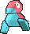
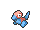
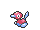
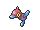

<!-- This file is generated by tools/generate_site.py. Edit the generator, not this file. -->

# #137 Porygon

{ .sprite-lg loading=lazy }

**Virtual Pokémon**

Normal

[:material-arrow-left: #136 Flareon](136.md) · [Pokédex](index.md) · [#138 Omanyte :material-arrow-right:](138.md)

!!! info "Changes in Rising Ruby / Sinking Sapphire"

    - **Evolution:** Use an Up-Grade

## Location

[New Mauville](../wild/new_mauville.md)

### Wild encounters

| Area | Method | Level | Note |
| --- | --- | --- | --- |
| [New Mauville](../wild/new_mauville.md) | Grass | 35 |  |

## Type defenses

| Damage taken | Attacking types |
| --- | --- |
| Immune (×0) | Ghost |
| Neutral (×1) | Normal Flying Poison Ground Rock Bug Steel Fire Water Grass Electric Psychic Ice Dragon Dark Fairy |
| Weak (×2) | Fighting |

## Abilities

| Slot | Ability | Effect | Note |
| --- | --- | --- | --- |
| Ability 1 | **Trace** | Copies an opponent's ability upon entering battle. |  |
| Ability 2 | **Download** | Raises the attack stat corresponding to the opponents' weaker defense one stage upon entering battle. |  |
| Hidden | **Analytic** | Strengthens moves to 1.3× their power when moving last. |  |

## Base stats

| Form | HP | Atk | Def | SpA | SpD | Spe | BST |
| --- | --- | --- | --- | --- | --- | --- | --- |
| { .sprite-sm loading=lazy } Normal | 65 | 60 | 70 | 85 | 75 | 40 | **395** |

## Training & breeding

| Property | Value |
| --- | --- |
| EV yield | 1 SpA |
| Catch rate | 45 |
| Base friendship | 70 |
| Base experience | 79 |
| Growth rate | medium |
| Egg groups | Mineral |
| Hatch counter | 20 |
| Gender ratio | Genderless |
| Height / weight | 0.8 m / 36.5 kg |

## Evolution

- { .icon loading=lazy } **[Porygon](../pokemon/137.md)** → { .icon loading=lazy } [Porygon2](../pokemon/233.md): Up-Grade changed <small>(vanilla: Trade holding Upgrade)</small>
- { .icon loading=lazy } [Porygon2](../pokemon/233.md) → { .icon loading=lazy } [Porygon-Z](../pokemon/474.md): Dubious Disc changed <small>(vanilla: Trade holding Dubious Disc)</small>

## Wild held items

None.

## Level-up moves { data-search-exclude }

Moves marked &#42; are not normally learned by level up (they come from egg moves, TMs/HMs or tutors in the official games); moves marked &#42;&#42; cannot normally be learned by this Pokémon at all and are omitted from the legal-moves version of the hack.

| Lv. | Move | Type | Cat. | Power | Acc. | PP | Effect | Note |
| --- | --- | --- | --- | --- | --- | --- | --- | --- |
| 1 | Conversion 2 | Normal | Status | — | — | 30 | Changes the user’s type to a random type either resistant or immune to the last move used against it. |  |
| 1 | Tackle | Normal | Physical | 50 | 100% | 35 | Inflicts regular damage with no additional effect. |  |
| 1 | Conversion | Normal | Status | — | — | 30 | User’s type changes to the type of one of its moves at random. |  |
| 1 | Sharpen | Normal | Status | — | — | 30 | Raises the user’s Attack by one stage. |  |
| 7 | Psybeam | Psychic | Special | 65 | 100% | 20 | Has a chance to confuse the target. |  |
| 11 | Agility | Psychic | Status | — | — | 30 | Raises the user’s Speed by two stages. |  |
| 15 | Recover | Normal | Status | — | — | 5 | Heals the user by half its max HP. |  |
| 19 | Magnet Rise | Electric | Status | — | — | 10 | User is immune to Ground moves and effects for five turns. |  |
| 23 | Signal Beam | Bug | Special | 75 | 100% | 15 | Has a chance to confuse the target. |  |
| 27 | Tri Attack | Normal | Special | 80 | 100% | 10 | Has a chance to burn, freeze, or paralyze the target. |  |
| 31 | Recycle | Normal | Status | — | — | 10 | User recovers the item it last used up. |  |
| 35 | Discharge | Electric | Special | 80 | 100% | 15 | Has a chance to paralyze the target. |  |
| 39 | Lock-On | Normal | Status | — | — | 5 | Ensures that the user’s next move will hit the target. |  |
| 43 | Magic Coat | Psychic | Status | — | — | 15 | Reflects back the first effect move used on the user this turn. |  |
| 47 | Zap Cannon | Electric | Special | 120 | 50% | 5 | Has a chance to paralyze the target. |  |

## TM & HM moves { data-search-exclude }

| Machine | Move | Type | Cat. | Power | Acc. | PP | Effect |
| --- | --- | --- | --- | --- | --- | --- | --- |
| TM03 | Psyshock | Psychic | Special | 80 | 100% | 10 | Inflicts damage based on the target’s Defense, not Special Defense. |
| TM06 | Toxic | Poison | Status | — | 90% | 10 | Badly poisons the target, inflicting more damage every turn. |
| TM10 | Hidden Power | Normal | Special | 60 | 100% | 15 | Power and type depend upon user’s IVs.  Power can range from 30 to 70. |
| TM100 | Confide | Normal | Status | — | — | 20 | Lowers the target’s Special Attack by one stage. |
| TM11 | Sunny Day | Fire | Status | — | — | 5 | Changes the weather to sunny for five turns. |
| TM13 | Ice Beam | Ice | Special | 90 | 100% | 10 | Has a chance to freeze the target. |
| TM14 | Blizzard | Ice | Special | 110 | 70% | 5 | Has a chance to freeze the target. |
| TM15 | Hyper Beam | Normal | Special | 150 | 90% | 5 | User foregoes its next turn to recharge. |
| TM17 | Protect | Normal | Status | — | — | 10 | Prevents any moves from hitting the user this turn. |
| TM18 | Rain Dance | Water | Status | — | — | 5 | Changes the weather to rain for five turns. |
| TM21 | Frustration | Normal | Physical | — | 100% | 20 | Power increases as happiness decreases, up to a maximum of 102. |
| TM22 | Solar Beam | Grass | Special | 120 | 100% | 10 | Requires a turn to charge before attacking. |
| TM24 | Thunderbolt | Electric | Special | 90 | 100% | 15 | Has a chance to paralyze the target. |
| TM25 | Thunder | Electric | Special | 110 | 70% | 10 | Has a chance to paralyze the target. |
| TM27 | Return | Normal | Physical | — | 100% | 20 | Power increases with happiness, up to a maximum of 102. |
| TM29 | Psychic | Psychic | Special | 90 | 100% | 10 | Has a chance to lower the target’s Special Defense by one stage. |
| TM30 | Shadow Ball | Ghost | Special | 80 | 100% | 15 | Has a chance to lower the target’s Special Defense by one stage. |
| TM32 | Double Team | Normal | Status | — | — | 15 | Raises the user’s evasion by one stage. |
| TM40 | Aerial Ace | Flying | Physical | 60 | — | 20 | Never misses. |
| TM42 | Facade | Normal | Physical | 70 | 100% | 20 | Power doubles if user is burned, paralyzed, or poisoned. |
| TM44 | Rest | Psychic | Status | — | — | 5 | User sleeps for two turns, completely healing itself. |
| TM46 | Thief | Dark | Physical | 60 | 100% | 25 | Takes the target’s item. |
| TM48 | Round | Normal | Special | 60 | 100% | 15 | Has double power if it’s used more than once per turn. |
| TM57 | Charge Beam | Electric | Special | 50 | 90% | 10 | Has a chance to raise the user’s Special Attack by one stage. |
| TM68 | Giga Impact | Normal | Physical | 150 | 90% | 5 | User foregoes its next turn to recharge. |
| TM70 | Flash | Normal | Status | — | 100% | 20 | Lowers the target’s accuracy by one stage. |
| TM73 | Thunder Wave | Electric | Status | — | 100% | 20 | Paralyzes the target. |
| TM77 | Psych Up | Normal | Status | — | — | 10 | Discards the user’s stat changes and copies the target’s. |
| TM85 | Dream Eater | Psychic | Special | 100 | 100% | 15 | Only works on sleeping Pokémon.  Drains half the damage inflicted to heal the user. |
| TM87 | Swagger | Normal | Status | — | 90% | 15 | Raises the target’s Attack by two stages and confuses the target. |
| TM88 | Sleep Talk | Normal | Status | — | — | 10 | Randomly uses one of the user’s other three moves.  Only works if the user is sleeping. |
| TM90 | Substitute | Normal | Status | — | — | 10 | Transfers 1/4 of the user’s max HP into a doll, protecting the user from further damage or status changes until it breaks. |
| TM92 | Trick Room | Psychic | Status | — | — | 5 | For five turns, slower Pokémon will act before faster Pokémon. |
| TM94 | Secret Power | Normal | Physical | 70 | 100% | 20 | Has a chance to inflict a status effect which depends upon the terrain. |

## Move tutor moves { data-search-exclude }

| Move | Type | Cat. | Power | Acc. | PP | Effect |
| --- | --- | --- | --- | --- | --- | --- |
| Electroweb | Electric | Special | 55 | 95% | 15 | Lowers the target’s Speed by one stage. |
| Foul Play | Dark | Physical | 95 | 100% | 15 | Calculates damage with the target’s attacking stat. |
| Gravity | Psychic | Status | — | — | 5 | Disables moves and immunities that involve flying or levitating for five turns. |
| Icy Wind | Ice | Special | 55 | 95% | 15 | Has a chance to lower the target’s Speed by one stage. |
| Iron Tail | Steel | Physical | 100 | 75% | 15 | Has a chance to lower the target’s Defense by one stage. |
| Last Resort | Normal | Physical | 140 | 100% | 5 | Can only be used after all of the user’s other moves have been used. |
| Magic Coat | Psychic | Status | — | — | 15 | Reflects back the first effect move used on the user this turn. |
| Magnet Rise | Electric | Status | — | — | 10 | User is immune to Ground moves and effects for five turns. |
| Pain Split | Normal | Status | — | — | 20 | Sets the user’s and targets’s HP to the average of their current HP. |
| Recycle | Normal | Status | — | — | 10 | User recovers the item it last used up. |
| Shock Wave | Electric | Special | 60 | — | 20 | Never misses. |
| Signal Beam | Bug | Special | 75 | 100% | 15 | Has a chance to confuse the target. |
| Snore | Normal | Special | 50 | 100% | 15 | Has a chance to make the target flinch.  Only works if the user is sleeping. |
| Trick | Psychic | Status | — | 100% | 10 | User and target swap items. |
| Wonder Room | Psychic | Status | — | — | 10 | All Pokémon’s Defense and Special Defense are swapped for 5 turns. |
| Zen Headbutt | Psychic | Physical | 80 | 90% | 15 | Has a chance to make the target flinch. |

## Egg moves { data-search-exclude }

No egg moves.

??? note "Trainers using Porygon (2)"

    | Area | Trainer | Level |
    | --- | --- | --- |
    | [Route 111](../trainers/route_111.md#trainers) | Interviewers Gabby & Ty | Lv. 25 |
    | [Route 114](../trainers/route_114.md#trainers) | Poké Maniac Steve | Lv. 28 |

---

[:material-arrow-left: #136 Flareon](136.md) · [#138 Omanyte :material-arrow-right:](138.md)
