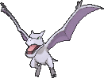
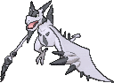

<!-- This file is generated by tools/generate_site.py. Edit the generator, not this file. -->

# #142 Aerodactyl

{ .sprite-lg loading=lazy }

**Fossil Pokémon**

Rock Flying

[:material-arrow-left: #141 Kabutops](141.md) · [Pokédex](index.md) · [#143 Snorlax :material-arrow-right:](143.md)

!!! info "Changes in Rising Ruby / Sinking Sapphire"

    - **Wild held items:** { .item loading=lazy } Flying Gem (100%)

## Location

[Seafloor Cavern](../wild/seafloor_cavern_out.md), [Cave of Origin](../wild/cave_of_origin_1f.md), Revive Amber Fossil

### Wild encounters

| Area | Method | Level | Note |
| --- | --- | --- | --- |
| [Seafloor Cavern Water Rooms](../wild/seafloor_cavern_water_rooms.md) | Walking | 56 |  |
| [Cave of Origin 1F](../wild/cave_of_origin_1f.md) | Walking | 57 |  |

### Gift & static encounters

| Category | Encounter | Changes |
| --- | --- | --- |
| Gift Pokémon Changes | Fossil Pokémon, Aerodactyl | Level increased to 30, always has max IVs |

See [Gifts & Static Encounters](../changes/gifts_and_statics.md) for the full list.

## Type defenses

| Damage taken | Attacking types |
| --- | --- |
| Immune (×0) | Ground |
| Resistant (×½) | Normal Flying Poison Bug Fire |
| Neutral (×1) | Fighting Ghost Grass Psychic Dragon Dark Fairy |
| Weak (×2) | Rock Steel Water Electric Ice |

## Abilities

| Slot | Ability | Effect | Note |
| --- | --- | --- | --- |
| Ability 1 | **Rock Head** | Protects against recoil damage. |  |
| Ability 2 | **Pressure** | Increases the PP cost of moves targetting the Pokémon by one. |  |
| Hidden | **Unnerve** | Prevents opposing Pokémon from eating held Berries. |  |

## Base stats

| Form | HP | Atk | Def | SpA | SpD | Spe | BST |
| --- | --- | --- | --- | --- | --- | --- | --- |
| { .sprite-sm loading=lazy } Normal | 80 | 105 | 65 | 60 | 75 | 130 | **515** |
| { .sprite-sm loading=lazy } Mega Aerodactyl | 80 | 135 | 85 | 70 | 95 | 150 | **615** |

## Training & breeding

| Property | Value |
| --- | --- |
| EV yield | 2 Spe |
| Catch rate | 45 |
| Base friendship | 70 |
| Base experience | 180 |
| Growth rate | slow |
| Egg groups | Flying |
| Hatch counter | 35 |
| Gender ratio | 87.5% ♂ / 12.5% ♀ |
| Height / weight | 1.8 m / 59 kg |

## Evolution

This Pokémon does not evolve.
- { .sprite-sm loading=lazy } **Mega Aerodactyl**: Mega Evolves by holding the { .item loading=lazy } Aerodactylite

## Wild held items

| Item | Chance | Note |
| --- | --- | --- |
| { .item loading=lazy } Flying Gem | 100% | changed |

## Level-up moves { data-search-exclude }

Moves marked &#42; are not normally learned by level up (they come from egg moves, TMs/HMs or tutors in the official games); moves marked &#42;&#42; cannot normally be learned by this Pokémon at all and are omitted from the legal-moves version of the hack.

| Lv. | Move | Type | Cat. | Power | Acc. | PP | Effect | Note |
| --- | --- | --- | --- | --- | --- | --- | --- | --- |
| 1 | Iron Head | Steel | Physical | 80 | 100% | 15 | Has a chance to make the target flinch. |  |
| 1 | Ice Fang | Ice | Physical | 65 | 95% | 15 | Has a chance to freeze the target and a chance to make the target flinch. |  |
| 1 | Fire Fang | Fire | Physical | 65 | 95% | 15 | Has a chance to burn the target and a chance to make the target flinch. |  |
| 1 | Thunder Fang | Electric | Physical | 65 | 95% | 15 | Has a chance to paralyze the target and a chance to make the target flinch. |  |
| 1 | Wing Attack | Flying | Physical | 60 | 100% | 35 | Inflicts regular damage with no additional effect. |  |
| 1 | Supersonic | Normal | Status | — | 55% | 20 | Confuses the target. |  |
| 1 | Bite | Dark | Physical | 60 | 100% | 25 | Has a chance to make the target flinch. |  |
| 1 | Scary Face | Normal | Status | — | 100% | 10 | Lowers the target’s Speed by two stages. |  |
| 7 | Roar | Normal | Status | — | — | 20 | Immediately ends wild battles.  Forces trainers to switch Pokémon. |  |
| 11 | Agility | Psychic | Status | — | — | 30 | Raises the user’s Speed by two stages. |  |
| 15 | [Ancient Power](../changes/moves.md#ancient-power) changed | Rock | Special | 80 | 100% | 10 | Has a chance to raise all of the user’s stats by one stage. |  |
| 19 | Crunch | Dark | Physical | 80 | 100% | 15 | Has a chance to lower the target’s Defense by one stage. |  |
| 23 | Take Down | Normal | Physical | 90 | 85% | 20 | User receives 1/4 the damage it inflicts in recoil. |  |
| 27 | Sky Drop | Flying | Physical | 60 | 100% | 10 | Carries the target high into the air, dodging all attacks against either, and drops it next turn. |  |
| 31 | Rock Slide | Rock | Physical | 75 | 90% | 10 | Has a chance to make the target flinch. |  |
| 35 | Iron Head | Steel | Physical | 80 | 100% | 15 | Has a chance to make the target flinch. |  |
| 39 | Dragon Claw | Dragon | Physical | 80 | 100% | 15 | Inflicts regular damage with no additional effect. | &#42; |
| 43 | Aqua Tail | Water | Physical | 90 | 90% | 10 | Inflicts regular damage with no additional effect. | &#42; |
| 47 | Stone Edge | Rock | Physical | 100 | 80% | 5 | Has an increased chance for a critical hit. | &#42; |
| 51 | Sky Attack | Flying | Physical | 140 | 90% | 5 | User charges for one turn before attacking.  Has a chance to make the target flinch. | &#42; |
| 55 | Hyper Beam | Normal | Special | 150 | 90% | 5 | User foregoes its next turn to recharge. |  |
| 59 | Giga Impact | Normal | Physical | 150 | 90% | 5 | User foregoes its next turn to recharge. |  |
| 63 | Brave Bird | Flying | Physical | 120 | 100% | 15 | User receives 1/3 the damage inflicted in recoil. | &#42;&#42; |

## TM & HM moves { data-search-exclude }

| Machine | Move | Type | Cat. | Power | Acc. | PP | Effect |
| --- | --- | --- | --- | --- | --- | --- | --- |
| HM02 | [Fly](../changes/moves.md#fly) changed | Flying | Physical | 100 | 100% | 10 | User flies high into the air, dodging all attacks, and hits next turn. |
| HM04 | [Strength](../changes/moves.md#strength) changed | Normal | Physical | 100 | 100% | 10 | Inflicts regular damage with no additional effect. |
| HM06 | [Rock Smash](../changes/moves.md#rock-smash) changed | Fighting | Physical | 65 | 100% | 15 | Has a chance to lower the target’s Defense by one stage. |
| TM01 | Hone Claws | Dark | Status | — | — | 15 | Raises the user’s Attack and accuracy by one stage. |
| TM02 | Dragon Claw | Dragon | Physical | 80 | 100% | 15 | Inflicts regular damage with no additional effect. |
| TM05 | Roar | Normal | Status | — | — | 20 | Immediately ends wild battles.  Forces trainers to switch Pokémon. |
| TM06 | Toxic | Poison | Status | — | 90% | 10 | Badly poisons the target, inflicting more damage every turn. |
| TM10 | Hidden Power | Normal | Special | 60 | 100% | 15 | Power and type depend upon user’s IVs.  Power can range from 30 to 70. |
| TM100 | Confide | Normal | Status | — | — | 20 | Lowers the target’s Special Attack by one stage. |
| TM11 | Sunny Day | Fire | Status | — | — | 5 | Changes the weather to sunny for five turns. |
| TM12 | Taunt | Dark | Status | — | 100% | 20 | For the next few turns, the target can only use damaging moves. |
| TM15 | Hyper Beam | Normal | Special | 150 | 90% | 5 | User foregoes its next turn to recharge. |
| TM17 | Protect | Normal | Status | — | — | 10 | Prevents any moves from hitting the user this turn. |
| TM18 | Rain Dance | Water | Status | — | — | 5 | Changes the weather to rain for five turns. |
| TM19 | Roost | Flying | Status | — | — | 5 | Heals the user by half its max HP. |
| TM21 | Frustration | Normal | Physical | — | 100% | 20 | Power increases as happiness decreases, up to a maximum of 102. |
| TM23 | Smack Down | Rock | Physical | 50 | 100% | 15 | Removes any immunity to Ground damage. |
| TM26 | Earthquake | Ground | Physical | 100 | 100% | 10 | Inflicts regular damage and can hit Dig users. |
| TM27 | Return | Normal | Physical | — | 100% | 20 | Power increases with happiness, up to a maximum of 102. |
| TM32 | Double Team | Normal | Status | — | — | 15 | Raises the user’s evasion by one stage. |
| TM35 | Flamethrower | Fire | Special | 90 | 100% | 15 | Has a chance to burn the target. |
| TM37 | Sandstorm | Rock | Status | — | — | 10 | Changes the weather to a sandstorm for five turns. |
| TM38 | Fire Blast | Fire | Special | 110 | 85% | 5 | Has a chance to burn the target. |
| TM39 | Rock Tomb | Rock | Physical | 60 | 95% | 15 | Has a chance to lower the target’s Speed by one stage. |
| TM40 | Aerial Ace | Flying | Physical | 60 | — | 20 | Never misses. |
| TM41 | Torment | Dark | Status | — | 100% | 15 | Prevents the target from using the same move twice in a row. |
| TM42 | Facade | Normal | Physical | 70 | 100% | 20 | Power doubles if user is burned, paralyzed, or poisoned. |
| TM44 | Rest | Psychic | Status | — | — | 5 | User sleeps for two turns, completely healing itself. |
| TM45 | Attract | Normal | Status | — | 100% | 15 | Target falls in love if it has the opposite gender, and has a 50% chance to refuse attacking the user. |
| TM46 | Thief | Dark | Physical | 60 | 100% | 25 | Takes the target’s item. |
| TM48 | Round | Normal | Special | 60 | 100% | 15 | Has double power if it’s used more than once per turn. |
| TM51 | Steel Wing | Steel | Physical | 70 | 90% | 25 | Has a chance to raise the user’s Defense by one stage. |
| TM58 | Sky Drop | Flying | Physical | 60 | 100% | 10 | Carries the target high into the air, dodging all attacks against either, and drops it next turn. |
| TM59 | Incinerate | Fire | Special | 60 | 100% | 15 | Destroys the target’s held berry. |
| TM66 | Payback | Dark | Physical | 50 | 100% | 10 | Power is doubled if the target has already moved this turn. |
| TM68 | Giga Impact | Normal | Physical | 150 | 90% | 5 | User foregoes its next turn to recharge. |
| TM69 | Rock Polish | Rock | Status | — | — | 20 | Raises the user’s Speed by two stages. |
| TM71 | Stone Edge | Rock | Physical | 100 | 80% | 5 | Has an increased chance for a critical hit. |
| TM78 | Bulldoze | Ground | Physical | 60 | 100% | 20 | Has a chance to lower the target’s Speed by one stage. |
| TM80 | Rock Slide | Rock | Physical | 75 | 90% | 10 | Has a chance to make the target flinch. |
| TM87 | Swagger | Normal | Status | — | 90% | 15 | Raises the target’s Attack by two stages and confuses the target. |
| TM88 | Sleep Talk | Normal | Status | — | — | 10 | Randomly uses one of the user’s other three moves.  Only works if the user is sleeping. |
| TM90 | Substitute | Normal | Status | — | — | 10 | Transfers 1/4 of the user’s max HP into a doll, protecting the user from further damage or status changes until it breaks. |
| TM94 | Secret Power | Normal | Physical | 70 | 100% | 20 | Has a chance to inflict a status effect which depends upon the terrain. |

## Move tutor moves { data-search-exclude }

| Move | Type | Cat. | Power | Acc. | PP | Effect |
| --- | --- | --- | --- | --- | --- | --- |
| Aqua Tail | Water | Physical | 90 | 90% | 10 | Inflicts regular damage with no additional effect. |
| Dragon Pulse | Dragon | Special | 85 | 100% | 10 | Inflicts regular damage with no additional effect. |
| Earth Power | Ground | Special | 90 | 100% | 10 | Has a chance to lower the target’s Special Defense by one stage. |
| Heat Wave | Fire | Special | 95 | 90% | 10 | Has a chance to burn the target. |
| Iron Head | Steel | Physical | 80 | 100% | 15 | Has a chance to make the target flinch. |
| Iron Tail | Steel | Physical | 100 | 75% | 15 | Has a chance to lower the target’s Defense by one stage. |
| Sky Attack | Flying | Physical | 140 | 90% | 5 | User charges for one turn before attacking.  Has a chance to make the target flinch. |
| Snore | Normal | Special | 50 | 100% | 15 | Has a chance to make the target flinch.  Only works if the user is sleeping. |
| Stealth Rock | Rock | Status | — | — | 20 | Causes damage when opposing Pokémon switch in. |
| Tailwind | Flying | Status | — | — | 15 | For three turns, friendly Pokémon have doubled Speed. |

## Egg moves { data-search-exclude }

| Move | Type | Cat. | Power | Acc. | PP | Effect |
| --- | --- | --- | --- | --- | --- | --- |
| Assurance | Dark | Physical | 60 | 100% | 10 | Power is doubled if the target has already received damage this turn. |
| Curse | Ghost | Status | — | — | 10 | Ghosts pay half their max HP to hurt the target every turn.  Others decrease Speed but raise Attack and Defense. |
| Dragon Breath | Dragon | Special | 60 | 100% | 20 | Has a chance to paralyze the target. |
| Foresight | Normal | Status | — | — | 40 | Forces the target to have no Evade, and allows it to be hit by Normal and Fighting moves even if it’s a Ghost. |
| Pursuit | Dark | Physical | 40 | 100% | 20 | Has double power against, and can hit, Pokémon attempting to switch out. |
| Roost | Flying | Status | — | — | 5 | Heals the user by half its max HP. |
| Steel Wing | Steel | Physical | 70 | 90% | 25 | Has a chance to raise the user’s Defense by one stage. |
| Tailwind | Flying | Status | — | — | 15 | For three turns, friendly Pokémon have doubled Speed. |
| Whirlwind | Normal | Status | — | — | 20 | Immediately ends wild battles.  Forces trainers to switch Pokémon. |
| Wide Guard | Rock | Status | — | — | 10 | Prevents any multi-target moves from hitting friendly Pokémon this turn. |

??? note "Trainers using Aerodactyl (13)"

    | Area | Trainer | Level |
    | --- | --- | --- |
    | [Route 111 (Desert)](../trainers/route_111_desert.md#rematches) | Ruin Maniac Dusty (5) | Lv. 39 |
    | [Route 111 (Desert)](../trainers/route_111_desert.md#rematches) | Ruin Maniac Dusty (6) | Lv. 47 |
    | [Route 111 (Desert)](../trainers/route_111_desert.md#rematches) | Ruin Maniac Dusty (7) | Lv. 59 |
    | [Route 111 (Desert)](../trainers/route_111_desert.md#rematches) | Ruin Maniac Dusty (C) | Lv. 75 |
    | [Route 115](../trainers/route_115.md#trainers) | Ruin Maniac Hayes | Lv. 36 |
    | [Meteor Falls 1F-2](../trainers/meteor_falls_1f_2.md#trainers) | Dragon Tamer Nicolas | Lv. 65 |
    | [Meteor Falls 1F-2](../trainers/meteor_falls_1f_2.md#rematches) | Dragon Tamer Nicolas (C) | Lv. 75 |
    | [Pokémon League](../trainers/pokemon_league.md#trainers) | Champion Steven | Lv. 77 |
    | [Battle Resort](../trainers/battle_resort.md#trainers) | Leader Carnation [Roxanne] | Lv. 79 |
    | [Battle Resort](../trainers/battle_resort.md#trainers) | Leader Carnation [Roxanne] | Lv. 79 |
    | [Battle Resort](../trainers/battle_resort.md#trainers) | Champion Josephine [Diantha] | Lv. 86 |
    | [Battle Resort](../trainers/battle_resort.md#trainers) | Leader Kelvin [Grant] | Lv. 79 |
    | [Pokémon League (Post Game)](../trainers/pokemon_league_post_game.md#trainers) | Champion Steven | Lv. 87 |

---

[:material-arrow-left: #141 Kabutops](141.md) · [#143 Snorlax :material-arrow-right:](143.md)
