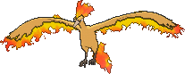

<!-- This file is generated by tools/generate_site.py. Edit the generator, not this file. -->

# #146 Moltres

{ .sprite-lg loading=lazy }

**Flame Pokémon**

Fire Flying

[:material-arrow-left: #145 Zapdos](145.md) · [Pokédex](index.md) · [#147 Dratini :material-arrow-right:](147.md)

!!! info "Changes in Rising Ruby / Sinking Sapphire"

    - **Ability 2:** **Flame Body** 

## Location

[Mirage Mountain](../wild/mirage_mountain_any.md)

### Wild encounters

| Area | Method | Level | Note |
| --- | --- | --- | --- |
| [Mirage Mountain (Any)](../wild/mirage_mountain_any.md) | Grass | 65 - 80 |  |

## Type defenses

| Damage taken | Attacking types |
| --- | --- |
| Immune (×0) | Ground |
| Very resistant (×¼) | Bug Grass |
| Resistant (×½) | Fighting Steel Fire Fairy |
| Neutral (×1) | Normal Flying Poison Ghost Psychic Ice Dragon Dark |
| Weak (×2) | Water Electric |
| Very weak (×4) | Rock |

## Abilities

| Slot | Ability | Effect | Note |
| --- | --- | --- | --- |
| Ability 1 | **Pressure** | Increases the PP cost of moves targetting the Pokémon by one. |  |
| Ability 2 | **Flame Body** | Has a 30% chance of burning attacking Pokémon on contact. | changed  |
| Hidden | **Flame Body** | Has a 30% chance of burning attacking Pokémon on contact. |  |

## Base stats

| Form | HP | Atk | Def | SpA | SpD | Spe | BST |
| --- | --- | --- | --- | --- | --- | --- | --- |
| { .sprite-sm loading=lazy } Normal | 90 | 100 | 90 | 125 | 85 | 90 | **580** |

## Training & breeding

| Property | Value |
| --- | --- |
| EV yield | 3 SpA |
| Catch rate | 3 |
| Base friendship | 35 |
| Base experience | 261 |
| Growth rate | slow |
| Egg groups | Undiscovered |
| Hatch counter | 80 |
| Gender ratio | Genderless |
| Height / weight | 2 m / 60 kg |

## Evolution

This Pokémon does not evolve.

## Wild held items

None.

## Level-up moves { data-search-exclude }

Moves marked &#42; are not normally learned by level up (they come from egg moves, TMs/HMs or tutors in the official games); moves marked &#42;&#42; cannot normally be learned by this Pokémon at all and are omitted from the legal-moves version of the hack.

| Lv. | Move | Type | Cat. | Power | Acc. | PP | Effect | Note |
| --- | --- | --- | --- | --- | --- | --- | --- | --- |
| 1 | Tailwind | Flying | Status | — | — | 15 | For three turns, friendly Pokémon have doubled Speed. | &#42; |
| 1 | Wing Attack | Flying | Physical | 60 | 100% | 35 | Inflicts regular damage with no additional effect. |  |
| 1 | Ember | Fire | Special | 40 | 100% | 25 | Has a chance to burn the target. |  |
| 5 | Fire Spin | Fire | Special | 35 | 85% | 15 | Prevents the target from fleeing and inflicts damage for 2-5 turns. |  |
| 10 | Agility | Psychic | Status | — | — | 30 | Raises the user’s Speed by two stages. |  |
| 15 | Endure | Normal | Status | — | — | 10 | Prevents the user’s HP from lowering below 1 this turn. |  |
| 20 | [Ancient Power](../changes/moves.md#ancient-power) changed | Rock | Special | 80 | 100% | 10 | Has a chance to raise all of the user’s stats by one stage. |  |
| 25 | Flamethrower | Fire | Special | 90 | 100% | 15 | Has a chance to burn the target. |  |
| 30 | Safeguard | Normal | Status | — | — | 25 | Protects the user’s field from major status ailments and confusion for five turns. |  |
| 35 | Roost | Flying | Status | — | — | 5 | Heals the user by half its max HP. |  |
| 40 | Air Slash | Flying | Special | 75 | 95% | 15 | Has a chance to make the target flinch. |  |
| 45 | Sunny Day | Fire | Status | — | — | 5 | Changes the weather to sunny for five turns. |  |
| 50 | Heat Wave | Fire | Special | 95 | 90% | 10 | Has a chance to burn the target. |  |
| 55 | Hurricane | Flying | Special | 110 | 70% | 10 | Has a chance to confuse the target. |  |
| 60 | Solar Beam | Grass | Special | 120 | 100% | 10 | Requires a turn to charge before attacking. |  |
| 65 | Sky Attack | Flying | Physical | 140 | 90% | 5 | User charges for one turn before attacking.  Has a chance to make the target flinch. |  |

## TM & HM moves { data-search-exclude }

| Machine | Move | Type | Cat. | Power | Acc. | PP | Effect |
| --- | --- | --- | --- | --- | --- | --- | --- |
| HM02 | [Fly](../changes/moves.md#fly) changed | Flying | Physical | 100 | 100% | 10 | User flies high into the air, dodging all attacks, and hits next turn. |
| HM06 | [Rock Smash](../changes/moves.md#rock-smash) changed | Fighting | Physical | 65 | 100% | 15 | Has a chance to lower the target’s Defense by one stage. |
| TM05 | Roar | Normal | Status | — | — | 20 | Immediately ends wild battles.  Forces trainers to switch Pokémon. |
| TM06 | Toxic | Poison | Status | — | 90% | 10 | Badly poisons the target, inflicting more damage every turn. |
| TM10 | Hidden Power | Normal | Special | 60 | 100% | 15 | Power and type depend upon user’s IVs.  Power can range from 30 to 70. |
| TM100 | Confide | Normal | Status | — | — | 20 | Lowers the target’s Special Attack by one stage. |
| TM11 | Sunny Day | Fire | Status | — | — | 5 | Changes the weather to sunny for five turns. |
| TM15 | Hyper Beam | Normal | Special | 150 | 90% | 5 | User foregoes its next turn to recharge. |
| TM17 | Protect | Normal | Status | — | — | 10 | Prevents any moves from hitting the user this turn. |
| TM18 | Rain Dance | Water | Status | — | — | 5 | Changes the weather to rain for five turns. |
| TM19 | Roost | Flying | Status | — | — | 5 | Heals the user by half its max HP. |
| TM20 | Safeguard | Normal | Status | — | — | 25 | Protects the user’s field from major status ailments and confusion for five turns. |
| TM21 | Frustration | Normal | Physical | — | 100% | 20 | Power increases as happiness decreases, up to a maximum of 102. |
| TM22 | Solar Beam | Grass | Special | 120 | 100% | 10 | Requires a turn to charge before attacking. |
| TM27 | Return | Normal | Physical | — | 100% | 20 | Power increases with happiness, up to a maximum of 102. |
| TM32 | Double Team | Normal | Status | — | — | 15 | Raises the user’s evasion by one stage. |
| TM35 | Flamethrower | Fire | Special | 90 | 100% | 15 | Has a chance to burn the target. |
| TM37 | Sandstorm | Rock | Status | — | — | 10 | Changes the weather to a sandstorm for five turns. |
| TM38 | Fire Blast | Fire | Special | 110 | 85% | 5 | Has a chance to burn the target. |
| TM40 | Aerial Ace | Flying | Physical | 60 | — | 20 | Never misses. |
| TM42 | Facade | Normal | Physical | 70 | 100% | 20 | Power doubles if user is burned, paralyzed, or poisoned. |
| TM43 | Flame Charge | Fire | Physical | 50 | 100% | 20 | Inflicts regular damage.  Raises the user’s Speed by one stage. |
| TM44 | Rest | Psychic | Status | — | — | 5 | User sleeps for two turns, completely healing itself. |
| TM48 | Round | Normal | Special | 60 | 100% | 15 | Has double power if it’s used more than once per turn. |
| TM50 | Overheat | Fire | Special | 130 | 90% | 5 | Lowers the user’s Special Attack by two stages after inflicting damage. |
| TM51 | Steel Wing | Steel | Physical | 70 | 90% | 25 | Has a chance to raise the user’s Defense by one stage. |
| TM58 | Sky Drop | Flying | Physical | 60 | 100% | 10 | Carries the target high into the air, dodging all attacks against either, and drops it next turn. |
| TM59 | Incinerate | Fire | Special | 60 | 100% | 15 | Destroys the target’s held berry. |
| TM61 | Will-O-Wisp | Fire | Status | — | 85% | 15 | Burns the target. |
| TM68 | Giga Impact | Normal | Physical | 150 | 90% | 5 | User foregoes its next turn to recharge. |
| TM87 | Swagger | Normal | Status | — | 90% | 15 | Raises the target’s Attack by two stages and confuses the target. |
| TM88 | Sleep Talk | Normal | Status | — | — | 10 | Randomly uses one of the user’s other three moves.  Only works if the user is sleeping. |
| TM89 | U-turn | Bug | Physical | 70 | 100% | 20 | User must switch out after attacking. |
| TM90 | Substitute | Normal | Status | — | — | 10 | Transfers 1/4 of the user’s max HP into a doll, protecting the user from further damage or status changes until it breaks. |
| TM94 | Secret Power | Normal | Physical | 70 | 100% | 20 | Has a chance to inflict a status effect which depends upon the terrain. |

## Move tutor moves { data-search-exclude }

| Move | Type | Cat. | Power | Acc. | PP | Effect |
| --- | --- | --- | --- | --- | --- | --- |
| Heat Wave | Fire | Special | 95 | 90% | 10 | Has a chance to burn the target. |
| Sky Attack | Flying | Physical | 140 | 90% | 5 | User charges for one turn before attacking.  Has a chance to make the target flinch. |
| Snore | Normal | Special | 50 | 100% | 15 | Has a chance to make the target flinch.  Only works if the user is sleeping. |
| Tailwind | Flying | Status | — | — | 15 | For three turns, friendly Pokémon have doubled Speed. |

## Egg moves { data-search-exclude }

No egg moves.

---

[:material-arrow-left: #145 Zapdos](145.md) · [#147 Dratini :material-arrow-right:](147.md)
