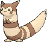
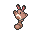

<!-- This file is generated by tools/generate_site.py. Edit the generator, not this file. -->

# #162 Furret

{ .sprite-lg loading=lazy }

**Long Body Pokémon**

Normal

[:material-arrow-left: #161 Sentret](161.md) · [Pokédex](index.md) · [#163 Hoothoot :material-arrow-right:](163.md)

!!! info "Changes in Rising Ruby / Sinking Sapphire"

    - **Ability 1:** Run Away → **Limber** &#42;&#42;
    - **Base stats:** HP 85 → **95**, Atk 76 → **85**, Def 64 → **65**, SpA 45 → **40**, Spe 90 → **100** (BST 415 → **440**)

## Location

[Safari Zone](../wild/safari_zone_1.md)

### Wild encounters

| Area | Method | Level | Note |
| --- | --- | --- | --- |
| [Safari Zone (2)](../wild/safari_zone_2.md) | Tall Grass | 45 |  |

## Type defenses

| Damage taken | Attacking types |
| --- | --- |
| Immune (×0) | Ghost |
| Neutral (×1) | Normal Flying Poison Ground Rock Bug Steel Fire Water Grass Electric Psychic Ice Dragon Dark Fairy |
| Weak (×2) | Fighting |

## Abilities

| Slot | Ability | Effect | Note |
| --- | --- | --- | --- |
| Ability 1 | **Limber** | Prevents paralysis. | changed (was Run Away) &#42;&#42; |
| Ability 2 | **Keen Eye** | Prevents accuracy from being lowered. |  |
| Hidden | **Frisk** | Reveals an opponent's held item upon entering battle. |  |

## Base stats

| Form | HP | Atk | Def | SpA | SpD | Spe | BST |
| --- | --- | --- | --- | --- | --- | --- | --- |
| { .sprite-sm loading=lazy } Normal | 95<small class="was">was 85</small> | 85<small class="was">was 76</small> | 65<small class="was">was 64</small> | 40<small class="was">was 45</small> | 55 | 100<small class="was">was 90</small> | 440<small class="was">was 415</small> |

## Training & breeding

| Property | Value |
| --- | --- |
| EV yield | 2 Spe |
| Catch rate | 90 |
| Base friendship | 70 |
| Base experience | 145 |
| Growth rate | medium |
| Egg groups | Field |
| Hatch counter | 15 |
| Gender ratio | 50% ♂ / 50% ♀ |
| Height / weight | 1.8 m / 32.5 kg |

## Evolution

- { .icon loading=lazy } [Sentret](../pokemon/161.md) → { .icon loading=lazy } **[Furret](../pokemon/162.md)**: Lv. 15

## Wild held items

None.

## Level-up moves { data-search-exclude }

Moves marked &#42; are not normally learned by level up (they come from egg moves, TMs/HMs or tutors in the official games); moves marked &#42;&#42; cannot normally be learned by this Pokémon at all and are omitted from the legal-moves version of the hack.

| Lv. | Move | Type | Cat. | Power | Acc. | PP | Effect | Note |
| --- | --- | --- | --- | --- | --- | --- | --- | --- |
| 1 | Double-Edge | Normal | Physical | 120 | 100% | 15 | User receives 1/3 the damage inflicted in recoil. |  |
| 1 | Aqua Tail | Water | Physical | 90 | 90% | 10 | Inflicts regular damage with no additional effect. | &#42; |
| 1 | Iron Tail | Steel | Physical | 100 | 75% | 15 | Has a chance to lower the target’s Defense by one stage. | &#42; |
| 1 | Covet | Normal | Physical | 60 | 100% | 25 | Takes the target’s item. | &#42; |
| 1 | [Scratch](../changes/moves.md#scratch) changed | Normal | Physical | 50 | 100% | 35 | Inflicts regular damage with no additional effect. |  |
| 1 | Foresight | Normal | Status | — | — | 40 | Forces the target to have no Evade, and allows it to be hit by Normal and Fighting moves even if it’s a Ghost. |  |
| 4 | Defense Curl | Normal | Status | — | — | 40 | Raises user’s Defense by one stage. |  |
| 7 | Quick Attack | Normal | Physical | 40 | 100% | 30 | Inflicts regular damage with no additional effect. |  |
| 10 | Fury Swipes | Normal | Physical | 18 | 80% | 15 | Hits 2-5 times in one turn. |  |
| 13 | Helping Hand | Normal | Status | — | — | 20 | Ally’s next move inflicts half more damage. |  |
| 15 | Slash | Normal | Physical | 70 | 100% | 20 | Has an increased chance for a critical hit. | &#42; |
| 17 | Slam | Normal | Physical | 80 | 75% | 20 | Inflicts regular damage with no additional effect. |  |
| 21 | Follow Me | Normal | Status | — | — | 20 | Redirects the target’s single-target effects to the user for this turn. |  |
| 25 | Rest | Psychic | Status | — | — | 5 | User sleeps for two turns, completely healing itself. |  |
| 29 | Sucker Punch | Dark | Physical | 80 | 100% | 5 | Only works if the target is about to use a damaging move. |  |
| 33 | Amnesia | Psychic | Status | — | — | 20 | Raises the user’s Special Defense by two stages. |  |
| 37 | Hyper Voice | Normal | Special | 90 | 100% | 10 | Inflicts regular damage with no additional effect. |  |
| 41 | Me First | Normal | Status | — | — | 20 | Uses the target’s move against it before it attacks, with power increased by half. |  |
| 45 | Baton Pass | Normal | Status | — | — | 40 | Allows the trainer to switch out the user and pass effects along to its replacement. |  |
| 49 | Double-Edge | Normal | Physical | 120 | 100% | 15 | User receives 1/3 the damage inflicted in recoil. | &#42; |

## TM & HM moves { data-search-exclude }

| Machine | Move | Type | Cat. | Power | Acc. | PP | Effect |
| --- | --- | --- | --- | --- | --- | --- | --- |
| HM01 | [Cut](../changes/moves.md#cut) changed | Grass | Physical | 70 | 100% | 15 | High Critical Rate. High Critical Rate |
| HM03 | Surf | Water | Special | 90 | 100% | 15 | Inflicts regular damage and can hit Dive users. |
| HM04 | [Strength](../changes/moves.md#strength) changed | Normal | Physical | 100 | 100% | 10 | Inflicts regular damage with no additional effect. |
| HM06 | [Rock Smash](../changes/moves.md#rock-smash) changed | Fighting | Physical | 65 | 100% | 15 | Has a chance to lower the target’s Defense by one stage. |
| TM01 | Hone Claws | Dark | Status | — | — | 15 | Raises the user’s Attack and accuracy by one stage. |
| TM06 | Toxic | Poison | Status | — | 90% | 10 | Badly poisons the target, inflicting more damage every turn. |
| TM10 | Hidden Power | Normal | Special | 60 | 100% | 15 | Power and type depend upon user’s IVs.  Power can range from 30 to 70. |
| TM100 | Confide | Normal | Status | — | — | 20 | Lowers the target’s Special Attack by one stage. |
| TM11 | Sunny Day | Fire | Status | — | — | 5 | Changes the weather to sunny for five turns. |
| TM13 | Ice Beam | Ice | Special | 90 | 100% | 10 | Has a chance to freeze the target. |
| TM14 | Blizzard | Ice | Special | 110 | 70% | 5 | Has a chance to freeze the target. |
| TM15 | Hyper Beam | Normal | Special | 150 | 90% | 5 | User foregoes its next turn to recharge. |
| TM17 | Protect | Normal | Status | — | — | 10 | Prevents any moves from hitting the user this turn. |
| TM18 | Rain Dance | Water | Status | — | — | 5 | Changes the weather to rain for five turns. |
| TM21 | Frustration | Normal | Physical | — | 100% | 20 | Power increases as happiness decreases, up to a maximum of 102. |
| TM22 | Solar Beam | Grass | Special | 120 | 100% | 10 | Requires a turn to charge before attacking. |
| TM24 | Thunderbolt | Electric | Special | 90 | 100% | 15 | Has a chance to paralyze the target. |
| TM25 | Thunder | Electric | Special | 110 | 70% | 10 | Has a chance to paralyze the target. |
| TM27 | Return | Normal | Physical | — | 100% | 20 | Power increases with happiness, up to a maximum of 102. |
| TM28 | Dig | Ground | Physical | 80 | 100% | 10 | User digs underground, dodging all attacks, and hits next turn. |
| TM30 | Shadow Ball | Ghost | Special | 80 | 100% | 15 | Has a chance to lower the target’s Special Defense by one stage. |
| TM31 | Brick Break | Fighting | Physical | 75 | 100% | 15 | Destroys Reflect and Light Screen. |
| TM32 | Double Team | Normal | Status | — | — | 15 | Raises the user’s evasion by one stage. |
| TM35 | Flamethrower | Fire | Special | 90 | 100% | 15 | Has a chance to burn the target. |
| TM42 | Facade | Normal | Physical | 70 | 100% | 20 | Power doubles if user is burned, paralyzed, or poisoned. |
| TM44 | Rest | Psychic | Status | — | — | 5 | User sleeps for two turns, completely healing itself. |
| TM45 | Attract | Normal | Status | — | 100% | 15 | Target falls in love if it has the opposite gender, and has a 50% chance to refuse attacking the user. |
| TM46 | Thief | Dark | Physical | 60 | 100% | 25 | Takes the target’s item. |
| TM48 | Round | Normal | Special | 60 | 100% | 15 | Has double power if it’s used more than once per turn. |
| TM49 | Echoed Voice | Normal | Special | 40 | 100% | 15 | Power increases by 100% for each consecutive use by any friendly Pokémon, to a maximum of 200. |
| TM52 | Focus Blast | Fighting | Special | 120 | 70% | 5 | Has a chance to lower the target’s Special Defense by one stage. |
| TM56 | Fling | Dark | Physical | — | 100% | 10 | Throws held item at the target; power depends on the item. |
| TM57 | Charge Beam | Electric | Special | 50 | 90% | 10 | Has a chance to raise the user’s Special Attack by one stage. |
| TM65 | Shadow Claw | Ghost | Physical | 70 | 100% | 15 | Has an increased chance for a critical hit. |
| TM67 | Retaliate | Normal | Physical | 70 | 100% | 5 | Has double power if a friendly Pokémon fainted last turn. |
| TM68 | Giga Impact | Normal | Physical | 150 | 90% | 5 | User foregoes its next turn to recharge. |
| TM86 | Grass Knot | Grass | Special | — | 100% | 20 | Inflicts more damage to heavier targets, with a maximum of 120 power. |
| TM87 | Swagger | Normal | Status | — | 90% | 15 | Raises the target’s Attack by two stages and confuses the target. |
| TM88 | Sleep Talk | Normal | Status | — | — | 10 | Randomly uses one of the user’s other three moves.  Only works if the user is sleeping. |
| TM89 | U-turn | Bug | Physical | 70 | 100% | 20 | User must switch out after attacking. |
| TM90 | Substitute | Normal | Status | — | — | 10 | Transfers 1/4 of the user’s max HP into a doll, protecting the user from further damage or status changes until it breaks. |
| TM94 | Secret Power | Normal | Physical | 70 | 100% | 20 | Has a chance to inflict a status effect which depends upon the terrain. |
| TM98 | Power-Up Punch | Fighting | Physical | 40 | 100% | 20 | Raises the user’s Attack by one stage after inflicting damage. |

## Move tutor moves { data-search-exclude }

| Move | Type | Cat. | Power | Acc. | PP | Effect |
| --- | --- | --- | --- | --- | --- | --- |
| Aqua Tail | Water | Physical | 90 | 90% | 10 | Inflicts regular damage with no additional effect. |
| Covet | Normal | Physical | 60 | 100% | 25 | Takes the target’s item. |
| Fire Punch | Fire | Physical | 75 | 100% | 15 | Has a chance to burn the target. |
| Focus Punch | Fighting | Physical | 150 | 100% | 20 | If the user takes damage before attacking, the attack is canceled. |
| Helping Hand | Normal | Status | — | — | 20 | Ally’s next move inflicts half more damage. |
| Hyper Voice | Normal | Special | 90 | 100% | 10 | Inflicts regular damage with no additional effect. |
| Ice Punch | Ice | Physical | 75 | 100% | 15 | Has a chance to freeze the target. |
| Iron Tail | Steel | Physical | 100 | 75% | 15 | Has a chance to lower the target’s Defense by one stage. |
| Knock Off | Dark | Physical | 65 | 100% | 20 | Target drops its held item. |
| Last Resort | Normal | Physical | 140 | 100% | 5 | Can only be used after all of the user’s other moves have been used. |
| Shock Wave | Electric | Special | 60 | — | 20 | Never misses. |
| Snore | Normal | Special | 50 | 100% | 15 | Has a chance to make the target flinch.  Only works if the user is sleeping. |
| Super Fang | Normal | Physical | — | 90% | 10 | Inflicts damage equal to half the target’s HP. |
| Thunder Punch | Electric | Physical | 75 | 100% | 15 | Has a chance to paralyze the target. |
| Trick | Psychic | Status | — | 100% | 10 | User and target swap items. |
| Uproar | Normal | Special | 90 | 100% | 10 | Forced to use this move for several turns.  Pokémon cannot fall asleep in that time. |
| Water Pulse | Water | Special | 60 | 100% | 20 | Has a chance to confuse the target. |

## Egg moves { data-search-exclude }

No egg moves.

??? note "Trainers using Furret (5)"

    | Area | Trainer | Level |
    | --- | --- | --- |
    | [Route 117](../trainers/route_117.md#trainers) | Teammates Anna & Meg | Lv. 23 |
    | [Route 117](../trainers/route_117.md#rematches) | Teammates Anna & Meg (4) | Lv. 35 |
    | [Route 117](../trainers/route_117.md#rematches) | Teammates Anna & Meg (5) | Lv. 39 |
    | [Route 117](../trainers/route_117.md#rematches) | Teammates Anna & Meg (7) | Lv. 59 |
    | [Route 117](../trainers/route_117.md#rematches) | Teammates Anna & Meg (C) | Lv. 75 |

---

[:material-arrow-left: #161 Sentret](161.md) · [#163 Hoothoot :material-arrow-right:](163.md)
