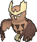

<!-- This file is generated by tools/generate_site.py. Edit the generator, not this file. -->

# #164 Noctowl

{ .sprite-lg loading=lazy }

**Owl Pokémon**

Psychic Flying

Type changed from Normal / Flying

[:material-arrow-left: #163 Hoothoot](163.md) · [Pokédex](index.md) · [#165 Ledyba :material-arrow-right:](165.md)

!!! info "Changes in Rising Ruby / Sinking Sapphire"

    - **Type:** Normal / Flying → Psychic Flying
    - **Ability 2:** Keen Eye → **Analytic** 
    - **Base stats:** Atk 50 → **30**, Def 50 → **60**, SpA 76 → **90**, SpD 96 → **110**, Spe 70 → **75** (BST 442 → **465**)
    - **EV yield:** 2 HP → **2 Sp. Def**

## Location

[Safari Zone](../wild/safari_zone_1.md), [Mt. Pyre](../wild/mt_pyre_1f_2f.md)

### Wild encounters

| Area | Method | Level | Note |
| --- | --- | --- | --- |
| [Safari Zone (2)](../wild/safari_zone_2.md) | Grass | 45 |  |
| [Mt. Pyre Summit 2](../wild/mt_pyre_summit_2.md) | Walking | 45 |  |

## Type defenses

| Damage taken | Attacking types |
| --- | --- |
| Immune (×0) | Ground |
| Very resistant (×¼) | Fighting |
| Resistant (×½) | Grass Psychic |
| Neutral (×1) | Normal Flying Poison Bug Steel Fire Water Dragon Fairy |
| Weak (×2) | Rock Ghost Electric Ice Dark |

## Abilities

| Slot | Ability | Effect | Note |
| --- | --- | --- | --- |
| Ability 1 | **Insomnia** | Prevents sleep. |  |
| Ability 2 | **Analytic** | Strengthens moves to 1.3× their power when moving last. | changed (was Keen Eye)  |
| Hidden | **Tinted Lens** | Doubles damage inflicted with not-very-effective moves. |  |

## Base stats

| Form | HP | Atk | Def | SpA | SpD | Spe | BST |
| --- | --- | --- | --- | --- | --- | --- | --- |
| { .sprite-sm loading=lazy } Normal | 100 | 30<small class="was">was 50</small> | 60<small class="was">was 50</small> | 90<small class="was">was 76</small> | 110<small class="was">was 96</small> | 75<small class="was">was 70</small> | 465<small class="was">was 442</small> |

## Training & breeding

| Property | Value |
| --- | --- |
| EV yield | 2 Sp. Def changed (was 2 HP) |
| Catch rate | 90 |
| Base friendship | 70 |
| Base experience | 158 |
| Growth rate | medium |
| Egg groups | Flying |
| Hatch counter | 15 |
| Gender ratio | 50% ♂ / 50% ♀ |
| Height / weight | 1.6 m / 40.8 kg |

## Evolution

- { .icon loading=lazy } [Hoothoot](../pokemon/163.md) → { .icon loading=lazy } **[Noctowl](../pokemon/164.md)**: Lv. 20

## Wild held items

None.

## Level-up moves { data-search-exclude }

Moves marked &#42; are not normally learned by level up (they come from egg moves, TMs/HMs or tutors in the official games); moves marked &#42;&#42; cannot normally be learned by this Pokémon at all and are omitted from the legal-moves version of the hack.

| Lv. | Move | Type | Cat. | Power | Acc. | PP | Effect | Note |
| --- | --- | --- | --- | --- | --- | --- | --- | --- |
| 1 | Hurricane | Flying | Special | 110 | 70% | 10 | Has a chance to confuse the target. | &#42;&#42; |
| 1 | Dream Eater | Psychic | Special | 100 | 100% | 15 | Only works on sleeping Pokémon.  Drains half the damage inflicted to heal the user. |  |
| 1 | Sky Attack | Flying | Physical | 140 | 90% | 5 | User charges for one turn before attacking.  Has a chance to make the target flinch. |  |
| 1 | Heat Wave | Fire | Special | 95 | 90% | 10 | Has a chance to burn the target. | &#42; |
| 1 | Hyper Voice | Normal | Special | 90 | 100% | 10 | Inflicts regular damage with no additional effect. | &#42; |
| 1 | Tackle | Normal | Physical | 50 | 100% | 35 | Inflicts regular damage with no additional effect. |  |
| 1 | Growl | Normal | Status | — | 100% | 40 | Lowers the target’s Attack by one stage. |  |
| 1 | Foresight | Normal | Status | — | — | 40 | Forces the target to have no Evade, and allows it to be hit by Normal and Fighting moves even if it’s a Ghost. |  |
| 1 | Hypnosis | Psychic | Status | — | 60% | 20 | Puts the target to sleep. |  |
| 6 | Echoed Voice | Normal | Special | 40 | 100% | 15 | Power increases by 100% for each consecutive use by any friendly Pokémon, to a maximum of 200. |  |
| 9 | Peck | Flying | Physical | 35 | 100% | 35 | Inflicts regular damage with no additional effect. |  |
| 12 | Uproar | Normal | Special | 90 | 100% | 10 | Forced to use this move for several turns.  Pokémon cannot fall asleep in that time. |  |
| 15 | Air Cutter | Flying | Special | 60 | 95% | 25 | Has an increased chance for a critical hit. | &#42; |
| 18 | Confusion | Psychic | Special | 50 | 100% | 25 | Has a chance to confuse the target. |  |
| 22 | Reflect | Psychic | Status | — | — | 20 | Reduces damage from physical attacks by half. |  |
| 26 | Extrasensory | Psychic | Special | 80 | 100% | 20 | Has a chance to make the target flinch. |  |
| 30 | Take Down | Normal | Physical | 90 | 85% | 20 | User receives 1/4 the damage it inflicts in recoil. |  |
| 34 | Air Slash | Flying | Special | 75 | 95% | 15 | Has a chance to make the target flinch. |  |
| 38 | Synchronoise | Psychic | Special | 120 | 100% | 10 | Hits any Pokémon that shares a type with the user. |  |
| 42 | Zen Headbutt | Psychic | Physical | 80 | 90% | 15 | Has a chance to make the target flinch. |  |
| 46 | Psycho Shift | Psychic | Status | — | 100% | 10 | Transfers the user’s major status effect to the target. |  |
| 50 | Psychic | Psychic | Special | 90 | 100% | 10 | Has a chance to lower the target’s Special Defense by one stage. | &#42; |
| 54 | Roost | Flying | Status | — | — | 5 | Heals the user by half its max HP. |  |
| 58 | Dream Eater | Psychic | Special | 100 | 100% | 15 | Only works on sleeping Pokémon.  Drains half the damage inflicted to heal the user. |  |
| 62 | Hurricane | Flying | Special | 110 | 70% | 10 | Has a chance to confuse the target. | &#42;&#42; |

## TM & HM moves { data-search-exclude }

| Machine | Move | Type | Cat. | Power | Acc. | PP | Effect |
| --- | --- | --- | --- | --- | --- | --- | --- |
| HM02 | [Fly](../changes/moves.md#fly) changed | Flying | Physical | 100 | 100% | 10 | User flies high into the air, dodging all attacks, and hits next turn. |
| TM06 | Toxic | Poison | Status | — | 90% | 10 | Badly poisons the target, inflicting more damage every turn. |
| TM10 | Hidden Power | Normal | Special | 60 | 100% | 15 | Power and type depend upon user’s IVs.  Power can range from 30 to 70. |
| TM100 | Confide | Normal | Status | — | — | 20 | Lowers the target’s Special Attack by one stage. |
| TM11 | Sunny Day | Fire | Status | — | — | 5 | Changes the weather to sunny for five turns. |
| TM15 | Hyper Beam | Normal | Special | 150 | 90% | 5 | User foregoes its next turn to recharge. |
| TM17 | Protect | Normal | Status | — | — | 10 | Prevents any moves from hitting the user this turn. |
| TM18 | Rain Dance | Water | Status | — | — | 5 | Changes the weather to rain for five turns. |
| TM19 | Roost | Flying | Status | — | — | 5 | Heals the user by half its max HP. |
| TM21 | Frustration | Normal | Physical | — | 100% | 20 | Power increases as happiness decreases, up to a maximum of 102. |
| TM27 | Return | Normal | Physical | — | 100% | 20 | Power increases with happiness, up to a maximum of 102. |
| TM29 | Psychic | Psychic | Special | 90 | 100% | 10 | Has a chance to lower the target’s Special Defense by one stage. |
| TM30 | Shadow Ball | Ghost | Special | 80 | 100% | 15 | Has a chance to lower the target’s Special Defense by one stage. |
| TM32 | Double Team | Normal | Status | — | — | 15 | Raises the user’s evasion by one stage. |
| TM33 | Reflect | Psychic | Status | — | — | 20 | Reduces damage from physical attacks by half. |
| TM40 | Aerial Ace | Flying | Physical | 60 | — | 20 | Never misses. |
| TM42 | Facade | Normal | Physical | 70 | 100% | 20 | Power doubles if user is burned, paralyzed, or poisoned. |
| TM44 | Rest | Psychic | Status | — | — | 5 | User sleeps for two turns, completely healing itself. |
| TM45 | Attract | Normal | Status | — | 100% | 15 | Target falls in love if it has the opposite gender, and has a 50% chance to refuse attacking the user. |
| TM46 | Thief | Dark | Physical | 60 | 100% | 25 | Takes the target’s item. |
| TM48 | Round | Normal | Special | 60 | 100% | 15 | Has double power if it’s used more than once per turn. |
| TM49 | Echoed Voice | Normal | Special | 40 | 100% | 15 | Power increases by 100% for each consecutive use by any friendly Pokémon, to a maximum of 200. |
| TM51 | Steel Wing | Steel | Physical | 70 | 90% | 25 | Has a chance to raise the user’s Defense by one stage. |
| TM68 | Giga Impact | Normal | Physical | 150 | 90% | 5 | User foregoes its next turn to recharge. |
| TM77 | Psych Up | Normal | Status | — | — | 10 | Discards the user’s stat changes and copies the target’s. |
| TM85 | Dream Eater | Psychic | Special | 100 | 100% | 15 | Only works on sleeping Pokémon.  Drains half the damage inflicted to heal the user. |
| TM87 | Swagger | Normal | Status | — | 90% | 15 | Raises the target’s Attack by two stages and confuses the target. |
| TM88 | Sleep Talk | Normal | Status | — | — | 10 | Randomly uses one of the user’s other three moves.  Only works if the user is sleeping. |
| TM90 | Substitute | Normal | Status | — | — | 10 | Transfers 1/4 of the user’s max HP into a doll, protecting the user from further damage or status changes until it breaks. |
| TM94 | Secret Power | Normal | Physical | 70 | 100% | 20 | Has a chance to inflict a status effect which depends upon the terrain. |

## Move tutor moves { data-search-exclude }

| Move | Type | Cat. | Power | Acc. | PP | Effect |
| --- | --- | --- | --- | --- | --- | --- |
| Heat Wave | Fire | Special | 95 | 90% | 10 | Has a chance to burn the target. |
| Hyper Voice | Normal | Special | 90 | 100% | 10 | Inflicts regular damage with no additional effect. |
| Magic Coat | Psychic | Status | — | — | 15 | Reflects back the first effect move used on the user this turn. |
| Recycle | Normal | Status | — | — | 10 | User recovers the item it last used up. |
| Sky Attack | Flying | Physical | 140 | 90% | 5 | User charges for one turn before attacking.  Has a chance to make the target flinch. |
| Snore | Normal | Special | 50 | 100% | 15 | Has a chance to make the target flinch.  Only works if the user is sleeping. |
| Tailwind | Flying | Status | — | — | 15 | For three turns, friendly Pokémon have doubled Speed. |
| Uproar | Normal | Special | 90 | 100% | 10 | Forced to use this move for several turns.  Pokémon cannot fall asleep in that time. |
| Zen Headbutt | Psychic | Physical | 80 | 90% | 15 | Has a chance to make the target flinch. |

## Egg moves { data-search-exclude }

No egg moves.

??? note "Trainers using Noctowl (2)"

    | Area | Trainer | Level |
    | --- | --- | --- |
    | [Route 118](../trainers/route_118.md#trainers-east-of-inlet) | Bird Keeper Perry | Lv. 37 |
    | [Fortree Gym](../trainers/fortree_gym.md#trainers) | Bird Keeper Jared | Lv. 45 |

---

[:material-arrow-left: #163 Hoothoot](163.md) · [#165 Ledyba :material-arrow-right:](165.md)
