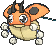

<!-- This file is generated by tools/generate_site.py. Edit the generator, not this file. -->

# #165 Ledyba

{ .sprite-lg loading=lazy }

**Five Star Pokémon**

Bug Flying

[:material-arrow-left: #164 Noctowl](164.md) · [Pokédex](index.md) · [#166 Ledian :material-arrow-right:](166.md)

!!! info "Changes in Rising Ruby / Sinking Sapphire"

    - **Base stats:** Atk 20 → **50**, SpA 40 → **20** (BST 265 → **275**)

## Location

[Route 104 North](../wild/route_104_north.md)

### Wild encounters

| Area | Method | Level | Note |
| --- | --- | --- | --- |
| [Route 104 North](../wild/route_104_north.md) | Grass | 10 |  |

## Type defenses

| Damage taken | Attacking types |
| --- | --- |
| Immune (×0) | Ground |
| Very resistant (×¼) | Fighting Grass |
| Resistant (×½) | Bug |
| Neutral (×1) | Normal Poison Ghost Steel Water Psychic Dragon Dark Fairy |
| Weak (×2) | Flying Fire Electric Ice |
| Very weak (×4) | Rock |

## Abilities

| Slot | Ability | Effect | Note |
| --- | --- | --- | --- |
| Ability 1 | **Swarm** | Strengthens Bug moves to inflict 1.5× damage at 1/3 max HP or less. |  |
| Ability 2 | **Early Bird** | Makes sleep pass twice as quickly. |  |
| Hidden | **Rattled** | Raises Speed one stage upon being hit by a Dark, Ghost, or Bug move. |  |

## Base stats

| Form | HP | Atk | Def | SpA | SpD | Spe | BST |
| --- | --- | --- | --- | --- | --- | --- | --- |
| { .sprite-sm loading=lazy } Normal | 40 | 50<small class="was">was 20</small> | 30 | 20<small class="was">was 40</small> | 80 | 55 | 275<small class="was">was 265</small> |

## Training & breeding

| Property | Value |
| --- | --- |
| EV yield | 1 SpD |
| Catch rate | 255 |
| Base friendship | 70 |
| Base experience | 53 |
| Growth rate | fast |
| Egg groups | Bug |
| Hatch counter | 15 |
| Gender ratio | 50% ♂ / 50% ♀ |
| Height / weight | 1 m / 10.8 kg |

## Evolution

- { .icon loading=lazy } **[Ledyba](../pokemon/165.md)** → { .icon loading=lazy } [Ledian](../pokemon/166.md): Lv. 18

## Wild held items

None.

## Level-up moves { data-search-exclude }

Moves marked &#42; are not normally learned by level up (they come from egg moves, TMs/HMs or tutors in the official games); moves marked &#42;&#42; cannot normally be learned by this Pokémon at all and are omitted from the legal-moves version of the hack.

| Lv. | Move | Type | Cat. | Power | Acc. | PP | Effect | Note |
| --- | --- | --- | --- | --- | --- | --- | --- | --- |
| 1 | Tackle | Normal | Physical | 50 | 100% | 35 | Inflicts regular damage with no additional effect. |  |
| 1 | Supersonic | Normal | Status | — | 55% | 20 | Confuses the target. |  |
| 6 | Comet Punch | Normal | Physical | 18 | 85% | 15 | Hits 2-5 times in one turn. |  |
| 8 | Bug Bite | Bug | Physical | 60 | 100% | 20 | If target has a berry, inflicts double damage and uses the berry. | &#42; |
| 10 | Light Screen | Psychic | Status | — | — | 30 | Reduces damage from special attacks by 50% for five turns. |  |
| 10 | Reflect | Psychic | Status | — | — | 20 | Reduces damage from physical attacks by half. |  |
| 12 | Aerial Ace | Flying | Physical | 60 | — | 20 | Never misses. | &#42; |
| 14 | Safeguard | Normal | Status | — | — | 25 | Protects the user’s field from major status ailments and confusion for five turns. |  |
| 16 | Mach Punch | Fighting | Physical | 40 | 100% | 30 | Inflicts regular damage with no additional effect. |  |
| 18 | Swift | Normal | Special | 60 | — | 20 | Never misses. |  |
| 20 | Drain Punch | Fighting | Physical | 75 | 100% | 10 | Drains half the damage inflicted to heal the user. | &#42; |
| 22 | Acrobatics | Flying | Physical | 55 | 100% | 15 | Has double power if the user has no held item. | &#42; |
| 24 | Baton Pass | Normal | Status | — | — | 40 | Allows the trainer to switch out the user and pass effects along to its replacement. |  |
| 26 | U-turn | Bug | Physical | 70 | 100% | 20 | User must switch out after attacking. | &#42; |
| 28 | Agility | Psychic | Status | — | — | 30 | Raises the user’s Speed by two stages. |  |
| 30 | Silver Wind | Bug | Special | 60 | 100% | 5 | Has a chance to raise all of the user’s stats by one stage. |  |
| 32 | Double-Edge | Normal | Physical | 120 | 100% | 15 | User receives 1/3 the damage inflicted in recoil. |  |
| 34 | Focus Punch | Fighting | Physical | 150 | 100% | 20 | If the user takes damage before attacking, the attack is canceled. | &#42; |
| 36 | Bug Buzz | Bug | Special | 90 | 100% | 10 | Has a chance to lower the target’s Special Defense by one stage. |  |
| 38 | Meteor Mash | Steel | Physical | 90 | 90% | 10 | Has a chance to raise the user’s Attack by one stage. | &#42;&#42; |

## TM & HM moves { data-search-exclude }

| Machine | Move | Type | Cat. | Power | Acc. | PP | Effect |
| --- | --- | --- | --- | --- | --- | --- | --- |
| TM06 | Toxic | Poison | Status | — | 90% | 10 | Badly poisons the target, inflicting more damage every turn. |
| TM10 | Hidden Power | Normal | Special | 60 | 100% | 15 | Power and type depend upon user’s IVs.  Power can range from 30 to 70. |
| TM100 | Confide | Normal | Status | — | — | 20 | Lowers the target’s Special Attack by one stage. |
| TM11 | Sunny Day | Fire | Status | — | — | 5 | Changes the weather to sunny for five turns. |
| TM16 | Light Screen | Psychic | Status | — | — | 30 | Reduces damage from special attacks by 50% for five turns. |
| TM17 | Protect | Normal | Status | — | — | 10 | Prevents any moves from hitting the user this turn. |
| TM19 | Roost | Flying | Status | — | — | 5 | Heals the user by half its max HP. |
| TM20 | Safeguard | Normal | Status | — | — | 25 | Protects the user’s field from major status ailments and confusion for five turns. |
| TM21 | Frustration | Normal | Physical | — | 100% | 20 | Power increases as happiness decreases, up to a maximum of 102. |
| TM22 | Solar Beam | Grass | Special | 120 | 100% | 10 | Requires a turn to charge before attacking. |
| TM27 | Return | Normal | Physical | — | 100% | 20 | Power increases with happiness, up to a maximum of 102. |
| TM28 | Dig | Ground | Physical | 80 | 100% | 10 | User digs underground, dodging all attacks, and hits next turn. |
| TM31 | Brick Break | Fighting | Physical | 75 | 100% | 15 | Destroys Reflect and Light Screen. |
| TM32 | Double Team | Normal | Status | — | — | 15 | Raises the user’s evasion by one stage. |
| TM33 | Reflect | Psychic | Status | — | — | 20 | Reduces damage from physical attacks by half. |
| TM40 | Aerial Ace | Flying | Physical | 60 | — | 20 | Never misses. |
| TM42 | Facade | Normal | Physical | 70 | 100% | 20 | Power doubles if user is burned, paralyzed, or poisoned. |
| TM44 | Rest | Psychic | Status | — | — | 5 | User sleeps for two turns, completely healing itself. |
| TM45 | Attract | Normal | Status | — | 100% | 15 | Target falls in love if it has the opposite gender, and has a 50% chance to refuse attacking the user. |
| TM46 | Thief | Dark | Physical | 60 | 100% | 25 | Takes the target’s item. |
| TM48 | Round | Normal | Special | 60 | 100% | 15 | Has double power if it’s used more than once per turn. |
| TM56 | Fling | Dark | Physical | — | 100% | 10 | Throws held item at the target; power depends on the item. |
| TM62 | Acrobatics | Flying | Physical | 55 | 100% | 15 | Has double power if the user has no held item. |
| TM70 | Flash | Normal | Status | — | 100% | 20 | Lowers the target’s accuracy by one stage. |
| TM75 | Swords Dance | Normal | Status | — | — | 20 | Raises the user’s Attack by two stages. |
| TM76 | Struggle Bug | Bug | Special | 50 | 100% | 20 | Has a chance to lower the target’s Special Attack by one stage. |
| TM83 | Infestation | Bug | Special | 20 | 100% | 20 | Prevents the target from fleeing and inflicts damage for 2-5 turns. |
| TM87 | Swagger | Normal | Status | — | 90% | 15 | Raises the target’s Attack by two stages and confuses the target. |
| TM88 | Sleep Talk | Normal | Status | — | — | 10 | Randomly uses one of the user’s other three moves.  Only works if the user is sleeping. |
| TM89 | U-turn | Bug | Physical | 70 | 100% | 20 | User must switch out after attacking. |
| TM90 | Substitute | Normal | Status | — | — | 10 | Transfers 1/4 of the user’s max HP into a doll, protecting the user from further damage or status changes until it breaks. |
| TM94 | Secret Power | Normal | Physical | 70 | 100% | 20 | Has a chance to inflict a status effect which depends upon the terrain. |
| TM98 | Power-Up Punch | Fighting | Physical | 40 | 100% | 20 | Raises the user’s Attack by one stage after inflicting damage. |

## Move tutor moves { data-search-exclude }

| Move | Type | Cat. | Power | Acc. | PP | Effect |
| --- | --- | --- | --- | --- | --- | --- |
| Bug Bite | Bug | Physical | 60 | 100% | 20 | If target has a berry, inflicts double damage and uses the berry. |
| Drain Punch | Fighting | Physical | 75 | 100% | 10 | Drains half the damage inflicted to heal the user. |
| Focus Punch | Fighting | Physical | 150 | 100% | 20 | If the user takes damage before attacking, the attack is canceled. |
| Giga Drain | Grass | Special | 75 | 100% | 10 | Drains half the damage inflicted to heal the user. |
| Ice Punch | Ice | Physical | 75 | 100% | 15 | Has a chance to freeze the target. |
| Knock Off | Dark | Physical | 65 | 100% | 20 | Target drops its held item. |
| Snore | Normal | Special | 50 | 100% | 15 | Has a chance to make the target flinch.  Only works if the user is sleeping. |
| Tailwind | Flying | Status | — | — | 15 | For three turns, friendly Pokémon have doubled Speed. |
| Thunder Punch | Electric | Physical | 75 | 100% | 15 | Has a chance to paralyze the target. |
| Uproar | Normal | Special | 90 | 100% | 10 | Forced to use this move for several turns.  Pokémon cannot fall asleep in that time. |

## Egg moves { data-search-exclude }

| Move | Type | Cat. | Power | Acc. | PP | Effect |
| --- | --- | --- | --- | --- | --- | --- |
| Bide | Normal | Physical | — | — | 10 | User waits for two turns, then hits back for twice the damage it took. |
| Bug Bite | Bug | Physical | 60 | 100% | 20 | If target has a berry, inflicts double damage and uses the berry. |
| Bug Buzz | Bug | Special | 90 | 100% | 10 | Has a chance to lower the target’s Special Defense by one stage. |
| Dizzy Punch | Normal | Physical | 70 | 100% | 10 | Has a chance to confuse the target. |
| Drain Punch | Fighting | Physical | 75 | 100% | 10 | Drains half the damage inflicted to heal the user. |
| Encore | Normal | Status | — | 100% | 5 | Forces the target to repeat its last used move every turn for 2 to 6 turns. |
| Focus Punch | Fighting | Physical | 150 | 100% | 20 | If the user takes damage before attacking, the attack is canceled. |
| Knock Off | Dark | Physical | 65 | 100% | 20 | Target drops its held item. |
| Psybeam | Psychic | Special | 65 | 100% | 20 | Has a chance to confuse the target. |
| Screech | Normal | Status | — | 85% | 40 | Lowers the target’s Defense by two stages. |
| Silver Wind | Bug | Special | 60 | 100% | 5 | Has a chance to raise all of the user’s stats by one stage. |
| Tailwind | Flying | Status | — | — | 15 | For three turns, friendly Pokémon have doubled Speed. |

??? note "Trainers using Ledyba (1)"

    | Area | Trainer | Level |
    | --- | --- | --- |
    | [Route 116](../trainers/route_116.md#trainers) | Bug Catcher Jose | Lv. 11 |

---

[:material-arrow-left: #164 Noctowl](164.md) · [#166 Ledian :material-arrow-right:](166.md)
