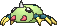

<!-- This file is generated by tools/generate_site.py. Edit the generator, not this file. -->

# #167 Spinarak

{ .sprite-lg loading=lazy }

**String Spit Pokémon**

Bug Poison

[:material-arrow-left: #166 Ledian](166.md) · [Pokédex](index.md) · [#168 Ariados :material-arrow-right:](168.md)

!!! info "Changes in Rising Ruby / Sinking Sapphire"

    - **Base stats:** Atk 60 → **70**, Spe 30 → **40** (BST 250 → **270**)

## Location

[Rusturf Tunnel](../wild/rusturf_tunnel.md)

### Wild encounters

| Area | Method | Level | Note |
| --- | --- | --- | --- |
| [Rusturf Tunnel](../wild/rusturf_tunnel.md) | Walking | 10 |  |

## Type defenses

| Damage taken | Attacking types |
| --- | --- |
| Very resistant (×¼) | Fighting Grass |
| Resistant (×½) | Poison Bug Fairy |
| Neutral (×1) | Normal Ground Ghost Steel Water Electric Ice Dragon Dark |
| Weak (×2) | Flying Rock Fire Psychic |

## Abilities

| Slot | Ability | Effect | Note |
| --- | --- | --- | --- |
| Ability 1 | **Swarm** | Strengthens Bug moves to inflict 1.5× damage at 1/3 max HP or less. |  |
| Ability 2 | **Insomnia** | Prevents sleep. |  |
| Hidden | **Sniper** | Strengthens critical hits to inflict 3× damage rather than 2×. |  |

## Base stats

| Form | HP | Atk | Def | SpA | SpD | Spe | BST |
| --- | --- | --- | --- | --- | --- | --- | --- |
| { .sprite-sm loading=lazy } Normal | 40 | 70<small class="was">was 60</small> | 40 | 40 | 40 | 40<small class="was">was 30</small> | 270<small class="was">was 250</small> |

## Training & breeding

| Property | Value |
| --- | --- |
| EV yield | 1 Atk |
| Catch rate | 255 |
| Base friendship | 70 |
| Base experience | 50 |
| Growth rate | fast |
| Egg groups | Bug |
| Hatch counter | 15 |
| Gender ratio | 50% ♂ / 50% ♀ |
| Height / weight | 0.5 m / 8.5 kg |

## Evolution

- { .icon loading=lazy } **[Spinarak](../pokemon/167.md)** → { .icon loading=lazy } [Ariados](../pokemon/168.md): Lv. 22

## Wild held items

None.

## Level-up moves { data-search-exclude }

Moves marked &#42; are not normally learned by level up (they come from egg moves, TMs/HMs or tutors in the official games); moves marked &#42;&#42; cannot normally be learned by this Pokémon at all and are omitted from the legal-moves version of the hack.

| Lv. | Move | Type | Cat. | Power | Acc. | PP | Effect | Note |
| --- | --- | --- | --- | --- | --- | --- | --- | --- |
| 1 | Poison Sting | Poison | Physical | 15 | 100% | 35 | Has a chance to poison the target. |  |
| 1 | String Shot | Bug | Status | — | 95% | 40 | Lowers the target’s Speed by one stage. |  |
| 1 | Electroweb | Electric | Special | 55 | 95% | 15 | Lowers the target’s Speed by one stage. | &#42; |
| 6 | Scary Face | Normal | Status | — | 100% | 10 | Lowers the target’s Speed by two stages. |  |
| 8 | Constrict | Normal | Physical | 10 | 100% | 35 | Has a chance to lower the target’s Speed by one stage. |  |
| 10 | Leech Life | Bug | Physical | 20 | 100% | 15 | Drains half the damage inflicted to heal the user. |  |
| 12 | Bug Bite | Bug | Physical | 60 | 100% | 20 | If target has a berry, inflicts double damage and uses the berry. | &#42; |
| 14 | Night Shade | Ghost | Special | — | 100% | 15 | Inflicts damage equal to the user’s level. |  |
| 16 | Shadow Sneak | Ghost | Physical | 40 | 100% | 30 | Inflicts regular damage with no additional effect. |  |
| 18 | X-Scissor | Bug | Physical | 80 | 100% | 15 | Inflicts regular damage with no additional effect. | &#42; |
| 20 | Fury Swipes | Normal | Physical | 18 | 80% | 15 | Hits 2-5 times in one turn. |  |
| 22 | Cross Poison | Poison | Physical | 70 | 100% | 20 | Has an increased chance for a critical hit and a chance to poison the target. |  |
| 24 | Night Slash | Dark | Physical | 70 | 100% | 15 | Has an increased chance for a critical hit. | &#42; |
| 26 | Sucker Punch | Dark | Physical | 80 | 100% | 5 | Only works if the target is about to use a damaging move. |  |
| 28 | Spider Web | Bug | Status | — | — | 10 | Prevents the target from leaving battle. |  |
| 30 | Agility | Psychic | Status | — | — | 30 | Raises the user’s Speed by two stages. |  |
| 32 | Pin Missile | Bug | Physical | 25 | 95% | 20 | Hits 2-5 times in one turn. |  |
| 34 | Psychic | Psychic | Special | 90 | 100% | 10 | Has a chance to lower the target’s Special Defense by one stage. |  |
| 36 | Poison Jab | Poison | Physical | 80 | 100% | 20 | Has a chance to poison the target. |  |
| 38 | Sticky Web | Bug | Status | — | — | 20 | Covers the opposing field, lowering opponents’ Speed by one stage upon switching in. |  |
| 40 | Megahorn | Bug | Physical | 120 | 85% | 10 | Inflicts regular damage with no additional effect. | &#42; |

## TM & HM moves { data-search-exclude }

| Machine | Move | Type | Cat. | Power | Acc. | PP | Effect |
| --- | --- | --- | --- | --- | --- | --- | --- |
| TM01 | Hone Claws | Dark | Status | — | — | 15 | Raises the user’s Attack and accuracy by one stage. |
| TM06 | Toxic | Poison | Status | — | 90% | 10 | Badly poisons the target, inflicting more damage every turn. |
| TM09 | Venoshock | Poison | Special | 65 | 100% | 10 | Inflicts double damage if the target is Poisoned. |
| TM10 | Hidden Power | Normal | Special | 60 | 100% | 15 | Power and type depend upon user’s IVs.  Power can range from 30 to 70. |
| TM100 | Confide | Normal | Status | — | — | 20 | Lowers the target’s Special Attack by one stage. |
| TM11 | Sunny Day | Fire | Status | — | — | 5 | Changes the weather to sunny for five turns. |
| TM17 | Protect | Normal | Status | — | — | 10 | Prevents any moves from hitting the user this turn. |
| TM21 | Frustration | Normal | Physical | — | 100% | 20 | Power increases as happiness decreases, up to a maximum of 102. |
| TM22 | Solar Beam | Grass | Special | 120 | 100% | 10 | Requires a turn to charge before attacking. |
| TM27 | Return | Normal | Physical | — | 100% | 20 | Power increases with happiness, up to a maximum of 102. |
| TM28 | Dig | Ground | Physical | 80 | 100% | 10 | User digs underground, dodging all attacks, and hits next turn. |
| TM29 | Psychic | Psychic | Special | 90 | 100% | 10 | Has a chance to lower the target’s Special Defense by one stage. |
| TM32 | Double Team | Normal | Status | — | — | 15 | Raises the user’s evasion by one stage. |
| TM36 | Sludge Bomb | Poison | Special | 90 | 100% | 10 | Has a chance to poison the target. |
| TM42 | Facade | Normal | Physical | 70 | 100% | 20 | Power doubles if user is burned, paralyzed, or poisoned. |
| TM44 | Rest | Psychic | Status | — | — | 5 | User sleeps for two turns, completely healing itself. |
| TM45 | Attract | Normal | Status | — | 100% | 15 | Target falls in love if it has the opposite gender, and has a 50% chance to refuse attacking the user. |
| TM46 | Thief | Dark | Physical | 60 | 100% | 25 | Takes the target’s item. |
| TM48 | Round | Normal | Special | 60 | 100% | 15 | Has double power if it’s used more than once per turn. |
| TM70 | Flash | Normal | Status | — | 100% | 20 | Lowers the target’s accuracy by one stage. |
| TM76 | Struggle Bug | Bug | Special | 50 | 100% | 20 | Has a chance to lower the target’s Special Attack by one stage. |
| TM81 | X-Scissor | Bug | Physical | 80 | 100% | 15 | Inflicts regular damage with no additional effect. |
| TM83 | Infestation | Bug | Special | 20 | 100% | 20 | Prevents the target from fleeing and inflicts damage for 2-5 turns. |
| TM84 | Poison Jab | Poison | Physical | 80 | 100% | 20 | Has a chance to poison the target. |
| TM87 | Swagger | Normal | Status | — | 90% | 15 | Raises the target’s Attack by two stages and confuses the target. |
| TM88 | Sleep Talk | Normal | Status | — | — | 10 | Randomly uses one of the user’s other three moves.  Only works if the user is sleeping. |
| TM90 | Substitute | Normal | Status | — | — | 10 | Transfers 1/4 of the user’s max HP into a doll, protecting the user from further damage or status changes until it breaks. |
| TM94 | Secret Power | Normal | Physical | 70 | 100% | 20 | Has a chance to inflict a status effect which depends upon the terrain. |

## Move tutor moves { data-search-exclude }

| Move | Type | Cat. | Power | Acc. | PP | Effect |
| --- | --- | --- | --- | --- | --- | --- |
| Bounce | Flying | Physical | 85 | 85% | 5 | User bounces high into the air, dodging all attacks, and hits next turn. |
| Bug Bite | Bug | Physical | 60 | 100% | 20 | If target has a berry, inflicts double damage and uses the berry. |
| Electroweb | Electric | Special | 55 | 95% | 15 | Lowers the target’s Speed by one stage. |
| Foul Play | Dark | Physical | 95 | 100% | 15 | Calculates damage with the target’s attacking stat. |
| Giga Drain | Grass | Special | 75 | 100% | 10 | Drains half the damage inflicted to heal the user. |
| Signal Beam | Bug | Special | 75 | 100% | 15 | Has a chance to confuse the target. |
| Snore | Normal | Special | 50 | 100% | 15 | Has a chance to make the target flinch.  Only works if the user is sleeping. |

## Egg moves { data-search-exclude }

| Move | Type | Cat. | Power | Acc. | PP | Effect |
| --- | --- | --- | --- | --- | --- | --- |
| Baton Pass | Normal | Status | — | — | 40 | Allows the trainer to switch out the user and pass effects along to its replacement. |
| Disable | Normal | Status | — | 100% | 20 | Disables the target’s last used move for 1-8 turns. |
| Electroweb | Electric | Special | 55 | 95% | 15 | Lowers the target’s Speed by one stage. |
| Megahorn | Bug | Physical | 120 | 85% | 10 | Inflicts regular damage with no additional effect. |
| Night Slash | Dark | Physical | 70 | 100% | 15 | Has an increased chance for a critical hit. |
| Psybeam | Psychic | Special | 65 | 100% | 20 | Has a chance to confuse the target. |
| Pursuit | Dark | Physical | 40 | 100% | 20 | Has double power against, and can hit, Pokémon attempting to switch out. |
| Rage Powder | Bug | Status | — | — | 20 | Redirects the target’s single-target effects to the user for this turn. |
| Signal Beam | Bug | Special | 75 | 100% | 15 | Has a chance to confuse the target. |
| Sonic Boom | Normal | Special | — | 90% | 20 | Inflicts 20 points of damage. |
| Toxic Spikes | Poison | Status | — | — | 20 | Scatters poisoned spikes, poisoning opposing Pokémon that switch in. |
| Twineedle | Bug | Physical | 25 | 100% | 20 | Hits twice in the same turn.  Has a chance to poison the target. |

??? note "Trainers using Spinarak (1)"

    | Area | Trainer | Level |
    | --- | --- | --- |
    | [Route 116](../trainers/route_116.md#trainers) | Bug Catcher Jose | Lv. 11 |

---

[:material-arrow-left: #166 Ledian](166.md) · [#168 Ariados :material-arrow-right:](168.md)
