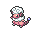

<!-- This file is generated by tools/generate_site.py. Edit the generator, not this file. -->

# #180 Flaaffy

{ .sprite-lg loading=lazy }

**Wool Pokémon**

Electric

[:material-arrow-left: #179 Mareep](179.md) · [Pokédex](index.md) · [#181 Ampharos :material-arrow-right:](181.md)

!!! note "No documented changes"

    Drayano's documentation lists no stat, type, ability, evolution or held item changes for this Pokémon. Its level-up moves are listed below as they appear in the hack.

## Location

[Route 121](../wild/route_121.md)

### Wild encounters

| Area | Method | Level | Note |
| --- | --- | --- | --- |
| [Route 121](../wild/route_121.md) | Grass | 40 |  |
| [Route 121](../wild/route_121.md) | Tall Grass | 44 |  |

## Type defenses

| Damage taken | Attacking types |
| --- | --- |
| Resistant (×½) | Flying Steel Electric |
| Neutral (×1) | Normal Fighting Poison Rock Bug Ghost Fire Water Grass Psychic Ice Dragon Dark Fairy |
| Weak (×2) | Ground |

## Abilities

| Slot | Ability | Effect | Note |
| --- | --- | --- | --- |
| Ability 1 | **Static** | Has a 30% chance of paralyzing attacking Pokémon on contact. |  |
| Hidden | **Plus** | Increases Special Attack to 1.5× when a friendly Pokémon has Plus or Minus. |  |

## Base stats

| Form | HP | Atk | Def | SpA | SpD | Spe | BST |
| --- | --- | --- | --- | --- | --- | --- | --- |
| { .sprite-sm loading=lazy } Normal | 70 | 55 | 55 | 80 | 60 | 45 | **365** |

## Training & breeding

| Property | Value |
| --- | --- |
| EV yield | 2 SpA |
| Catch rate | 120 |
| Base friendship | 70 |
| Base experience | 128 |
| Growth rate | medium slow |
| Egg groups | Monster, Field |
| Hatch counter | 20 |
| Gender ratio | 50% ♂ / 50% ♀ |
| Height / weight | 0.8 m / 13.3 kg |

## Evolution

- { .icon loading=lazy } [Mareep](../pokemon/179.md) → { .icon loading=lazy } **[Flaaffy](../pokemon/180.md)**: Lv. 15
- { .icon loading=lazy } **[Flaaffy](../pokemon/180.md)** → { .icon loading=lazy } [Ampharos](../pokemon/181.md): Lv. 30

## Wild held items

None.

## Level-up moves { data-search-exclude }

Moves marked &#42; are not normally learned by level up (they come from egg moves, TMs/HMs or tutors in the official games); moves marked &#42;&#42; cannot normally be learned by this Pokémon at all and are omitted from the legal-moves version of the hack.

| Lv. | Move | Type | Cat. | Power | Acc. | PP | Effect | Note |
| --- | --- | --- | --- | --- | --- | --- | --- | --- |
| 1 | Tackle | Normal | Physical | 50 | 100% | 35 | Inflicts regular damage with no additional effect. |  |
| 1 | Growl | Normal | Status | — | 100% | 40 | Lowers the target’s Attack by one stage. |  |
| 4 | Thunder Wave | Electric | Status | — | 100% | 20 | Paralyzes the target. |  |
| 7 | Thunder Shock | Electric | Special | 40 | 100% | 30 | Has a chance to paralyze the target. |  |
| 10 | Cotton Spore | Grass | Status | — | 100% | 40 | Lowers the target’s Speed by two stages. |  |
| 13 | Shock Wave | Electric | Special | 60 | — | 20 | Never misses. | &#42; |
| 16 | Charge | Electric | Status | — | — | 20 | Raises the user’s Special Defense by one stage.  User’s Electric moves have doubled power next turn. |  |
| 20 | Take Down | Normal | Physical | 90 | 85% | 20 | User receives 1/4 the damage it inflicts in recoil. |  |
| 24 | Electro Ball | Electric | Special | — | 100% | 10 | Power is higher when the user has greater Speed than the target, up to a maximum of 150. |  |
| 28 | [Power Gem](../changes/moves.md#power-gem) changed | Rock | Special | 90 | 100% | 10 | Inflicts regular damage with no additional effect. |  |
| 32 | Discharge | Electric | Special | 80 | 100% | 15 | Has a chance to paralyze the target. |  |
| 36 | Confuse Ray | Ghost | Status | — | 100% | 10 | Confuses the target. |  |
| 40 | Signal Beam | Bug | Special | 75 | 100% | 15 | Has a chance to confuse the target. |  |
| 44 | Thunderbolt | Electric | Special | 90 | 100% | 15 | Has a chance to paralyze the target. | &#42; |
| 48 | Cotton Guard | Grass | Status | — | — | 10 | Raises the user’s Defense by three stages. |  |
| 52 | Light Screen | Psychic | Status | — | — | 30 | Reduces damage from special attacks by 50% for five turns. |  |
| 56 | Thunder | Electric | Special | 110 | 70% | 10 | Has a chance to paralyze the target. |  |

## TM & HM moves { data-search-exclude }

| Machine | Move | Type | Cat. | Power | Acc. | PP | Effect |
| --- | --- | --- | --- | --- | --- | --- | --- |
| HM04 | [Strength](../changes/moves.md#strength) changed | Normal | Physical | 100 | 100% | 10 | Inflicts regular damage with no additional effect. |
| HM06 | [Rock Smash](../changes/moves.md#rock-smash) changed | Fighting | Physical | 65 | 100% | 15 | Has a chance to lower the target’s Defense by one stage. |
| TM06 | Toxic | Poison | Status | — | 90% | 10 | Badly poisons the target, inflicting more damage every turn. |
| TM10 | Hidden Power | Normal | Special | 60 | 100% | 15 | Power and type depend upon user’s IVs.  Power can range from 30 to 70. |
| TM100 | Confide | Normal | Status | — | — | 20 | Lowers the target’s Special Attack by one stage. |
| TM16 | Light Screen | Psychic | Status | — | — | 30 | Reduces damage from special attacks by 50% for five turns. |
| TM17 | Protect | Normal | Status | — | — | 10 | Prevents any moves from hitting the user this turn. |
| TM18 | Rain Dance | Water | Status | — | — | 5 | Changes the weather to rain for five turns. |
| TM20 | Safeguard | Normal | Status | — | — | 25 | Protects the user’s field from major status ailments and confusion for five turns. |
| TM21 | Frustration | Normal | Physical | — | 100% | 20 | Power increases as happiness decreases, up to a maximum of 102. |
| TM24 | Thunderbolt | Electric | Special | 90 | 100% | 15 | Has a chance to paralyze the target. |
| TM25 | Thunder | Electric | Special | 110 | 70% | 10 | Has a chance to paralyze the target. |
| TM27 | Return | Normal | Physical | — | 100% | 20 | Power increases with happiness, up to a maximum of 102. |
| TM31 | Brick Break | Fighting | Physical | 75 | 100% | 15 | Destroys Reflect and Light Screen. |
| TM32 | Double Team | Normal | Status | — | — | 15 | Raises the user’s evasion by one stage. |
| TM42 | Facade | Normal | Physical | 70 | 100% | 20 | Power doubles if user is burned, paralyzed, or poisoned. |
| TM44 | Rest | Psychic | Status | — | — | 5 | User sleeps for two turns, completely healing itself. |
| TM45 | Attract | Normal | Status | — | 100% | 15 | Target falls in love if it has the opposite gender, and has a 50% chance to refuse attacking the user. |
| TM48 | Round | Normal | Special | 60 | 100% | 15 | Has double power if it’s used more than once per turn. |
| TM49 | Echoed Voice | Normal | Special | 40 | 100% | 15 | Power increases by 100% for each consecutive use by any friendly Pokémon, to a maximum of 200. |
| TM56 | Fling | Dark | Physical | — | 100% | 10 | Throws held item at the target; power depends on the item. |
| TM57 | Charge Beam | Electric | Special | 50 | 90% | 10 | Has a chance to raise the user’s Special Attack by one stage. |
| TM70 | Flash | Normal | Status | — | 100% | 20 | Lowers the target’s accuracy by one stage. |
| TM72 | Volt Switch | Electric | Special | 70 | 100% | 20 | User must switch out after attacking. |
| TM73 | Thunder Wave | Electric | Status | — | 100% | 20 | Paralyzes the target. |
| TM87 | Swagger | Normal | Status | — | 90% | 15 | Raises the target’s Attack by two stages and confuses the target. |
| TM88 | Sleep Talk | Normal | Status | — | — | 10 | Randomly uses one of the user’s other three moves.  Only works if the user is sleeping. |
| TM90 | Substitute | Normal | Status | — | — | 10 | Transfers 1/4 of the user’s max HP into a doll, protecting the user from further damage or status changes until it breaks. |
| TM93 | Wild Charge | Electric | Physical | 90 | 100% | 15 | User receives 1/4 the damage it inflicts in recoil. |
| TM94 | Secret Power | Normal | Physical | 70 | 100% | 20 | Has a chance to inflict a status effect which depends upon the terrain. |
| TM98 | Power-Up Punch | Fighting | Physical | 40 | 100% | 20 | Raises the user’s Attack by one stage after inflicting damage. |

## Move tutor moves { data-search-exclude }

| Move | Type | Cat. | Power | Acc. | PP | Effect |
| --- | --- | --- | --- | --- | --- | --- |
| After You | Normal | Status | — | — | 15 | Makes the target act next this turn. |
| Electroweb | Electric | Special | 55 | 95% | 15 | Lowers the target’s Speed by one stage. |
| Fire Punch | Fire | Physical | 75 | 100% | 15 | Has a chance to burn the target. |
| Focus Punch | Fighting | Physical | 150 | 100% | 20 | If the user takes damage before attacking, the attack is canceled. |
| Heal Bell | Normal | Status | — | — | 5 | Cures the entire party of major status effects. |
| Iron Tail | Steel | Physical | 100 | 75% | 15 | Has a chance to lower the target’s Defense by one stage. |
| Magnet Rise | Electric | Status | — | — | 10 | User is immune to Ground moves and effects for five turns. |
| Shock Wave | Electric | Special | 60 | — | 20 | Never misses. |
| Signal Beam | Bug | Special | 75 | 100% | 15 | Has a chance to confuse the target. |
| Snore | Normal | Special | 50 | 100% | 15 | Has a chance to make the target flinch.  Only works if the user is sleeping. |
| Thunder Punch | Electric | Physical | 75 | 100% | 15 | Has a chance to paralyze the target. |

## Egg moves { data-search-exclude }

No egg moves.

??? note "Trainers using Flaaffy (2)"

    | Area | Trainer | Level |
    | --- | --- | --- |
    | [Route 110](../trainers/route_110.md#trainers-cycling-road) | Triathelete Sloan | Lv. 24 |
    | [Mauville Gym](../trainers/mauville_gym.md#trainers) | Leader Wattson | Lv. 26 |

---

[:material-arrow-left: #179 Mareep](179.md) · [#181 Ampharos :material-arrow-right:](181.md)
