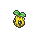

<!-- This file is generated by tools/generate_site.py. Edit the generator, not this file. -->

# #191 Sunkern

{ .sprite-lg loading=lazy }

**Seed Pokémon**

Grass

[:material-arrow-left: #190 Aipom](190.md) · [Pokédex](index.md) · [#192 Sunflora :material-arrow-right:](192.md)

!!! note "No documented changes"

    Drayano's documentation lists no stat, type, ability, evolution or held item changes for this Pokémon. Its level-up moves are listed below as they appear in the hack.

## Location

[Route 115](../wild/route_115.md)

### Wild encounters

| Area | Method | Level | Note |
| --- | --- | --- | --- |
| [Route 115](../wild/route_115.md) | Grass | 35 |  |

## Type defenses

| Damage taken | Attacking types |
| --- | --- |
| Resistant (×½) | Ground Water Grass Electric |
| Neutral (×1) | Normal Fighting Rock Ghost Steel Psychic Dragon Dark Fairy |
| Weak (×2) | Flying Poison Bug Fire Ice |

## Abilities

| Slot | Ability | Effect | Note |
| --- | --- | --- | --- |
| Ability 1 | **Chlorophyll** | Doubles Speed during strong sunlight. |  |
| Ability 2 | **Solar Power** | Increases Special Attack to 1.5× but costs 1/8 max HP after each turn during strong sunlight. |  |
| Hidden | **Early Bird** | Makes sleep pass twice as quickly. |  |

## Base stats

| Form | HP | Atk | Def | SpA | SpD | Spe | BST |
| --- | --- | --- | --- | --- | --- | --- | --- |
| { .sprite-sm loading=lazy } Normal | 30 | 30 | 30 | 30 | 30 | 30 | **180** |

## Training & breeding

| Property | Value |
| --- | --- |
| EV yield | 1 SpA |
| Catch rate | 235 |
| Base friendship | 70 |
| Base experience | 36 |
| Growth rate | medium slow |
| Egg groups | Grass |
| Hatch counter | 20 |
| Gender ratio | 50% ♂ / 50% ♀ |
| Height / weight | 0.3 m / 1.8 kg |

## Evolution

- { .icon loading=lazy } **[Sunkern](../pokemon/191.md)** → { .icon loading=lazy } [Sunflora](../pokemon/192.md): Sun Stone

## Wild held items

None.

## Level-up moves { data-search-exclude }

Moves marked &#42; are not normally learned by level up (they come from egg moves, TMs/HMs or tutors in the official games); moves marked &#42;&#42; cannot normally be learned by this Pokémon at all and are omitted from the legal-moves version of the hack.

| Lv. | Move | Type | Cat. | Power | Acc. | PP | Effect | Note |
| --- | --- | --- | --- | --- | --- | --- | --- | --- |
| 1 | Absorb | Grass | Special | 20 | 100% | 25 | Drains half the damage inflicted to heal the user. |  |
| 1 | Growth | Normal | Status | — | — | 20 | Raises the user’s Attack and Special Attack by one stage. |  |
| 4 | Ingrain | Grass | Status | — | — | 20 | Prevents the user from leaving battle.  User regains 1/16 of its max HP every turn. |  |
| 7 | Grass Whistle | Grass | Status | — | 55% | 15 | Puts the target to sleep. |  |
| 10 | Mega Drain | Grass | Special | 40 | 100% | 15 | Drains half the damage inflicted to heal the user. |  |
| 13 | Leech Seed | Grass | Status | — | 90% | 10 | Seeds the target, stealing HP from it every turn. |  |
| 16 | Razor Leaf | Grass | Physical | 55 | 95% | 25 | Has an increased chance for a critical hit. |  |
| 19 | Worry Seed | Grass | Status | — | 100% | 10 | Changes the target’s ability to Insomnia. |  |
| 22 | Giga Drain | Grass | Special | 75 | 100% | 10 | Drains half the damage inflicted to heal the user. |  |
| 25 | Endeavor | Normal | Physical | — | 100% | 5 | Lowers the target’s HP to equal the user’s. |  |
| 28 | Synthesis | Grass | Status | — | — | 5 | Heals the user by half its max HP.  Affected by weather. |  |
| 31 | Natural Gift | Normal | Physical | — | 100% | 15 | Power and type depend on the held berry. |  |
| 34 | Solar Beam | Grass | Special | 120 | 100% | 10 | Requires a turn to charge before attacking. |  |
| 37 | Double-Edge | Normal | Physical | 120 | 100% | 15 | User receives 1/3 the damage inflicted in recoil. |  |
| 40 | Sunny Day | Fire | Status | — | — | 5 | Changes the weather to sunny for five turns. |  |
| 43 | Seed Bomb | Grass | Physical | 80 | 100% | 15 | Inflicts regular damage with no additional effect. |  |

## TM & HM moves { data-search-exclude }

| Machine | Move | Type | Cat. | Power | Acc. | PP | Effect |
| --- | --- | --- | --- | --- | --- | --- | --- |
| HM01 | [Cut](../changes/moves.md#cut) changed | Grass | Physical | 70 | 100% | 15 | High Critical Rate. High Critical Rate |
| TM06 | Toxic | Poison | Status | — | 90% | 10 | Badly poisons the target, inflicting more damage every turn. |
| TM10 | Hidden Power | Normal | Special | 60 | 100% | 15 | Power and type depend upon user’s IVs.  Power can range from 30 to 70. |
| TM100 | Confide | Normal | Status | — | — | 20 | Lowers the target’s Special Attack by one stage. |
| TM11 | Sunny Day | Fire | Status | — | — | 5 | Changes the weather to sunny for five turns. |
| TM16 | Light Screen | Psychic | Status | — | — | 30 | Reduces damage from special attacks by 50% for five turns. |
| TM17 | Protect | Normal | Status | — | — | 10 | Prevents any moves from hitting the user this turn. |
| TM20 | Safeguard | Normal | Status | — | — | 25 | Protects the user’s field from major status ailments and confusion for five turns. |
| TM21 | Frustration | Normal | Physical | — | 100% | 20 | Power increases as happiness decreases, up to a maximum of 102. |
| TM22 | Solar Beam | Grass | Special | 120 | 100% | 10 | Requires a turn to charge before attacking. |
| TM27 | Return | Normal | Physical | — | 100% | 20 | Power increases with happiness, up to a maximum of 102. |
| TM32 | Double Team | Normal | Status | — | — | 15 | Raises the user’s evasion by one stage. |
| TM36 | Sludge Bomb | Poison | Special | 90 | 100% | 10 | Has a chance to poison the target. |
| TM42 | Facade | Normal | Physical | 70 | 100% | 20 | Power doubles if user is burned, paralyzed, or poisoned. |
| TM44 | Rest | Psychic | Status | — | — | 5 | User sleeps for two turns, completely healing itself. |
| TM45 | Attract | Normal | Status | — | 100% | 15 | Target falls in love if it has the opposite gender, and has a 50% chance to refuse attacking the user. |
| TM48 | Round | Normal | Special | 60 | 100% | 15 | Has double power if it’s used more than once per turn. |
| TM53 | Energy Ball | Grass | Special | 90 | 100% | 10 | Has a chance to lower the target’s Special Defense by one stage. |
| TM70 | Flash | Normal | Status | — | 100% | 20 | Lowers the target’s accuracy by one stage. |
| TM75 | Swords Dance | Normal | Status | — | — | 20 | Raises the user’s Attack by two stages. |
| TM86 | Grass Knot | Grass | Special | — | 100% | 20 | Inflicts more damage to heavier targets, with a maximum of 120 power. |
| TM87 | Swagger | Normal | Status | — | 90% | 15 | Raises the target’s Attack by two stages and confuses the target. |
| TM88 | Sleep Talk | Normal | Status | — | — | 10 | Randomly uses one of the user’s other three moves.  Only works if the user is sleeping. |
| TM90 | Substitute | Normal | Status | — | — | 10 | Transfers 1/4 of the user’s max HP into a doll, protecting the user from further damage or status changes until it breaks. |
| TM94 | Secret Power | Normal | Physical | 70 | 100% | 20 | Has a chance to inflict a status effect which depends upon the terrain. |
| TM96 | Nature Power | Normal | Status | — | — | 20 | Uses a move which depends upon the terrain. |

## Move tutor moves { data-search-exclude }

| Move | Type | Cat. | Power | Acc. | PP | Effect |
| --- | --- | --- | --- | --- | --- | --- |
| After You | Normal | Status | — | — | 15 | Makes the target act next this turn. |
| Earth Power | Ground | Special | 90 | 100% | 10 | Has a chance to lower the target’s Special Defense by one stage. |
| Endeavor | Normal | Physical | — | 100% | 5 | Lowers the target’s HP to equal the user’s. |
| Giga Drain | Grass | Special | 75 | 100% | 10 | Drains half the damage inflicted to heal the user. |
| Helping Hand | Normal | Status | — | — | 20 | Ally’s next move inflicts half more damage. |
| Seed Bomb | Grass | Physical | 80 | 100% | 15 | Inflicts regular damage with no additional effect. |
| Snore | Normal | Special | 50 | 100% | 15 | Has a chance to make the target flinch.  Only works if the user is sleeping. |
| Synthesis | Grass | Status | — | — | 5 | Heals the user by half its max HP.  Affected by weather. |
| Uproar | Normal | Special | 90 | 100% | 10 | Forced to use this move for several turns.  Pokémon cannot fall asleep in that time. |
| Worry Seed | Grass | Status | — | 100% | 10 | Changes the target’s ability to Insomnia. |

## Egg moves { data-search-exclude }

| Move | Type | Cat. | Power | Acc. | PP | Effect |
| --- | --- | --- | --- | --- | --- | --- |
| Bide | Normal | Physical | — | — | 10 | User waits for two turns, then hits back for twice the damage it took. |
| Curse | Ghost | Status | — | — | 10 | Ghosts pay half their max HP to hurt the target every turn.  Others decrease Speed but raise Attack and Defense. |
| Encore | Normal | Status | — | 100% | 5 | Forces the target to repeat its last used move every turn for 2 to 6 turns. |
| Endure | Normal | Status | — | — | 10 | Prevents the user’s HP from lowering below 1 this turn. |
| Grass Whistle | Grass | Status | — | 55% | 15 | Puts the target to sleep. |
| Grassy Terrain | Grass | Status | — | — | 10 | For five turns, heals all Pokémon on the ground for 1/16 max HP each turn and strengthens their Grass moves to 1.5× their power. |
| Helping Hand | Normal | Status | — | — | 20 | Ally’s next move inflicts half more damage. |
| Ingrain | Grass | Status | — | — | 20 | Prevents the user from leaving battle.  User regains 1/16 of its max HP every turn. |
| Leech Seed | Grass | Status | — | 90% | 10 | Seeds the target, stealing HP from it every turn. |
| Morning Sun | Normal | Status | — | — | 5 | Heals the user by half its max HP.  Affected by weather. |
| Natural Gift | Normal | Physical | — | 100% | 15 | Power and type depend on the held berry. |
| Nature Power | Normal | Status | — | — | 20 | Uses a move which depends upon the terrain. |
| Sweet Scent | Normal | Status | — | 100% | 20 | Lowers the target’s evasion by one stage. |

??? note "Trainers using Sunkern (1)"

    | Area | Trainer | Level |
    | --- | --- | --- |
    | [Route 118](../trainers/route_118.md#trainers-west-of-inlet) | Aroma Lady Rose | Lv. 22 |

---

[:material-arrow-left: #190 Aipom](190.md) · [#192 Sunflora :material-arrow-right:](192.md)
