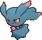

<!-- This file is generated by tools/generate_site.py. Edit the generator, not this file. -->

# #200 Misdreavus

{ .sprite-lg loading=lazy }

**Screech Pokémon**

Ghost Fairy

Type changed from Ghost

[:material-arrow-left: #199 Slowking](199.md) · [Pokédex](index.md) · [#201 Unown :material-arrow-right:](201.md)

!!! info "Changes in Rising Ruby / Sinking Sapphire"

    - **Type:** Ghost → Ghost Fairy

## Location

[Route 114](../wild/route_114.md)

### Wild encounters

| Area | Method | Level | Note |
| --- | --- | --- | --- |
| [Route 114](../wild/route_114.md) | Grass | 25 |  |
| [Mt. Pyre Summit 1](../wild/mt_pyre_summit_1.md) | Walking | 40 |  |
| [Mt. Pyre Summit 2](../wild/mt_pyre_summit_2.md) | Walking | 45 |  |

## Type defenses

| Damage taken | Attacking types |
| --- | --- |
| Immune (×0) | Normal Fighting Dragon |
| Very resistant (×¼) | Bug |
| Neutral (×1) | Flying Poison Ground Rock Fire Water Grass Electric Psychic Ice Dark Fairy |
| Weak (×2) | Ghost Steel |

## Abilities

| Slot | Ability | Effect | Note |
| --- | --- | --- | --- |
| Ability 1 | **Levitate** | Evades Ground moves. |  |

## Base stats

| Form | HP | Atk | Def | SpA | SpD | Spe | BST |
| --- | --- | --- | --- | --- | --- | --- | --- |
| { .sprite-sm loading=lazy } Normal | 60 | 60 | 60 | 85 | 85 | 85 | **435** |

## Training & breeding

| Property | Value |
| --- | --- |
| EV yield | 1 SpD |
| Catch rate | 45 |
| Base friendship | 35 |
| Base experience | 87 |
| Growth rate | fast |
| Egg groups | Amorphous |
| Hatch counter | 25 |
| Gender ratio | 50% ♂ / 50% ♀ |
| Height / weight | 0.7 m / 1 kg |

## Evolution

- { .icon loading=lazy } **[Misdreavus](../pokemon/200.md)** → { .icon loading=lazy } [Mismagius](../pokemon/429.md): Use Dusk Stone

## Wild held items

None.

## Level-up moves { data-search-exclude }

Moves marked &#42; are not normally learned by level up (they come from egg moves, TMs/HMs or tutors in the official games); moves marked &#42;&#42; cannot normally be learned by this Pokémon at all and are omitted from the legal-moves version of the hack.

| Lv. | Move | Type | Cat. | Power | Acc. | PP | Effect | Note |
| --- | --- | --- | --- | --- | --- | --- | --- | --- |
| 1 | Growl | Normal | Status | — | 100% | 40 | Lowers the target’s Attack by one stage. |  |
| 1 | Psywave | Psychic | Special | — | 100% | 15 | Inflicts damage between 50% and 150% of the user’s level. |  |
| 1 | Spite | Ghost | Status | — | 100% | 10 | Lowers the PP of the target’s last used move by 4. |  |
| 5 | Astonish | Ghost | Physical | 30 | 100% | 15 | Has a chance to make the target flinch. |  |
| 8 | Confuse Ray | Ghost | Status | — | 100% | 10 | Confuses the target. |  |
| 11 | Mean Look | Normal | Status | — | — | 5 | Prevents the target from leaving battle. |  |
| 14 | Hex | Ghost | Special | 65 | 100% | 10 | Has double power if the target has a major status ailment. |  |
| 17 | [Disarming Voice](../changes/moves.md#disarming-voice) changed | Fairy | Special | 60 | — | 20 | Never misses. | &#42; |
| 20 | Psybeam | Psychic | Special | 65 | 100% | 20 | Has a chance to confuse the target. |  |
| 23 | [Power Gem](../changes/moves.md#power-gem) changed | Rock | Special | 90 | 100% | 10 | Inflicts regular damage with no additional effect. |  |
| 26 | Shadow Ball | Ghost | Special | 80 | 100% | 15 | Has a chance to lower the target’s Special Defense by one stage. |  |
| 29 | Payback | Dark | Physical | 50 | 100% | 10 | Power is doubled if the target has already moved this turn. |  |
| 32 | Pain Split | Normal | Status | — | — | 20 | Sets the user’s and targets’s HP to the average of their current HP. |  |
| 36 | Moonblast | Fairy | Special | 95 | 100% | 15 | Has a chance to lower the target’s Special Attack by one stage. | &#42;&#42; |
| 40 | Perish Song | Normal | Status | — | — | 5 | User and target both faint after three turns. |  |
| 44 | Grudge | Ghost | Status | — | — | 5 | If the user faints this turn, the PP of the move that fainted it drops to 0. |  |
| 48 | Nasty Plot | Dark | Status | — | — | 20 | Raises the user’s Special Attack by two stages. | &#42; |

## TM & HM moves { data-search-exclude }

| Machine | Move | Type | Cat. | Power | Acc. | PP | Effect |
| --- | --- | --- | --- | --- | --- | --- | --- |
| TM04 | Calm Mind | Psychic | Status | — | — | 20 | Raises the user’s Special Attack and Special Defense by one stage. |
| TM06 | Toxic | Poison | Status | — | 90% | 10 | Badly poisons the target, inflicting more damage every turn. |
| TM10 | Hidden Power | Normal | Special | 60 | 100% | 15 | Power and type depend upon user’s IVs.  Power can range from 30 to 70. |
| TM100 | Confide | Normal | Status | — | — | 20 | Lowers the target’s Special Attack by one stage. |
| TM11 | Sunny Day | Fire | Status | — | — | 5 | Changes the weather to sunny for five turns. |
| TM12 | Taunt | Dark | Status | — | 100% | 20 | For the next few turns, the target can only use damaging moves. |
| TM17 | Protect | Normal | Status | — | — | 10 | Prevents any moves from hitting the user this turn. |
| TM18 | Rain Dance | Water | Status | — | — | 5 | Changes the weather to rain for five turns. |
| TM21 | Frustration | Normal | Physical | — | 100% | 20 | Power increases as happiness decreases, up to a maximum of 102. |
| TM24 | Thunderbolt | Electric | Special | 90 | 100% | 15 | Has a chance to paralyze the target. |
| TM25 | Thunder | Electric | Special | 110 | 70% | 10 | Has a chance to paralyze the target. |
| TM27 | Return | Normal | Physical | — | 100% | 20 | Power increases with happiness, up to a maximum of 102. |
| TM29 | Psychic | Psychic | Special | 90 | 100% | 10 | Has a chance to lower the target’s Special Defense by one stage. |
| TM30 | Shadow Ball | Ghost | Special | 80 | 100% | 15 | Has a chance to lower the target’s Special Defense by one stage. |
| TM32 | Double Team | Normal | Status | — | — | 15 | Raises the user’s evasion by one stage. |
| TM40 | Aerial Ace | Flying | Physical | 60 | — | 20 | Never misses. |
| TM41 | Torment | Dark | Status | — | 100% | 15 | Prevents the target from using the same move twice in a row. |
| TM42 | Facade | Normal | Physical | 70 | 100% | 20 | Power doubles if user is burned, paralyzed, or poisoned. |
| TM44 | Rest | Psychic | Status | — | — | 5 | User sleeps for two turns, completely healing itself. |
| TM45 | Attract | Normal | Status | — | 100% | 15 | Target falls in love if it has the opposite gender, and has a 50% chance to refuse attacking the user. |
| TM46 | Thief | Dark | Physical | 60 | 100% | 25 | Takes the target’s item. |
| TM48 | Round | Normal | Special | 60 | 100% | 15 | Has double power if it’s used more than once per turn. |
| TM49 | Echoed Voice | Normal | Special | 40 | 100% | 15 | Power increases by 100% for each consecutive use by any friendly Pokémon, to a maximum of 200. |
| TM57 | Charge Beam | Electric | Special | 50 | 90% | 10 | Has a chance to raise the user’s Special Attack by one stage. |
| TM61 | Will-O-Wisp | Fire | Status | — | 85% | 15 | Burns the target. |
| TM63 | Embargo | Dark | Status | — | 100% | 15 | Target cannot use held items. |
| TM66 | Payback | Dark | Physical | 50 | 100% | 10 | Power is doubled if the target has already moved this turn. |
| TM70 | Flash | Normal | Status | — | 100% | 20 | Lowers the target’s accuracy by one stage. |
| TM73 | Thunder Wave | Electric | Status | — | 100% | 20 | Paralyzes the target. |
| TM77 | Psych Up | Normal | Status | — | — | 10 | Discards the user’s stat changes and copies the target’s. |
| TM85 | Dream Eater | Psychic | Special | 100 | 100% | 15 | Only works on sleeping Pokémon.  Drains half the damage inflicted to heal the user. |
| TM87 | Swagger | Normal | Status | — | 90% | 15 | Raises the target’s Attack by two stages and confuses the target. |
| TM88 | Sleep Talk | Normal | Status | — | — | 10 | Randomly uses one of the user’s other three moves.  Only works if the user is sleeping. |
| TM90 | Substitute | Normal | Status | — | — | 10 | Transfers 1/4 of the user’s max HP into a doll, protecting the user from further damage or status changes until it breaks. |
| TM92 | Trick Room | Psychic | Status | — | — | 5 | For five turns, slower Pokémon will act before faster Pokémon. |
| TM94 | Secret Power | Normal | Physical | 70 | 100% | 20 | Has a chance to inflict a status effect which depends upon the terrain. |
| TM97 | Dark Pulse | Dark | Special | 80 | 100% | 15 | Has a chance to make the target flinch. |
| TM99 | Dazzling Gleam | Fairy | Special | 80 | 100% | 10 | Inflicts regular damage with no additional effect. |

## Move tutor moves { data-search-exclude }

| Move | Type | Cat. | Power | Acc. | PP | Effect |
| --- | --- | --- | --- | --- | --- | --- |
| Foul Play | Dark | Physical | 95 | 100% | 15 | Calculates damage with the target’s attacking stat. |
| Heal Bell | Normal | Status | — | — | 5 | Cures the entire party of major status effects. |
| Hyper Voice | Normal | Special | 90 | 100% | 10 | Inflicts regular damage with no additional effect. |
| Icy Wind | Ice | Special | 55 | 95% | 15 | Has a chance to lower the target’s Speed by one stage. |
| Magic Coat | Psychic | Status | — | — | 15 | Reflects back the first effect move used on the user this turn. |
| Magic Room | Psychic | Status | — | — | 10 | Negates held items for five turns. |
| Pain Split | Normal | Status | — | — | 20 | Sets the user’s and targets’s HP to the average of their current HP. |
| Shock Wave | Electric | Special | 60 | — | 20 | Never misses. |
| Skill Swap | Psychic | Status | — | — | 10 | User and target swap abilities. |
| Snatch | Dark | Status | — | — | 10 | Steals the target’s move, if it’s self-targeted. |
| Snore | Normal | Special | 50 | 100% | 15 | Has a chance to make the target flinch.  Only works if the user is sleeping. |
| Spite | Ghost | Status | — | 100% | 10 | Lowers the PP of the target’s last used move by 4. |
| Trick | Psychic | Status | — | 100% | 10 | User and target swap items. |
| Uproar | Normal | Special | 90 | 100% | 10 | Forced to use this move for several turns.  Pokémon cannot fall asleep in that time. |
| Wonder Room | Psychic | Status | — | — | 10 | All Pokémon’s Defense and Special Defense are swapped for 5 turns. |

## Egg moves { data-search-exclude }

| Move | Type | Cat. | Power | Acc. | PP | Effect |
| --- | --- | --- | --- | --- | --- | --- |
| Curse | Ghost | Status | — | — | 10 | Ghosts pay half their max HP to hurt the target every turn.  Others decrease Speed but raise Attack and Defense. |
| Destiny Bond | Ghost | Status | — | — | 5 | If the user faints this turn, the target automatically will, too. |
| Imprison | Psychic | Status | — | — | 10 | Prevents the target from using any moves that the user also knows. |
| Me First | Normal | Status | — | — | 20 | Uses the target’s move against it before it attacks, with power increased by half. |
| Memento | Dark | Status | — | 100% | 10 | Lowers the target’s Attack and Special Attack by two stages.  User faints. |
| Nasty Plot | Dark | Status | — | — | 20 | Raises the user’s Special Attack by two stages. |
| Ominous Wind | Ghost | Special | 60 | 100% | 5 | Has a chance to raise all of the user’s stats by one stage. |
| Screech | Normal | Status | — | 85% | 40 | Lowers the target’s Defense by two stages. |
| Shadow Sneak | Ghost | Physical | 40 | 100% | 30 | Inflicts regular damage with no additional effect. |
| Skill Swap | Psychic | Status | — | — | 10 | User and target swap abilities. |
| Spite | Ghost | Status | — | 100% | 10 | Lowers the PP of the target’s last used move by 4. |
| Sucker Punch | Dark | Physical | 80 | 100% | 5 | Only works if the target is about to use a damaging move. |
| Wonder Room | Psychic | Status | — | — | 10 | All Pokémon’s Defense and Special Defense are swapped for 5 turns. |

??? note "Trainers using Misdreavus (1)"

    | Area | Trainer | Level |
    | --- | --- | --- |
    | [Route 121](../trainers/route_121.md#trainers) | Hex Maniac Tammy | Lv. 47 |

---

[:material-arrow-left: #199 Slowking](199.md) · [#201 Unown :material-arrow-right:](201.md)
