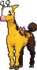

<!-- This file is generated by tools/generate_site.py. Edit the generator, not this file. -->

# #203 Girafarig

{ .sprite-lg loading=lazy }

**Long Neck Pokémon**

Normal Psychic

[:material-arrow-left: #202 Wobbuffet](202.md) · [Pokédex](index.md) · [#204 Pineco :material-arrow-right:](204.md)

!!! note "No documented changes"

    Drayano's documentation lists no stat, type, ability, evolution or held item changes for this Pokémon. Its level-up moves are listed below as they appear in the hack.

## Location

[Route 112 South](../wild/route_112_south.md)

### Wild encounters

| Area | Method | Level | Note |
| --- | --- | --- | --- |
| [Route 112 South](../wild/route_112_south.md) | Grass | 23 |  |

## Type defenses

| Damage taken | Attacking types |
| --- | --- |
| Immune (×0) | Ghost |
| Resistant (×½) | Psychic |
| Neutral (×1) | Normal Fighting Flying Poison Ground Rock Steel Fire Water Grass Electric Ice Dragon Fairy |
| Weak (×2) | Bug Dark |

## Abilities

| Slot | Ability | Effect | Note |
| --- | --- | --- | --- |
| Ability 1 | **Inner Focus** | Prevents flinching. |  |
| Ability 2 | **Early Bird** | Makes sleep pass twice as quickly. |  |
| Hidden | **Sap Sipper** | Absorbs Grass moves, raising Attack one stage. |  |

## Base stats

| Form | HP | Atk | Def | SpA | SpD | Spe | BST |
| --- | --- | --- | --- | --- | --- | --- | --- |
| { .sprite-sm loading=lazy } Normal | 70 | 80 | 65 | 90 | 65 | 85 | **455** |

## Training & breeding

| Property | Value |
| --- | --- |
| EV yield | 2 SpA |
| Catch rate | 60 |
| Base friendship | 70 |
| Base experience | 159 |
| Growth rate | medium |
| Egg groups | Field |
| Hatch counter | 20 |
| Gender ratio | 50% ♂ / 50% ♀ |
| Height / weight | 1.5 m / 41.5 kg |

## Evolution

This Pokémon does not evolve.

## Wild held items

None.

## Level-up moves { data-search-exclude }

Moves marked &#42; are not normally learned by level up (they come from egg moves, TMs/HMs or tutors in the official games); moves marked &#42;&#42; cannot normally be learned by this Pokémon at all and are omitted from the legal-moves version of the hack.

| Lv. | Move | Type | Cat. | Power | Acc. | PP | Effect | Note |
| --- | --- | --- | --- | --- | --- | --- | --- | --- |
| 1 | Power Swap | Psychic | Status | — | — | 10 | User swaps Attack and Special Attack changes with the target. |  |
| 1 | Guard Swap | Psychic | Status | — | — | 10 | User swaps Defense and Special Defense changes with the target. |  |
| 1 | Astonish | Ghost | Physical | 30 | 100% | 15 | Has a chance to make the target flinch. |  |
| 1 | Tackle | Normal | Physical | 50 | 100% | 35 | Inflicts regular damage with no additional effect. |  |
| 1 | Growl | Normal | Status | — | 100% | 40 | Lowers the target’s Attack by one stage. |  |
| 1 | Confusion | Psychic | Special | 50 | 100% | 25 | Has a chance to confuse the target. |  |
| 6 | Odor Sleuth | Normal | Status | — | — | 40 | Forces the target to have no Evade, and allows it to be hit by Normal and Fighting moves even if it’s a Ghost. |  |
| 10 | Assurance | Dark | Physical | 60 | 100% | 10 | Power is doubled if the target has already received damage this turn. |  |
| 14 | Stomp | Normal | Physical | 65 | 100% | 20 | Has a chance to make the target flinch. |  |
| 18 | Psybeam | Psychic | Special | 65 | 100% | 20 | Has a chance to confuse the target. |  |
| 22 | Agility | Psychic | Status | — | — | 30 | Raises the user’s Speed by two stages. |  |
| 26 | Double Hit | Normal | Physical | 35 | 90% | 10 | Hits twice in one turn. |  |
| 30 | Zen Headbutt | Psychic | Physical | 80 | 90% | 15 | Has a chance to make the target flinch. |  |
| 34 | Crunch | Dark | Physical | 80 | 100% | 15 | Has a chance to lower the target’s Defense by one stage. |  |
| 38 | Baton Pass | Normal | Status | — | — | 40 | Allows the trainer to switch out the user and pass effects along to its replacement. |  |
| 42 | Nasty Plot | Dark | Status | — | — | 20 | Raises the user’s Special Attack by two stages. |  |
| 46 | Psychic | Psychic | Special | 90 | 100% | 10 | Has a chance to lower the target’s Special Defense by one stage. |  |
| 50 | Hyper Voice | Normal | Special | 90 | 100% | 10 | Inflicts regular damage with no additional effect. | &#42; |

## TM & HM moves { data-search-exclude }

| Machine | Move | Type | Cat. | Power | Acc. | PP | Effect |
| --- | --- | --- | --- | --- | --- | --- | --- |
| HM04 | [Strength](../changes/moves.md#strength) changed | Normal | Physical | 100 | 100% | 10 | Inflicts regular damage with no additional effect. |
| HM06 | [Rock Smash](../changes/moves.md#rock-smash) changed | Fighting | Physical | 65 | 100% | 15 | Has a chance to lower the target’s Defense by one stage. |
| TM03 | Psyshock | Psychic | Special | 80 | 100% | 10 | Inflicts damage based on the target’s Defense, not Special Defense. |
| TM04 | Calm Mind | Psychic | Status | — | — | 20 | Raises the user’s Special Attack and Special Defense by one stage. |
| TM06 | Toxic | Poison | Status | — | 90% | 10 | Badly poisons the target, inflicting more damage every turn. |
| TM10 | Hidden Power | Normal | Special | 60 | 100% | 15 | Power and type depend upon user’s IVs.  Power can range from 30 to 70. |
| TM100 | Confide | Normal | Status | — | — | 20 | Lowers the target’s Special Attack by one stage. |
| TM11 | Sunny Day | Fire | Status | — | — | 5 | Changes the weather to sunny for five turns. |
| TM16 | Light Screen | Psychic | Status | — | — | 30 | Reduces damage from special attacks by 50% for five turns. |
| TM17 | Protect | Normal | Status | — | — | 10 | Prevents any moves from hitting the user this turn. |
| TM18 | Rain Dance | Water | Status | — | — | 5 | Changes the weather to rain for five turns. |
| TM21 | Frustration | Normal | Physical | — | 100% | 20 | Power increases as happiness decreases, up to a maximum of 102. |
| TM24 | Thunderbolt | Electric | Special | 90 | 100% | 15 | Has a chance to paralyze the target. |
| TM25 | Thunder | Electric | Special | 110 | 70% | 10 | Has a chance to paralyze the target. |
| TM26 | Earthquake | Ground | Physical | 100 | 100% | 10 | Inflicts regular damage and can hit Dig users. |
| TM27 | Return | Normal | Physical | — | 100% | 20 | Power increases with happiness, up to a maximum of 102. |
| TM29 | Psychic | Psychic | Special | 90 | 100% | 10 | Has a chance to lower the target’s Special Defense by one stage. |
| TM30 | Shadow Ball | Ghost | Special | 80 | 100% | 15 | Has a chance to lower the target’s Special Defense by one stage. |
| TM32 | Double Team | Normal | Status | — | — | 15 | Raises the user’s evasion by one stage. |
| TM33 | Reflect | Psychic | Status | — | — | 20 | Reduces damage from physical attacks by half. |
| TM42 | Facade | Normal | Physical | 70 | 100% | 20 | Power doubles if user is burned, paralyzed, or poisoned. |
| TM44 | Rest | Psychic | Status | — | — | 5 | User sleeps for two turns, completely healing itself. |
| TM45 | Attract | Normal | Status | — | 100% | 15 | Target falls in love if it has the opposite gender, and has a 50% chance to refuse attacking the user. |
| TM46 | Thief | Dark | Physical | 60 | 100% | 25 | Takes the target’s item. |
| TM48 | Round | Normal | Special | 60 | 100% | 15 | Has double power if it’s used more than once per turn. |
| TM49 | Echoed Voice | Normal | Special | 40 | 100% | 15 | Power increases by 100% for each consecutive use by any friendly Pokémon, to a maximum of 200. |
| TM53 | Energy Ball | Grass | Special | 90 | 100% | 10 | Has a chance to lower the target’s Special Defense by one stage. |
| TM57 | Charge Beam | Electric | Special | 50 | 90% | 10 | Has a chance to raise the user’s Special Attack by one stage. |
| TM67 | Retaliate | Normal | Physical | 70 | 100% | 5 | Has double power if a friendly Pokémon fainted last turn. |
| TM70 | Flash | Normal | Status | — | 100% | 20 | Lowers the target’s accuracy by one stage. |
| TM73 | Thunder Wave | Electric | Status | — | 100% | 20 | Paralyzes the target. |
| TM77 | Psych Up | Normal | Status | — | — | 10 | Discards the user’s stat changes and copies the target’s. |
| TM78 | Bulldoze | Ground | Physical | 60 | 100% | 20 | Has a chance to lower the target’s Speed by one stage. |
| TM85 | Dream Eater | Psychic | Special | 100 | 100% | 15 | Only works on sleeping Pokémon.  Drains half the damage inflicted to heal the user. |
| TM86 | Grass Knot | Grass | Special | — | 100% | 20 | Inflicts more damage to heavier targets, with a maximum of 120 power. |
| TM87 | Swagger | Normal | Status | — | 90% | 15 | Raises the target’s Attack by two stages and confuses the target. |
| TM88 | Sleep Talk | Normal | Status | — | — | 10 | Randomly uses one of the user’s other three moves.  Only works if the user is sleeping. |
| TM90 | Substitute | Normal | Status | — | — | 10 | Transfers 1/4 of the user’s max HP into a doll, protecting the user from further damage or status changes until it breaks. |
| TM92 | Trick Room | Psychic | Status | — | — | 5 | For five turns, slower Pokémon will act before faster Pokémon. |
| TM94 | Secret Power | Normal | Physical | 70 | 100% | 20 | Has a chance to inflict a status effect which depends upon the terrain. |
| TM99 | Dazzling Gleam | Fairy | Special | 80 | 100% | 10 | Inflicts regular damage with no additional effect. |

## Move tutor moves { data-search-exclude }

| Move | Type | Cat. | Power | Acc. | PP | Effect |
| --- | --- | --- | --- | --- | --- | --- |
| Foul Play | Dark | Physical | 95 | 100% | 15 | Calculates damage with the target’s attacking stat. |
| Gravity | Psychic | Status | — | — | 5 | Disables moves and immunities that involve flying or levitating for five turns. |
| Hyper Voice | Normal | Special | 90 | 100% | 10 | Inflicts regular damage with no additional effect. |
| Iron Tail | Steel | Physical | 100 | 75% | 15 | Has a chance to lower the target’s Defense by one stage. |
| Magic Coat | Psychic | Status | — | — | 15 | Reflects back the first effect move used on the user this turn. |
| Recycle | Normal | Status | — | — | 10 | User recovers the item it last used up. |
| Shock Wave | Electric | Special | 60 | — | 20 | Never misses. |
| Signal Beam | Bug | Special | 75 | 100% | 15 | Has a chance to confuse the target. |
| Skill Swap | Psychic | Status | — | — | 10 | User and target swap abilities. |
| Snore | Normal | Special | 50 | 100% | 15 | Has a chance to make the target flinch.  Only works if the user is sleeping. |
| Trick | Psychic | Status | — | 100% | 10 | User and target swap items. |
| Uproar | Normal | Special | 90 | 100% | 10 | Forced to use this move for several turns.  Pokémon cannot fall asleep in that time. |
| Zen Headbutt | Psychic | Physical | 80 | 90% | 15 | Has a chance to make the target flinch. |

## Egg moves { data-search-exclude }

| Move | Type | Cat. | Power | Acc. | PP | Effect |
| --- | --- | --- | --- | --- | --- | --- |
| Amnesia | Psychic | Status | — | — | 20 | Raises the user’s Special Defense by two stages. |
| Beat Up | Dark | Physical | — | 100% | 10 | Hits once for every conscious Pokémon the trainer has. |
| Double Kick | Fighting | Physical | 30 | 100% | 30 | Hits twice in one turn. |
| Foresight | Normal | Status | — | — | 40 | Forces the target to have no Evade, and allows it to be hit by Normal and Fighting moves even if it’s a Ghost. |
| Future Sight | Psychic | Special | 120 | 100% | 10 | Hits the target two turns later. |
| Magic Coat | Psychic | Status | — | — | 15 | Reflects back the first effect move used on the user this turn. |
| Mean Look | Normal | Status | — | — | 5 | Prevents the target from leaving battle. |
| Mirror Coat | Psychic | Special | — | 100% | 20 | Inflicts twice the damage the user received from the last special hit it took. |
| Razor Wind | Normal | Special | 80 | 100% | 10 | Requires a turn to charge before attacking. |
| Secret Power | Normal | Physical | 70 | 100% | 20 | Has a chance to inflict a status effect which depends upon the terrain. |
| Skill Swap | Psychic | Status | — | — | 10 | User and target swap abilities. |
| Take Down | Normal | Physical | 90 | 85% | 20 | User receives 1/4 the damage it inflicts in recoil. |
| Wish | Normal | Status | — | — | 10 | User will recover half its max HP at the end of the next turn. |

??? note "Trainers using Girafarig (4)"

    | Area | Trainer | Level |
    | --- | --- | --- |
    | [Petalburg Gym](../trainers/petalburg_gym.md#trainers) | Ace Trainer Parker | Lv. 37 |
    | [Mt. Pyre 3F / 4F](../trainers/mt_pyre_3f_4f.md#trainers) | Backpacker Darnell | Lv. 49 |
    | [Mossdeep Gym](../trainers/mossdeep_gym.md#trainers) | Psychic Virgil | Lv. 59 |
    | [S.S Tidal](../trainers/s_s_tidal.md#trainers) | Gentleman Tucker | Lv. 75 |

---

[:material-arrow-left: #202 Wobbuffet](202.md) · [#204 Pineco :material-arrow-right:](204.md)
